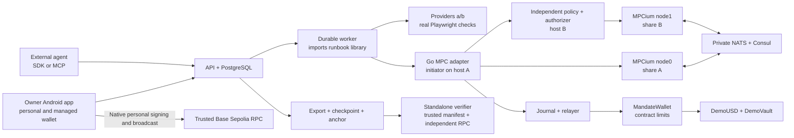

# Mandate — four-person implementation plan

> Repository bootstrap added 2026-10-17. Read [README](README.md) and [setup](docs/SETUP.md) for existing foundation files. Continue from that code; financial features and acceptance gates remain unimplemented.

**Give one handoff document to each person.** Each contains that person's complete deliverables, files, tasks, dependencies, acceptance cases and an identical shared interface appendix. They can work in parallel against that contract; the system must also pass shared integration gates. Finishing four isolated components is not sufficient.

This version replaces the five-person/cb-mpc plan. Use **MPCium**, two nodes with `mpc_threshold:1` (two required participants in inspected code), mandatory policy authorizer on both nodes and a local owner key on Android. No Circle or custom cryptographic protocol. Documentation6 requires new wallet domain5 and Login2; agent evidence schema4 stays. W0 migrates existing bootstrap interfaces before new signing.

**Release decision:** WalletConnect/external dApp connections are deferred. Complete personal-wallet and agent-wallet flows remain required.

## 1. The four assignments

| Give this document | Person's outputs | First thing to prove | Final responsibility |
| --- | --- | --- | --- |
| [01 - Contracts and Shared Interfaces](docs/plans/01%20-%20Contracts%20and%20Shared%20Interfaces.md) | Wallet/factory/token/vault/anchor; shared schemas, fixtures, ABI, deployment manifest | Same typed hashes/signatures across Solidity/TS/native/Go | On-chain financial authority and contract acceptance |
| [02 - Platform Policy and MPCium](docs/plans/02%20-%20Platform%20Policy%20and%20MPCium.md) | API, sessions/history, DB, worker/reservations/policy, MPCium/Go integration, owner/agent relayers, evidence export and infrastructure | Two nodes sign; missing authorizer or either node alone cannot | Durable controlled execution and operable deployment |
| [03 - Android Owner Wallet](docs/plans/03%20-%20Android%20Owner%20Wallet.md) | Complete personal/managed Android wallet, native transactions/accounts/backup/sessions/security; independent recovery and APK | Physical-phone owner signature and successful word restore | User experience and owner independence |
| [04 - Agents Services Inspection and Demo](docs/plans/04%20-%20Agents%20Services%20Inspection%20and%20Demo.md) | Three runbooks; paid providers; SDK/MCP; independent inspector; payment-request fixtures/full-app acceptance/demo/submission | Actual browser checks, signed invoice/receipt and verifier fixtures | Useful agent work, independent inspection and demonstrated release |

Person2 owns worker process; Person4 owns imported runbook library. Person2 writes ledger; Person4 independently verifies exports. Person1 owns shared interface changes; consumers do not silently fork types. Every owner supplies their own tests, security notes and deployment instructions. Required everyday-wallet W tasks now extend all four handoffs; the app is not limited to agent approval screens. Person4 assembles them; no fifth owner is implied.

## 2. Fixed product and concrete applications

**Mandate Wallet** supplies personal receive/send/assets/history/accounts/security on Base Sepolia. It also lets an owner approve a task and financial boundaries once, then lets an online agent execute while the owner is offline. Our first application is a developer's agent purchasing browser checks for a staging checkout. It compares allowed provider capabilities/prices, buys actual checks, validates returned evidence, retrieves missing output and uses another approved provider within remaining budget. Payment success and delivery success stay separate.

| Feature | Concrete implementation | Observable result |
| --- | --- | --- |
| Personal Wallet / Owner Control | Local accounts, ETH/ERC20/managed transfers, QR/history/backup, native actual-field confirmation and independent owner relay | Everyday wallet works through RPC without API consent; managed owner send stops old agent grants |
| Session Control | Signed Login2/native rotating refresh and device revoke | Logout, local lock and on-chain stop have visibly different effects |
| MPC Execution | MPCium two-node executor plus required policy authorizer | One compromised agent credential cannot independently sign forbidden payment |
| Task Permit | Owner-signed task/kind/recipients/caps/time/runbook/conditions | Direct contract calls cannot exceed stored permission |
| Shared Budget | Transactional reservations plus on-chain gross counters/floor | Concurrent tasks/retries do not consume the same remaining allowance twice |
| Delivery Check | Provider invoice/payment/output binding, original retrieval, bounded fallback | A paid timeout remains recorded; B can complete within gross budget |
| Mandate Receipt | Hash-linked events/checkpoint/anchor + independent six-finding inspector | Altered export detected; settlement/delivery/finality/gaps remain distinguishable |

Three runbooks: Browser Check (PAY), Liquidity Keeper (one explicit approved deposit/redeem), Scheduled Pay (fixed amount/recipient/window/count, missed periods skipped). Each closes authority separately when possible. One controlled test vault and DemoUSD demonstrate asset management without production-yield claims.

## 3. System and financial boundaries

Threshold protects executor signing; native owner governs wallet. Policy authorizer checks the exact signing request before nodes cooperate. Wallet independently enforces current epoch, operation, recipient, caps/floor and replay. Colluding/compromised share hosts can bypass off-chain policy, but cannot enlarge contract authority. Owner can pause/recover/transfer managed funds without MPC/API consent using locally signed typed owner command and native personal-gas relay or independent funded sender. Successful managed OwnerTransfer pauses/increments epoch; personal EOA send is a separate path.

MPCium qualification is a release gate: exact pinned source, threshold behavior, required-authorizer configuration, correct raw digest/signature encoding, outage/restore and transport isolation must be demonstrated. No claim that repository marketing establishes production safety. Upstream production guide calls for≥3nodes while proposed topology has2; G1 must resolve actual supported configuration before deployment readiness.

## 4. Shared contracts and merge discipline

One repo at `./`. Person1 bootstraps root workspace and `packages/schema`; paths are planned source locations, not an implementation created by this planning task. Full interface appendix is included identically in all four handoffs and reproduced in [architecture](architecture.md). It fixes signed field order, Conditions, API routes, native bridge, runbook driver, provider protocol and evidence format.

1. Person1 publishes schemas/fixtures/ABI field names first. Others start against these samples immediately.
2. Owners use separate branches and owned directories; shared schema/root changes are proposed to Person1.
3. Merge frequently after owned checks. A PR includes commit/schema version, commands/results, new environment variables, migration impact and handoff examples.
4. Person2 merges services into development deployment. Person4 runs cross-component scenarios; every owner fixes their component.
5. A breaking schema/domain/contract change updates fixtures and every affected consumer in one coordinated gate. Already signed history is immutable; new deployment/domain only if semantics require it.

No raw signer route, owner seed on servers, provider-controlled arbitrary scripts, independent duplicate worker, mock settlement or unsigned hidden authority is accepted.

## 5. Milestones, current-date targets

All times Dhaka (UTC+6). Internal completion remains Oct18; official submission Oct20 21:59 (Beijing23:59). Original targets below remain aggressive; only bootstrap code exists, and required scope now also includes W0–W5 everyday-wallet gates. Earlier elapsed targets are not reported as completed. Record actual pass/failure; schedule is not a feasibility guarantee.

| Gate | Target | Required joint acceptance |
| --- | --- | --- |
| G0 | Oct17 15:30 | Shared schemas/examples/ABI, two Linux hosts, private connectivity, secrets/funding, phone/native package access |
| G1 | Oct17 18:00 | Local contract pay, native owner signature/restore, actual two-node MPC signature and mandatory authorization denial, real browser fixture |
| G2 | Oct18 02:00 | Phone owner approval→public-testnet MPC payment→actual browser output→durable export→initial independent inspection |
| G3 | Oct18 10:00 | Three runbooks, bounded fallback, restart/reservations, owner stop/recovery, SDK/MCP, six-finding inspector |
| G4 | Oct18 15:00 | Q01–Q14/evaluation and defect fixes, node/DB/RPC/outage recovery, APK installation/rebuild |
| G5 | Oct18 18:00 | Tagged complete source/APK/manifest, measured evidence, English deck/demo/security/deploy docs |
| Upload | Oct20 18:00 | Complete latest package uploaded and receipt checked before official cutoff |

If G1 fails, fix the signing/native/contract blocker before claiming whole-system readiness. If dates slip, record delay and use submission buffer. No ordinary-key fallback disguised as MPC or promise of guaranteed completion/winning.

## 6. Integration sequence and acceptance ownership

| Sequence | Lead / support | System evidence |
| --- | --- | --- |
| Shared hashes/schema | 1 /2,3,4 | One identical fixture accepted by every signer/verifier |
| Owner+executor primitives | 3 and2 /1 | Phone signature; threshold signature; authorization/isolation denials |
| First payment | 2 /1,3,4 | Real ActionExecuted + DemoUSD transfer + useful browser output |
| Durable orchestration | 2 /4 | Duplicate/restart/UNKNOWN keeps one logical payment and reservations |
| Full use cases | 4 /1,2,3 | Asset deposit/redeem; due schedule once; failed delivery retrieval/fallback |
| Owner escape | 3 /1,2 | Confirmed pause invalidates prior grants; API-offline independent recovery |
| Portable inspection | 4 /1,2 | Authentic/tampered/missing/provisional cases independently classified |
| Release | 4 coordinates /all | Reproducible source/APK, known risks, transaction index, measured evaluation |

Security cases Q01–Q14 are listed in every handoff.18 normal-category variants include correctly rejected insufficient-budget cases, reported separately from delivered tasks; add6 failure/contention/asset/schedule runs. Report all failures and denominators, not selected successful clips. Test instructions are planned implementation work, not results from this documentation operation.

## 7. Definition of complete

- Installed APK creates/imports/backs up local accounts; sends/receives ETH/ERC20, shows personal/managed funds, QR/contacts/assets/history, transaction lifecycle and all security/session screens.
- OwnerTransfer5, Login2/native refresh and validated receive requests implement S8, with no backend-held owner key and correct independent fee/recovery behavior.
- API authenticates/isolates users and external tokens; jobs/reservations/journal survive documented failures.
- Two independent MPCium share hosts, required policy authorizer, verified EVM signatures and no full-key fallback.
- Contracts enforce financial authority even when API is bypassed; owner can independently stop/recover.
- Real paid browser output, genuine controlled vault operation and fixed schedule work through same runtime.
- Evidence retains permission/payment/output/stop linkage; standalone CLI independently checks supported facts and labels assertion gaps.
- Original agent Q01–Q14 and new wallet WQ01–WQ14 have actual acceptance evidence; no mock core capability is advertised.
- Tagged source/README/deployment/tests/security self-assessment/actual on-chain hashes, APK, deck≤10min and demo≤5min are assembled without secrets.

The supplied competition PDF controls submission requirements. Public testnet acceptance is the user's organizer confirmation. These handoffs are team implementation instructions, not instructions extracted from external documents.

**Active references:** [PRD](PRD.md), [architecture](architecture.md), [pitch](pitch.md), [review](review.md). Historical repository plans are preserved in `docs/archive/`; they are superseded. Start with the four handoffs above.

## 8. Complete app work and order — required

[Complete App Plan](docs/COMPLETE-APP.md) defines exact source accounts, fees/nonce/retry behavior, owner-transfer contract, sessions, QR/assets/history and validated receive requests. [Migration](docs/PLAN-MIGRATION-v6.md) lists bootstrap files to change before signing.

| Gate | Required result | Handoffs |
| --- | --- | --- |
| W0 | Domain5/OwnerTransfer/Login2, account/session/activity/native DTOs and fixtures agreed | All, Person1 controls schema |
| W1 | Native create/import/account switch, receive/QR/assets and personal ETH/ERC20 sends | Person3 with1/2/4 |
| W2 | Fund agent wallet; owner-managed send/epoch stop/independent relay; correct evidence attribution | Person1/2/3 with4 |
| W3 | Pending/restart/replacement/cancel, history/backfill/reorg, sessions/revoke/logout/outage/restore | Person2/3 with1/4 |
| W4 | Complete-app navigation, accessible confirmations, QR/permission/error cases and real transfer review pass | Person3/4 |
| W5 | Installed complete APK and actual wallet+agent qualification/release materials | All |

W0 precedes new signatures. W1/W2 run alongside G1–G3; W3/W4 required before G4/G5. Internal Oct18 and official Oct20 deadline remain targets/cutoff, not capacity proof. Complete app means all advertised required flows actually work on supported Base Sepolia; it does not claim every MetaMask network/DeFi feature. Swaps/bridges/NFT/general dApp contract calls remain outside supported capability list.
