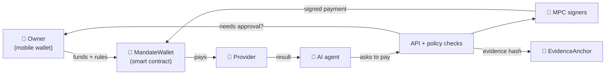

<h1 align="center">Mandate Wallet</h1>

<p align="center"><strong>Your wallet. Your agents. Your rules.</strong></p>

<p align="center">
  A phone wallet that lets you give AI agents a small, limited budget to pay for things on your behalf,<br>
  while you stay in control of every rule and can stop them at any time.
</p>

<p align="center">
  
</p>

<p align="center">
  <a href="https://github.com/Safius-Sifat/Mandate-Agentic-Wallet/actions"></a>
  
  
  
  
  
</p>

<p align="center">
  <a href="https://github.com/Safius-Sifat/Mandate-Agentic-Wallet">Repository</a> ·
  <a href="https://mandate-demo-04323111.malaysiawest.cloudapp.azure.com/healthz">Live API</a> ·
  <a href="pitch.md">Pitch</a> ·
  <a href="architecture.md">Architecture</a> ·
  <a href="docs/SETUP.md">Setup guide</a>
</p>

https://github.com/user-attachments/assets/786351cc-10ab-4f77-83a2-54eedb4b8b6c

<p align="center">
  <sub>A real 3-minute walkthrough on Base Sepolia: restore a wallet, set the agent's limits, shop by chat, approve with Face ID and pay on chain.<br>
  <a href="demo/PROOF.md">Check every wallet and transaction on BaseScan</a>.</sub>
</p>

---

## Table of contents

- [What is Mandate?](#what-is-mandate)
- [Features](#features)
- [How it works](#how-it-works)
- [Built with](#built-with)
- [Project structure](#project-structure)
- [Getting started](#getting-started)
- [Deployment](#deployment)
- [Testing](#testing)
- [Project status](#project-status)
- [Documentation](#documentation)
- [Team](#team)

## What is Mandate?

AI agents can already search, compare and book things. The hard part is letting them **pay**. Handing an agent your card or your wallet key is risky: it could spend too much, pay the wrong people, or be tricked.

Mandate solves this with two separate wallets:

- **Your personal wallet** lives on your phone. Your recovery words and keys never leave it.
- **An agent wallet** is a smart contract on the blockchain. You move a budget into it and write the rules: how much the agent may spend, who it may pay, and until when. The contract itself enforces those rules, so even a misbehaving agent cannot break them.

Every task an agent runs leaves a receipt trail (evidence) that anyone can check independently.

Built for the PBCSF Fintechathon, Topic F. It runs on the Base Sepolia test network, so no real money is involved.

## Features

|     | Feature                  | In simple words                                                                                          |
| --- | ------------------------ | -------------------------------------------------------------------------------------------------------- |
| 👛  | **Personal wallet**      | Create or restore a wallet, send and receive tokens, scan QR codes. Keys stay on the phone.              |
| 🤖  | **AI agent**             | A real agent built on the OpenAI Agents SDK picks a provider, pays for a task and collects the result.   |
| 📜  | **On-chain rules**       | Spending limits, allowed recipients, time windows and call templates are enforced by the smart contract. |
| ✋  | **Owner approval**       | Bigger or unusual payments wait for you to approve them on your phone (co-signature).                    |
| 🧊  | **Freeze and stop**      | One tap freezes or stops an agent on-chain.                                                              |
| 🔐  | **Shared signing (MPC)** | Agent payments are signed by several servers together, so no single server holds a full key.             |
| 🛡️  | **Risk checks**          | A policy service screens each payment before it is signed.                                               |
| 🧾  | **Verifiable evidence**  | Each task's history is hashed and anchored on-chain; a separate verifier tool checks it.                 |
| 💵  | **USDC and x402**        | Agents can pay in test USDC, including web services that charge per request (x402).                      |

## How it works



1. **You set up** an agent wallet from your phone, add a budget and choose the rules.
2. **The agent asks to pay** a provider for a task, through the API.
3. **The policy service checks** the request. If the rules say so, your phone asks you to approve it.
4. **MPC signers sign** the payment together. The smart contract checks the rules again before any money moves.
5. **The provider delivers** the result, and the task's evidence is recorded on-chain.
6. **You can freeze or stop** the agent at any moment from your phone.

## Built with

<p align="center">
  
</p>

| Area                    | Third-party packages                                                                                                                                                                                                                                |
| ----------------------- | --------------------------------------------------------------------------------------------------------------------------------------------------------------------------------------------------------------------------------------------------- |
| AI agent                | [OpenAI Agents SDK](https://www.npmjs.com/package/@openai/agents) 0.20.0                                                                                                                                                                            |
| Backend                 | [Fastify](https://fastify.dev) 5.6.2, [viem](https://viem.sh) 2.38.5, [zod](https://zod.dev) 3.25.76, [jose](https://github.com/panva/jose) 6.1.0, [pg](https://node-postgres.com) 8.16.3, [playwright-core](https://playwright.dev) 1.55.1, dotenv |
| Shared schema           | viem, zod, [@scure/bip39](https://github.com/paulmillr/scure-bip39) 1.6.0, [json-canonicalize](https://www.npmjs.com/package/json-canonicalize) 1.2.0                                                                                               |
| Mobile app              | [Expo](https://expo.dev) SDK 54, React Native 0.81.5, React 19.1.0, React Navigation, expo-secure-store, expo-local-authentication, expo-camera, react-native-svg, react-native-qrcode-svg                                                          |
| Smart contracts         | [OpenZeppelin Contracts](https://www.openzeppelin.com/contracts) 5.4.0, [Foundry](https://book.getfoundry.sh), Solidity 0.8.28                                                                                                                      |
| MPC signing (Go 1.25.8) | [MPCium](https://github.com/fystack/mpcium) (pinned `90e3ee3`), pgx, nats.go, decred secp256k1                                                                                                                                                      |
| Infrastructure          | PostgreSQL 16, NATS 2.11, Consul 1.21, Docker, Caddy, Azure                                                                                                                                                                                         |
| Tooling                 | TypeScript 5.9.3, tsx, Prettier, pnpm 10.20.0, Node 22.23.3                                                                                                                                                                                         |

Circle's test USDC is used only as a normal token. Mandate does not use any Circle custody, wallet or signing service.

## Project structure

```text
Mandate-Agentic-Wallet/
├── apps/
│   ├── api/            Main backend: login, wallets, tasks, approvals, permits, evidence
│   ├── worker/         Sends signed agent payments and records receipts
│   ├── agent/          Task and chat agents (OpenAI Agents SDK)
│   ├── mcp/            MCP server so other AI tools can use Mandate
│   ├── provider/       Paid services the agent buys from
│   └── mobile/         The phone wallet (Android and iOS)
├── packages/
│   ├── contracts/      Smart contracts (MandateWallet, WalletFactory, EvidenceAnchor, DemoVault, DemoUSD)
│   ├── schema/         Shared data formats and test vectors used by every part
│   ├── platform/       Shared server code and database migrations
│   ├── runbooks/       Step-by-step task recipes for agents
│   ├── sdk/            Client library for agents
│   └── verifier/       Command-line tool that checks task evidence
├── services/
│   ├── policy/         Risk and policy checks before signing
│   ├── mpc-boundary/   Go: checks signing requests and signatures
│   ├── mpc-adapter/    Go: talks to the MPCium signing nodes
│   └── mpc-authorizer/ Go: decides which requests may be signed
├── modules/
│   └── owner-wallet/   Wallet module used by the phone app
├── deployments/        Deployed contract addresses and config
├── evidence/           Public deployment and test records
├── infra/              Local Docker setup and Azure templates
├── scripts/            Setup, check and operations scripts
├── docs/               Plans, guides and security notes
├── Dockerfile          Container image for the API
└── Makefile            Shortcuts for setup, running and testing
```

## Getting started

### 1. Install the tools

| Tool                                                               | Version    | Needed for                       |
| ------------------------------------------------------------------ | ---------- | -------------------------------- |
| Node.js                                                            | 22.23.3    | Everything                       |
| pnpm                                                               | 10.20.0    | Everything                       |
| Docker                                                             | any recent | Local database and message queue |
| [Foundry](https://book.getfoundry.sh/getting-started/installation) | latest     | Smart contracts                  |
| Go                                                                 | 1.25.8     | MPC signing services             |
| JDK 17 + Android SDK, or Xcode                                     |            | Phone app                        |

You don't have to install the exact Node and pnpm versions yourself: the `make` commands download them for this project only.

### 2. Run it locally

```bash
git clone https://github.com/Safius-Sifat/Mandate-Agentic-Wallet.git
cd Mandate-Agentic-Wallet

make setup         # install packages and create your local .env
make infra-up      # start PostgreSQL, NATS and Consul in Docker
make db-migrate    # create the database tables
make dev-platform  # start the API
```

Then, each in its own terminal:

```bash
make dev-worker    # payment worker
make dev-provider  # example paid services
make dev-mobile    # phone app (needs a development build, see below)
```

Run `make doctor` if something does not start; it checks your tools.

> Your `.env`, recovery words, MPC key shares and backups are private. Never commit or share them.

More detail: [setup guide](docs/SETUP.md) and [mobile build guide](docs/mobile-build.md).

## Deployment

### Smart contracts (Base Sepolia)

The contracts are already deployed and checked. Anyone can look them up on a Base Sepolia block explorer.

| Contract       | What it does                | Address                                      |
| -------------- | --------------------------- | -------------------------------------------- |
| WalletFactory  | Creates agent wallets       | `0x094875D5656726980016E8712a8A02C96aD382ce` |
| EvidenceAnchor | Stores task evidence hashes | `0x11384648A1FbB81da2E664E5Ae5EF547720BCC49` |
| DemoVault      | Demo vault for agent tasks  | `0xd82b54fbaD1B03D4D593479c154b2d6C413d9800` |
| DemoUSD        | Demo token                  | `0xE030717a657E9194bC086A546fb59aDBc631ad7a` |
| USDC           | Circle's test USDC          | `0x036CbD53842c5426634e7929541eC2318f3dCF7e` |

Full record with code hashes and transactions: `evidence/person1/deployment.json`.

<details>
<summary>Deploy a new set of contracts (owner only)</summary>

Run from `packages/contracts`. The deployer key is kept in an encrypted Foundry keystore, never in plain text.

```bash
# 1. Store the deployer key safely (you will be asked for the key and a password)
cast wallet import mandate-deployer --interactive

# 2. Dry run: nothing is sent
forge script script/Deploy.s.sol --rpc-url "$BASE_SEPOLIA_RPC_URL" --account mandate-deployer

# 3. Deploy for real
forge script script/Deploy.s.sol --rpc-url "$BASE_SEPOLIA_RPC_URL" --account mandate-deployer --broadcast --slow

# 4. Read everything back from the chain and save the record
RPC_URL="$BASE_SEPOLIA_RPC_URL" node scripts/record-deployment.mjs \
  broadcast/Deploy.s.sol/84532/run-latest.json \
  ../../deployments/base-sepolia.config.json \
  ../../evidence/person1/deployment.json
```

The script refuses to run on the wrong network or with a wrong configuration. See [contract deployment](docs/contracts-deploy.md).

</details>

### Backend (Azure)

Deployment is automatic:

1. Every pull request runs the full test suite on GitHub Actions.
2. When a change is merged into `main`, GitHub logs in to Azure (without stored passwords) and tells the server to update.
3. The server backs up the database, applies new migrations, builds the API container and restarts it.
4. The release only counts as successful if the new API reports the right version and passes its health checks.

To build and test the API container on your own machine:

```bash
docker build --tag mandate-api .
bash scripts/ops/container-smoke.sh mandate-api
```

More detail: [Azure runbook](docs/operations/LIVE-SETUP.md) and [delivery design](docs/operations/AZURE-DELIVERY-DESIGN.md).

### Mobile app

The phone app needs an Expo development build (the Expo Go app is not enough). It only connects to Base Sepolia.

```bash
cd apps/mobile
npx expo run:android --device   # or: npx expo run:ios
```

Step-by-step guide: [mobile build](docs/mobile-build.md).

## Testing

Each area has its own test command. GitHub Actions also runs these on every pull request.

| What is tested  | Command                                                  | What the tests check                                                                                                                                                             |
| --------------- | -------------------------------------------------------- | -------------------------------------------------------------------------------------------------------------------------------------------------------------------------------- |
| Smart contracts | `make check-contracts`                                   | Spending limits, allowances, approvals, freeze, replay protection, x402 payments, recovery, owner transfer, plus "can never happen" invariant tests and a live-network fork test |
| Shared formats  | `make check-schema`                                      | The TypeScript and Solidity code produce the exact same hashes and signatures                                                                                                    |
| API             | `pnpm --filter @mandate/api check`                       | Login, sessions and routes against a real database                                                                                                                               |
| Worker          | `pnpm --filter @mandate/worker check`                    | Key storage, reading receipts, restarts, and a full MPC payment end to end                                                                                                       |
| Policy          | `pnpm --filter @mandate/policy check`                    | Risk screening rules                                                                                                                                                             |
| Provider        | `pnpm --filter @mandate/provider check`                  | Signed quotes, only exact payments count, and results come from a real browser check                                                                                             |
| Agent, MCP, SDK | `pnpm --filter @mandate/agent check` (also `mcp`, `sdk`) | The agent and its tools behave correctly                                                                                                                                         |
| Verifier        | `pnpm --filter @mandate/verifier check`                  | Evidence checks catch tampering                                                                                                                                                  |
| Runbooks        | `pnpm --filter @mandate/runbooks check`                  | Task recipes are valid                                                                                                                                                           |
| Mobile app      | `make check-mobile`                                      | Wallet logic, send drafts, service calls and screen logic                                                                                                                        |
| Database        | `pnpm test:migrations` and `pnpm test:db`                | Migrations apply cleanly on a fresh PostgreSQL                                                                                                                                   |
| MPC services    | `go test -race ./...` in each `services/mpc-*` folder    | Signing requests and signatures are checked correctly (run `make mpc-fetch` first)                                                                                               |
| Whole repo      | `pnpm typecheck`, `pnpm check:repository`                | Types compile and repository rules hold                                                                                                                                          |
| Container       | `bash scripts/ops/container-smoke.sh <image>`            | The production image starts and answers health checks                                                                                                                            |

Checks for parts that are not finished yet (`check-platform`, `check-agents`, `check-integration`) fail on purpose instead of pretending to pass.

## Project status

**Working today on Base Sepolia:**

- ✅ Smart contracts deployed and verified
- ✅ Phone wallet: create, restore, send, receive, agent tasks, approvals, live payments, proof and stop
- ✅ Wallet-signed login with sessions that can be revoked
- ✅ API for tasks, approvals, permits and evidence
- ✅ MPC-signed agent payments through the worker, with policy checks
- ✅ Reference agent, MCP server, SDK and evidence verifier

**Not done yet:**

- ⏳ The full release manifest (`deployments/base-sepolia.json`)
- ⏳ The readiness check `/readyz` still returns 503 until every release gate passes
- ⏳ WalletConnect and connections to outside dApps

Mandate never fakes a payment or a result. If something is missing, it fails with a clear error.

## Documentation

| Topic           | Document                                                                                                      |
| --------------- | ------------------------------------------------------------------------------------------------------------- |
| Product idea    | [Pitch](pitch.md), [PRD](PRD.md)                                                                              |
| How it is built | [Architecture](architecture.md), [master plan](FINAL%20PLAN.md), [complete app](docs/COMPLETE-APP.md)         |
| Setting up      | [Setup](docs/SETUP.md), [mobile build](docs/mobile-build.md)                                                  |
| Security        | [Security self-assessment](docs/security-self-assessment.md), [contract security](docs/contracts-security.md) |
| APIs            | [Owner sessions](docs/api/OWNER-SESSIONS.md), [owner transfer](docs/owner-transfer.md)                        |
| Teamwork        | [Coordination and merge rules](docs/COORDINATION-AND-MERGE-POLICY.md), [review](review.md)                    |

Older documents are kept in [docs/archive](docs/archive/pre-bootstrap-2026-10-17/) for history only.

## Team

| Member   | Responsible for                              | Plan                                                                          |
| -------- | -------------------------------------------- | ----------------------------------------------------------------------------- |
| Person 1 | Smart contracts, shared formats, deployment  | [Plan 01](docs/plans/01%20-%20Contracts%20and%20Shared%20Interfaces.md)       |
| Person 2 | Backend, policy, MPC signing, infrastructure | [Plan 02](docs/plans/02%20-%20Platform%20Policy%20and%20MPCium.md)            |
| Person 3 | Mobile wallet (Android and iOS)              | [Plan 03](docs/plans/03%20-%20Android%20Owner%20Wallet.md)                    |
| Person 4 | Agents, providers, verifier, demo            | [Plan 04](docs/plans/04%20-%20Agents%20Services%20Inspection%20and%20Demo.md) |
