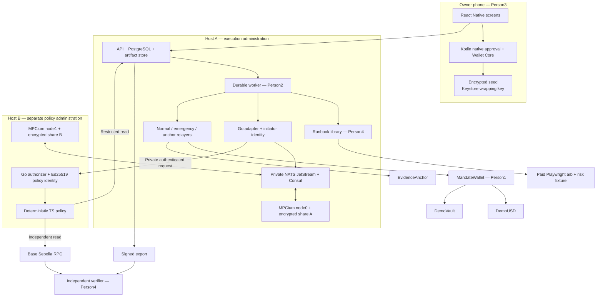
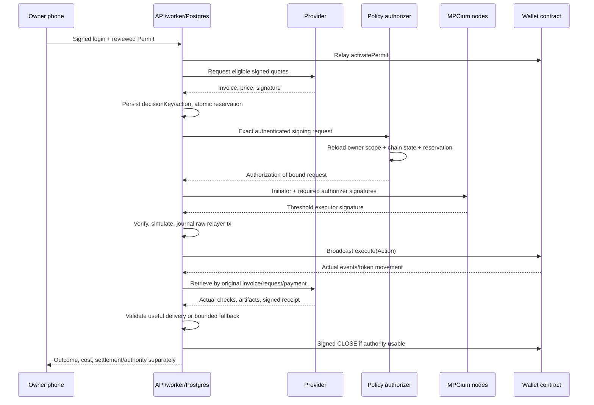
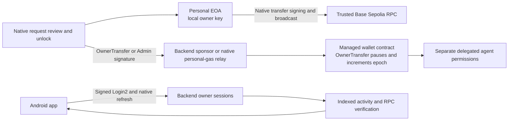

# Mandate Wallet — implementation architecture

> Repository bootstrap added 2026-10-17. Read [README](README.md) and [setup](docs/SETUP.md) for existing foundation files. Continue from that code; financial features and acceptance gates remain unimplemented.

**Read [FINAL PLAN](FINAL%20PLAN.md) for assignments/gates.** Four handoffs include the identical interface contract reproduced below. Documentation version6 replaces cb-mpc/five-owner architecture; EIP712 wallet domain is5 and Login domain2; agent receipt schema4 remains. S8 adds everyday wallet methods; W0 source migration is required. No executable code was built by writing these documents.

## A1. Deployment and authority



Policy uses restricted direct DB reads, not a trusted API verdict. Diagram's API box includes Postgres. Both nodes verify initiator and required authorizer before participating; authorizer does not replace a threshold share. Owner signs Permit/Admin/OwnerTransfer; executor signs Action; relayers pay gas only. Provider keys sign quotes/output and receive test payments. Evidence key signs checkpoint, publisher anchors it; neither has owner authority.

Host A and B have separate administrators/access credentials/share encryption/backup keys. Actual ability of one person to access both is documented; two containers under one root account are a development topology, not independent compromise domains. NATS/Consul can cause availability failure; quorum cannot sign through node outage. Owner can stay offline during active delegated work because online hosts remain available.

## A2. MPCium integration

Pin `fystack/mpcium` commit `90e3ee3c15e6698ade5626ff6c6b49d2453d8ce2`, Go1.25.8 and its replaced Fystack tss-lib dependency. Two nodes, `mpc_threshold:1` because inspected consumer requires t+1. G1 must actually demonstrate this deployment, signature recovery, either-node-alone failure and required-authorizer rejection. The repository's security/threshold marketing is not deployment evidence.

No custom cryptographic protocol/round transport/DER wrapper. Upstream provides distributed keygen, threshold signing, NATS coordination, Consul discovery and encrypted share storage. One DKG per wallet executor; unused HD functionality still requires common32byte chain_code. Empty derivation path; no shared derived customer key hierarchy. Ed25519 initiator identity and policy authorizer identity authenticate/authorize MPC requests; neither is Ethereum signing key.

Both nodes use authorization.enabled=true, nonempty required_authorizers=[mandate-policy-v1], same trusted authorizer public key. Startup/readiness checks fail if missing. Upstream permits no-authorizer requests when list empty: never rely on enabled flag alone. Administrative keygen is separately authorized; no public reshare endpoint. Lifecycle after loss is owner stop→fresh DKG→new executor→new owner Permit, not unqualified share refresh/full-key reconstruction.

Adapter loads immutable actionId, recomputes original EIP712 digest, builds upstream SignTxMessage (secp256k1,registered walletId,attempt UUID,`eip155:84532`,Tx exact32bytes,nil path), signs Raw with A's Ed25519 initiator. B verifies that signature and independently reconstructs all fields from approved records/current chain. TS policy checks scope/rules/reservation; Go authorizer signs upstream ComposeAuthorizerRaw. Adapter attaches authorization; Go client's repeated Ed25519 request signature must be identical. Subscribe before publish; stable unique ClientID; response correlation wallet/attempt/key/digest. Node0+node1 yield R/S/recovery; vetted normalization/recovery produces canonical65byte signature matching expected executor. No digest rehashing.

No generic signing HTTP route; internal endpoints accept actionId only except authenticated B authorization carrying reconstructible message. Per-key signing serialized. Persist attempt/action/digest/keyVersion/status; upstream fresh session nonce on retries, no restored ephemeral state or custom offline nonce/preprocessing cache. Uncertain result remains potentially executable and holds reservation. Contract deadline/replay/epoch protect delayed signed actions; authorizer message itself has no independent action expiry field.

All infrastructure private and authenticated. Release transport is a private authenticated encrypted tunnel between hosts, service firewalls/credentials/ACLs, node message identities and TLS where verified supported by pinned clients. Public NATS/Consul/Badger access forbidden. Separate encrypted long-term backups; restore isolated with signing disabled then reconcile chain/session/journal. No independent audit of this integrated stack established.

## A3. Transaction and task algorithm



Runbook advance is library logic owned by Person4, called by Person2 durable leased worker; it returns proposal/wait/complete/failure and nextState. Task+decisionKey uniqueness controls logical action identity. Agent never directly sets signature, chain nonce, executor or raw calldata. Runbook/conditions hashes bind exact reviewed software/input; no runtime attestation is claimed.

Reservation transaction locks wallet/permit; chain-included gross totals plus disjoint unresolved reservations, never finalized+included double count. Liquid minus floor minus not-included outflows gives available funds. Pending deposits reserve, pending withdrawal does not fund a purchase. Refund does not decrease gross; unresolved requests carry into current admission day until reconciled. One outstanding financial tx/wallet, separate normal/emergency/anchor sender nonces.

Persist raw signed tx/hash/nonce before broadcast; retry same bytes, replacements same nonce/business calldata with full lineage. INCLUDED after3canonical confirmations allows delivery; FINALIZED from finalized head.60s UNKNOWN/120s attention retain reservations. Reorg blocks dependents and reconciles. Release reserved amount only after known revert, no usable signature ever released, or confirmed invalidation plus complete past-chain reconciliation; expiry/broadcast error alone does not establish no earlier payment.

## A4. Owner app and escape path

Wallet Core JNI creates12word/imports supported BIP39 wallets with optional native import passphrase and account indexes0..19 at standard Ethereum paths. AES256GCM seed storage under authenticated Android Keystore wrapping key; no words/private key crosses RN bridge/server, no raw-sign method. Native confirmation verifies typed schema/domain/trusted deployment, recomputes scope/recipient/schedule/code hashes and displays actual terms. Cancellation no signature. Keystore protection is for wrapping key, Ethereum key enters native memory for signing; rooted process remains threat.

Login2 EIP712 one-use≤5min challenge binds origin/deviceId and issues15min session JWT plus native-protected rotating refresh. See S8 for session/revocation semantics. Agent tokens read/prepare/run/evidence scopes, wallet/task restrictions, expiry/revocation, no Admin. Native owner key and words restore independent of services. API-offline native screen discovers wallet via trusted factory/RPC, verifies owner/config, reads fresh adminNonce, locally signs Admin, exports signed command deliberately. Independent funded CLI sender simulates/submits through another RPC with no owner secret/backend. Owner must still have chain access and gas sponsor. Lost required words/passphrase and device has no server recovery.

## A5. Evidence and independent findings

Writer uses RFC8785SHA256 event chain, encrypted retained artifact commitments, Ed25519 checkpoint and on-chain anchor, exact schema below. Append corrections, never rewrite. Export contains authentic scope/signatures, immutable actions/invoices, transaction lineage, output/receipts/bytes, closure/governance and public signing metadata. Private MPC material/owner words/tokens/hidden model reasoning excluded.

Independent CLI uses separately trusted keys/contracts and its own RPC. Six findings separately verify integrity/authority/policy/settlement/delivery/completion. Some reservations/rate/risk/MPC-protocol claims remain independently unverifiable assertions; correct reporting of that is acceptance, not failure to achieve six green badges. Provider signature proves identity of claim, not honest browser execution. Anchoring commits published history, not truth/completeness of every original record. Full supported-asset outflow history from deployment is inspected for unmatched events; missing history explicitly limits results.

## A6. Implementation references and proof status

- [MPCium pinned source](https://github.com/fystack/mpcium/tree/90e3ee3c15e6698ade5626ff6c6b49d2453d8ce2), [threshold consumer](https://github.com/fystack/mpcium/blob/90e3ee3c15e6698ade5626ff6c6b49d2453d8ce2/pkg/eventconsumer/sign_consumer.go), [authorizer implementation](https://github.com/fystack/mpcium/blob/90e3ee3c15e6698ade5626ff6c6b49d2453d8ce2/pkg/identity/identity.go), [request serialization](https://github.com/fystack/mpcium/blob/90e3ee3c15e6698ade5626ff6c6b49d2453d8ce2/pkg/types/initiator_msg.go).
- [Wallet Core Android](https://developer.trustwallet.com/developer/wallet-core/integration-guide/android-guide), [Android Keystore](https://developer.android.com/privacy-and-security/keystore), [EIP712](https://eips.ethereum.org/EIPS/eip-712), [OZ ERC4626](https://docs.openzeppelin.com/contracts/5.x/erc4626), [Base finality](https://docs.base.org/specifications/transactions/transaction-finality).

Available primitives and inspected source support these choices. Actual compatibility/security/recovery results must be produced at G1–G5. Neither source browsing nor this document proves the implementation already works.

## A7. Everyday wallet and session architecture

The app is now required to provide a complete everyday wallet on Base Sepolia: multiple local accounts, native ETH/standard ERC20 send/receive, managed-wallet owner transfers, asset import/history, device sessions, local lock/backup/restore, contacts/QR and complete security/settings flows. This is required work alongside agent tasks; swaps, arbitrary DeFi calls, NFTs and other chains are not advertised as supported.



### Three transaction paths

| Path | Signed by | Fee payer | Financial authority |
| --- | --- | --- | --- |
| Personal ETH/ERC20 transfer | Native owner EOA signs exact transaction | Personal EOA | Explicit native per-request review; no MPC/API consent |
| Managed owner transfer/Admin | Native owner signs typed command; relay signs its gas transaction | Backend sponsor, funded personal EOA or independent sender | OwnerTransfer5/Admin5; separate nonce, current epoch; owner transfer stops prior agent grants |
| Agent operation | Online MPC executor signs Action5 | Backend normal relayer | Stored owner Permit5 + policy + contract caps/floor/replay |

Personal and managed funds are displayed separately; only an explicit chain transfer moves funds between them. Native receives/reads/sends can continue with backend outage through trusted RPC; full history may be cached/incomplete until indexer returns. Recovery words restore local owner identities, not server MPC shares. One account per derived address has independent backend session/factory wallet/executor.

### Account/session lifecycle

Native profile stores seed/optional import passphrase and indexes0..19 encrypted under authenticated Keystore. All exposed signing methods bind accountId to derived address and reject cross-account/context mutation. Native personal journal records signed raw bytes before broadcast and coordinates EOA nonces across manual and specific owner-operation gas relay. No server raw-sign endpoint or generic native digest method exists.

Login2 uses origin/deviceId/one-use nonce/time and owner signature.15min JWT carries original auth_time and sessionId. Native refresh token storage and atomic server hash/family rotation give7day idle/30day absolute continuity; refresh never fakes recent owner authentication. Logout/session revoke/local lock/on-chain pause are different operations with different effects. Blockchain owner authority survives expired API credentials.

### Managed wallet extension

New wallet domain5 prevents mixing earlier approval templates. OwnerTransfer has its own nonce/unique ID/expiry/epoch, supports liquid ETH and standard ERC20 owner sweep, rejects approved vault share token/arbitrary calls and requires immutable owner signature. Successful transfer sets paused/increments epoch even while already paused; floor/caps apply to agents, not immutable owner's control. Evidence classifies event OWNER_CONTROL and records actual value/fee payer/authority invalidation. Revert has no successful stop effect. Exact fields/events/native/API contracts are S8 below.

### History and receive requests

History discovery uses Etherscan V2 chain84532 with server-only API key, pagination/coverage and independently verified receipts/logs. Account-native balances never come solely from indexer. Indexer outage/partial backfill/unverified internal traces are visible gaps; no zero/complete-history fabrication. Personal local journal and agent receipts remain separate evidence channels.

User explicitly deferred WalletConnect/external dApp connections. No WalletKit/Reown projectId, dApp approval screen or dApp release gate is required. QR receive requests remain data-only drafts requiring ordinary native transfer review. Agent SDK/MCP access still uses scoped backend tokens and active owner permits; it does not expose a personal transaction signer.

### Compatibility and qualification

Update bootstrap TS/Solidity/native/Go fixtures/domain constants before new signing; current runtime scaffold is not automatically v6-compatible. Receipt/runbook schema4 and Invoice/Delivery domains1 remain; OwnerTransfer/manual activity are new independent channels. No implemented path/deployment/test result is created by updating this architecture.

MPC topology is still a qualification blocker: pinned production guide specifies≥3nodes while our proposed topology has2. Confirm actual supported setup and revise all infrastructure manifests together if necessary; do not treat a t+1 source check as deployed proof. App-completeness requirements do not remove this gate.

Primary integration references: [Wallet Core usage](https://developer.trustwallet.com/developer/wallet-core/integration-guide/wallet-core-usage), [ERC681](https://eips.ethereum.org/EIPS/eip-681), [EIP712](https://eips.ethereum.org/EIPS/eip-712), [Etherscan supported chain API](https://api.etherscan.io/v2/chainlist), [Etherscan transaction history](https://docs.etherscan.io/api-reference/endpoint/txlist), [viem OP-stack fee estimation](https://viem.sh/op-stack/actions/estimateTotalFee). Sources establish available interfaces, not our successful integration.


---

# Exact shared implementation contract

## Shared implementation contract — included in all four handoffs

This appendix is identical in the four documents. Specification6.0, dated2026-10-17: new MandateWallet EIP712 domain5, MandateLogin domain2 and unchanged agent receipt/runbook schema4. S8 adds the complete everyday-wallet behavior. No live contract is deployed by this update. Person1 owns shared interface changes; update fixtures and every consumer together. Existing bootstrap source is pre-v6 and must undergo W0 migration before signing.

### S1. Product, boundary and ownership

Build **Mandate Wallet**: an Android personal ETH/ERC20 wallet with receive/send/history/accounts and local security; a separately funded managed wallet delegates bounded tasks to an online agent; the agent buys real browser checks, operates one approved test vault and makes fixed scheduled payments. Payments and useful delivery are recorded separately. An independent verifier reconstructs permission, spending and delivery from an export and public chain data.

| Person | Sole write ownership | Outputs consumed by others |
| --- | --- | --- |
| 1 | `packages/contracts`, `packages/schema`, `deployments`, root workspace/CI configuration | ABI, schemas, fixtures, deployment manifest, chain validation |
| 2 | `apps/api`, `apps/worker`, `services/policy`, `services/mpc-adapter`, `services/mpc-authorizer`, `infra`, migrations, evidence writer | Public API, durable execution, two-node MPCium, policy authorization, exports |
| 3 | `apps/mobile`, `modules/owner-wallet`, `tools/relay-admin.ts` | Complete personal/managed owner wallet, local transactions/sessions/security, installed APK, independent recovery sender |
| 4 | `packages/runbooks`, `apps/provider`, `packages/sdk`, `apps/mcp`, `packages/verifier`, `demo`, `evaluation`, submission assembly | Runbook driver, paid browser services, integrations, standalone inspector, recorded demonstration |

Person 2 owns the worker process; Person 4 supplies its runbook library. Person 2 writes evidence; Person 4 verifies it independently. Person 1 owns ABI/schema generation; other owners never hand-maintain copies. Each owner supplies tests, deployment instructions, known risks and screenshots/logs for their own deliverable. No unassigned fifth person is required.

Use one monorepo `./`, Node 22, TypeScript, pnpm workspaces with a checked-in lockfile; Solidity 0.8.28/OZ 5.x/Foundry; PostgreSQL 16; React Native with Expo 54 native Android build; Go 1.25.8 for MPCium. Person1 creates the workspace. All filenames here are relative to it and are planned files, not claims that source already exists. Pin resolved package versions in lockfiles; container images use resolved digests in the release manifest. Keep secrets out of Git and frontend bundles.

`DeploymentManifest` includes `{schemaVersion:4,walletDomainVersion:"5",loginDomainVersion:"2",chainId:84532,sourceTag,contracts:{factory,token,vault,anchor,walletImplementation:null},providers,targets,origins,mpc,evidence,runbooks,supportedTokens,dependencyPins}`. Each non-null contract is `{address,deploymentBlock,codeHash}`; providers are `{providerId,recipient,capabilities}`; targets are `{targetId,url,expectedTitle}`; origins are `{api,provider}`; mpc is `{engine:'mpcium',commit,thresholdConfig:1,participants:2,initiatorPublicKey,authorizerPublicKey}`; evidence is `{ed25519PublicKey,publisher}`; runbooks is list of full hashed manifests. supportedTokens is a reviewed registry of {chainId,address,codeHash,decimals,symbol,transferMode:'STANDARD_ERC20'}; unknown imports remain watch-only. Strings for times/blocks, strict validated keys/addresses/hashes. Per-wallet mapping is `{walletId,owner,walletAddress,deploymentBlock,codeHash,mpcWalletId,executorAddress,executorPublicKey,keyVersion}` checked against factory and signed Permit. Keys in these structures are public only. Resolve real deployment addresses/versions at setup gates; do not fabricate them to fill the manifest.

### S2. Network, assets and financial identities

Base Sepolia, chainId **84532**. Agents use only six-decimal valueless DemoUSD and one controlled ERC4626 DemoVault. Personal wallet supports native test ETH and standard imported ERC20; managed OwnerTransfer supports owner liquid-token/native control under S8. Imported tokens do not become agent-authorized assets. No other chain or delegated vault is accepted. On-chain amounts are integers; JSON represents uint64/uint256 as decimal strings, enum/count fields as bounded integers, addresses as validated EVM addresses and bytes32/signatures as `0x` hex. API UUIDs never substitute for chain bytes32 IDs. Store explicit UUID ↔ chain ID mappings.

Identities: local owner EOA; per-wallet MPC executor EOA; wallet contract; separately funded normal/emergency/anchor relayers; two provider signer/recipient EOAs; Ed25519 evidence signer; Ed25519 MPC initiator and policy-authorizer identities. None of the service credentials is the owner key. An executor signature authorizes an Action; a relayer signature only pays gas.

Fixed ceilings: 500000 units/payment; 2000000/task gross spend; 5000000/executor/UTC day; 10000000/wallet/UTC day; minimum liquid floor 3000000; post-deposit allocation ≤2000 basis points; ≤20 financial actions/permit, browser ≤3 payments. Owner can tighten. Gross PAY/TRANSFER counters never decrease on refunds. Deposits/withdrawals have separate caps. UTC day is `block.timestamp / 86400`. Allocation limit applies when admitting a deposit, not as a perpetual ratio guarantee.

Permit lifetime ≤24h. Browser task ≤10min, 8 workflow steps, 3 paid attempts. Action and invoice lifetime ≤60s. Policy chain snapshot ≤15s old; risk signal NORMAL and ≤60s old before deposit. Scheduled transfer uses exact owner-approved period/window; missed periods skip. No arbitrary agent/dApp calls/approvals, swaps, bridges, credit, production yield, x402 interoperability, iOS, mobile MPC or open marketplace. Personal transfers and owner-controlled transfers in S8 are required. WalletConnect/external dApp connections are deferred by user choice.

### S3. Signed financial objects

Person 1 creates `packages/schema/src/{authority,hashing,api,runbook,evidence,manifest}.ts`, Zod validators, generated ABI exports and `fixtures/*.json`. These are imported by every JS component. Solidity and native signing are checked against the same JSON golden vectors. EIP-712 field **order and types** are fixed:

```text
domain MandateWallet / version "5" / chainId 84532 / verifyingContract wallet
Permit(bytes32 taskId,address executor,uint8 kind,bytes32 runbookHash,
 bytes32 conditionsHash,bytes32 recipientsHash,bytes32 scheduleHash,
 uint64 issuedAt,uint64 startsAt,uint64 expiresAt,uint64 epoch,uint256 nonce,
 uint32 maxActions,uint32 maxPayments,uint256 maxPayment,uint256 spendCap,
 uint256 liquidFloor,uint256 depositCap,uint256 withdrawCap)
Action(bytes32 permitId,bytes32 requestId,uint8 operation,address target,
 uint256 amount,uint256 minOutput,bytes32 invoiceId,bytes32 inputHash,
 uint32 period,uint64 issuedAt,uint64 deadline)
Schedule(address recipient,uint256 amount,uint64 start,uint32 interval,
 uint32 window,uint32 periods)
Admin(uint8 command,bytes32 permitId,uint256 nonce,uint64 issuedAt,uint64 deadline)
OwnerTransfer(bytes32 transferId,address asset,address recipient,uint256 amount,
 uint64 epoch,uint256 nonce,uint64 issuedAt,uint64 deadline)

kind: BROWSER=0 LIQUIDITY=1 SCHEDULE=2
operation: PAY=0 TRANSFER=1 DEPOSIT=2 WITHDRAW=3 CLOSE=4
command: PAUSE=0 UNPAUSE=1 REVOKE=2 RECOVER=3 RECOVER_LIQUID=4

domain MandateInvoice / "1" / 84532 / wallet
Invoice(bytes32 invoiceId,bytes32 taskId,address wallet,address recipient,
 uint256 amount,bytes32 inputHash,uint64 issuedAt,uint64 expiresAt)

domain MandateDelivery / "1" / 84532 / wallet
DeliveryReceipt(bytes32 invoiceId,bytes32 requestId,bytes32 inputHash,
 bytes32 resultHash,bytes32 paymentTxHash,uint64 completedAt)

domain MandateLogin / "2" / 84532 / zero address
Login(string origin,bytes32 nonce,bytes32 deviceId,uint64 issuedAt,uint64 expiresAt)
```

`permitId = hashStruct(Permit)`; signatures sign EIP-712 domain-separated digests. Shared helper `hashPermit(permit)` returns this struct hash/ID; `buildTypedData('Permit',permit,domain)` builds the signing payload; `hashAction(action,domain)` returns the domain-separated Action digest. Helpers never infer domain from untrusted payload. `recipientsHash = keccak256(abi.encode(address[]))` on sorted unique ≤4 recipients. `scheduleHash = keccak256(abi.encode(Schedule))`; non-schedule uses zero hash and zeroed Schedule. Other hashes are SHA-256 over RFC8785 canonical UTF-8 JSON, represented as bytes32. `runbookHash` hashes `{schemaVersion:4,runbookId,kind,version,entryArtifactHash,inputSchemaHash,outputSchemaHash,validatorArtifactHash,dependencyLockHash}`. Hash built artifacts/lockfile, omit own hash/timestamps. Installed runbook must match owner-signed hash. Contract does not attest worker execution.

`conditionsHash` commits exact owner-reviewed Conditions:

```ts
type Conditions = {
 schemaVersion: 4; runbookId: 'browser-check'|'liquidity-keeper'|'scheduled-pay';
 browser: null | {targetId:string; checks:('pageLoad'|'title'|'formSubmit')[];
   providerIds:('a'|'b')[]; maxPaidAttempts:number; maxSteps:number;
   taskDeadline:string; resultMaxAgeSeconds:300};
 liquidity: null | {vault:Address; command:'deposit'|'redeem'; amountUnits:string;
   maxSlippageBps:50; riskSourceId:'demo-risk-v1'; signalMaxAgeSeconds:60};
 schedule: null | Schedule;
}; // exactly one non-null branch; schema rejects unknown fields
```

Scope envelope is `{conditions,runbookManifest,providerBindings}` with `providerBindings:[{providerId,recipient}]` from trusted deployment manifest. Conditions provider IDs resolve only through that manifest; recipients must equal sorted permitted provider recipients. Goals are display metadata; executable interpretation is committed in Conditions and confirmed natively. Scope bytes must recompute both signed hashes. Deposit/redeem amount is explicit; no natural-language financial parameter reaches the signer unchecked.

Wallet ABI: `activatePermit(Permit,address[],Schedule,bytes ownerSignature)`; `execute(Action,bytes executorSignature,Invoice,bytes providerSignature)`; `applyAdmin(Admin,bytes ownerSignature)`; `applyOwnerTransfer(OwnerTransfer,bytes ownerSignature)`; `ownerTransferNonce()`; `usedOwnerTransfer(bytes32)`; `getPermit(bytes32)`; `getBudget(address executor)`; `usedRequest(bytes32)`; `permitNonce()`; `adminNonce()`; `authorityEpoch()`; `paused()`; `owner()/token()/vault()`; factory `createWallet(address owner)`/`walletForOwner(address)`. Anyone can relay fixed-configuration wallet creation; the nonzero provided address is immutable owner, never the relayer. Non-PAY uses zeroed Invoice and empty provider signature. `getPermit` returns `{permit,activated,closed,revoked,grossSpend,paymentCount,actionCount,depositedAssets,withdrawnAssets}`; counters uint256 except counts uint32, flags bool. `getBudget` returns uint256 `{day,walletGross,executorGross,liquidAssets,vaultShares,vaultAssets}`. ABI field names/bindings are generated by Person1; consumers never guess positional tuples. Required wallet events:

```text
ActionExecuted(bytes32 indexed permitId,bytes32 indexed requestId,uint8 operation,
 address target,uint256 assets,uint256 shares,bytes32 invoiceId,
 bytes32 inputHash,bytes32 actionDigest)
PermitActivated(bytes32 indexed permitId,bytes32 indexed taskId,address executor,uint64 epoch)
PermitRevoked(bytes32 indexed permitId)
WalletPaused(bool paused,uint64 epoch)
PermitClosed(bytes32 indexed permitId)
Recovered(uint256 liquidAssets,uint256 redeemedShares,uint256 redeemedAssets,bool vaultFailed)
OwnerTransferExecuted(bytes32 indexed transferId,address indexed asset,address indexed recipient,
 uint256 amount,uint64 newEpoch,bytes32 transferDigest)
```

Financial execution checks current epoch/time, executor signature, kind, recipient, counts, gross caps/floor, request/invoice uniqueness and invoice binding. BROWSER only PAY/CLOSE; LIQUIDITY only DEPOSIT/WITHDRAW/CLOSE; SCHEDULE only TRANSFER/CLOSE. WITHDRAW amount is shares and returns assets only to wallet; positive minOutput required for vault operations. Unused fields must be zero. CLOSE is signed, zero-value and exempt from financial quotas. PAUSE and either RECOVER pause/increment epoch; UNPAUSE never revives prior permits. REVOKE works on pending IDs. Recovery only to immutable owner, works while paused, separate admin nonce/lifetime ≤30min. `RECOVER_LIQUID` makes no vault call. No owner-admin operation requires MPC or backend consent. OwnerTransfer liquid funds, epoch effects, manual nonce and native ETH receive are defined in S8; they do not grant agents personal-wallet privileges.

### S4. Public API and mobile bridge

All endpoints under `/v1`. Mutations except challenge/verify/refresh require UUID `Idempotency-Key`; same tenant+route+key+body returns original response, changed body returns409. Challenge uses no bearer; normal owner routes use15min revocable-session JWT with native-protected rotating refresh as S8.5. Agent tokens have explicit `read`, `prepare`, `run`, `evidence` scopes, wallet/task restriction, expiry/revocation; no owner/admin authority. Evidence scope is separate because artifacts can be private.

| Route | Body / response |
| --- | --- |
| POST `/auth/challenge` | `{ownerAddress,deviceId}` → `{challengeId,typedData}` |
| POST `/auth/verify` | `{challengeId,signature}` → `{accessToken,expiresAt,sessionId,refreshToken,refreshExpiresAt}` |
| POST `/wallets` | `{}` → WalletView with provisioning state |
| GET `/wallets/:walletId` | → WalletView |
| POST `/tasks` | `{walletId,runbookId,goal,input}` → TaskView; input is selected runbook schema |
| POST `/permits/draft` | `{taskId,terms}` → OwnerApproval |
| POST `/permits/activate` | `{draftId,ownerSignature}` → `{permitId,activationTxHash,authorityState}` |
| POST `/tasks/:taskId/run` | `{}` → TaskView |
| GET `/tasks/:taskId` | → TaskView |
| POST `/wallets/:walletId/admin/draft` | `{command,permitId}` → `{draftId,typedData,digest}` |
| POST `/wallets/:walletId/admin/submit` | `{draftId,ownerSignature}` → `{txHash,chainState,epoch}` |
| POST `/agent-tokens` | `{walletId,taskId:null|string,scopes,expiresAt}` → `{id,token}` once |
| DELETE `/agent-tokens/:tokenId` | → `{revoked:true}` |
| GET `/tasks/:taskId/evidence` | authenticated streamed export bundle; no permanent public URL |

`terms` is exactly `{startsAt,expiresAt,maxActions,maxPayments,maxPayment,spendCap,liquidFloor,depositCap,withdrawCap,recipients,schedule}` using Permit/Schedule types. All fields required; kind-inapplicable fields zero. Server derives issuedAt/executor/kind/task ID/hashes/nonce/epoch from verified state and checks recipients/Schedule equal Conditions and trusted provider bindings. Unknown/redundant mismatched fields fail. At most one outstanding Permit draft per wallet; refreshed terms require new native confirmation. Admin nonce/lane is separate.

```ts
type OwnerApproval = {draftId:string; typedData:TypedPermit; scope:Scope;
 recipients:Address[]; schedule:Schedule; digest:Hex32};
type WalletView = {walletId:string; owner:Address; address:Address|null;
 chainId:84532; provisioningState:'DEPLOYING'|'KEYGEN'|'READY'|'FAILED';
 executorAddress:Address|null; paused:boolean; epoch:string;
 liquidUnits:string; floorUnits:string; reservedUnits:string;
 vaultAssetsUnits:string; spendableUnits:string;
 budgets:{day:string; walletSpentUnits:string; executorSpentUnits:string;
 walletRemainingUnits:string; executorRemainingUnits:string}; asOfBlock:string};
type Finding = {name:'integrity'|'authority'|'policy'|'settlement'|'delivery'|'completion';
 state:'PASS'|'FAIL'|'PENDING'|'UNVERIFIABLE'; ruleId:string; reason:string;
 evidenceIds:string[]; basis:('chain'|'signature'|'artifact'|'recorder_assertion')[]};
type TaskView = {taskId:string; chainTaskId:Hex32; walletId:string;
 runbookId:string; outcomeState:string; authorityState:string; currentStep:string;
 grossSpendUnits:string; payments:{actionId:string;requestId:Hex32;providerId:string|null;
 amountUnits:string;txHash:Hex32|null;chainState:string}[];
 delivery:{state:'NONE'|'PENDING'|'VALID'|'INVALID'|'FAILED';result:BrowserResult|null};
 result:JsonObject|null;
 findings:Finding[]; nextPollMs:2000};
```

Native methods are the account-aware interfaces in S8.6: native profile/accounts, specific Login2/Permit5/Admin5/OwnerTransfer5 signing, semantic personal transaction builder/journal, protected NativeSession and QR receive-request validation. Recovery words/private keys never cross RN bridge. Native scope/domain/actual-field confirmation remains mandatory; no generic raw digest method exists.

Errors: `{code,message,actionId:string|null,evidenceId:string|null,retryable:boolean}`. 401 auth,403 scope/tenant,409 idempotency/state conflict,422 invalid policy/input,503 unavailable dependency. Error codes include AUTH_SCOPE, PERMIT_INACTIVE, SCOPE_MISMATCH, RUNBOOK_VERSION, RECIPIENT_DENIED, PAYMENT_CAP, DAILY_CAP, LIQUID_FLOOR, RESERVATION_CONFLICT, QUOTE_EXPIRED, DUPLICATE_REQUEST, SCHEDULE_WINDOW, STALE_SIGNAL, MPC_UNAVAILABLE, SIGNING_UNKNOWN, SIMULATION_REVERT, SETTLEMENT_UNKNOWN, DELIVERY_INVALID, EVIDENCE_UNAVAILABLE. Never automatically retry a new financial request after UNKNOWN.

### S5. Worker ↔ runbook boundary

Person 4 exports `advance(snapshot,deps):Promise<RunbookDecision>` from `@mandate/runbooks`; Person 2 invokes it under a durable task lease. No provider or agent calls the signer directly.

```ts
type RunbookDecision = (
 | {type:'PROPOSE'; decisionKey:string; intent:ActionIntent; evidence:JsonObject[]}
 | {type:'WAIT'; dueAt:string; reason:string}
 | {type:'COMPLETE'; result:JsonObject; evidence:JsonObject[]}
 | {type:'NEEDS_OWNER'|'FAILED'; reason:string; evidence:JsonObject[]}
 ) & {nextState:RunbookState};
type ActionIntent = {operation:0|1|2|3; target:Address; amount:string; minOutput:string;
 invoice:Invoice|null; providerSignature:Hex|null; inputHash:Hex32; period:number};
```

Snapshot is `{taskId,chainTaskId,walletId,walletAddress,permitId,conditions,scope,permit,now,chainBlock,wallet,actions,observations,runbookState}` using shared schema types; `now`/times are seconds strings, `actions` includes stored decisionKey, Action, state, txHash and invoice, observations include signed provider output and risk signals. `RunbookState={schemaVersion:4,step:number,attempt:number,retrievals:number,selectedProvider:null|'a'|'b',quotes:QuoteEnvelope[],delivery:DeliveryEnvelope|null,missedPeriods:number[]}`; initialize zero counters/null/empty arrays. `deps` offers `quote(providerId,input)→QuoteEnvelope`, `retrieve(providerId,invoiceId,requestId,paymentTxHash)→{state:'PENDING'}|DeliveryEnvelope`, `readVault()→{blockNumber,liquidAssets,vaultShares,vaultAssets,previewDepositShares,previewRedeemAssets,maxRedeemShares}`, `readRisk()→{sourceId:'demo-risk-v1',state:'NORMAL'|'WARNING',observedAt,sequence}` only; all uint/time values are decimal strings. Vault previews use the amount in immutable Conditions. QuoteEnvelope/DeliveryEnvelope are the exact S6 response bodies, JSON types/validators exported from shared schema. COMPLETE records useful outcome; Person2 separately closes authority. Person4 cannot set signature, epoch, requestId or raw calldata.

Unique `(taskId,decisionKey)` makes repeated advance calls return the same logical action. Person 2 creates random requestId once, chooses issuedAt/deadline, validates input against Permit, stores immutable Action/invoice, reserves atomically and initiates signing. Old expired unbroadcast signatures can be replaced only after prior usability/history is reconciled; never simply release the reservation because a timer elapsed. runbookState update, observations, action insertion and job scheduling commit transactionally. External quote/retrieval calls may repeat; payment cannot repeat.

Outcome states: DRAFT/AWAITING_OWNER/READY/RUNNING/COMPLETED/DELIVERY_FAILED/NEEDS_OWNER/CANCELLED. Authority: PENDING/ACTIVE/CLOSING/CLOSED/REVOKED/EXPIRED/INVALIDATED. Action: PROPOSED/RESERVED/SIGNING/SIGNED/SUBMITTED/INCLUDED/FINALIZED/DENIED/REVERTED/UNKNOWN. Chain INCLUDED means three canonical confirmations; FINALIZED requires RPC finalized head. Delivery may proceed at INCLUDED; never label it finalized. Reorg returns action to unresolved and blocks dependent new spending.

### S6. Provider and inspection contracts

Trusted manifest maps target IDs `checkout-healthy`/`checkout-broken` to exact HTTPS fixture URLs; browser workers reject arbitrary URLs, scripts, selectors, redirects and private-network egress. Provider request `POST /providers/:id/check` body `{taskId:Hex32,wallet:Address,targetId,checks}` returns402 `{providerId,invoice,providerSignature}`. InputHash commits canonical `{taskId,wallet,targetId,checks}` with fixed check ordering pageLoad,title,formSubmit. Two providers a/b use prices200000/350000 units, distinct signer=recipient EOAs. Provider a supports pageLoad/title; b supports pageLoad/title/formSubmit. A+B fallback demonstration requests pageLoad/title; capability-filter variant requests formSubmit and selects b. No charge at quote generation.

Authenticated `POST /providers/:id/result {invoiceId,requestId,paymentTxHash}` returns202 `{state:'PENDING'}` or200 `{result,receipt,providerSignature,artifacts}`. It verifies canonical success + three confirmations + matching ActionExecuted and exact DemoUSD Transfer before running Playwright once. Unique invoice lock/cache; repeated retrieval returns original output. An invalid payment never triggers paid work. BrowserResult is `{schemaVersion:4,targetId,inputHash,checkedAt:string,checks:{pageLoad?:boolean,title?:{actual:string,expected:string,pass:boolean},formSubmit?:boolean},screenshotHash:Hex32,logHash:Hex32}`; exactly requested checks present; title expectation comes from trusted target fixture. Hash result canonical JSON; screenshot/log hashes cover actual bytes. Artifacts return `{artifactId,mediaType,sha256,base64}` through authenticated channel with a 10MiB/result bound. Provider signs DeliveryReceipt under S3. Negative form check is valid delivered inspection. First completed output must be ≤300s old, ≤5s future and consistent with receipt; retries never re-date old output.

Evidence event: `{schemaVersion:4,eventId,taskId:UUID,chainTaskId,wallet,sequence:number,recordedAt:string,type,requestId:Hex32|null,permitId:Hex32|null,payload,prevHash,eventHash}`. SHA-256 RFC8785 of whole event except eventHash, first prevHash zero32; append under task lock. Never overwrite corrections. Checkpoint `{schemaVersion:4,chainId:84532,wallet,taskId:Hex32,sequence,headHash}` is RFC8785 bytes signed Ed25519, digest SHA-256 anchored via `EvidenceAnchor.anchor(bytes32 taskId,bytes32 checkpointDigest,uint64 sequence)` with event `Anchored(bytes32 indexed taskId,bytes32 checkpointDigest,uint64 sequence,address publisher)`. Anchor is not an event in its own committed checkpoint; append it to a later checkpoint if needed.

Export ZIP: `manifest.json`, `events.jsonl`, `checkpoint.json`, `checkpoint.sig`, `authority.json`, `transactions.json`, `artifact-index.json`, `artifacts/`. Manifest lists schema, chain/wallet/task, inspection range, public keys, retained hashes and anchor tx; verifier trusts keys/addresses from a separately supplied deployment manifest, never export alone. Store artifacts AES256GCM unique IV, AAD taskId/artifactId; storage commitment SHA256(salt32 || plaintext), with salt+plaintext disclosed only in authorized export. Retain original unsalted provider content hashes too. Retention30days; absent retained bytes means UNVERIFIABLE. Export contains no seeds, shares, service tokens or hidden model reasoning.

`mandate-verify --bundle <zip> --trusted <manifest.json> --rpc <url> --out <report.json>` reads only files/RPC and returns `{schemaVersion:4,taskId,inspectionHead,findings:Finding[],unmatchedOutflows:[],limitations:[]}`. Exit0 only when all required findings PASS; exit1 any FAIL; exit2 no FAIL but pending/unverifiable; exit3 malformed input/tool error. Scan wallet transactions/logs from deployment to inspection head for unexplained supported-asset outflows. A fixture vault's Transfer events are distinguished from wallet PAY. Audit assertions without independent support remain UNVERIFIABLE even if hash integrity passes.

### S7. Delivery gates and honest evidence

| Gate, Dhaka time | Cross-owner result |
| --- | --- |
| G0, Oct17 15:30 | Workspace, ABI/schema fixtures, route examples, credentials, hosts, phone and test ETH agreed |
| G1, Oct17 18:00 | Native owner signature + restore; MPCium two-node signature recovered correctly; mandatory authorizer rejection; contract local payment |
| G2, Oct18 02:00 | One phone-approved real Base Sepolia purchase, actual browser output, durable export, initial independent report |
| G3, Oct18 10:00 | All three runbooks, fallback, reservations/restart, pause/recovery, SDK/MCP, full inspector |
| G4, Oct18 15:00 | Adversarial/evaluation results and fixes, rebuild/install/recovery evidence |
| G5, Oct18 18:00 | Tagged APK/source, manifest, deck, ≤5min demo, submission package frozen |
| Submission, Oct20 18:00 target | Upload and verify receipt; official cutoff Oct20 21:59 Dhaka /23:59 Beijing |

These are aggressive targets from Oct17, not estimates backed by an existing implementation. Record actual pass times; a failed gate remains incomplete. Keep a single scope and fix the blocker. No hidden ordinary-key MPC fallback, fabricated test results or guarantee of winning. Tests below are instructions for implementers; this documentation task does not run implementation tests.

Every owner contributes to Q01 native recovery, Q02 MPC isolation, Q03 scope, Q04 contention, Q05 crash durability, Q06 useful purchase, Q07 paid failure/fallback, Q08 assets, Q09 schedule, Q10 confirmed stop, Q11 tampered evidence, Q12 tenant/input isolation, Q13 outage/restore/API-offline recovery, Q14 closure/finality. Required evaluation additionally includes wallet WQ01–WQ14 (S8). Agent evaluation: two target fixtures × three purchase variants × three repeats=18 runs: both providers, capability-filtered provider B, and budget-cap rejection. Report valid denials separately from useful task completion. Add two paid-failure, two contention/restart, one asset and one schedule run; record all outcomes. Direct contract/invariant checks are additional, not counted as user runs. Competition requires technical docs, source/README/deploy/test cases, security self-assessment, actual on-chain hashes, English presentation≤10min; optional demo≤5min. Scoring40% completion/30% security-compliance/30% innovation-interaction, possible0–5 on-chain bonus. Public testnet acceptance was confirmed by the user with organizer.

### S8. Complete wallet application — required v6 extension

This section is required implementation work, not an optional UI upgrade. It extends the agent wallet into a usable Android wallet on **Base Sepolia84532**. Documentation is6.0; newly deployed MandateWallet domain is**5**; MandateLogin domain is**2**; existing runbook/evidence payload schema remains4. Existing bootstrap TS/Solidity layouts/domain constants are pre-v6 scaffolds and must be migrated before financial signing. No contract is currently deployed, so no live migration is claimed. Imported accounts/assets do not grant agents new powers.

#### S8.1 Accounts, funds and screens

One encrypted local BIP39 seed supports account indexes0..19 at `m/44'/60'/0'/0/i`. Generate12words; import all Wallet-Core-supported BIP39 word lengths and optional BIP39 passphrase through native UI. Passphrase is separate from device unlock; restore needs same words, passphrase and index. Native encrypted profile stores passphrase if used, account indexes/labels and backup status; none leaves native boundary. Backup flow includes separate passphrase acknowledgement when used; words alone may restore a different valid address. New additional account is derived locally after unlock; no server-generated private keys. On restore derive/display first5 addresses, let user reveal remaining indexes, check RPC balances/nonces and known factory mappings. Do not claim exhaustive account discovery or that an imported seed has no funds because initial addresses are empty.

Each derived owner address has a separate backend owner/session context and, when activated, one factory wallet plus its own MPC executor. Backend never receives the seed/passphrase or derivation proof linking two addresses; account switching invalidates in-memory query/cache/request context and selects that account's session. Local contacts and labels are encrypted device metadata, not recovered from blockchain. Accounts can be renamed/hidden, never silently reassigned to another derivation path.

| Screen group | Required content and actions |
| --- | --- |
| Onboarding | Create/import, optional import passphrase, native backup/verification, receive address, restore consequences |
| Accounts/Home | Account switch/add/rename; separate **Personal account** and **Agent wallet** cards, full addresses, chain label and per-source spendable balances |
| Assets | Native test ETH and ERC20 balances for personal account; token import/hide/details; managed DemoUSD/vault/floor/reservations separately |
| Receive | Account/source+asset selector, copy address, chain-qualified QR/share, supported-asset/network explanation; executor address never presented as receive address |
| Send | Source/asset/recipient/amount, address book or QR, fee quote, simulation, full native confirmation, submitted/pending/detail states |
| Activity | Incoming/outgoing/manual/agent/funding/vault/admin entries, search/filter, fees/nonce/replacement lineage, explorer links, retry/status and exports |
| Agents | Task approval, budgets, useful output/failures, current permissions, pause/revoke/close and recovery |
| Security/Agent Access | Backend devices/sessions, agent-token scopes/revoke, local lock/biometrics/backup/remove wallet, separate logout and stop-agent controls |
| Network/Help | Supported chain/RPC/explorer status, testnet funding guide, offline/stale states, error recovery, app/build/spec version and support instructions |

A combined portfolio total may sum supported assets for display only; it never supplies one fungible spendable amount across accounts/contracts or assets. Show native units and token decimals; no fabricated fiat prices/APY. API/cloud login is not required to create/import, receive, read balances through RPC or send a personal transaction. Internet/chain RPC and personal ETH gas balance are still required to submit it.

#### S8.2 Personal transfers and transaction lifecycle

Personal sends use the local owner EOA, independent of MPC/backend. Native module signs and broadcasts an EIP1559 transaction only after confirmation. It accepts semantic transfer fields, never arbitrary calldata/raw digest. Supported forms: native ETH with empty data, ERC20 `transfer(recipient,amount)` with zero ETH, and explicitly reviewed speed-up/cancel for an existing local nonce. Imported ERC20s need code at address and valid metadata/balance calls; decimals0..36, strings sanitized/length-bounded. Maintain a manifest-backed send-enabled token registry with chain/address/expected code hash and reviewed standard-transfer behavior; DemoUSD is the initial entry; proxy/upgradeable tokens require a separately pinned implementation and are not enabled by default. Imported unqualified tokens are watch-only until reviewed. Known taxed/rebasing/nonstandard tokens are not enabled. Code/metadata checks and eth_call alone cannot prove arbitrary token honesty or exact future transfer behavior. Token names/logos are not authenticity evidence; full token address remains visible. No ERC20 approval/Permit2/raw contract-call capability is added to the agent.

PersonalTransferRequest is `{clientRequestId:UUID,accountId:UUID,chainId:84532,asset:Address,recipient:Address,amount:string}`; asset zero means native ETH. Native validates account/chain/address and builds calldata itself; amounts are base-unit integer strings. Recipient must be nonzero and not the selected sending address; own agent wallet is allowed as a labelled funding destination. Preview is `{localOperationId,from,to,asset,amount,nonce,gasLimit,maxFeePerGas,maxPriorityFeePerGas,estimatedL1FeeWei,estimatedTotalFeeWei,estimatedTotalDebitWei,quoteBlock,quoteExpiresAt,simulation,requestDigest}`; all uint fields strings. estimatedTotalDebitWei is only the personal ETH debit (gas plus value for native sends); token amount remains separate and must never be added to ETH units. TTL≤30s. Use a read-only OP-stack viem quote adapter including L1 data fee; native supplies the exact proposed transaction fields, validates the adapter result against configured chain/RPC and its own nonce/balance/fee checks, and never delegates signing or calldata construction to the adapter; fee buffer is admission estimate, not a guaranteed upper bound on final L1 charges. Never use floating point for balances, amounts or fees.

Native rechecks actual sender, chainId, recipient/calldata, nonce, fee quote and balance before confirming; changed fields/expired quote require new review. Sender needs ETH for token sends. Serialize nonce allocation per EOA across manual transfers and specific owner-operation relays, reconcile RPC pending nonce with durable local signed journal and external activity. Persist encrypted raw signed bytes and txHash before broadcast; same clientRequestId/same transfer returns the same local operation, changed transfer rejects. Restart/retry broadcasts identical bytes; timeout is UNKNOWN, not permission to create another payment. Backend receives only optional transaction hash/account association after submission, never owner secret or authority to rebuild a changed transaction.

UI states: DRAFT/AWAITING_SIGNATURE/SIGNED/SUBMITTED/INCLUDED/FINALIZED/REVERTED/REPLACED/UNKNOWN/CANCELLED/REORGED. Local cancellation before signing discards draft. Speed-up uses same nonce/to/value/data and freshly reviewed higher fees. Cancel after signing is a separately reviewed0-value self transaction with same nonce; original may win. Show **cancel requested** until cancellation is included; only one canonical replacement can settle. Reorg reverses provisional effects. Included=3canonical confirmations; finalized from RPC finalized head. Do not label a missing/dropped RPC transaction as failed without nonce/history reconciliation.

Funding agent wallet is a personal DemoUSD transfer to its verified factory address; native ETH is optional for owner-controlled holdings only and does not expand agent assets. Do not send funds to executor EOA. Direct RPC operates with an API outage; pending native journal survives app restart. If network is offline, show unavailable/queued draft rather than pretend a transaction was sent.

#### S8.3 Manual transfers from the managed wallet

Add a separate owner-only typed operation, outside executor authority:

```text
domain MandateWallet / "5" / 84532 / wallet
OwnerTransfer(bytes32 transferId,address asset,address recipient,uint256 amount,
 uint64 epoch,uint256 nonce,uint64 issuedAt,uint64 deadline)

applyOwnerTransfer(OwnerTransfer transfer,bytes ownerSignature)
ownerTransferNonce() -> uint256
usedOwnerTransfer(bytes32 transferId) -> bool
OwnerTransferExecuted(bytes32 indexed transferId,address indexed asset,
 address indexed recipient,uint256 amount,uint64 newEpoch,bytes32 transferDigest)
```

Only immutable owner signature, exact current epoch/ownerTransferNonce, unique transferId, positive amount/nonzero non-wallet recipient, correct chain/domain and lifetime≤10min are accepted. Native ETH asset=zero; other asset must be an ERC20 contract and cannot equal the approved DemoVault share token. `receive()` accepts ETH with no delegated ETH operation; fallback rejects unknown calls. Use SafeERC20/ReentrancyGuard/checks-effects-interactions; sufficient balance; for ERC20 require exact wallet debit and recipient credit matching amount, otherwise revert (tax/rebase/nonstandard tokens unsupported). Native ETH uses a value transfer with empty calldata under reentrancy protection. Zero-value calls/arbitrary calldata, token approvals and executor/agent signatures cannot invoke this path.

**Every successful owner transfer pauses the managed wallet and increments authorityEpoch**, invalidating all active/delayed permits. It intentionally bypasses delegated floor/caps: this is owner governance, not an agent payment. Native confirmation explains amount/destination and that agents will stop; unpause requires fresh permits. Works while already paused, requires neither MPC nor backend consent, and only moves current liquid asset balances. Vault shares are not arbitrarily transferrable: use approved redeem/recovery first. Failure rolls back transfer/nonce/epoch; UI cannot claim stop from a reverted transfer. Transaction ordering still permits earlier agent transactions to settle before owner stop.

Backend sets local inhibit during owner transfer preparation; financial lane and Admin coordination re-read epochs/nonces. OwnerTransfer has a separate nonce; relayer fee/retry lineage follows signed original. During API outage the app can pay gas from the funded personal EOA through the specific native relayOwnerOperation method, or export the signed command to an independent funded sender. The native method constructs only known Admin/OwnerTransfer contract calls with verified owner signatures, uses the same personal nonce journal and shows actual gas fees. This is not arbitrary dApp calldata signing. Agent contracts/counters still support DemoUSD only; manual imported-token sweep is owner privilege. Transfer of unsupported/nonstandard tokens fails explicitly, no successful debit is invented.

Inspector classifies OwnerTransferExecuted as **OWNER_CONTROL**, with owner signature, epoch and actual asset movement; it is neither unmatched theft nor an agent payment counted against task budgets. Full managed-wallet history scanning must include it. No fake task/Permit is created for a manual transfer. Personal transactions have their own activity receipts; agent evidence schema4 remains unchanged.

Recovery UI is explicit by asset: existing Admin RECOVER attempts approved vault redemption and sends core DemoUSD to owner; RECOVER_LIQUID sends core liquid DemoUSD only. Native ETH/imported standard ERC20 use separate owner-approved OwnerTransfer sweeps to owner. A multi-asset recovery is a visible sequence with per-transaction progress and remaining balances, not a claimed atomic all-assets recovery. Unavailable vault/nonstandard token remains a visible unrecovered position.

#### S8.4 Receiving, assets and history

Receive supports address copy and constrained ERC681 forms with explicit84532 chain: `ethereum:pay-<recipient>@84532?value=<wei>` and `ethereum:<token>@84532/transfer?address=<recipient>&uint256=<units>`. QR is a draft request only; scan cannot sign/pay. Parse once, show resolved recipient/token/amount, reject conflicting duplicate/unknown function parameters, unsupported chain, malformed address/amount and ambiguous precision. Raw address scan uses visible current chain with explicit review. Do not auto-switch to mainnet or resolve untrusted arbitrary URLs/scripts from QR. Camera permission is requested only for scan; recovery words never go to clipboard. Public receive addresses may be copied/shared.

Personal balances read current RPC; imported-token list max20/account, keyed by chain+token address. Confirm token code/decimals on trusted RPC, allow add/hide/remove metadata without affecting on-chain balances; display watch-only versus reviewed send-enabled status explicitly. Managed card shows supported DemoUSD, ETH if received, approved vault position, floor/reservations and no unearned APY. Hide never burns/withdraws assets. Contacts store only labels+validated addresses per chain in encrypted device storage.

Backend HistoryAdapter uses Etherscan API V2 at `https://api.etherscan.io/v2/api`, chainid84532, configured server-only API key; required actions txlist/tokentx/txlistinternal with bounded paginated queries. Check supported-chain/account quota at setup; do not assume anonymous Blockscout access (the endpoint returned403 during planning). No API key is embedded in APK. Discover hashes/transfers from indexer, verify receipts/block hashes/logs and current balances through independent RPC; mark unverified internal-trace claims as indexer assertions, not independently proved settlement. Managed wallet history additionally scans known token/wallet/vault events from factory deployment; personal account backfill may predate factory creation.

Activity has `{activityId,ownerAddress,source:'PERSONAL'|'MANAGED',category,chainId,txHash,blockHash,blockNumber,nonce,asset,from,to,amount,feeWei,state,operationId:null|string,taskId:null|string,transferId:null|Hex32,replacementOf:null|Hex32,provenance,observedAt}`. Paginate with stable server cursor and dedupe chain+txHash+logIndex/traceIndex. Expose coverage `{fromBlock,toBlock,indexedThrough,backfillState,gaps}`; indexer outage/incomplete history never renders as a verified empty account. Cache last known history/balances with stale labels. Personal native journal remains available without backend; restored full history needs indexer/RPC access. Never derive canonical spendable balance from indexer-only totals.

#### S8.5 App lock and backend sessions

Local unlock, backend API session and on-chain agent Permit are three independent states. External dApp connections are deferred by user choice. Default app lock after60s inactivity/background; signing/seed display always requires explicit native confirmation plus fresh biometric/device-credential authentication. Cancel/re-enrollment/device-lock failure gives no signature; restore through words+passphrase remains possible. Local app unlock never grants backend signing authority.

Use Login domain2 and fields `Login(string origin,bytes32 nonce,bytes32 deviceId,uint64 issuedAt,uint64 expiresAt)`; random deviceId identifies installation, not hardware attestation. Native checks current selected account, expected origin/deviceId and≤5min one-use challenge. Backend consumes nonce transactionally, issues15min JWT carrying ownerAddress/sessionId/audience/expiry plus32byte random refresh token. Refresh token is native-encrypted at rest, never AsyncStorage/logs; native HTTPS exchange stores it and returns only access token/session metadata to JS. Server stores token hash/family/session/expiry/revoked/replaced metadata. JWT sessions checked against revocation on each authenticated request; auth DB unavailable denies private API access, not local owner keys.

Refresh rotates atomically, single-flight per native account,7day idle and30day absolute session expiry. Used token replay revokes that family. Lost refresh response requires fresh signed login rather than replaying old token indefinitely. Session expiry never regenerates seed/address. Device list shows creation/last use/public device label/revoked status; revoke other/all sessions requires JWT original auth_time≤5min from an actual owner-signed login (refresh never resets auth_time). Older sessions receive REAUTH_REQUIRED and complete a new native login before revocation. Device label is untrusted text, not proof of hardware identity. No email/password/social account is needed.

Logout revokes current backend session and clears local API tokens; **active agent permits/tokens are not automatically revoked**. Provide separate Stop Agents and Revoke Agent Tokens actions with chain confirmations where needed. Remove Wallet clears encrypted local seed/profile only after native authentication+backup acknowledgement; show that on-chain funds/active permissions remain. Offer confirmed pause before removal and never claim offline deletion stopped agents. No automatic cloud mnemonic backup or server recovery.

#### S8.6 Additional API/native interfaces

Owner JWT and same S4 idempotency rules apply; agent tokens cannot invoke owner transfer/session controls. `/auth/refresh` uses native refresh token, not JWT/idempotency replay cache. New routes:

```text
POST /v1/auth/challenge {ownerAddress,deviceId} -> {challengeId,typedData}
POST /v1/auth/verify {challengeId,signature} -> {accessToken,expiresAt,sessionId,refreshToken,refreshExpiresAt}
POST /v1/auth/refresh {sessionId,refreshToken} -> rotated response above
POST /v1/auth/logout {} -> {revoked:true}
GET /v1/auth/sessions -> {items:SessionView[]}
POST /v1/auth/sessions/revoke {sessionIds:string[]|'ALL'} -> {revokedIds:string[]} // recent signed-login auth_time required
GET /v1/accounts/:ownerAddress/assets -> {items,asOfBlock,stale}
GET /v1/accounts/:ownerAddress/activity?cursor=... -> {items,nextCursor,coverage}
GET /v1/transactions/:txHash -> {transaction,receipt,activity,coverage}
POST /v1/wallets/:walletId/owner-transfers/draft {asset,recipient,amount} -> {draftId,typedData,digest,assetMetadata,feeQuote,effects}
POST /v1/wallets/:walletId/owner-transfers/submit {draftId,ownerSignature} -> {transferId,txHash,state}
POST /v1/accounts/:ownerAddress/transactions {txHash,clientRequestId} -> {activityId,state}
```

OwnerAddress path must equal JWT subject; transaction lookup checks owned involvement before returning private annotations. Hash registration proves nothing until chain verification. No personal signing key/raw signed transaction/private refresh token accepted by transaction registration. Owner-transfer draft includes expected epoch/nonce, token metadata, gas sponsor status and visible stop-agent effect; expired/changed draft requires fresh confirmation. If sponsor unavailable, show independent relay/funded personal-account route, never silently charge owner.

Native interfaces replace single-account assumptions:

```text
createOwner()/restoreOwner() -> {walletProfileId,backupConfirmed,accounts:Account[]}
listAccounts() -> Account[]; addAccount(index,label) -> Account
getAccount(accountId)/renameAccount(accountId,label) -> Account
Account={accountId,address,index,label,backupConfirmed}
signLogin(accountId,typedJson) -> {address,signature}
signPermit(accountId,typedJson,scopeJson,recipients,schedule) -> {address,signature,digest}
signAdmin(accountId,typedJson) -> {address,signature,digest}
signOwnerTransfer(accountId,typedJson) -> {address,signature,digest}
relayOwnerOperation(accountId,'ADMIN'|'OWNER_TRANSFER',typedJson,ownerSignature) -> {txHash,state}
previewPersonalTransfer(request) -> PersonalTransferPreview
confirmAndSendPersonalTransfer(localOperationId) -> {localOperationId,txHash,state}
getLocalTransactions(accountId)/rebroadcastPersonalTransaction(localOperationId)
replacePersonalTransaction(localOperationId,'SPEED_UP'|'CANCEL') -> reviewed replacement result
showRecoveryWords(walletProfileId) -> {completed}; removeLocalWallet(walletProfileId) -> {removed:true}
NativeSession.exchangeLogin(accountId,challengeId,ownerSignature)/refresh(accountId) -> {accessToken,expiresAt,sessionId}
NativeSession.logout(accountId) -> {revoked:boolean,localCredentialsCleared:true}
```

Native accepts semantic transfer and specific permitted typed requests only, no raw digest/private-key export. NativeSession uses pinned API origin/TLS and stores refresh credentials itself. Node/indexer calls need no owner key. Sensitive profile/local-journal/session storage excluded from OS cloud backup; support account switching without cross-owner token/cache leakage.

#### S8.7 External dApp connections — explicitly deferred

User chose to keep WalletConnect/dApp connections for a later release. They are not required work, resource dependencies, navigation controls, demo claims or release blockers. Do not install WalletKit or require a Reown projectId as part of this release. Current app supports direct manual transfers and agent SDK/MCP access; it is not advertised as a general dApp wallet.

A future wallet-side integration must keep owner signing native, select personal EOA/chain/methods explicitly and require per-request native confirmation; it cannot expose managed/executor authority or use AppKit to offload owner approval to another wallet. Future scope needs a separately approved request-method/security specification. Existing native internal Login/Permit/Admin/OwnerTransfer and semantic transfer builders do not become generic dApp signing APIs.

#### S8.8 Owners, milestones and required wallet acceptance

| Wallet gate | Person1 | Person2 | Person3 | Person4 |
| --- | --- | --- | --- | --- |
| W0 — interface freeze | Domain5/OwnerTransfer/Login2 DTOs, vectors | Sessions/history/transfer API samples | Account/native/session interfaces | QR/receive and receipt activity fixtures |
| W1 — personal wallet | Fee/serialization vectors | History adapter/indexer key gate | Create/import/account switch/receive/manual ETH+ERC20 sends | Actual receive/send/QR reference scenarios |
| W2 — managed funds | OwnerTransfer/receive/event/epoch contract | Owner relay/inhibit and history attribution | Managed send/funding/native approval/independent relay | Verifier OWNER_CONTROL attribution |
| W3 — continuity | Nonce/replay/epoch outcomes | Refresh rotation/revocation/pagination/reorg | Lock/restore/retry/cancel/activity/security screens | Reconnect/outage/same-seed restoration cases |
| W4 — whole-app qualification | Transfer/admin/replay vectors | Outage/history/session error states | Navigation, lock, camera permission and secure confirmation | Receive-request fixtures and end-to-end app cases |
| W5 — release | Chain/ABI/type manifest | Deploy/session/indexer actual status | Signed installed APK with all flows | Complete app demo/evaluation assembled |

W0 precedes new signing; W1/W2 run alongside existing G1–G3; W3/W4 before release G4/G5. Original Oct18 internal target/Oct20 official deadline remain, but scope expansion does not establish capacity or guaranteed completion. Record actual gate times/failures and use submission buffer; no passing result or complete-app claim from a scaffold.

Required wallet cases: WQ01 create/import same words+passphrase/index; WQ02 cross-account cache/session isolation; WQ03 native/token QR and wrong-chain/precision rejection; WQ04 ETH/ERC20 transfer exact debit/fee/balance; WQ05 sponsor versus personal gas clarity; WQ06 pending/restart/rebroadcast/UNKNOWN and replacement winner; WQ07 manual managed send pauses/epoch and works without MPC; WQ08 rejected owner/agent/token signatures/domain/nonce; WQ09 refresh replay/revoked device/session expiry leaves owner account unchanged; WQ10 logout versus on-chain stop/local removal; WQ11 history backfill/indexer outage/reorg/no false empty data; WQ12 API-offline personal send/owner independent recovery; WQ13 imported token metadata/taxed/invalid token behavior; WQ14 complete navigation/accessibility, camera permission denial, scan/clipboard precision and double-tap/cancel confirmation. Every case has actual operation/hash or explicit failure evidence. These are planned acceptance cases, not tests run by this update.
