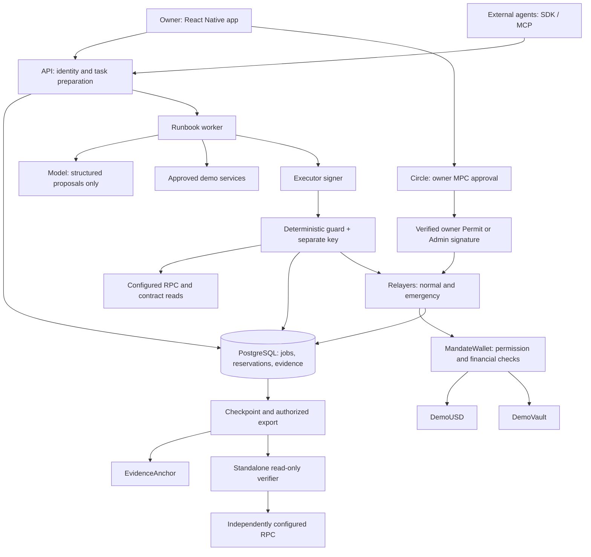

# Mandate Wallet — Architecture

**Implements [[PRD]] v3.0.** This is the engineering contract between the five workstreams. It specifies planned behavior; it is not a source-code audit, deployment record, or assurance of production safety. [[review]] records the design corrections and unresolved gates.

## 1. System, components, and trust boundaries



| Component | Responsibility | Cannot do |
| --- | --- | --- |
| Mobile / Owner Key F01 | Display scope, recompute hashes, initiate embedded approval, show status and stop controls. | Grant authority without owner signature. |
| API | Authenticate app users/agent tokens; validate requests; create drafts/challenges/jobs. | Expose owner PIN/key or generic signing endpoints. |
| Planner and runbook worker F04 | Interpret goals; choose eligible services; propose typed actions; persist progress. | Read signer credentials or supply arbitrary contract calldata. |
| Executor signer | Sign the approved Action schema for its assigned executor identity. | Sign owner Permit/Admin or substitute guard authority. |
| Execution Guard F03 | Independently load signed scope and chain state; check/simulate; sign exact actions. | Expand owner scope or grant an unknown template execution rights. |
| Contract: Task Permit / Shared Budget / Liquidity Reserve F02/F05/F06 | Hold assets, validate authority and counters, execute fixed operations. | Understand natural-language goals or prove off-chain service quality. |
| Relayers and Recovery Control F08 | Sponsor gas, persist/broadcast/reconcile executable transactions. | Change a signed action or authorize spending with relayer key alone. |
| Providers and Delivery Check F07 | Quote, verify payment, perform browser work, validate and retain signed results. | Supply wallet permissions or mark their own output sufficient without validation. |
| Evidence Inspector F09 | Export/recompute findings against trusted manifest and public chain. | Sign or spend; infer truth from a hash alone. |

**Compromise boundary:** executor alone cannot transact. Executor + guard can spend within an existing permit, including unwanted purchases to allowed recipients; immutable caps still apply. A whole-host compromise can acquire both ordinary execution keys and tamper with unanchored evidence. Owner signing UI, app binary, Circle authorization, contract correctness and chain/RPC assumptions remain trusted dependencies. A compromised app/API can try to mislead an owner into signing a different scope; MPC is not a defense against deceptive consent.

### Fixed stack and deployment

| Layer | Choice |
| --- | --- |
| Mobile | Expo SDK 54 with its matching React Native version; TypeScript; native development build; physical Android. SecureStore for app tokens, no embedded server secrets. |
| Owner provider | Circle User-Controlled EOA, PIN flow, `BASE-SEPOLIA`; adapter isolated behind `OwnerSigner`. |
| Server | Node 22, Fastify, Zod, viem, `pg`, PostgreSQL 16; PostgreSQL job leases and outbox. |
| Model | Existing OpenAI Responses structured-plan approach; one account-available model pinned in release configuration after an actual schema call succeeds. No financial tools directly exposed to it. |
| Contracts | Solidity 0.8.28, compatible pinned OpenZeppelin 5.x, Foundry; non-upgradeable. |
| Demo services | Fastify + Playwright Chromium; two provider identities; fixed sample targets. |
| Evidence | RFC 8785 canonical JSON; SHA-256 event chain; Ed25519 checkpoints; encrypted artifact volume. |
| Network | Base Sepolia 84532; one provisioned execution RPC and independently configurable inspection RPC. |
| Hosting | Docker Compose, distinct service accounts/secrets, HTTPS; API/provider public, signers/DB private. No Docker socket in containers. |

Pin exact package versions, compiler, deployed bytecode and model ID in lockfiles/manifest during the first integration gate. Do not invent a tested compatibility matrix before that gate.

## 2. Owner signing, authentication, and recovery

Circle documents user-controlled MPC with user authentication and Circle-hosted nodes. Here it signs **owner permissions and administration only**. Agent execution uses two ordinary signatures. [Key model](https://developers.circle.com/wallets/key-management).

1. Obtain test API key/App ID and GitHub `read:packages` credential for Android dependencies. Use `@circle-fin/w3s-pw-react-native-sdk` in an Expo development build. [Native setup](https://github.com/circlefin/w3s-react-native-sdk).
2. API creates a Circle user bound to the authenticated app account, then an EOA initialization challenge. Native UI handles PIN/recovery inputs. Never proxy plaintext PIN/security answers through our API.
3. Retrieve the owner address. Factory creates its wallet. The app checks chain, trusted factory, wallet bytecode/config, owner, token and vault before funding/approval. Trust the release manifest bundled with the app, not an arbitrary manifest returned by the API.
4. Mobile constructs/recomputes the exact typed Permit/Admin from reviewed terms. API creates the matching signing challenge and records the draft hash/challenge binding. Use Circle's typed-data signing flow. [Signature API](https://developers.circle.com/wallets/user-controlled/request-a-signature).
5. Mobile authorizes the challenge. Retrieve its completed signature; independently recover it against the original typed payload in both mobile/backend before relay. Reject mismatches and unexpected challenge/account IDs. Never treat a UI callback as sufficient evidence.
6. Relayer activates the permit; the worker waits for the configured inclusion threshold. Owner can close the app. New authority, revocation, unpause and recovery require owner approval.

**Gate:** physical-phone exact-signature recovery, cancel, stale challenge, account substitution and payload substitution checks. Determine which pre-sign payload details Circle exposes for PIN challenges. If the client cannot independently bind those details before approval, explicitly retain trusted API/challenge preparation in the threat model; post-sign mismatch detection alone does not prevent a malicious API using a wrongly obtained signature.

App authentication: two seeded demo users, Argon2id password hashes, rate-limited login, expiring 15-minute JWT, re-login on expiry. No fabricated production account system. Server-only Circle API key; issue sessions solely for the authenticated user's stored Circle ID. Redact session/encryption tokens from logs.

External agents use random 256-bit API tokens, hashed in DB, scoped to a wallet and optionally a task, with `read/prepare/run`, expiry and revocation. Tokens never authorize owner endpoints. A wallet-scoped prepare token can draft tasks, but cannot activate them. A task-scoped token cannot move to a different task.

Owner recovery: Circle handles access recovery under its documented process; contract recovery moves supported assets to the immutable owner. Our relayer can be replaced by another funded sender carrying a valid signed Admin. That does not remove the Circle signing dependency. Key export, owner rotation, arbitrary-token recovery and provider-independent recovery are not implemented claims. [Provider recovery](https://developers.circle.com/wallets/user-controlled/recover-account).

## 3. Contract specification

### 3.1 Contract inventory

| Contract | Required implementation |
| --- | --- |
| `WalletFactory` | One wallet per owner; fixed release config; public deploy-for-owner allowed, but funds/admin always belong to supplied owner. No central withdrawal privilege. |
| `MandateWallet` | Immutable owner, DemoUSD, DemoVault, guard and financial ceilings; permits, counters, fixed actions, epoch invalidation and recovery. No proxy, arbitrary call/delegatecall, Permit2 or generic EIP-1271 authorization. |
| `DemoUSD` | Six decimals; fixture faucet max 10 tokens per wallet per UTC day; valueless test asset. Faucet/admin powers disclosed. |
| `DemoVault` | Standard ERC-4626 shares over DemoUSD with exact assets and synchronous redemption; fixture controller can disable withdrawals. Use OZ virtual-share defense; do not implement custom share accounting. |
| `EvidenceAnchor` | Immutable authorized publisher; append-only events for checkpoint digest, wallet, task, sequence. No custody or power over wallet funds. |

Use OZ `EIP712`, `ECDSA`, `SafeERC20`, `ReentrancyGuard`. Shared-token daily counters count every PAY/TRANSFER across all permits. Owner recovery is separately identified and intentionally outside delegated spending limits. [EIP-712](https://eips.ethereum.org/EIPS/eip-712), [OZ cryptography](https://docs.openzeppelin.com/contracts/5.x/api/utils/cryptography), [vault mechanics](https://docs.openzeppelin.com/contracts/5.x/erc4626).

### 3.2 Signed objects and canonical encoding

Domain: `MandateWallet`, version `3`, chainId `84532`, verifyingContract = this wallet. Freeze the following fields/order in `packages/schema`; generate shared TypeScript/Solidity golden vectors. Token amounts are `uint256` serialized as decimal strings. Times are Unix seconds, addresses canonical lowercase in JSON, hashes `0x` prefixed.

```solidity
struct Permit {
    bytes32 taskId;
    address executor;
    bytes32 recipientsHash;
    bytes32 runbookHash;
    bytes32 conditionsHash;
    bytes32 scheduleHash;
    bytes32 exactActionHash; // zero = bounded autonomy
    uint8 operations;        // bits PAY=1 TRANSFER=2 DEPOSIT=4 WITHDRAW=8 CLOSE=16
    uint64 issuedAt;
    uint64 startsAt;
    uint64 expiresAt;
    uint64 epoch;
    uint32 maxActions;
    uint32 maxPaidActions;
    uint256 maxPayment;
    uint256 spendCap;
    uint256 liquidFloor;
    uint256 depositCap;
    uint256 withdrawCap;
    uint256 nonce;           // separate permitNonce
}
struct Action {
    bytes32 permitId;
    bytes32 requestId;
    uint8 operation;         // enum PAY=0 TRANSFER=1 DEPOSIT=2 WITHDRAW=3 CLOSE=4
    address target;
    uint256 amount;         // assets, except WITHDRAW = shares
    uint256 minOutput;      // DEPOSIT shares / WITHDRAW assets
    bytes32 invoiceId;
    bytes32 inputHash;
    uint32 period;
    uint64 issuedAt;
    uint64 deadline;
}
struct Schedule {
    address recipient;
    uint256 amount;
    uint64 start;
    uint32 interval;
    uint32 window;
    uint32 periods;
}
struct Admin {
    uint8 command; // PAUSE=0 UNPAUSE=1 REVOKE=2 RECOVER=3 RECOVER_LIQUID=4
    bytes32 permitId;
    uint256 nonce; // separate adminNonce
    uint64 issuedAt;
    uint64 deadline;
}
```

`permitId = EIP-712 Permit structHash`; signing uses the domain-separated digest. Distinct type names prevent cross-purpose signature use. `exactActionHash` is the typed `ActionIntent` struct hash of every Action field **except permitId**, in the same order. This avoids a circular hash dependency and binds request ID, target, amount, deadline and all other action parameters. Exact mode requires `maxActions=1`; after its successful financial action, mark the permit CLOSED atomically. CLOSE does not need to match exactActionHash.

Recipients: sorted unique address array, length ≤4, `keccak256(abi.encode(address[]))`; nonzero destinations and exclude wallet/token/vault as PAY/TRANSFER recipients. Schedule commitment: `keccak256(abi.encode(Schedule))`, or zero with entirely zero fields. Runbook and conditions commitments: SHA-256 of RFC 8785 canonical JSON, stored as bytes32. Runbook manifest includes ID, version, workflow/schema/validator file hashes and allowed operation mask. Conditions include target ID, requested checks, provider IDs/origins/keys, selection rule, freshness and stop limits. The contract commits to these JSON hashes; the guard validates their meaning. Both signatures and actual scope bytes appear in the export.

Provider `Invoice` fields, in order: `invoiceId:bytes32, taskId:bytes32, wallet:address, recipient:address, amount:uint256, inputHash:bytes32, issuedAt:uint64, expiresAt:uint64`. EIP-712 domain `MandateInvoice/1`, chain 84532, verifying wallet. For this demo the provider signing address equals its allowed payment recipient. Provider can otherwise be separated from payout identity in a future schema, not silently changed here.

### 3.3 Activation, invalidation, and lifecycle

```text
activatePermit(Permit, address[] recipients, Schedule, ownerSig)
execute(Action, executorSig, guardSig, Invoice, providerSig)
applyAdmin(Admin, ownerSig)
getPermit(permitId), getBudget(executor), usedRequest(requestId)
permitNonce(), adminNonce(), authorityEpoch(), paused()
```

Activation requires unpaused wallet; valid owner signature; matching current epoch and permitNonce; unused task/permit IDs; not revoked; nonzero executor; `issuedAt <= now`, `issuedAt <= startsAt < expiresAt`, `expiresAt-issuedAt <=24h`, `now<expiresAt`; limits within immutable ceilings; action count 1–20. Permit nonce increments only on accepted activation. Each task ID has one lifetime permit; changed authority creates a new task ID with an off-chain parent reference. Never renew authority under the same task to conceal extra budget.

Mode checks: RB01 allowed PAY/CLOSE only with `1<=maxPaidActions<=min(3,maxActions)`; RB02 DEPOSIT/WITHDRAW/CLOSE with spendCap/maxPayment/maxPaidActions zero and no recipients; RB03 TRANSFER/CLOSE only and both maxActions/maxPaidActions cover periods. Unused schedule fields/hash must be zero for RB01/RB02; RB03 requires a nonzero matching scheduleHash. Enforce operation-mask rules from constructor-fixed mappings of approved `runbookHash` values supplied to the wallet at deployment. Exclude unknown hashes; freeze three runbooks before public deployment. All masks contain CLOSE. Financial caps unused by a runbook must be zero. There is no administrator mechanism to install a new runbook hash into an existing wallet; future code versions require a new wallet/migration with owner consent. A pre-release repair therefore requires regenerating the manifest and deployment, not silently replacing code under an existing hash.

Admin uses its own nonce so delayed grant activation cannot block emergency commands. Validity is `issuedAt<=now<=deadline`, with lifespan ≤30min. REVOKE requires a nonzero permitId, all other commands zero. Revoking a known or pending permit records it as unusable. **PAUSE and both RECOVER commands set paused and increment authorityEpoch**, invalidating active permits and signed unactivated drafts from older epochs. UNPAUSE preserves the new epoch; old authority stays invalid. REVOKE affects one permit without changing unrelated authority. Unpause alone grants nothing.

Effective permit state = stored state plus epoch, expiry and wallet pause. Expiry need not generate an on-chain event. Do not erase counters/used IDs on pause, revoke, day rollover or completion.

### 3.4 Execution invariants

For every action, atomically:

1. Check unpaused wallet, active permit/current epoch, `startsAt<=now<expiresAt`; `issuedAt<=now<=deadline`, `deadline-issuedAt<=60s`, deadline≤permit expiry. Recover exact executor and immutable guard signatures. Verify operation bit and canonical unused fields. No caller privilege bypass.
2. Reject previously used request ID; PAY also rejects used invoice ID. For financial actions, require positive amount, financial/paid-action counts within permit, exactActionHash match when set. CLOSE is exempt from those amount/count/exact-action checks. Record counters/IDs before external transfer; any revert rolls all effects back. Paid-action count covers PAY/TRANSFER; financial-action count also covers DEPOSIT/WITHDRAW.
3. PAY: verify invoice signature and exact invoiceId/task/wallet/recipient/amount/input match; require `invoice.issuedAt<=now<=invoice.expiresAt`, lifetime ≤60s, and action deadline≤invoice expiry. Contract verifies signature/fields; guard additionally verifies that inputHash describes the approved target/checks. Count gross spend.
4. TRANSFER: fixed allowlisted destination and, for RB03, exact schedule terms and unused due period. Count gross spend. No unscheduled generic transfer runbook is exposed in this release.
5. PAY/TRANSFER: per-payment ≤permit cap≤0.50; permit spend≤2.00 or stricter; wallet UTC-day spend≤10.00; executor UTC-day spend≤5.00. Day = `block.timestamp / 86400`. Remaining liquid≥max(3.00, permit floor). Never let a refund restore these counters.
6. DEPOSIT: immutable vault only; assets deposited within cumulative cap; exact allowance, `deposit(amount,wallet)`, clear allowance; positive actual shares≥minOutput. Require post-deposit liquid floor and allocation rule below. No zero-share donation accepted.
7. WITHDRAW: immutable vault only; `redeem(shares,wallet,wallet)`; actual received assets≥positive minOutput and cumulative received assets≤withdrawCap. Compare actual balance/share deltas, not just return values. Assets never go to executor/provider. A standard vault revert leaves accounting unchanged.
8. CLOSE: zero target/amount/minOutput/invoice/input/period; requires its operation bit and valid signatures. Skip financial count limits so an exhausted permit can close; record CLOSED. If already expired/epoch-invalid, no close is necessary and execution may reject it. Closed permits never execute again.

Canonical fields: PAY has minOutput=0 and period=0; scheduled TRANSFER has minOutput/invoiceId/inputHash=0; vault actions have invoiceId/inputHash/period=0. Non-PAY passes empty invoice and signature. Unknown operations reject. Each successful action emits digest plus permit/request IDs, operation, recipient/target, actual asset/share deltas and invoice/input IDs.

Allocation after deposit: `vaultAssets=convertToAssets(balanceOf(wallet))`; `vaultAssets*10000 <= (liquid+vaultAssets)*2000`. This is a **deposit admission limit**, not a perpetual ratio guarantee. Subsequent payments can raise the ratio; no forced sale is triggered. Guard blocks further deposits and reports the change. Fixture valuation cannot establish market liquidity, oracle correctness or mainnet protocol safety.

Guard computes positive minOutput from a fresh vault preview, allowing at most 50 basis points adverse difference with explicit integer rounding and a minimum of one unit. The contract enforces the signed minOutput; it does not independently guarantee the off-chain 50bp derivation. Owner exact-action mode binds minOutput; delegated compromise can choose poorer bounds within the remaining on-chain envelope. Token/vault fixture is immutable and non-rebasing with no transfer tax.

Schedule checks at activation: positive amount/interval; amount≤maxPayment; `0<window<=interval`; 1–20 periods; start≥permit startsAt; final window ends≤permit expiry; amount×periods≤spendCap; recipient allowlisted. At execution: period p<periods, `start+p*interval <= block.timestamp < start+p*interval+window`, unused period, exact amount/recipient. Missed periods cannot execute later. Arithmetic uses checked operations.

### 3.5 Owner asset recovery

RECOVER invalidates authority first, attempts a bounded-gas external redemption of `maxRedeem(wallet)` in try/catch, then transfers available DemoUSD to immutable owner. Emit the actual recovered amount and any vault failure. Do not assume all shares are redeemable. RECOVER_LIQUID skips the vault and moves only liquid DemoUSD; it is the reliable escape from a reverting vault dependency. Both work while paused and intentionally bypass the delegated liquid floor. Recovery does not imply lost owner-key recovery or retrieval of unsupported accidentally sent assets.

## 4. API, schemas, and durable state

### API surface

Every mutation uses `Idempotency-Key` UUID scoped to principal + route; store payload hash and response. Same key/different payload → 409. Amounts are decimal integer strings. Tenant ownership is checked on every resource, including artifact download.

| Route | Capability / response |
| --- | --- |
| `POST /auth/login` | Password → expiring app JWT. |
| `POST /owner/session`, `/owner/initialize` | Owner-only bound Circle session/challenge. |
| `POST /wallets` | Owner-only wallet deployment; returns pending receipt/address. |
| `POST /tasks` | Prepare scope → runbook draft, interpreted conditions, task ID. |
| `POST /permits/draft` | Owner/prepare → immutable proposed scope + typed Permit; no signature. |
| `POST /permits/:id/challenge` | Owner-only reviewed digest → Circle challenge. |
| `POST /permits/:id/activate` | Owner-only completed challenge → verified signature and activation transaction. |
| `POST /tasks/:id/run` | Run scope, active matching permit → queued job. |
| `GET /tasks/:id`, `/wallets/:id` | Read scope → state, funds, reservations, findings. |
| `POST /wallets/:id/admin/draft` | Owner-only exact Admin; pause/revoke requests immediately inhibit affected local signing. |
| `POST /wallets/:id/admin/challenge`, `/admin/submit` | Owner-only reviewed digest/challenge → signature verification + emergency relay. |
| `GET /tasks/:id/evidence` | Authorized read → export; private artifacts need owner's export permission. |
| `POST /agent-tokens`, `DELETE /agent-tokens/:id` | Owner-only token creation/revocation. |

Common error codes: `AUTH_SCOPE`, `PERMIT_INACTIVE`, `SCOPE_MISMATCH`, `RUNBOOK_VERSION`, `RECIPIENT_DENIED`, `PAYMENT_CAP`, `DAILY_CAP`, `LIQUID_FLOOR`, `RESERVATION_CONFLICT`, `QUOTE_EXPIRED`, `DUPLICATE_REQUEST`, `SCHEDULE_WINDOW`, `STALE_SIGNAL`, `SIMULATION_REVERT`, `SETTLEMENT_UNKNOWN`, `DELIVERY_INVALID`, `EVIDENCE_UNAVAILABLE`. Return rule ID, safe explanation, retry class and related action ID. Never return key material or sensitive provider bodies in errors.

### Minimal persistent model

```text
users(id, password_hash, circle_user_id)
wallets(id, user_id, owner_address, contract_address, chain_id, signing_inhibited)
agent_tokens(id, wallet_id, task_id, scopes, token_hash, expires_at, revoked_at)
idempotency(principal_id, route, key, payload_hash, response_json)
permits(id, wallet_id, task_id, typed_json, scope_json, signatures, state, activation_tx)
tasks(id, parent_task_id, wallet_id, runbook_hash, goal, acceptance_json, plan_json,
      outcome_state, authority_state, deadline, paid_attempts)
actions(id, wallet_id, permit_id, request_id, typed_json, invoice_json, state,
        invoice_id, period, is_scheduled, reservation_units, created_at)
clearances(action_id, action_digest, guard_signature, inputs_json, results_json)
transactions(id, action_id, purpose, relayer_address, nonce, raw_tx, tx_hash,
             replaced_by, state, receipt_json, fee_estimate, actual_fee)
jobs(id, kind, payload_json, state, lease_until, attempts)
events(wallet_id, task_id, sequence, type, payload_json, prev_hash, event_hash)
artifacts(id, task_id, encrypted_path, digest, salt, created_at, expires_at)
checkpoints(wallet_id, task_id, sequence, head_hash, signature, anchor_tx)
```

Unique keys: wallet/request; wallet/non-null invoice; permit/period for scheduled transfers; task/sequence; relayer/nonce for a transaction lineage (replacements are child records); principal/route/idempotency key. Active action proposal/scope becomes immutable after reservation; changed inputs get a new proposal and fresh checks, never an overwritten signature-bearing object.

Separate statuses: task outcome `DRAFT/AWAITING_OWNER/READY/RUNNING/COMPLETED/DELIVERY_FAILED/NEEDS_OWNER/CANCELLED`; authority `PENDING/ACTIVE/CLOSING/CLOSED/REVOKED/EXPIRED/INVALIDATED`; action `PROPOSED/RESERVED/CLEARED/SIGNED/SUBMITTED/INCLUDED/FINALIZED/DENIED/REVERTED/UNKNOWN`. Result completion can precede authority closure and chain finality. UI must preserve those distinctions.

### Reservations and accounting

Within one DB transaction, lock wallet and permit rows, check signed scope/current state, reserve funds, append the proposal event and enqueue the next job. Never sign if durable storage is unavailable. Use integer arithmetic.

`spendableNow = max(0, onChainLiquid - effectiveFloor - notYetIncludedOutflows)`.

`remainingBudget = cap - finalizedSpend - provisionallyIncludedSpend - unresolvedReservations`.

Categories are disjoint: a payment appears in only one. Match the chain snapshot block to reconciled spend. Settled daily spend uses execution block day; unresolved reservations conservatively count against the current day. UTC rollover does not release them. Deposits preserve outstanding spending reservations; pending deposits reserve liquid too. Pending withdrawals do not create spendable liquidity until included. No speculative borrowing from future redemptions.

Serialize outstanding financial actions per wallet for the prototype. Accept concurrent task requests, reserve atomically, then queue them. On-chain counters still protect against direct concurrent submissions outside this queue. These counters do not guarantee backend reservation fairness after both execution keys are compromised.

## 5. Guard, signing, and transaction recovery

### Non-circular execution flow

```mermaid
sequenceDiagram
    participant W as Worker
    participant D as Durable store
    participant E as Executor signer
    participant G as Guard
    participant R as Relayer
    participant C as Chain
    W->>D: Persist immutable proposal and reserve
    W->>E: Sign exact Action under assigned identity
    E->>G: Action ID + executor signature
    G->>D: Load and verify signed scope, reservation and runbook
    G->>C: Read current authority, balances and counters
    G->>G: Check rules; produce guard signature in memory
    G->>C: Simulate full execute call with both signatures
    G->>D: Persist clearance and evidence if simulation passes
    G->>R: Release checked signed Action
    R->>D: Persist nonce, serialized tx and hash
    R->>C: Broadcast same bytes
    R->>D: Reconcile receipt, fees and finality
```

Guard never exposes a generic signing method. Internal authenticated `/clearance` takes an action ID and executor signature, not caller-provided `allowed=true`. It reloads the original owner signature, scope hashes and manifest version; independently reads chain; verifies provider signature and input commitment; recomputes budgets/reservations; rejects unknown/malformed/stale inputs. Pin balance/counter/preview reads to one latest block and retain its hash; if that block is older than 15 seconds, stop for RPC recovery. It prepares its signature internally, simulates exact execution, then persists and releases it only on success. Simulation is a current-state check; contract enforcement remains authoritative at inclusion.

Use two executor identities in the shared-budget scenario. Ordinary signer keys are isolated service secrets, not in the model worker environment. Demo separation protects against some process mistakes, not privileged host access. Guard DB role reads inputs and appends clearance; runtime event writer cannot UPDATE/DELETE events.

### Broadcast and uncertain settlement

1. Normal relayer serializes nonce allocation using a DB lock. Persist complete signed transaction bytes/hash/nonce before network submission. Crash retry broadcasts identical bytes.
2. Emergency relayer has its own funded EOA/nonce lane for owner Admin, so a stuck normal nonce cannot prevent a pause. Contract signatures allow any sender. Emergency lane has no independent wallet authority.
3. Poll every 2s. At 60s unresolved, mark UNKNOWN and retain reservation; at 120s show owner attention. Continue reconciliation. No automatic payment at a new nonce.
4. Fee replacement keeps the same sender nonce and exact business calldata; record every hash. Check request/invoice usage and receipts across replacements before concluding failure.
5. After 3 canonical confirmations mark INCLUDED and permit demo delivery/dependent work. This is provisional. Mark FINALIZED only after receipt block/hash is covered by the RPC's finalized head; if unavailable, leave PENDING finality. Do not infer finality from elapsed seconds. [Base finality](https://docs.base.org/specifications/transactions/transaction-finality).
6. Reorg returns consumed amounts to unresolved status; withdraw-dependent actions are paused and chain state re-read. Already delivered services may become unpaid; flag and escalate, never blindly repay. Never alter a provider receipt to hide a reorg.
7. Release unused reservation only after known reverted execution, cancellation before an executable signature pair exists outside the guard, or confirmed invalidation plus complete reconciliation proving no successful earlier inclusion. A documented guard denial with no stored/released guard signature can release its reservation; an executor signature alone is insufficient to execute. After a crash leaves signature release uncertain, treat the pair as potentially released. If RPC/history is insufficient, retain UNKNOWN. Expiry or failed broadcast alone is insufficient.
8. On restart, reconcile unfinished actions before allowing new spending. Close successful bounded tasks through CLOSE; if delayed, outcome can be COMPLETED while authority stays CLOSING. Expiry/epoch invalidation/revoke also ends authority. Anchor after terminal chain state or explicitly label provisional evidence.

### Fees and availability

Estimate L2 execution **and L1 data fee** for the serialized transaction, with a 20% admission buffer. Default normal admission ≤0.0005 ETH per tx; combined daily service allowance 0.02 ETH, of which 0.002 is reserved for emergency administration. Normal actions and anchors cannot use that emergency portion. Reserve pending fee estimates atomically across relayers; reconcile actual receipts including L1 charges. These are service admission controls, not an on-chain guarantee of exact final cost. EIP-1559 L2 caps alone do not cap Base's full fee. [Base fees](https://docs.base.org/specifications/transactions/network-fees).

If DB, guard or RPC is unavailable, stop new signing. If Circle is unavailable, active permits may continue until stopped/expired, but new owner authorizations cannot complete. If emergency fee reserve is depleted, display the failure and allow an independently funded relay of the signed Admin. No guarantee of instant stop while chain/provider access is unavailable.

## 6. Runbooks, providers, and SDK/MCP

Runbook manifest commits executable file hashes and validator schemas; the skill is explanatory text. Permit approval pins the runbook hash. Worker/guard refuse version mismatch. Do not auto-install a skill or execute returned code from a provider.

```text
runbooks/browser-check/v1/{manifest.json,input.schema.json,output.schema.json,
                          plan.ts,buildAction.ts,validateResult.ts,SKILL.md}
runbooks/liquidity-keeper/v1/{same files}
runbooks/scheduled-pay/v1/{same files}
```

Planner receives goal, approved catalog and current budgets; returns `Plan{runbookId,requiredChecks,candidateProviderIds,purchaseRequired,reason}`. Zod validates it; missing/ambiguous checks return to owner before approval. After activation, planner cannot silently add/remove required checks. Eligible service selection uses capability subset, valid quote and caps, then lowest price and provider-ID tie-break. Bounded fallback excludes providers that failed delivery for this task. Refusal/incomplete model output → NEEDS_OWNER. Persist short reasons/observable inputs, not private chain-of-thought.

### Demo provider contract

```text
GET  /catalog
 -> [{providerId,origin,recipient,checks,priceUnits,catalogVersion}]
POST /providers/:id/check {taskId,wallet,targetId,checks}
 -> 402 {invoice,providerSignature,inputHash}
POST /providers/:id/result {invoiceId,paymentTxHash,requestId}
 -> 202 {state} | 200 {result,receipt,receiptSignature}
```

The HTTP 402 flow is **our custom signed-invoice adapter**, not a claim of x402/MPP compatibility. Two identities in one server represent independent demo counterparties; they are not independent businesses. A/B normally cost 0.20/0.35; fixture controller varies price/capability/timeout/malformed output to exercise actual choices. Catalog membership is an allowlist, not a reputation score. Provider mutation/result endpoints require the authenticated worker service identity; invoices are bound to its wallet/task requests. A public transaction hash alone must not grant access to private output. No claim of account-free production interoperability follows from this demo adapter.

`inputHash=SHA256(canonicalJSON({taskId,targetId,checks}))`, with sorted unique check names. An invoice pins exactly that request. Retrieval verifies successful receipt, deployed wallet, ActionExecuted fields and corresponding DemoUSD Transfer log, canonical block, amount/recipient/input, and 3 confirmations. Cache results by invoice; repeated retrieval does not charge again. Never accept a transaction merely because its hash exists.

Playwright actually opens one of two approved staging fixtures and checks page load, title and test-form submission. Serve fixtures at two explicit HTTPS origins; allowlist origins/redirects and their pinned addresses, blocking loopback/link-local/cloud-metadata/private-network destinations and uncontrolled subresource egress. Do not accept arbitrary user URL or executable selectors/code. Demo result includes ordered assertions, checkedAt, targetId, inputHash and screenshot SHA-256.

Provider signs an EIP-712 `DeliveryReceipt` under `MandateDelivery/1` for wallet/chain, fields `invoiceId,requestId,inputHash,resultHash,paymentTxHash` (bytes32), `completedAt` (uint64). `resultHash=SHA256(canonicalJSON(result))`. Delivery validator verifies signature, exact IDs/fields, matching completedAt/checkedAt, and ≤5min output age relative to recorded retrieval time (reject timestamps more than 5 seconds in the future), then retained artifact bytes. At later inspection, evaluate freshness at original retrieval time, not at audit time. A negative assertion is an observed result, not malformed delivery.

This proves consistency with a provider-signed statement and retained artifacts. It does not independently prove the provider actually visited a remote website. The controlled demo also retains browser execution logs; production claims require stronger provider evidence or independent checks. A screenshot hash alone is not proof of website correctness.

RB02 consumes `{vault,observedAt,riskStatus:NORMAL|WARNING}` from the labelled fixture controller and chain balance/preview/maxRedeem. Deposit requires NORMAL and age≤60s; warning/staleness blocks it. Withdrawal needs a separate active asset permit and fresh chain state, regardless of an agent's recommendation. RB03 uses chain time and signed schedule windows; missed periods are skipped.

SDK methods: `createTask`, `getTask`, `runTask`, `getWallet`, `getEvidence`. MCP tools mirror them with schema validation and a scoped token. Skill guides document authorization handoff, status polling, stable idempotency keys, runbook inputs, denial handling and stop conditions. No `signAnything`, raw transfer or owner-admin tools. SDK/MCP users need our credentials only; Circle credentials remain internal to owner onboarding/approval.

## 7. Evidence Trail and inspection

### Durable records and anchoring

Every event contains `{walletId,taskId,sequence,type,requestId,permitId,recordedAt,payload,prevHash,eventHash}`. Null action identifiers are allowed for task-level events. Under a task-row lock, allocate a monotonic sequence and append. Initial previous hash = 32 zero bytes. `eventHash=SHA256(RFC8785(event excluding eventHash))`. Corrections append a referenced event; never rewrite history.

Record: goal/approval interpretation; exact owner signature and scope; plan/quotes; rule inputs/results; reservations; action/signatures; submission attempts; receipt/fees/finality; delivery results; recovery; closure. Denials/reverts are off-chain events because reverted contract calls cannot retain their own logs. DB insert-only permissions discourage accidental alteration but privileged DB access can still change unanchored records.

Artifact encryption: AES-256-GCM, fresh random 96-bit IV, authenticated metadata including task/artifact ID, dedicated protected key. Private storage commitment = `SHA256(random32ByteSalt || plaintext)`. Provider's unsalted screenshot/result digest remains within authenticated off-chain evidence; only the resulting checkpoint commitment goes on-chain. Authorized export includes bytes/salts needed to verify. Avoid confusing provider digest and salted storage digest.

Checkpoint message canonical JSON: `{schemaVersion:3,chainId,wallet,taskId,sequence,headHash}`. Sign bytes with dedicated Ed25519 audit key. `checkpointDigest=SHA256(canonicalMessage)`. `EvidenceAnchor.publish(wallet,taskId,sequence,checkpointDigest)` requires `msg.sender` to be its immutable publisher EOA. That separately funded publisher sends the anchor transaction through the same durable transaction journal with its own nonce lane; it is not an ordinary relayer impersonating the publisher. Anchor fees consume the normal portion of the shared service budget. Publisher is distinct from guard/executor; its key cannot move wallet funds. Keep monotonically increasing sequence per wallet/task and all earlier anchor events. No self-referential anchor hash inside its own checkpoint; anchor reference is envelope metadata or a later event.

Anchor at terminal task/authority state. If a payment/closure is unresolved, export an explicitly provisional checkpoint and anchor the later final sequence after reconciliation. This is per-task anchoring; live periodic Merkle batching is deferred. A finalized anchor establishes that this digest was published, not the completeness/truth of its contents. Daily checkpoint/backups aid operations but do not substitute for independently retained manifests/anchors.

### Export and independent inspection procedure

Export schema includes full signed Permit/Admin/Action/Invoice/DeliveryReceipt; scope/runbook manifests; events and snapshots; artifacts or explicit omission reasons; checkpoint/signature/anchor references; all transaction replacement hashes; windowStart=wallet deployment block and windowEnd=chosen canonical inspection head. Public deployment manifest/audit key must come from a trusted release, **not solely from the export being checked**.

| Finding | Procedure | Limit |
| --- | --- | --- |
| **Integrity** | Recompute sequence/hash chain and artifact digests; verify checkpoint signature and chain anchor match. | Unanchored tail → PENDING; missing bytes → UNVERIFIABLE; cannot detect all pre-anchor omissions. |
| **Authority** | Recover signatures/domains, runbook/scope hashes; reconstruct activation, epochs, close/revoke and validity in transaction/log order. | Signature proves key authorization, not that the app explained it honestly. |
| **Policy** | Recompute task/day counters and fixed contract checks using chain history; inspect recorded guard rules and contemporaneous inputs. | DB reservations/rate limits/signals are recorder evidence; mark their independent proof level explicitly. |
| **Settlement** | Query receipts/canonical blocks/finality; match action digest and token movement; enumerate all wallet outgoing token transfers and actions from deployment through windowEnd. | Flag unmatched activity, including transfers lacking expected wallet events. RPC completeness remains a dependency. |
| **Delivery** | Verify provider receipt/signature, result binding, schema, original freshness and retained bytes. | Provider statements and screenshots do not guarantee truthful execution or subjective quality. |
| **Completion** | Apply pinned validator to the owner-approved acceptance checks and each operation outcome; inspect closure separately. | Ambiguous requirements need owner review; missing artifacts cannot become a pass. |

Each finding uses PASS/FAIL/PENDING/UNVERIFIABLE plus rule ID, reason, evidence references and basis (`chain`, `signature`, `artifact`, `recorder_assertion`). A claim whose only available basis is an uncorroborated backend assertion is marked UNVERIFIABLE for independent proof, even if internally consistent. Report subchecks; do not collapse everything into one green badge. Integrity failure taints dependent off-chain findings but does not erase independently verified chain facts.

For historical counters, scan and replay known wallet events/token transfers in canonical order; verify counters against available state reads. A range containing only the current task cannot prove wallet-wide daily allowance. Document any pruned history or incomplete scan. Zero-value or unrelated-token activity is separately classified, not silently treated as supported recovery.

CLI takes `export.json`, trusted `deployment.json`, `--rpc`; produces JSON/Markdown without backend credentials or spend authority. Demo alters only a copy of an anchored export. Owner-authorized artifacts retained 30 days; expired/deleted bytes produce a visible evidence gap. Prompts, PINs, tokens and personal data never go on-chain; public addresses and activity remain visible despite encrypted artifacts.

## 8. Repository, handoffs, and implementation gates

```text
apps/mobile/src/{onboarding,wallet,permits,tasks,assets,schedules,inspector}/ D
apps/api/src/{auth,circle,routes}/                                        C
apps/worker/src/{planner,runner,scheduler,reconcile}/                      B/C
apps/executor/src/signer.ts                                              C
apps/guard/src/{checks,simulation,signer}/                                C
apps/relayer/src/{normal,emergency,fees,nonce}/                            C
apps/provider/src/{catalog,invoice,checks,result,fixtures}/                E
apps/mcp/src/server.ts                                                   E
packages/contracts/src/{WalletFactory,MandateWallet,DemoUSD,
                       DemoVault,EvidenceAnchor}.sol                     A
packages/schema/src/{permit,action,invoice,receipt,event,status}.ts       A/C
packages/sdk/src/client.ts                                               E
packages/verifier/src/{integrity,authority,policy,chain,delivery}.ts       E
runbooks/{browser-check,liquidity-keeper,scheduled-pay}/v1/                B/E
infra/{compose.yaml,migrations/001.sql}/                                  C
deployments/base-sepolia.json                                             A
evidence/{transactions,task-export,verification,evaluation}.json           E/C
docs/{deployment,security-self-assessment,algorithm}.md                    All
```

| Gate | Required handoff |
| --- | --- |
| G1: owner + schemas | A/C/D agree all EIP-712 vectors, runbook/conditions hashes and signature recovery; physical-phone gate passes or explicit limitation recorded. |
| G2: contracts | A supplies ABI/config and local invariant results: caps, replay, wrong action, epoch, exact approval, vault floor, recovery. |
| G3: purchase | C/E wire invoice→reservation→signatures→chain→provider; B/D add real goal/approval/output. Public-testnet T01 passes. |
| G4: operations/evidence | A/B/C complete vault/schedule/recovery; E verifies exports independently; SDK/MCP run the same path. |
| G5: release | Defined PRD suite, source rebuild/APK, security report, matching evidence manifest, timed English demo/deck. |

Implementation tests must include direct contract bypass, contract invariants, signer/tenant isolation, crash-point recovery, midnight rollover, reorg simulation, vault rounding/donation, exact-action substitution, old-epoch activation, and inspection tampering. Review by a second team member before public deployment. This document revision did not execute those tests.

Deployment manifest: chain/genesis/config; deployment blocks; addresses/code hashes/ABIs; immutable constants; owner/executor/guard/provider/audit/publisher public keys; runbook/schema versions; accepted fixture origins; package/model versions; tagged source. Bundle it in app/verifier and retain a release copy outside the runtime host.

Secrets: Circle key, native-build PAT, JWT signing key, per-executor keys, guard key, relayer keys, provider keys, checkpoint/publisher keys, artifact encryption key. Load per-service only; never commit/export. Back up DB/artifacts with separate access; after uncertain restore, reconcile chain before resuming. A guard-key loss cannot be repaired by silently changing immutable guard: pause/recover using owner authority and deploy a new wallet.

Production gate after competition: independent contract audit, stronger signer/host isolation, authenticated production users, tested key-loss/provider-outage recovery, real service adapters and customer validation. The demo's single chain/token/vault and two controlled providers do not establish production breadth or security certification.
