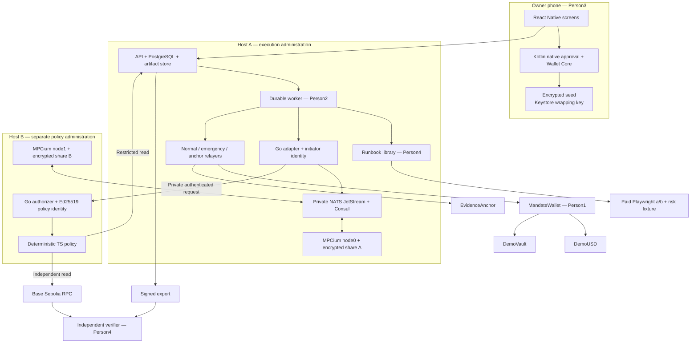
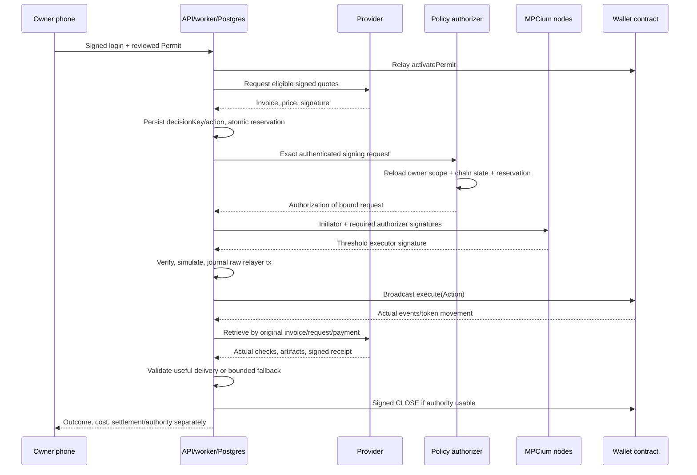

# Mandate Wallet — implementation architecture

> Repository bootstrap added 2026-10-17. Read [README](README.md) and [setup](docs/SETUP.md) for existing foundation files. Continue from that code; financial features and acceptance gates remain unimplemented.

**Read [FINAL PLAN](FINAL%20PLAN.md) for assignments/gates.** Four handoffs include the identical interface contract reproduced below. Documentation version5 replaces cb-mpc/five-owner architecture; EIP-712 domain remains4, receipt schema4. No executable code was built by writing these documents.

## A1. Deployment and authority



Policy uses restricted direct DB reads, not a trusted API verdict. Diagram's API box includes Postgres. Both nodes verify initiator and required authorizer before participating; authorizer does not replace a threshold share. Owner signs Permit/Admin; executor signs Action; relayers pay gas only. Provider keys sign quotes/output and receive test payments. Evidence key signs checkpoint, publisher anchors it; neither has owner authority.

Host A and B have separate administrators/access credentials/share encryption/backup keys. Actual ability of one person to access both is documented; two containers under one root account are a development topology, not independent compromise domains. NATS/Consul can cause availability failure; quorum cannot sign through node outage. Owner can stay offline during active delegated work because online hosts remain available.

## A2. MPCium integration

Pin `fystack/mpcium` commit `90e3ee3c15e6698ade5626ff6c6b49d2453d8ce2`, Go1.25.8 and its replaced Fystack tss-lib dependency. Two nodes, `mpc_threshold:1` because inspected consumer requires t+1. G1 must actually demonstrate this deployment, signature recovery, either-node-alone failure and required-authorizer rejection. The repository's security/threshold marketing is not deployment evidence.

No custom cryptographic protocol/round transport/DER wrapper. Upstream provides distributed keygen, threshold signing, NATS coordination, Consul discovery and encrypted share storage. One DKG per wallet executor; unused HD functionality still requires common32byte chain_code. Empty derivation path; no shared derived customer key hierarchy. Ed25519 initiator identity and policy authorizer identity authenticate/authorize MPC requests; neither is Ethereum signing key.

Both nodes use authorization.enabled=true, nonempty required_authorizers=[mandate-policy-v1], same trusted authorizer public key. Startup/readiness checks fail if missing. Upstream permits no-authorizer requests when list empty: never rely on enabled flag alone. Administrative keygen is separately authorized; no public reshare endpoint. Lifecycle after loss is owner stop→fresh DKG→new executor→new owner Permit, not unqualified share refresh/full-key reconstruction.

Adapter loads immutable actionId, recomputes original EIP712 digest, builds upstream SignTxMessage (secp256k1,registered walletId,attempt UUID,`eip155:84532`,Tx exact32bytes,nil path), signs Raw with A's Ed25519 initiator. B verifies that signature and independently reconstructs all fields from approved records/current chain. TS policy checks scope/rules/reservation; Go authorizer signs upstream ComposeAuthorizerRaw. Adapter attaches authorization; Go client's repeated Ed25519 request signature must be identical. Subscribe before publish; stable unique ClientID; response correlation wallet/attempt/key/digest. Node0+node1 yield R/S/recovery; vetted normalization/recovery produces canonical65byte signature matching expected executor. No digest rehashing.

No generic signing HTTP route; internal endpoints accept actionId only except authenticated B authorization carrying reconstructible message. Per-key signing serialized. Persist attempt/action/digest/keyVersion/status; upstream fresh session nonce on retries, no restored ephemeral state or custom offline nonce/preprocessing cache. Uncertain result remains potentially executable and holds reservation. Contract deadline/replay/epoch protect delayed signed actions; authorizer message itself has no independent action expiry field.

All infrastructure private and authenticated. Release transport is a private authenticated encrypted tunnel between hosts, service firewalls/credentials/ACLs, node message identities and TLS where verified supported by pinned clients. Public NATS/Consul/Badger access forbidden. Separate encrypted long-term backups; restore isolated with signing disabled then reconcile chain/session/journal. No independent audit of this integrated stack established.

## A3. Transaction and task algorithm



Runbook advance is library logic owned by Person4, called by Person2 durable leased worker; it returns proposal/wait/complete/failure and nextState. Task+decisionKey uniqueness controls logical action identity. Agent never directly sets signature, chain nonce, executor or raw calldata. Runbook/conditions hashes bind exact reviewed software/input; no runtime attestation is claimed.

Reservation transaction locks wallet/permit; chain-included gross totals plus disjoint unresolved reservations, never finalized+included double count. Liquid minus floor minus not-included outflows gives available funds. Pending deposits reserve, pending withdrawal does not fund a purchase. Refund does not decrease gross; unresolved requests carry into current admission day until reconciled. One outstanding financial tx/wallet, separate normal/emergency/anchor sender nonces.

Persist raw signed tx/hash/nonce before broadcast; retry same bytes, replacements same nonce/business calldata with full lineage. INCLUDED after3canonical confirmations allows delivery; FINALIZED from finalized head.60s UNKNOWN/120s attention retain reservations. Reorg blocks dependents and reconciles. Release reserved amount only after known revert, no usable signature ever released, or confirmed invalidation plus complete past-chain reconciliation; expiry/broadcast error alone does not establish no earlier payment.

## A4. Owner app and escape path

Wallet Core JNI generates/imports native12word BIP39 owner at Ethereum standard path. AES256GCM seed storage under authenticated Android Keystore wrapping key; no words/private key crosses RN bridge/server, no raw-sign method. Native confirmation verifies typed schema/domain/trusted deployment, recomputes scope/recipient/schedule/code hashes and displays actual terms. Cancellation no signature. Keystore protection is for wrapping key, Ethereum key enters native memory for signing; rooted process remains threat.

Login EIP712 one-use≤5min challenge issues15minJWT. Agent tokens read/prepare/run/evidence scopes, wallet/task restrictions, expiry/revocation, no Admin. Native owner key and words restore independent of services. API-offline native screen discovers wallet via trusted factory/RPC, verifies owner/config, reads fresh adminNonce, locally signs Admin, exports signed command deliberately. Independent funded CLI sender simulates/submits through another RPC with no owner secret/backend. Owner must still have chain access and gas sponsor. Lost device+words has no server recovery.

## A5. Evidence and independent findings

Writer uses RFC8785SHA256 event chain, encrypted retained artifact commitments, Ed25519 checkpoint and on-chain anchor, exact schema below. Append corrections, never rewrite. Export contains authentic scope/signatures, immutable actions/invoices, transaction lineage, output/receipts/bytes, closure/governance and public signing metadata. Private MPC material/owner words/tokens/hidden model reasoning excluded.

Independent CLI uses separately trusted keys/contracts and its own RPC. Six findings separately verify integrity/authority/policy/settlement/delivery/completion. Some reservations/rate/risk/MPC-protocol claims remain independently unverifiable assertions; correct reporting of that is acceptance, not failure to achieve six green badges. Provider signature proves identity of claim, not honest browser execution. Anchoring commits published history, not truth/completeness of every original record. Full supported-asset outflow history from deployment is inspected for unmatched events; missing history explicitly limits results.

## A6. Implementation references and proof status

- [MPCium pinned source](https://github.com/fystack/mpcium/tree/90e3ee3c15e6698ade5626ff6c6b49d2453d8ce2), [threshold consumer](https://github.com/fystack/mpcium/blob/90e3ee3c15e6698ade5626ff6c6b49d2453d8ce2/pkg/eventconsumer/sign_consumer.go), [authorizer implementation](https://github.com/fystack/mpcium/blob/90e3ee3c15e6698ade5626ff6c6b49d2453d8ce2/pkg/identity/identity.go), [request serialization](https://github.com/fystack/mpcium/blob/90e3ee3c15e6698ade5626ff6c6b49d2453d8ce2/pkg/types/initiator_msg.go).
- [Wallet Core Android](https://developer.trustwallet.com/developer/wallet-core/integration-guide/android-guide), [Android Keystore](https://developer.android.com/privacy-and-security/keystore), [EIP712](https://eips.ethereum.org/EIPS/eip-712), [OZ ERC4626](https://docs.openzeppelin.com/contracts/5.x/erc4626), [Base finality](https://docs.base.org/specifications/transactions/transaction-finality).

Available primitives and inspected source support these choices. Actual compatibility/security/recovery results must be produced at G1–G5. Neither source browsing nor this document proves the implementation already works.

---

# Exact shared implementation contract

The following text is reproduced identically in all four handoffs; its SHA256 is listed in the handoff package manifest. It defines the interfaces beyond the architectural overview.

## Shared implementation contract — included in all four handoffs

This appendix is identical in the four documents. It is specification version 5, dated 2026-10-17. On-chain EIP-712 domains remain version **4**, and receipt schema remains **4**: the MPC engine and team allocation changed, not the signed Solidity fields. Never change an interface in only one component. Person 1 owns `packages/schema`; consumers propose a change and update its fixtures before merging.

### S1. Product, boundary and ownership

Build **Mandate Wallet**: an Android owner wallet delegates bounded tasks to an online agent; the agent buys real browser checks, operates one approved test vault and makes fixed scheduled payments. Payments and useful delivery are recorded separately. An independent verifier reconstructs permission, spending and delivery from an export and public chain data.

| Person | Sole write ownership                                                                                                                  | Outputs consumed by others                                                                        |
| ------ | ------------------------------------------------------------------------------------------------------------------------------------- | ------------------------------------------------------------------------------------------------- |
| 1      | `packages/contracts`, `packages/schema`, `deployments`, root workspace/CI configuration                                               | ABI, schemas, fixtures, deployment manifest, chain validation                                     |
| 2      | `apps/api`, `apps/worker`, `services/policy`, `services/mpc-adapter`, `services/mpc-authorizer`, `infra`, migrations, evidence writer | Public API, durable execution, two-node MPCium, policy authorization, exports                     |
| 3      | `apps/mobile`, `modules/owner-wallet`, `tools/relay-admin.ts`                                                                         | Native owner wallet and signed authority, installed APK, independent recovery sender              |
| 4      | `packages/runbooks`, `apps/provider`, `packages/sdk`, `apps/mcp`, `packages/verifier`, `demo`, `evaluation`, submission assembly      | Runbook driver, paid browser services, integrations, standalone inspector, recorded demonstration |

Person 2 owns the worker process; Person 4 supplies its runbook library. Person 2 writes evidence; Person 4 verifies it independently. Person 1 owns ABI/schema generation; other owners never hand-maintain copies. Each owner supplies tests, deployment instructions, known risks and screenshots/logs for their own deliverable. No unassigned fifth person is required.

Use one monorepo `./`, Node 22, TypeScript, pnpm workspaces with a checked-in lockfile; Solidity 0.8.28/OZ 5.x/Foundry; PostgreSQL 16; React Native with Expo 54 native Android build; Go 1.25.8 for MPCium. Person1 creates the workspace. All filenames here are relative to it and are planned files, not claims that source already exists. Pin resolved package versions in lockfiles; container images use resolved digests in the release manifest. Keep secrets out of Git and frontend bundles.

`DeploymentManifest` includes `{schemaVersion:4,chainId:84532,sourceTag,contracts:{factory,token,vault,anchor,walletImplementation:null},providers,targets,origins,mpc,evidence,runbooks,dependencyPins}`. Each non-null contract is `{address,deploymentBlock,codeHash}`; providers are `{providerId,recipient,capabilities}`; targets are `{targetId,url,expectedTitle}`; origins are `{api,provider}`; mpc is `{engine:'mpcium',commit,thresholdConfig:1,participants:2,initiatorPublicKey,authorizerPublicKey}`; evidence is `{ed25519PublicKey,publisher}`; runbooks is list of full hashed manifests. Strings for times/blocks, strict validated keys/addresses/hashes. Per-wallet mapping is `{walletId,owner,walletAddress,deploymentBlock,codeHash,mpcWalletId,executorAddress,executorPublicKey,keyVersion}` checked against factory and signed Permit. Keys in these structures are public only. Resolve real deployment addresses/versions at setup gates; do not fabricate them to fill the manifest.

### S2. Network, assets and financial identities

Base Sepolia, chainId **84532**. Six-decimal `DemoUSD`, no monetary value; one controlled ERC-4626 `DemoVault`. No other token/chain/vault is accepted. On-chain amounts are integers; JSON represents uint64/uint256 as decimal strings, enum/count fields as bounded integers, addresses as validated EVM addresses and bytes32/signatures as `0x` hex. API UUIDs never substitute for chain bytes32 IDs. Store explicit UUID ↔ chain ID mappings.

Identities: local owner EOA; per-wallet MPC executor EOA; wallet contract; separately funded normal/emergency/anchor relayers; two provider signer/recipient EOAs; Ed25519 evidence signer; Ed25519 MPC initiator and policy-authorizer identities. None of the service credentials is the owner key. An executor signature authorizes an Action; a relayer signature only pays gas.

Fixed ceilings: 500000 units/payment; 2000000/task gross spend; 5000000/executor/UTC day; 10000000/wallet/UTC day; minimum liquid floor 3000000; post-deposit allocation ≤2000 basis points; ≤20 financial actions/permit, browser ≤3 payments. Owner can tighten. Gross PAY/TRANSFER counters never decrease on refunds. Deposits/withdrawals have separate caps. UTC day is `block.timestamp / 86400`. Allocation limit applies when admitting a deposit, not as a perpetual ratio guarantee.

Permit lifetime ≤24h. Browser task ≤10min, 8 workflow steps, 3 paid attempts. Action and invoice lifetime ≤60s. Policy chain snapshot ≤15s old; risk signal NORMAL and ≤60s old before deposit. Scheduled transfer uses exact owner-approved period/window; missed periods skip. No arbitrary calls/approvals, swaps, bridges, credit, production yield, x402 interoperability, iOS, mobile MPC or open marketplace in this release.

### S3. Signed financial objects

Person 1 creates `packages/schema/src/{authority,hashing,api,runbook,evidence,manifest}.ts`, Zod validators, generated ABI exports and `fixtures/*.json`. These are imported by every JS component. Solidity and native signing are checked against the same JSON golden vectors. EIP-712 field **order and types** are fixed:

```text
domain MandateWallet / version "4" / chainId 84532 / verifyingContract wallet
Permit(bytes32 taskId,address executor,uint8 kind,bytes32 runbookHash,
 bytes32 conditionsHash,bytes32 recipientsHash,bytes32 scheduleHash,
 uint64 issuedAt,uint64 startsAt,uint64 expiresAt,uint64 epoch,uint256 nonce,
 uint32 maxActions,uint32 maxPayments,uint256 maxPayment,uint256 spendCap,
 uint256 liquidFloor,uint256 depositCap,uint256 withdrawCap)
Action(bytes32 permitId,bytes32 requestId,uint8 operation,address target,
 uint256 amount,uint256 minOutput,bytes32 invoiceId,bytes32 inputHash,
 uint32 period,uint64 issuedAt,uint64 deadline)
Schedule(address recipient,uint256 amount,uint64 start,uint32 interval,
 uint32 window,uint32 periods)
Admin(uint8 command,bytes32 permitId,uint256 nonce,uint64 issuedAt,uint64 deadline)

kind: BROWSER=0 LIQUIDITY=1 SCHEDULE=2
operation: PAY=0 TRANSFER=1 DEPOSIT=2 WITHDRAW=3 CLOSE=4
command: PAUSE=0 UNPAUSE=1 REVOKE=2 RECOVER=3 RECOVER_LIQUID=4

domain MandateInvoice / "1" / 84532 / wallet
Invoice(bytes32 invoiceId,bytes32 taskId,address wallet,address recipient,
 uint256 amount,bytes32 inputHash,uint64 issuedAt,uint64 expiresAt)

domain MandateDelivery / "1" / 84532 / wallet
DeliveryReceipt(bytes32 invoiceId,bytes32 requestId,bytes32 inputHash,
 bytes32 resultHash,bytes32 paymentTxHash,uint64 completedAt)

domain MandateLogin / "1" / 84532 / zero address
Login(string origin,bytes32 nonce,uint64 issuedAt,uint64 expiresAt)
```

`permitId = hashStruct(Permit)`; signatures sign EIP-712 domain-separated digests. Shared helper `hashPermit(permit)` returns this struct hash/ID; `buildTypedData('Permit',permit,domain)` builds the signing payload; `hashAction(action,domain)` returns the domain-separated Action digest. Helpers never infer domain from untrusted payload. `recipientsHash = keccak256(abi.encode(address[]))` on sorted unique ≤4 recipients. `scheduleHash = keccak256(abi.encode(Schedule))`; non-schedule uses zero hash and zeroed Schedule. Other hashes are SHA-256 over RFC8785 canonical UTF-8 JSON, represented as bytes32. `runbookHash` hashes `{schemaVersion:4,runbookId,kind,version,entryArtifactHash,inputSchemaHash,outputSchemaHash,validatorArtifactHash,dependencyLockHash}`. Hash built artifacts/lockfile, omit own hash/timestamps. Installed runbook must match owner-signed hash. Contract does not attest worker execution.

`conditionsHash` commits exact owner-reviewed Conditions:

```ts
type Conditions = {
  schemaVersion: 4;
  runbookId: "browser-check" | "liquidity-keeper" | "scheduled-pay";
  browser: null | {
    targetId: string;
    checks: ("pageLoad" | "title" | "formSubmit")[];
    providerIds: ("a" | "b")[];
    maxPaidAttempts: number;
    maxSteps: number;
    taskDeadline: string;
    resultMaxAgeSeconds: 300;
  };
  liquidity: null | {
    vault: Address;
    command: "deposit" | "redeem";
    amountUnits: string;
    maxSlippageBps: 50;
    riskSourceId: "demo-risk-v1";
    signalMaxAgeSeconds: 60;
  };
  schedule: null | Schedule;
}; // exactly one non-null branch; schema rejects unknown fields
```

Scope envelope is `{conditions,runbookManifest,providerBindings}` with `providerBindings:[{providerId,recipient}]` from trusted deployment manifest. Conditions provider IDs resolve only through that manifest; recipients must equal sorted permitted provider recipients. Goals are display metadata; executable interpretation is committed in Conditions and confirmed natively. Scope bytes must recompute both signed hashes. Deposit/redeem amount is explicit; no natural-language financial parameter reaches the signer unchecked.

Wallet ABI: `activatePermit(Permit,address[],Schedule,bytes ownerSignature)`; `execute(Action,bytes executorSignature,Invoice,bytes providerSignature)`; `applyAdmin(Admin,bytes ownerSignature)`; `getPermit(bytes32)`; `getBudget(address executor)`; `usedRequest(bytes32)`; `permitNonce()`; `adminNonce()`; `authorityEpoch()`; `paused()`; `owner()/token()/vault()`; factory `createWallet(address owner)`/`walletForOwner(address)`. Anyone can relay fixed-configuration wallet creation; the nonzero provided address is immutable owner, never the relayer. Non-PAY uses zeroed Invoice and empty provider signature. `getPermit` returns `{permit,activated,closed,revoked,grossSpend,paymentCount,actionCount,depositedAssets,withdrawnAssets}`; counters uint256 except counts uint32, flags bool. `getBudget` returns uint256 `{day,walletGross,executorGross,liquidAssets,vaultShares,vaultAssets}`. ABI field names/bindings are generated by Person1; consumers never guess positional tuples. Required wallet events:

```text
ActionExecuted(bytes32 indexed permitId,bytes32 indexed requestId,uint8 operation,
 address target,uint256 assets,uint256 shares,bytes32 invoiceId,
 bytes32 inputHash,bytes32 actionDigest)
PermitActivated(bytes32 indexed permitId,bytes32 indexed taskId,address executor,uint64 epoch)
PermitRevoked(bytes32 indexed permitId)
WalletPaused(bool paused,uint64 epoch)
PermitClosed(bytes32 indexed permitId)
Recovered(uint256 liquidAssets,uint256 redeemedShares,uint256 redeemedAssets,bool vaultFailed)
```

Financial execution checks current epoch/time, executor signature, kind, recipient, counts, gross caps/floor, request/invoice uniqueness and invoice binding. BROWSER only PAY/CLOSE; LIQUIDITY only DEPOSIT/WITHDRAW/CLOSE; SCHEDULE only TRANSFER/CLOSE. WITHDRAW amount is shares and returns assets only to wallet; positive minOutput required for vault operations. Unused fields must be zero. CLOSE is signed, zero-value and exempt from financial quotas. PAUSE and either RECOVER pause/increment epoch; UNPAUSE never revives prior permits. REVOKE works on pending IDs. Recovery only to immutable owner, works while paused, separate admin nonce/lifetime ≤30min. `RECOVER_LIQUID` makes no vault call. No owner-admin operation requires MPC or backend consent.

### S4. Public API and mobile bridge

All endpoints under `/v1`. Mutations except challenge/verify require UUID `Idempotency-Key`; same tenant+route+key+body returns original response, changed body returns409. Challenge uses no bearer; normal owner routes use 15min JWT. Agent tokens have explicit `read`, `prepare`, `run`, `evidence` scopes, wallet/task restriction, expiry/revocation; no owner/admin authority. Evidence scope is separate because artifacts can be private.

| Route                                  | Body / response                                                                |
| -------------------------------------- | ------------------------------------------------------------------------------ | ------------------------------------------- |
| POST `/auth/challenge`                 | `{ownerAddress}` → `{challengeId,typedData}`                                   |
| POST `/auth/verify`                    | `{challengeId,signature}` → `{accessToken,expiresAt,ownerAddress}`             |
| POST `/wallets`                        | `{}` → WalletView with provisioning state                                      |
| GET `/wallets/:walletId`               | → WalletView                                                                   |
| POST `/tasks`                          | `{walletId,runbookId,goal,input}` → TaskView; input is selected runbook schema |
| POST `/permits/draft`                  | `{taskId,terms}` → OwnerApproval                                               |
| POST `/permits/activate`               | `{draftId,ownerSignature}` → `{permitId,activationTxHash,authorityState}`      |
| POST `/tasks/:taskId/run`              | `{}` → TaskView                                                                |
| GET `/tasks/:taskId`                   | → TaskView                                                                     |
| POST `/wallets/:walletId/admin/draft`  | `{command,permitId}` → `{draftId,typedData,digest}`                            |
| POST `/wallets/:walletId/admin/submit` | `{draftId,ownerSignature}` → `{txHash,chainState,epoch}`                       |
| POST `/agent-tokens`                   | `{walletId,taskId:null                                                         | string,scopes,expiresAt}`→`{id,token}` once |
| DELETE `/agent-tokens/:tokenId`        | → `{revoked:true}`                                                             |
| GET `/tasks/:taskId/evidence`          | authenticated streamed export bundle; no permanent public URL                  |

`terms` is exactly `{startsAt,expiresAt,maxActions,maxPayments,maxPayment,spendCap,liquidFloor,depositCap,withdrawCap,recipients,schedule}` using Permit/Schedule types. All fields required; kind-inapplicable fields zero. Server derives issuedAt/executor/kind/task ID/hashes/nonce/epoch from verified state and checks recipients/Schedule equal Conditions and trusted provider bindings. Unknown/redundant mismatched fields fail. At most one outstanding Permit draft per wallet; refreshed terms require new native confirmation. Admin nonce/lane is separate.

```ts
type OwnerApproval = {
  draftId: string;
  typedData: TypedPermit;
  scope: Scope;
  recipients: Address[];
  schedule: Schedule;
  digest: Hex32;
};
type WalletView = {
  walletId: string;
  owner: Address;
  address: Address | null;
  chainId: 84532;
  provisioningState: "DEPLOYING" | "KEYGEN" | "READY" | "FAILED";
  executorAddress: Address | null;
  paused: boolean;
  epoch: string;
  liquidUnits: string;
  floorUnits: string;
  reservedUnits: string;
  vaultAssetsUnits: string;
  spendableUnits: string;
  budgets: {
    day: string;
    walletSpentUnits: string;
    executorSpentUnits: string;
    walletRemainingUnits: string;
    executorRemainingUnits: string;
  };
  asOfBlock: string;
};
type Finding = {
  name:
    | "integrity"
    | "authority"
    | "policy"
    | "settlement"
    | "delivery"
    | "completion";
  state: "PASS" | "FAIL" | "PENDING" | "UNVERIFIABLE";
  ruleId: string;
  reason: string;
  evidenceIds: string[];
  basis: ("chain" | "signature" | "artifact" | "recorder_assertion")[];
};
type TaskView = {
  taskId: string;
  chainTaskId: Hex32;
  walletId: string;
  runbookId: string;
  outcomeState: string;
  authorityState: string;
  currentStep: string;
  grossSpendUnits: string;
  payments: {
    actionId: string;
    requestId: Hex32;
    providerId: string | null;
    amountUnits: string;
    txHash: Hex32 | null;
    chainState: string;
  }[];
  delivery: {
    state: "NONE" | "PENDING" | "VALID" | "INVALID" | "FAILED";
    result: BrowserResult | null;
  };
  result: JsonObject | null;
  findings: Finding[];
  nextPollMs: 2000;
};
```

Native methods: `createOwner()/restoreOwner()/getOwner() → {address,backupConfirmed}`; `signLogin(typedJson) → {address,signature}`; `signPermit(typedJson,scopeJson,recipients,schedule) → {address,signature,digest}`; `signAdmin(typedJson) → {address,signature,digest}`; `showRecoveryWords() → {completed}`. Seed words never cross the RN bridge. Native module recomputes scope hashes, validates permitted schemas/domains/trusted deployment and shows actual signed terms before biometric/device-credential unlock. No raw-sign method.

Errors: `{code,message,actionId:string|null,evidenceId:string|null,retryable:boolean}`. 401 auth,403 scope/tenant,409 idempotency/state conflict,422 invalid policy/input,503 unavailable dependency. Error codes include AUTH_SCOPE, PERMIT_INACTIVE, SCOPE_MISMATCH, RUNBOOK_VERSION, RECIPIENT_DENIED, PAYMENT_CAP, DAILY_CAP, LIQUID_FLOOR, RESERVATION_CONFLICT, QUOTE_EXPIRED, DUPLICATE_REQUEST, SCHEDULE_WINDOW, STALE_SIGNAL, MPC_UNAVAILABLE, SIGNING_UNKNOWN, SIMULATION_REVERT, SETTLEMENT_UNKNOWN, DELIVERY_INVALID, EVIDENCE_UNAVAILABLE. Never automatically retry a new financial request after UNKNOWN.

### S5. Worker ↔ runbook boundary

Person 4 exports `advance(snapshot,deps):Promise<RunbookDecision>` from `@mandate/runbooks`; Person 2 invokes it under a durable task lease. No provider or agent calls the signer directly.

```ts
type RunbookDecision = (
  | {
      type: "PROPOSE";
      decisionKey: string;
      intent: ActionIntent;
      evidence: JsonObject[];
    }
  | { type: "WAIT"; dueAt: string; reason: string }
  | { type: "COMPLETE"; result: JsonObject; evidence: JsonObject[] }
  | { type: "NEEDS_OWNER" | "FAILED"; reason: string; evidence: JsonObject[] }
) & { nextState: RunbookState };
type ActionIntent = {
  operation: 0 | 1 | 2 | 3;
  target: Address;
  amount: string;
  minOutput: string;
  invoice: Invoice | null;
  providerSignature: Hex | null;
  inputHash: Hex32;
  period: number;
};
```

Snapshot is `{taskId,chainTaskId,walletId,walletAddress,permitId,conditions,scope,permit,now,chainBlock,wallet,actions,observations,runbookState}` using shared schema types; `now`/times are seconds strings, `actions` includes stored decisionKey, Action, state, txHash and invoice, observations include signed provider output and risk signals. `RunbookState={schemaVersion:4,step:number,attempt:number,retrievals:number,selectedProvider:null|'a'|'b',quotes:QuoteEnvelope[],delivery:DeliveryEnvelope|null,missedPeriods:number[]}`; initialize zero counters/null/empty arrays. `deps` offers `quote(providerId,input)→QuoteEnvelope`, `retrieve(providerId,invoiceId,requestId,paymentTxHash)→{state:'PENDING'}|DeliveryEnvelope`, `readVault()→{blockNumber,liquidAssets,vaultShares,vaultAssets,previewDepositShares,previewRedeemAssets,maxRedeemShares}`, `readRisk()→{sourceId:'demo-risk-v1',state:'NORMAL'|'WARNING',observedAt,sequence}` only; all uint/time values are decimal strings. Vault previews use the amount in immutable Conditions. QuoteEnvelope/DeliveryEnvelope are the exact S6 response bodies, JSON types/validators exported from shared schema. COMPLETE records useful outcome; Person2 separately closes authority. Person4 cannot set signature, epoch, requestId or raw calldata.

Unique `(taskId,decisionKey)` makes repeated advance calls return the same logical action. Person 2 creates random requestId once, chooses issuedAt/deadline, validates input against Permit, stores immutable Action/invoice, reserves atomically and initiates signing. Old expired unbroadcast signatures can be replaced only after prior usability/history is reconciled; never simply release the reservation because a timer elapsed. runbookState update, observations, action insertion and job scheduling commit transactionally. External quote/retrieval calls may repeat; payment cannot repeat.

Outcome states: DRAFT/AWAITING_OWNER/READY/RUNNING/COMPLETED/DELIVERY_FAILED/NEEDS_OWNER/CANCELLED. Authority: PENDING/ACTIVE/CLOSING/CLOSED/REVOKED/EXPIRED/INVALIDATED. Action: PROPOSED/RESERVED/SIGNING/SIGNED/SUBMITTED/INCLUDED/FINALIZED/DENIED/REVERTED/UNKNOWN. Chain INCLUDED means three canonical confirmations; FINALIZED requires RPC finalized head. Delivery may proceed at INCLUDED; never label it finalized. Reorg returns action to unresolved and blocks dependent new spending.

### S6. Provider and inspection contracts

Trusted manifest maps target IDs `checkout-healthy`/`checkout-broken` to exact HTTPS fixture URLs; browser workers reject arbitrary URLs, scripts, selectors, redirects and private-network egress. Provider request `POST /providers/:id/check` body `{taskId:Hex32,wallet:Address,targetId,checks}` returns402 `{providerId,invoice,providerSignature}`. InputHash commits canonical `{taskId,wallet,targetId,checks}` with fixed check ordering pageLoad,title,formSubmit. Two providers a/b use prices200000/350000 units, distinct signer=recipient EOAs. Provider a supports pageLoad/title; b supports pageLoad/title/formSubmit. A+B fallback demonstration requests pageLoad/title; capability-filter variant requests formSubmit and selects b. No charge at quote generation.

Authenticated `POST /providers/:id/result {invoiceId,requestId,paymentTxHash}` returns202 `{state:'PENDING'}` or200 `{result,receipt,providerSignature,artifacts}`. It verifies canonical success + three confirmations + matching ActionExecuted and exact DemoUSD Transfer before running Playwright once. Unique invoice lock/cache; repeated retrieval returns original output. An invalid payment never triggers paid work. BrowserResult is `{schemaVersion:4,targetId,inputHash,checkedAt:string,checks:{pageLoad?:boolean,title?:{actual:string,expected:string,pass:boolean},formSubmit?:boolean},screenshotHash:Hex32,logHash:Hex32}`; exactly requested checks present; title expectation comes from trusted target fixture. Hash result canonical JSON; screenshot/log hashes cover actual bytes. Artifacts return `{artifactId,mediaType,sha256,base64}` through authenticated channel with a 10MiB/result bound. Provider signs DeliveryReceipt under S3. Negative form check is valid delivered inspection. First completed output must be ≤300s old, ≤5s future and consistent with receipt; retries never re-date old output.

Evidence event: `{schemaVersion:4,eventId,taskId:UUID,chainTaskId,wallet,sequence:number,recordedAt:string,type,requestId:Hex32|null,permitId:Hex32|null,payload,prevHash,eventHash}`. SHA-256 RFC8785 of whole event except eventHash, first prevHash zero32; append under task lock. Never overwrite corrections. Checkpoint `{schemaVersion:4,chainId:84532,wallet,taskId:Hex32,sequence,headHash}` is RFC8785 bytes signed Ed25519, digest SHA-256 anchored via `EvidenceAnchor.anchor(bytes32 taskId,bytes32 checkpointDigest,uint64 sequence)` with event `Anchored(bytes32 indexed taskId,bytes32 checkpointDigest,uint64 sequence,address publisher)`. Anchor is not an event in its own committed checkpoint; append it to a later checkpoint if needed.

Export ZIP: `manifest.json`, `events.jsonl`, `checkpoint.json`, `checkpoint.sig`, `authority.json`, `transactions.json`, `artifact-index.json`, `artifacts/`. Manifest lists schema, chain/wallet/task, inspection range, public keys, retained hashes and anchor tx; verifier trusts keys/addresses from a separately supplied deployment manifest, never export alone. Store artifacts AES256GCM unique IV, AAD taskId/artifactId; storage commitment SHA256(salt32 || plaintext), with salt+plaintext disclosed only in authorized export. Retain original unsalted provider content hashes too. Retention30days; absent retained bytes means UNVERIFIABLE. Export contains no seeds, shares, service tokens or hidden model reasoning.

`mandate-verify --bundle <zip> --trusted <manifest.json> --rpc <url> --out <report.json>` reads only files/RPC and returns `{schemaVersion:4,taskId,inspectionHead,findings:Finding[],unmatchedOutflows:[],limitations:[]}`. Exit0 only when all required findings PASS; exit1 any FAIL; exit2 no FAIL but pending/unverifiable; exit3 malformed input/tool error. Scan wallet transactions/logs from deployment to inspection head for unexplained supported-asset outflows. A fixture vault's Transfer events are distinguished from wallet PAY. Audit assertions without independent support remain UNVERIFIABLE even if hash integrity passes.

### S7. Delivery gates and honest evidence

| Gate, Dhaka time               | Cross-owner result                                                                                                                      |
| ------------------------------ | --------------------------------------------------------------------------------------------------------------------------------------- |
| G0, Oct17 15:30                | Workspace, ABI/schema fixtures, route examples, credentials, hosts, phone and test ETH agreed                                           |
| G1, Oct17 18:00                | Native owner signature + restore; MPCium two-node signature recovered correctly; mandatory authorizer rejection; contract local payment |
| G2, Oct18 02:00                | One phone-approved real Base Sepolia purchase, actual browser output, durable export, initial independent report                        |
| G3, Oct18 10:00                | All three runbooks, fallback, reservations/restart, pause/recovery, SDK/MCP, full inspector                                             |
| G4, Oct18 15:00                | Adversarial/evaluation results and fixes, rebuild/install/recovery evidence                                                             |
| G5, Oct18 18:00                | Tagged APK/source, manifest, deck, ≤5min demo, submission package frozen                                                                |
| Submission, Oct20 18:00 target | Upload and verify receipt; official cutoff Oct20 21:59 Dhaka /23:59 Beijing                                                             |

These are aggressive targets from Oct17, not estimates backed by an existing implementation. Record actual pass times; a failed gate remains incomplete. Keep a single scope and fix the blocker. No hidden ordinary-key MPC fallback, fabricated test results or guarantee of winning. Tests below are instructions for implementers; this documentation task does not run implementation tests.

Every owner contributes to Q01 native recovery, Q02 MPC isolation, Q03 scope, Q04 contention, Q05 crash durability, Q06 useful purchase, Q07 paid failure/fallback, Q08 assets, Q09 schedule, Q10 confirmed stop, Q11 tampered evidence, Q12 tenant/input isolation, Q13 outage/restore/API-offline recovery, Q14 closure/finality. Required evaluation: two target fixtures × three purchase variants × three repeats=18 runs: both providers, capability-filtered provider B, and budget-cap rejection. Report valid denials separately from useful task completion. Add two paid-failure, two contention/restart, one asset and one schedule run; record all outcomes. Direct contract/invariant checks are additional, not counted as user runs. Competition requires technical docs, source/README/deploy/test cases, security self-assessment, actual on-chain hashes, English presentation≤10min; optional demo≤5min. Scoring40% completion/30% security-compliance/30% innovation-interaction, possible0–5 on-chain bonus. Public testnet acceptance was confirmed by the user with organizer.
