# Automatic testnet delivery

Updated 2026-10-17 following the request to simplify. The current operating procedure is [Azure delivery runbook](LIVE-SETUP.md). This replaces the earlier multi-controller deployment design. The reviewed source has been published and the app infrastructure configured. Follow GitHub Actions and the API health endpoint for live release status.

## One normal workflow

```mermaid
flowchart LR
  PR[Pull request] --> Tests[Tests and container build]
  Tests --> Merge[Merge to main]
  Merge --> Retest[Run tests on exact main commit]
  Retest --> Contracts[Contract acceptance tests]
  Contracts --> Deploy[Deploy changed contracts or verify existing deployment]
  Deploy --> Manifest[Generate and verify address manifest]
  Manifest --> Backup[Back up database]
  Backup --> Migrate[Apply pending migrations]
  Migrate --> Backend[Deploy backend]
  Backend --> Smoke[Health and manifest smoke tests]
```



PRs run without cloud credentials. Once activated, successful main builds deploy automatically. No manual address copying or routine deployment approval is required. The `demo` GitHub environment may have no required reviewers for this competition workflow. Teammate names are informational until supplied.

## Files and responsibilities

| File | Job |
| --- | --- |
| `.github/workflows/foundation.yml` | One workflow: tests, then Azure OIDC and app VM release |
| `scripts/ops/deploy-host.sh` | Serialize releases; select exact tested main commit; contract tests/deployment; manifest; backup; migrate; roll out; smoke-test |
| `scripts/ops/deployment-manifest.mjs` | Produce contract addresses from actual Foundry broadcast receipts; verify finality, receipt/block/code hashes and the shared schema |
| `packages/platform/src/migrate.ts` | Apply ordered, immutable, reviewed SQL migrations under a bounded advisory lock |
| `Dockerfile`, `infra/release/compose.foundation.yaml / compose.wallet.yaml` | API container; local immutable image ID; persistent DB is outside the app container |
| `scripts/ops/load-secrets.mjs` | Retrieve version-pinned app secrets through app VM managed identity into private files |

## Contract deployment and addresses

Person1 supplies `packages/contracts/script/Deploy.s.sol:Deploy`, real contract acceptance tests, and `deployments/config.base-sepolia.json`. The deployment script reads the public constructor configuration from `DEPLOYMENT_CONFIG`; the public config supplies all non-address fields of the exact schema4 manifest. The shared package must export `DeploymentManifestSchema` before delivery can pass.

Foundry must broadcast exactly one ordinary CREATE each for `WalletFactory`, `DemoUSD`, `DemoVault`, and `EvidenceAnchor`. The contract deployment helper combines the broadcast with observed RPC data to fill `{address,deploymentBlock,codeHash}` for factory/token/vault/anchor; walletImplementation remains null. If deployment changes to CREATE2 or another script layout, update the helper and its tests together.

The persistent registry is `/opt/mandate/deployments/<contract-input-hash>.json`. Hash inputs are tracked contract sources, deployment script, contract package/config/lock files and public constructor configuration. Changes to an API source file do not deploy new contracts. A reused registry is verified against the chain again. Contract dependency pins and constructor inputs must be explicit in these tracked inputs; the deploy script must not consume undeclared changing environment values.

New contracts create a new deployment version. Old registries and wallets remain retained. Existing funded wallets are never automatically moved; users must explicitly accept a new deployment and grant new permissions. An uncertain/partial broadcast leaves a reconciliation marker and stops retries rather than spending gas on duplicate deployments.

The generated `deployments/base-sepolia.json` is mounted into the deployed backend and exposed as `/deployment.json`. Backend contracts must be resolved from this file. Person3 bundles this exact validated manifest into the Android build; Person4 supplies it to SDK/verifier builds. Those consumers must use shared validation and compare chain/code hashes before financial operations, as the four handoffs require. Their financial consumers are not implemented by this operations task. An installed mobile app must not silently trust a changed remote manifest.

## Database rules

1. Add `0002_name.sql`, then higher unique numbers; never edit an applied file.
2. Register every file in `apps/api/migrations/manifest.json` as expansion/transaction-required.
3. Automatic SQL permits conservative additive changes. The SQL check is a lint rule, not proof of compatibility. Preserve old backend queries during rollout.
4. The runner verifies checksums, serializes competing runners and wraps each file plus ledger update in a transaction. A failure stops backend rollout. Earlier successful migration files may remain applied.
5. Runtime DB credentials cannot perform schema changes. A separate non-admin migration role owns the application schema. Production connections require verified TLS and the expected role name.
6. Before migration, `pg_dump` must succeed and its archive must be readable. Rehearse a real restore before activating delivery; an archive listing alone does not prove restore success.
7. Failed SQL or interrupted deployment requires inspection of `/opt/mandate/state/needs-reconciliation`; do not delete it without checking chain transactions, migration ledger and current backend. Never automatically roll back SQL.

## Backend releases

The Azure app VM checks out the exact tested main commit into a release directory. It rejects stale commits, overlapping releases and unresolved interrupted releases. It builds an API image and uses its immutable local image ID. It migrates before starting the new API, then checks liveness and exact public manifest equality. A liveness failure attempts to restore the previous compatible backend; the release remains failed and requires reconciliation. Retain previous images and compose-compatible configuration. Compose recreation can cause brief downtime; zero downtime is not claimed.

`/healthz` is process health. `/readyz` remains503 in the bootstrap. Financial acceptance commands deliberately fail until owners implement their real tests. The workflow must never replace those failures with successful placeholder tests.

Worker/provider deployment is not supplied by this API-only compose file. Person2/4 add their implemented services and real readiness/queue-drain checks before claiming complete product deployment. MPC binaries, node identities, shares and membership changes remain a separate controlled release; the app workflow has no permission to deploy signer hosts.

## One-time Azure setup

Use the existing 2 vCPU/4 GiB **app** VM for this competition delivery. The accepted PoC puts three MPCium node containers on this same VM. That does not create independent MPC host-compromise boundaries: a VM administrator can access all node containers, the policy service and their mounted secrets. This is a competition-only integration choice; keep signer secret generation and node restart/recovery as a separate controlled operation from ordinary API CI/CD. Install Node22.23.3, pnpm10.20.0, the team's pinned Foundry release (record its exact first `forge --version` line in `packages/contracts/foundry-version.txt`), Docker/Compose, Azure CLI, PostgreSQL16 client tools, Git, curl and flock. Runtime memory must accommodate builds; do not promise a $5/month full stack.

Create Linux user `mandate-deploy`, its owned `/opt/mandate/{source,bin,private,state,releases,deployments,logs,backups}`, and private directory mode0700. Clone the public repo into `source`. Install the reviewed `deploy-host.sh` as `/opt/mandate/bin/deploy`, executable by that user. Azure Run Command invokes this fixed script with only a validated commit hash. Docker access implies administration of this app VM; the approved PoC accepts that this administrator can access the co-located MPC shares.

Configure PostgreSQL persistence, verified TLS and separate runtime/migration/backup roles once; do not expose its port publicly. Give the app VM managed identity read access only to the designated app Key Vault secrets. Put these versioned secret references in `/opt/mandate/private/key-vault-map.json`:

```json
{"schemaVersion":1,"entries":[{"file":"runtime.env","secretId":"https://<app-vault>.vault.azure.net/secrets/runtime-env/<32-hex-version>"}]}
```

Add actual entries for `migration.env`, `backup.env`, `backup.pgpass`, `deploy.env`, `db-ca.crt`, and `deployer-password`. The example is a format, not a deployable configuration. Only app secrets belong in this vault/map. MPC shares and owner keys never enter CI or this helper. Private files are written mode0600; generated public deployment manifests are mode0644; rotation replaces files and requires a coordinated release. Protect/rotate the encrypted Foundry keystore separately under this host user's default Foundry keystore directory, account name `mandate-testnet-deployer`. Fund it with valueless testnet ETH only. It is not a wallet executor key.

| Private file | Required settings |
| --- | --- |
| `runtime.env` | Runtime-only service credentials; no migration role |
| `migration.env` | `MIGRATION_DATABASE_URL`, `MIGRATION_EXPECTED_USER`, optional schema/timeouts; no URL SSL overrides |
| `backup.env` | libpq host/port/database/backup user; `PGSSLMODE=verify-full`; `PGSSLROOTCERT=/opt/mandate/private/db-ca.crt`; `PGPASSFILE=/opt/mandate/private/backup.pgpass` |
| `deploy.env` | `BASE_SEPOLIA_RPC_URL`; public chain configuration only otherwise |

Configure HTTPS reverse proxy to API127.0.0.1:3000; no public Docker/Postgres/MPC management ports. Protect persistent disks and copy encrypted backups outside the VM; define retention appropriate to available credits. GitHub deployment identity gets Run Command access only to this app VM, no Key Vault/signers/subscription-admin access. Runtime identity reads app secrets. GitHub authenticates through OIDC; no long-lived Azure client secret.

Create GitHub environment `demo` with the four Azure ID variables. Set the deployment activation variable at repository level:

- `AZURE_CLIENT_ID`, `AZURE_TENANT_ID`, `AZURE_SUBSCRIPTION_ID`
- `AZURE_APP_VM_ID` for an app VM named `mandate-app-*`
- Set `AZURE_DEPLOY_ENABLED=true` **last**, after provisioning, owner acceptance tests, restore/reconciliation rehearsal and a successful manual trial.

Federation issuer: `https://token.actions.githubusercontent.com`; audience: `api://AzureADTokenExchange`. This repository's expected immutable subject is `repo:Safius-Sifat@71771857/Fintechathon@1418679494:environment:demo`; verify actual emitted claims before configuring Azure trust. Missing variables leave automatic deployment disabled.

## Team policy

Work on short branches, open a PR, run tests, and merge to main when reviewed. Commit shared schema/ABI changes with all affected consumers. Keep secrets out of commits and screenshots. Do not edit another person's shared interface silently. Missing teammate usernames do not prevent local testing; CODEOWNERS currently names the owner only and provides no independent review guarantee. PR/CI enforcement and app-only cloud permissions are now configured; collaborator invitations and independent reviews remain pending real usernames.
