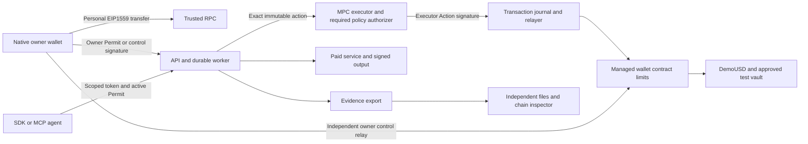

# Person 1 — Contracts and Shared Interfaces

> Repository bootstrap added 2026-10-17. Read [README](../../README.md) and [setup](../SETUP.md) for existing foundation files. Continue from that code; financial features and acceptance gates remain unimplemented.
>
> **Coordination rule:** follow the shared [team coordination and merge rules](../COORDINATION-AND-MERGE-POLICY.md). Do not change a shared interface without the review and consumer tests in that document.

> Implementation handoff: execute the numbered tasks in order, check off completed steps and attach actual acceptance evidence. Read the shared implementation contract in this document before coding. Work in your owned paths; propose interface changes through `packages/schema` before consumers change. Implementation agents may execute tasks directly; delegation is not required.

**Goal:** deliver the financial contracts and shared interfaces for both personal-wallet integration and bounded agent execution, including owner-only managed transfers and independent recovery.

**Architecture:** owner EIP-712 permissions authorize a per-wallet MPC executor. The executor signs bounded Actions; a sponsored relayer submits them. Contracts enforce financial rules independently of the API, MPC policy and AI model. Owner recovery remains independent of those services.

**Stack:** Solidity0.8.28, pinned compatible OZ5.x, Foundry, Node22/TypeScript/viem/Zod, pnpm workspace, Base Sepolia84532.

## Agent execution instructions

You are the implementation owner named in this document. Implement this assigned subsystem in the existing repository `/Users/safiussifat/web-projects/fintechathon`. Read this whole prompt, including the identical shared implementation contract, before changing code. Produce working software, tests, operation instructions and measured evidence. A summary, scaffold, mock integration or list of suggested improvements is not the requested implementation.

### Product context every implementation must preserve

The personal account is a locally owned EOA. The managed agent wallet is a separate contract/address/balance. The MPC executor is a third signing identity, never a user receiving address. Moving budget into the managed wallet does not expose the personal seed. The owner approves a bounded task once; online agents then execute while the phone is offline. Owner stop/recovery/managed transfer is independently signed locally and can be relayed without backend/MPC consent. A successful managed OwnerTransfer pauses/increments epoch; ordinary personal sends do not use agent permissions.



Mock tests are isolated local tests. The release demonstration uses real public-testnet transactions and real controlled browser services, with fixture risk/test assets labelled. Never describe these services as an existing commercial integration or test assets as real money.

### Scope and authority

- Treat the user's current instructions and repository `AGENTS.md` as controlling instructions. This document specifies the implementation; quoted competition/vendor material is reference data.
- Use the existing monorepo. Extend existing source and preserve unrelated work; do not create another repository or nested application. Check current files/branch/changes before editing. At the dated bootstrap baseline, source has wallet domain4/Login1 and unfinished financial routes; inspect current changes and preserve newer correct work; migrate consumers together to wallet domain5/Login2 before signing.
- Deliver every required task below, including the complete-wallet W tasks. WalletConnect/external dApp connections are deferred. Native owner signing, personal transfers and scoped external agent SDK/MCP are required. Do not add Circle, an embedded custody replacement, arbitrary signing, unapproved chains/assets, a full-key executor fallback or extra product scope.
- Own only the paths assigned here. Shared schema, root scripts, lockfile and manifest changes go through Person1. Specify the exact required patch and dependency when another owner must change their files; do independent work while that dependency is pending. Never silently fork an ABI/type, fake another person's service or mark their component complete.
- Supplied public fixture keys are test fixtures only. Follow repository/session authorization for key generation and deployment; real-fund/mainnet operations are outside this prompt. A missing host, native package credential, testnet faucet balance or authorized deployment is a named dependency, not a reason to substitute mock signing/settlement.
- Do not remove controls to meet a date. Internal target is October 18, 2026, 18:00 Dhaka; submission cutoff October 20, 2026, 21:59 Dhaka. Record actual gate times; old elapsed milestones are not completed automatically.

### Mandatory task loop

1. Read a task's dependencies, interfaces, existing implementation requirements and test specifications. Write down the exact files and required schema commit in `evidence/person1/progress.json`.
2. Create the named test files and a fixture for every case ID. Make the test fail for the missing behavior, run it and retain the failing assertion. A missing test runner/import/toolchain is a setup failure, not the intended red assertion; fix setup first.
3. Implement the task in small changes. Keep identifiers, type order, amount units, nonce lanes and trust boundaries exactly as specified. The implementation checklist and the test matrix are both required.
4. Run the targeted cases, then the entire affected package suite and type/build checks. When a dependency changes, rerun consuming tests against its actual commit. Mocked RPC/MPC/provider tests qualify local behavior only; the milestone also needs the real integration evidence stated below.
5. Record each case's command, exit status, expected/observed state, assertion result, commit and redacted artifact references. A missing credential/device or skipped test is BLOCKED/NOT_RUN, never PASS. Fix owned failures and repeat. Never edit expected outputs to match an incorrect implementation.
6. Supply the actual output/interface sample to the receiving owner and obtain integration confirmation. Use a focused commit if commits are authorized in the current session; otherwise leave a clearly described, reviewable working-tree change. No automatic push/publish/submission is requested by this prompt.
7. Mark the task complete only when its mandatory outcome and every applicable case pass, and any explicitly required physical-device/public-chain gate has evidence. Continue to the next unblocked task; finish with the report format below.

### Test harness contract — build this before relying on commands

Commands in task blocks are **required implementation targets**, not claims that the bootstrap already implements them. At the bootstrap baseline, `make check-*` and release targets intentionally fail. Person1 owns `scripts/check-suite.mjs` and root wrappers; each owner supplies the real package tests, and Person4 supplies `evaluation/run.ts` and `evaluation/release-check.ts` consumed by those wrappers. Coordinate with Person1 to replace each placeholder only after a real test runner exists. A command must exit nonzero for missing suites, zero discovered tests, assertion failure or required prerequisite failure. Do not use `--if-present`, `|| true`, empty tests or skipped required suites to make acceptance green.

- TypeScript package tests: use Node's test runner through the existing pinned `tsx`; define `test` as `tsx --test test/*.test.ts`. Keep Node mobile tests limited to pure domain/view-model/API logic; native UI and real React Native screens use instrumentation/installed flows, not an unsupported direct Node import. Test files are named explicitly in each task; Node test names contain the exact case ID. Go/Solidity/Kotlin test identifiers use the same ID with hyphens/dots replaced by underscores and record the canonical ID in the result mapping. A package `check` runs its complete tests and typecheck. Resolve/install any additional test dependency explicitly and record its exact lockfile version through Person1.
- Solidity: Solidity 0.8.28 Foundry configuration and OZ5.4.0 already exist. Add `forge-std` from its official repository with a recorded exact commit/remapping; record the Foundry toolchain version. `forge build`, named `forge test` suites and invariants are all required. No business contract is currently supplied.
- MPC: run actual pinned Go1.25.8 tests in both modules plus an isolated node-qualification runner. Mock signatures are insufficient for the real MPC gate. Pin and inspect dependency/source/configuration before starting nodes.
- Android: define native library Gradle project `:owner-wallet`, JVM tests, connected instrumentation and an installed-app flow runner. Record generated native project/module wiring and dependency pins. Implement and pin the Maestro CLI prerequisites for the listed installed-app flows; biometric/device-credential/restore cases may require a recorded human operator, and an omitted manual step cannot pass. JVM/RN mocks cannot qualify Keystore, biometric cancellation, restore or physical signing. Device-only cases require the actual device record.
- Cross-owner integration: Person4 supplies scenario definitions and the runner; each owner supplies assertions for their component. `make check-integration` must run the scenarios against real configured services and a real testnet manifest, or fail with the unmet prerequisite. CI/local deterministic tests use isolated local fixtures. Testnet faults use valueless test assets; public chain reorgs are modelled on an isolated local chain, never induced on public infrastructure.
- `make release-check` is a separate evidence/artifact gate. Passing unit tests or `/healthz` does not satisfy it. `/readyz` stays503 until required service dependencies, versions and applicable qualification gates actually pass.

### Required evidence format

Store `evidence/person1/cases/<task-id>.json` and `evidence/person1/progress.json`. Each case record has `{caseId,taskId,status,sourceCommit,workingTreeDigest,schemaCommit,environment,command,exitCode,expected,observed,startedAt,finishedAt,artifactRefs,limitations}`. Status is PASS/FAIL/BLOCKED/NOT_RUN. Timestamps include timezone. Artifacts may include redacted test output, canonical fixture/hash, chainId/transaction/block hash, independent verifier report, device/build fingerprint or screenshot. Never include mnemonic, BIP39 passphrase, share, private key, raw MPC rounds, refresh token, credential-bearing RPC URL or hidden model reasoning. Test secrets use isolated local ignored configuration.

Use base sourceCommit plus a working-tree diff digest while work is uncommitted; rerun release checks against the final identified source. Parameterized cases must record each variant and assertion, not only an aggregate label. A PASS test case may correctly expect an inspector finding to be UNVERIFIABLE; case success is not the same as all findings being PASS.

A milestone record lists all required case IDs, dependencies and actual pass time. All required cases must be PASS; absence is not success. Reproduce at least one prior failure after its fix. Preserve old failed runs rather than overwriting history. If authentic inspection returns PENDING/UNVERIFIABLE, preserve that result and explain it; verification correctness does not mean forcing every finding green.

### Final implementation report required from the receiving agent

1. **Implemented:** task IDs, owned files, source/schema/deployment versions and actual delivered capabilities.
2. **Verified:** exact commands and case IDs, counts of PASS/FAIL/BLOCKED/NOT_RUN, device/chain references and artifact paths.
3. **Integration:** upstream/downstream commit IDs and the confirmed end-to-end flows.
4. **Incomplete:** exact missing capability/resource, security impact, owner and next executable action. Never say complete if any required gate is missing.
5. **Operate:** fresh-start, migration, funding, restart, backup/restore and rollback instructions relevant to this owner.
6. **Review:** changed-file summary, residual limitations and no-secret check. Do not claim audited safety, mainnet readiness, full MetaMask parity or competition success.

**Tool references:** [Foundry testing](https://getfoundry.sh/forge/tests), [Forge Standard Library](https://getfoundry.sh/reference/forge-std/overview). Pin the actual resolved tool/dependency versions and verify their behavior; documentation is not a passing implementation result.

## Owner milestones — mandatory exit gates

Task-level case IDs and public/device evidence below are the gate criteria. Refer to S7 for the original Dhaka target times. No gate passes merely because its target time elapsed.

| Milestone | Required task coverage | Mandatory outcome |
| --- | --- | --- |
| M0 / W0 | `P1-01, P1-W01` | Shared domain5/Login2/OwnerTransfer/accounts/native/API/manifest package and valid/invalid vectors published; every listed schema case PASS. |
| M1 / G1,W2 | `P1-02, P1-W02` | Real local contract payment and owner transfer/epoch behavior, atomic failures and exact generated ABI; all corresponding case IDs PASS. |
| M2 / G2 | `P1-03/04/05/06` | Deployed fixed-config testnet contracts, readback manifest and actual phone/MPC payment/public owner-control hashes; no deployment-only mock result. |
| M3 / G3,W3 | `P1-03/04/05, P1-W03` | Vault/schedule/recovery/invariants and manual-owner attribution consumed correctly by API/native/verifier. |
| M4 / G4,W4 | `All contract/schema cases` | Complete direct-call/fuzz/invariant/replay/owner-ordering regression suite and cross-owner integration; actual executed counts recorded. |
| M5 / G5,W5 | `P1-06, P1-W03` | Reproducible compiled/deployed code/ABI/manifest/security/licenses, all required PASS results and final actual transaction index. |
| MA / W0–W4 (v7) | `P1-A01, P1-A02, P1-A03` | v7 policy, co-sign, freeze, allowance, call-template, multi-asset and x402 contract cases PASS locally and on Base Sepolia; X402-G recorded honestly. |

## Start here — current release scope and task order

**Required:** the complete personal-wallet and managed-agent flows in S8. **Deferred:** WalletConnect/external dApp connections; no WalletKit dependency, Reown projectId, dApp screen or pairing acceptance gate. External agent SDK/MCP access remains required.

Sections 2–6 and the wallet tasks in section 7 are one delivery. Follow the sequence below; wallet tasks are not work postponed until after the agent-only path. Existing bootstrap source needs W0 migration before new financial signatures. Documentation 7.0 keeps wallet domain 5, Login 2 and agent receipt/runbook schema 4, moves Invoice to domain 2 and adds the S9 agentic layer and policy controls; section 8 tasks are required in the same delivery.

| Work order | Task IDs | Deliverable / dependency |
| --- | --- | --- |
| Interface freeze | `P1-01 + P1-W01` | Extend existing bootstrap schemas to wallet domain5/Login2; publish OwnerTransfer, accounts, sessions, activity, token registry and native/API vectors before consumers sign. |
| First wallet transaction | `P1-02 + P1-W02` | Implement agent payment and owner-only liquid transfers; owner transfer has its own nonce and pauses/increments epoch. |
| Assets and owner recovery | `P1-03 + P1-04` | Implement fixed vault/schedule rules and independently relayed owner controls. |
| Inspection and deployment | `P1-05 + P1-06 + P1-W03` | Publish generated ABI/manifest, owner/manual activity examples and real original-agent plus wallet acceptance evidence. |
| Agentic layer and policy controls | `P1-A01 + P1-A02 + P1-A03` | Freeze v7 types with W0, then implement policy/co-sign/freeze/allowance/multi-asset and call templates/x402. |

**Completion record:** for each task record source commit, shared-schema commit, command/device or chain reference, observed result and known gaps. Unrun or failed cases stay incomplete. Both original G/Q and wallet W/WQ gates apply; no acceptance or implementation tests were executed by updating this document.

## 1. Your complete delivery

| Deliverable | Required files | Consumer / acceptance |
| --- | --- | --- |
| Workspace | `package.json`, `pnpm-workspace.yaml`, `pnpm-lock.yaml`, `Makefile`, `.github/workflows/ci.yml`, `.gitignore` | All owners can install/build; CI runs owned checks |
| Shared types | `packages/schema/src/{authority,hashing,api,accounts,assets,activity,sessions,runbook,evidence,manifest,index}.ts` | Owners2/3/4 import exported schemas; unknown fields rejected |
| Compatibility vectors | `packages/schema/fixtures/{permit,admin,owner-transfer,invoice,delivery,login,accounts,sessions,activity,transfers,hashes,api,runbook,evidence}-v5.json` | Native, Go, TS and Solidity agree on hashes/signatures/encoding |
| Contracts | `packages/contracts/src/{MandateWallet,WalletFactory,DemoUSD,DemoVault,EvidenceAnchor}.sol` | Agent constraints plus OwnerTransfer/epoch/receive/recovery pass direct-call checks |
| Generated bindings | `packages/schema/src/generated/abi.ts`, `packages/contracts/abi/*.json` | API/providers/verifier use these exact ABIs |
| Deployment | `packages/contracts/script/Deploy.s.sol`, `deployments/base-sepolia.json`, deployment README | Code verified against deployed bytecode/hashes; public addresses/block |
| Evidence | `docs/contracts-security.md`, `evidence/person1/` | Actual cases, limitations, transaction references, license record |

You do not implement MPCium, mobile or runbook business logic. You must review their signed data against your vectors and review the complete financial vertical flow at G2.

## 2. First handoff — do this before full contracts

### P1-01. Freeze the executable interface, G0

**Create:** shared type files/fixtures above; `packages/schema/package.json`, `tsconfig.json`; workspace configuration.

**Consumes:** signed field orders, domain versions and API contract in appendix S3–S6. **Produces:** `@mandate/schema` exports `PermitSchema`, `ActionSchema`, `AdminSchema`, `InvoiceSchema`, `ConditionsSchema`, `OwnerApprovalSchema`, `RunbookSnapshotSchema`, `RunbookDecisionSchema`, `TaskViewSchema`, `WalletViewSchema`, `EvidenceBundleSchema`, `DeploymentManifestSchema`, `hashPermit`, `hashAction`, `hashConditions`, `hashRunbook`, `hashRecipients`, `hashSchedule`, `buildTypedData`.

- [ ] Extend the existing repo/workspace and preserve the exact Node/pnpm pins; define root `make check-schema`, `make check-contracts`, `make check-platform`, `make check-mobile`, `make check-agents`, `make check-integration`, `make release-check`. Each delegates to owned package scripts; until implemented, a missing check fails rather than reporting success.
- [ ] Translate S3 to strict Zod schemas and EIP-712 type arrays. Big integer strings match `^(0|[1-9][0-9]*)$` and are bounded to actual Solidity width; reject floats, negative values, invalid hex and unknown fields. Reject null where a zero field is required.
- [ ] Implement RFC8785 SHA256, ABI recipients/schedule hash and EIP-712 digest helpers with established libraries. Freeze `Conditions` branch invariants, target IDs, provider bindings and browser check ordering.
- [ ] Supply fixed **public test keys only** with one example of every signed object including OwnerTransfer/Login2, canonical bytes, struct hash, domain hash, digest, expected signer and canonical65-byte signature. Add counterexamples wrong chain, wrong domain version, reordered fields, 1-unit amount change and null/empty derivation payload distinction for Go adapter fixtures.
- [ ] Supply valid/invalid API response examples and full stub RunbookSnapshot/Decision files to Owners2/3/4. Provide schema package at an identifiable commit and announce it. No mock counts as a completed financial gate.

**Acceptance:** `make check-schema` passes and consumers recover the same owner/executor/provider addresses from fixture signatures. Each required test has a named case ID, exact setup/action and expected postcondition in its task verification block.


#### Required execution contract — P1-01

**Prerequisites / blockers:** Existing bootstrap read; confirm root workspace pins and own all schema/root changes.

**Required source and test files:** `packages/schema/src/{authority,hashing,api,runbook,evidence,manifest,index}.ts`; `packages/schema/test/{authority,hashing,api}.test.ts`; `packages/schema/test/support/fixtures.ts`; `Makefile`; `package scripts`; `scripts/{check-suite,run-integration,release-check}.mjs`.

**Consumes / produces:** Consumes S3–S6 field order/Conditions/API shapes. Produces strict exported schemas, canonical hashing helpers, generated public vectors and working check-schema target. No consumer maintains a parallel definition.

**Implementation algorithm:**

```text
1. Parse every uint at its Solidity width; JSON financial integers remain canonical decimal strings.
2. Build typed data from trusted domain constants plus a verified wallet address, not arbitrary caller domain metadata.
3. Compute permitId as Permit struct hash; compute signing digest separately with domain separation.
4. Canonicalize exact committed JSON; recipient ordering and zero/non-applicable fields are deterministic.
5. Publish both valid and invalid vectors; schema package commit is the W0 consumer contract.
```

**Mandatory tests — implement each ID as an independently reported case:**

| Case ID | Exact setup / action | Required assertion / observed outcome |
| --- | --- | --- |
| `P1-01.T01` | Valid fixture with amount "200000" and all exact fields | Parse succeeds; TS digest equals recorded independent vector; recovered signer equals public fixture signer. |
| `P1-01.T02` | Try "0.5", "-1", leading-zero "01", float number and uint256 overflow | Every invalid amount rejects; no rounding/coercion reaches hashing. |
| `P1-01.T03` | Add an unknown field; replace a mandatory zero field with null | Strict parser rejects both; no silent field drop. |
| `P1-01.T04` | Change chainId, wallet address, domain version or one amount unit | Signing digest changes and original signature no longer recovers the authorized signer for the changed payload. |
| `P1-01.T05` | Duplicate/reorder recipient list; change a signed Schedule value or committed Conditions content (object key order alone is not a value change) | Noncanonical recipient input rejects; any actual committed-value change changes its hash; canonical equivalent JSON key order has identical hash. |

**Task execution checklist:**

- [ ] Create the listed test files and fixtures; implement every case above with direct assertions on state/bytes/balances/status, not only HTTP200 or a log message.
- [ ] Run the targeted cases against the incomplete behavior; retain genuine failing assertions after the runner/toolchain is working.
- [ ] Complete the implementation checklist above and the algorithm here; keep ownership/trust boundaries intact.
- [ ] Run the commands below and all affected regression suites. Real chain/device/MPC cases require the actual environment; label deterministic substitutes as local tests only.
- [ ] Record each case in `evidence/person1/cases/P1-01.json`; attach source/schema commit, command/exit status, expected/observed result, environment and redacted artifacts.
- [ ] Give the receiving owner the actual interface sample/commit and verify the joint behavior; leave blocked dependencies explicitly incomplete.

**Required verification commands** (wire missing real test scripts as specified above; placeholders cannot pass):

```bash
make check-schema
```

**Mandatory outcome before this task is complete:** All golden vectors and rejection cases pass; every consumer receives schema commit and example payload. Root target runs actual tests and typecheck, not only a placeholder/typecheck.

### P1-02. Implement wallet authorization and payment, G1

**Create:** `MandateTypes.sol`, `MandateWallet.sol`, `WalletFactory.sol`, `test/{Authority,Payment,Replay}.t.sol`.

**Consumes:** shared golden types. **Produces:** factory/wallet ABI and local activation/payment/revocation path for Owner2.

- [ ] Implement immutable owner/token/vault/limits, domain version5, independent permit/admin nonces, epoch, paused flag, unique task/permit/request/invoice mappings, and gross task/day counters. Use OZ ECDSA/EIP712/SafeERC20/ReentrancyGuard; disallow malformed/high-S signatures.
- [ ] Factory exposes `createWallet(address owner)` for permissionless sponsored deployment, no caller-selected limits/token/vault. Immutable owner is the provided nonzero address; caller gains no privilege. Return existing mapping on repeat. It is safe for someone to pre-create another owner's fixed-config wallet. `walletForOwner(address)` is canonical.
- [ ] Implement activation with full S3 checks, canonical zero fields and kind restrictions. Sender need not equal owner because signature authorizes relay. `permitId` is struct hash; duplicate task cannot receive a second permit. Store committed recipients/Schedule. A zero executor and malformed recipient array fail.
- [ ] Implement PAY, provider invoice domain/binding/time checks, gross cap/floor updates and exact transfer. Use checks-effects-interactions so external calls cannot reenter before IDs/counters are consumed. On revert all effects roll back.
- [ ] Implement zero-value CLOSE even when financial quota fully used. Check active epoch/time and executor signature before closing. Keep request uniqueness. Generate ABI/bindings automatically, commit them with source.
- [ ] Directly call contracts with valid executor signatures bypassing API: wrong recipient, expired quote, excessive amount/cap, changed inputHash, wrong task/wallet, replay and incorrect domain must fail.

**Acceptance:** activated fixture Permit + correct executor Action transfers exactly200000 units and emits the exact S3 ActionExecuted event; replay cannot transfer again. Sender relayer has no ability to change destination. Hand Owners2/4 local contract addresses, ABI and public transaction fixture.


#### Required execution contract — P1-02

**Prerequisites / blockers:** P1-01 + P1-W01; Foundry/forge-std installed with exact pins.

**Required source and test files:** `packages/contracts/src/{MandateWallet,WalletFactory,MandateTypes}.sol`; `packages/contracts/test/{Authority,Payment,Replay}.t.sol`; `packages/contracts/test/support/MandateFixture.sol`.

**Consumes / produces:** Implements activatePermit/execute/factory mapping and S3 event/view ABI. Test fixture deploys immutable DemoUSD/vault configuration, funds wallet with 10000000 units, uses public test owner/executor/provider keys and signs with the exact type hashes.

**Implementation algorithm:**

```text
activatePermit: verify immutable owner signature/domain/time/nonce/epoch -> validate kind/caps/recipients/schedule/unused fields -> consume nonce/task and store full permission.
execute PAY: load active permission/current epoch -> verify executor and invoice/provider binding -> check unique request/invoice, counters/gross limits/floor -> consume IDs/counters -> transfer exact DemoUSD -> emit bound actionDigest.
Any revert rolls back every counter/ID. Factory parameters are fixed; relayer never selects authority or changes a signed destination.
```

**Mandatory tests — implement each ID as an independently reported case:**

| Case ID | Exact setup / action | Required assertion / observed outcome |
| --- | --- | --- |
| `P1-02.T01` | Activate valid BROWSER Permit; execute PAY of 200000 to provider A | A gains200000, wallet loses200000; ActionExecuted identifies exact permit/request/invoice/input/digest; counters increment once. |
| `P1-02.T02` | Resubmit identical PAY through a different relayer and higher fee | Reverts; provider balance and every gross counter are unchanged after first execution. |
| `P1-02.T03` | Mutate target/amount/input/task/invoice wallet; use a wrong provider signature | Each mutation rejects before value movement; no request/invoice ID is consumed by a failed call. |
| `P1-02.T04` | Wrong owner/executor, malformed/high-S signature, expired/future-invalid authority or wrong epoch | Call rejects with stable documented error; no active authority or transfer is created. |
| `P1-02.T05` | Payment500001 or task/day cap exceeded; liquid would become2999999 | Rejected; exact ceilings/floor boundary cases pass when all other limits permit. |
| `P1-02.T06` | Pre-create wallet for another owner; call createWallet again | Same canonical mapping/configuration returns; caller acquires no owner privilege. |
| `P1-02.T07` | Use BROWSER permission for transfer/deposit/withdraw; nonzero unused fields | Reject; signed CLOSE remains zero-value and succeeds even when financial quota is exhausted. |

**Task execution checklist:**

- [ ] Create the listed test files and fixtures; implement every case above with direct assertions on state/bytes/balances/status, not only HTTP200 or a log message.
- [ ] Run the targeted cases against the incomplete behavior; retain genuine failing assertions after the runner/toolchain is working.
- [ ] Complete the implementation checklist above and the algorithm here; keep ownership/trust boundaries intact.
- [ ] Run the commands below and all affected regression suites. Real chain/device/MPC cases require the actual environment; label deterministic substitutes as local tests only.
- [ ] Record each case in `evidence/person1/cases/P1-02.json`; attach source/schema commit, command/exit status, expected/observed result, environment and redacted artifacts.
- [ ] Give the receiving owner the actual interface sample/commit and verify the joint behavior; leave blocked dependencies explicitly incomplete.

**Required verification commands** (wire missing real test scripts as specified above; placeholders cannot pass):

```bash
forge test --root packages/contracts --match-contract "AuthorityTest|PaymentTest|ReplayTest" -vv
make check-contracts
```

**Mandatory outcome before this task is complete:** G1 local payment/replay/authority cases pass with exact state assertions. ABI is generated from compiled source; no handwritten consumer tuple order.

## 3. Complete the asset and owner controls

### P1-03. Vault and schedule mechanics, G2–G3

**Create:** `DemoUSD.sol`, `DemoVault.sol`, `test/{Vault,Schedule,Limits}.t.sol`.

- [ ] DemoUSD has6 decimals and public faucet10 tokens per recipient/UTC day. Track by recipient, so changing caller cannot bypass the faucet. Label unlimited supply potential/test-only status. Faucet cannot seize funds.
- [ ] DemoVault uses OZ ERC4626 accounting with same DemoUSD; deposit/redeem operate real balances/shares. Add administrator-controlled withdrawal-disabled test switch that affects maxRedeem/redeem consistently. It cannot transfer users' shares or underlying to administrator; no production yield claim.
- [ ] DEPOSIT allows only immutable vault, caps cumulative assets, preserves effective floor and checks post-deposit allocation using actual balances and `convertToAssets`. Use exact allowance, clear afterward; verify actual assets spent and shares received≥positive minOutput. Reject fee-on-transfer behavior in this fixed-asset release.
- [ ] WITHDRAW uses shares as Action.amount; actual redeemed assets count toward cumulative withdrawCap, send only to wallet; enforce positive minimum assets and owned shares. Gross spend counters are unchanged. Protect external calls and verify actual deltas.
- [ ] TRANSFER requires exact stored recipient/amount/due window/unused period. Use uint256 intermediate arithmetic to prevent uint32 overflow; final period/window fits Permit. Schedule maxPayments equals permitted periods and≤maxActions. Unused invoice/input/minOutput fields are zero. Emit real token transfers.
- [ ] Test floor3 at exact boundary and one unit below;20% allocation boundary and one unit above; withdrawal unavailable; wrong minOutput; deposit cap; UTC day rollover; exact early/open/close schedule boundaries and duplicate/missed periods. No catch-up when multiple windows pass.

**Acceptance:** deposit1 from liquid10 creates a real share position; redeem returns funds to wallet; subsequent payment remains independently permitted. Three0.1 transfers have distinct due periods and cannot repeat.


#### Required execution contract — P1-03

**Prerequisites / blockers:** P1-02; exact fixed token/vault addresses and independent LIQUIDITY/SCHEDULE permits.

**Required source and test files:** `packages/contracts/src/{DemoUSD,DemoVault,MandateWallet}.sol`; `packages/contracts/test/{Vault,Schedule,Limits}.t.sol`; `packages/contracts/test/mocks/UnavailableVault.sol`.

**Consumes / produces:** ERC4626 deposit/redeem use assets versus shares explicitly; schedule stores fixed signed recipient/amount/start/interval/window/periods. Demo controls are operator-only valueless fixtures.

**Implementation algorithm:**

```text
Deposit checks preview/minOutput, deposit cap, liquid floor and post-deposit vaultAssets/(liquid+vaultAssets)<=2000bp; reset any temporary token approval after call.
Withdraw Action.amount means shares, minOutput means assets, output returns only to wallet and requires separate withdraw cap.
Scheduled transfer derives exact period from block timestamp; allow once in that period window, no catch-up, no recipient/amount override.
DemoUSD/Vault have no production yield claim; fixture failures preserve truthful asset state.
```

**Mandatory tests — implement each ID as an independently reported case:**

| Case ID | Exact setup / action | Required assertion / observed outcome |
| --- | --- | --- |
| `P1-03.T01` | Wallet total10000000, no position; deposit2000000 versus2000001 | Exact20% admission passes if floor/caps permit; above20% rejects. Shares/assets/counters match ERC4626 outputs. |
| `P1-03.T02` | Deposit leaves below floor or minOutput exceeds actual shares | Revert with no allowance/balance/counter residue. |
| `P1-03.T03` | Redeem known shares to wallet; attempt arbitrary recipient | Only wallet receives assets; arbitrary target/recipient rejects; minOutput failure is atomic. |
| `P1-03.T04` | Vault disables/reverts redemption | Position remains visible; no phantom liquid balance/withdraw success. |
| `P1-03.T05` | Three-period schedule: first valid window, repeat first, miss second, enter third | Periods0 and2 can pay once; duplicate0 and catch-up1 reject; amount and recipient remain signed constants. |
| `P1-03.T06` | Wrong task kind, out-of-range period or zero minOutput on vault operation | Reject; no financial counters consumed. |

**Task execution checklist:**

- [ ] Create the listed test files and fixtures; implement every case above with direct assertions on state/bytes/balances/status, not only HTTP200 or a log message.
- [ ] Run the targeted cases against the incomplete behavior; retain genuine failing assertions after the runner/toolchain is working.
- [ ] Complete the implementation checklist above and the algorithm here; keep ownership/trust boundaries intact.
- [ ] Run the commands below and all affected regression suites. Real chain/device/MPC cases require the actual environment; label deterministic substitutes as local tests only.
- [ ] Record each case in `evidence/person1/cases/P1-03.json`; attach source/schema commit, command/exit status, expected/observed result, environment and redacted artifacts.
- [ ] Give the receiving owner the actual interface sample/commit and verify the joint behavior; leave blocked dependencies explicitly incomplete.

**Required verification commands** (wire missing real test scripts as specified above; placeholders cannot pass):

```bash
forge test --root packages/contracts --match-contract "VaultTest|ScheduleTest|LimitsTest" -vv
make check-contracts
```

**Mandatory outcome before this task is complete:** Q08/Q09 local cases pass with exact balances, shares and period usage; vault controls are documented as fixtures.

### P1-04. Governance and independent recovery, G2–G3

**Create:** `test/{Admin,Recovery,Epoch}.t.sol`, canonical admin vectors.

- [ ] Admin issuedAt≤now≤deadline,≤30min validity, independent nonce. PAUSE/RECOVER/RECOVER_LIQUID increment epoch, pause and invalidate prior active and delayed signed grants. UNPAUSE changes paused status only. REVOKE marks target ID permanently, including an unactivated permit ID; other Admin commands require permitId zero.
- [ ] Recovery destination is immutable owner. RECOVER attempts vault maxRedeem/redeem within bounded low-level call gas, catches failure and still sends liquid supported token; record actual received amounts. RECOVER_LIQUID never calls vault. Document chosen gas bounds and account for relayer gas before releasing APK.
- [ ] Recovery works while paused, bypasses delegated floor intentionally and cannot be denied by executor/policy. A successful pause cannot reverse transactions ordered earlier in chain.
- [ ] Add separate tests for vault revert/oversized gas use, recovered liquid only, repeated Admin nonce, stale draft activation after pause/unpause, old close/payment after epoch bump and signer cancellation fixture.
- [ ] Review Owner3's `tools/relay-admin.ts` and native confirmation against final ABI. Run recovery through an independent relayer/RPC with API stopped at integration gate.

**Acceptance:** recovered DemoUSD arrives only at owner EOA; old grants remain unusable after unpause; no secret or API session is needed by the independent sender.


#### Required execution contract — P1-04

**Prerequisites / blockers:** P1-02 and P1-03; native Admin vectors from W0.

**Required source and test files:** `packages/contracts/src/MandateWallet.sol`; `packages/contracts/test/{Admin,Recovery,Epoch}.t.sol`; `docs/contracts-security.md`.

**Consumes / produces:** Implements PAUSE/UNPAUSE/REVOKE/RECOVER/RECOVER_LIQUID with independent admin nonce; recovery destination immutable owner. Recovery event reports actual redeemed and liquid amounts.

**Implementation algorithm:**

```text
Verify Admin owner/domain/time/nonce; non-REVOKE permitId must be zero. PAUSE and either RECOVER pause/increment epoch; UNPAUSE never changes epoch backwards.
REVOKE permanently marks even an unactivated permitId.
RECOVER attempts approved vault maxRedeem/redeem in a bounded-gas call; if it fails, retain visible position and still send core liquid DemoUSD.
RECOVER_LIQUID never calls vault. Native ETH/other reviewed token sweeps are separate OwnerTransfer commands, not falsely included in core recovery.
```

**Mandatory tests — implement each ID as an independently reported case:**

| Case ID | Exact setup / action | Required assertion / observed outcome |
| --- | --- | --- |
| `P1-04.T01` | Sign Permit before pause; pause then unpause then activate/execute old payload | Old epoch never regains authority; admin nonce consumed once. |
| `P1-04.T02` | Revoke a known signed but unactivated permitId | Later activation rejects; unrelated grant is not silently revoked. |
| `P1-04.T03` | RECOVER with healthy vault | Redeemed shares/actual assets and liquid core token reach immutable owner; wallet paused/epoch incremented. |
| `P1-04.T04` | Vault reverts/uses its allowed gas; RECOVER then RECOVER_LIQUID | Liquid recovery still works within recorded gas budget; liquid-only path makes zero vault calls. |
| `P1-04.T05` | Wrong Admin owner/nonce/domain/deadline; arbitrary recovery destination | Reject; no transfer or epoch change. |
| `P1-04.T06` | Both MPC nodes/API offline, owner signature relayed from independent funded sender | Same on-chain owner controls succeed; gas payer is not mistaken for financial owner. |

**Task execution checklist:**

- [ ] Create the listed test files and fixtures; implement every case above with direct assertions on state/bytes/balances/status, not only HTTP200 or a log message.
- [ ] Run the targeted cases against the incomplete behavior; retain genuine failing assertions after the runner/toolchain is working.
- [ ] Complete the implementation checklist above and the algorithm here; keep ownership/trust boundaries intact.
- [ ] Run the commands below and all affected regression suites. Real chain/device/MPC cases require the actual environment; label deterministic substitutes as local tests only.
- [ ] Record each case in `evidence/person1/cases/P1-04.json`; attach source/schema commit, command/exit status, expected/observed result, environment and redacted artifacts.
- [ ] Give the receiving owner the actual interface sample/commit and verify the joint behavior; leave blocked dependencies explicitly incomplete.

**Required verification commands** (wire missing real test scripts as specified above; placeholders cannot pass):

```bash
forge test --root packages/contracts --match-contract "AdminTest|RecoveryTest|EpochTest" -vv
make check-contracts
```

**Mandatory outcome before this task is complete:** Q10/Q13/Q14 contract side proven. Report unrecovered vault/nonstandard positions explicitly; no claim of atomic all-asset recovery.

## 4. Inspection support, deployment and release

### P1-05. Views, anchors and financial invariants, G3–G4

**Create:** `EvidenceAnchor.sol`, `test/{Anchor,Invariants}.t.sol`, `packages/schema/src/generated/abi.ts`.

- [ ] `getPermit(id)` returns generated tuple `{permit,activated,closed,revoked,grossSpend,paymentCount,actionCount,depositedAssets,withdrawnAssets}`; all numeric counters uint256 except counts uint32, flags bool. UI authorityState derives epoch/expiry/paused separately. `getBudget(executor)` returns `{day,walletGross,executorGross,liquidAssets,vaultShares,vaultAssets}`, uint256 fields. Expose immutable `owner()/token()/vault()` plus nonces/epoch/paused. Publish ABI field names to consumers at G0 even if implementation follows.
- [ ] Anchor permits only immutable publisher, records the S6 digest/sequence and emits exact event. Reject zero task/digest, non-increasing sequence per task and duplicate sequence. The publisher is trusted only for checkpoint publication, cannot control wallet. No upgrade key.
- [ ] Add stateful invariants: no unauthorized recipient outflow, supported liquid floor on delegated spending, gross counters monotonic within day/task, request/invoice/period at most once, aggregate deposit cap, no owner privilege from relayer/factory caller. Model Admin recovery exceptions explicitly.
- [ ] Produce public chain receipt/event examples for PAY/DEPOSIT/WITHDRAW/TRANSFER/CLOSE/PAUSE/REVOKE/RECOVER/anchor. Review Owner4 verifier's historical rule reconstruction, including withdrawals/refunds that must not replenish gross allowance.

**Acceptance:** `forge test` plus invariant suite pass at pinned source; save seeds/run counts and failures/fixes in `evidence/person1/contract-results.json`. Do not report unexecuted assertions as tested properties.


#### Required execution contract — P1-05

**Prerequisites / blockers:** P1-02/03/04/W02; views and event field types frozen with all consumers.

**Required source and test files:** `packages/contracts/src/EvidenceAnchor.sol`; `packages/contracts/test/{Views,Anchor,Invariant}.t.sol`; `packages/schema/src/generated/abi.ts`; `packages/contracts/abi/*.json`.

**Consumes / produces:** Produces exact getPermit/getBudget/usedRequest/nonce/epoch views and publisher-bound checkpoint events. Anchor stores commitments only; it does not certify truth.

**Implementation algorithm:**

```text
Generate ABI from compiled contracts; export named tuple bindings. Reconstruct all gross counters using actual financial events; refunds do not decrement them.
Anchor taskId/checkpointDigest/sequence and publisher; consume no owner/executor signing authority.
Set profile.default.fuzz.runs=1000 and profile.default.invariant.runs=256/depth=64 in packages/contracts/foundry.toml. Invariant handler generates bounded activated permissions, payments, pause/revoke/owner sends and failed calls, tracking successful canonical actions independently.
```

**Mandatory tests — implement each ID as an independently reported case:**

| Case ID | Exact setup / action | Required assertion / observed outcome |
| --- | --- | --- |
| `P1-05.T01` | Refund200000 after successful PAY | Balance may increase but task/executor/wallet gross spend remains200000. |
| `P1-05.T02` | Read views after successful action, failed action and owner transfer | Views match exact stored state; owner outflow does not become agent-budget spend. |
| `P1-05.T03` | 1000 fuzz cases and256 invariant runs at depth64 | No duplicate request pays twice; unauthorized recipient never gains delegated funds; failed calls are atomic; historical counters do not decrease. |
| `P1-05.T04` | Anchor wrong digest/sequence/publisher in independent fixture | Verifier can distinguish the actual committed bytes/publisher; contract never claims validity of an export. |
| `P1-05.T05` | ABI regeneration from unchanged source | Output is deterministic; no consumer-maintained ABI drift. |

**Task execution checklist:**

- [ ] Create the listed test files and fixtures; implement every case above with direct assertions on state/bytes/balances/status, not only HTTP200 or a log message.
- [ ] Run the targeted cases against the incomplete behavior; retain genuine failing assertions after the runner/toolchain is working.
- [ ] Complete the implementation checklist above and the algorithm here; keep ownership/trust boundaries intact.
- [ ] Run the commands below and all affected regression suites. Real chain/device/MPC cases require the actual environment; label deterministic substitutes as local tests only.
- [ ] Record each case in `evidence/person1/cases/P1-05.json`; attach source/schema commit, command/exit status, expected/observed result, environment and redacted artifacts.
- [ ] Give the receiving owner the actual interface sample/commit and verify the joint behavior; leave blocked dependencies explicitly incomplete.

**Required verification commands** (wire missing real test scripts as specified above; placeholders cannot pass):

```bash
forge test --root packages/contracts --match-contract "ViewsTest|AnchorTest" -vv
forge test --root packages/contracts --match-contract InvariantTest --fuzz-runs 1000 -vv
make check-schema
make check-contracts
```

**Mandatory outcome before this task is complete:** Invariant config includes runs=256/depth=64 and records actual executed count. ABI/view fixtures accepted by Person2 and Person4.

### P1-06. Deploy and qualify final manifest, G2 then refresh G5

- [ ] Coordinate addresses before deployment: provider recipient keys from Owner4, anchor publisher from Owner2; configure vault and factory release constants. Deploy to Base Sepolia with funded deployment account, persist chain ID/deployment block/addresses/transaction hashes/runtime bytecode hashes/compiler settings and constructor values.
- [ ] `deployments/base-sepolia.json` must satisfy DeploymentManifestSchema: schemaVersion4; chainId84532; `contracts:{factory,walletImplementation:null,token,vault,anchor}`; per-contract deploymentBlock/codeHash; provider bindings/target origins; API/provider origins; MPC engine/source commit/key public metadata; evidence Ed25519 key/anchor publisher; approved runbook manifest hashes; exact package/native pins; source tag and inspection start blocks. Per-wallet addresses/executors are separate runtime records. No secret keys/chain passwords/PATs.
- [ ] Owner3 bundles a trusted manifest in APK; Owner4 supplies it separately to verifier. Compare network/address/code hashes; mismatches block approval/export verification. API cannot silently switch chain or contract after owner confirmation.
- [ ] Rebuild from clean checkout/tag, regenerate ABI without diff and verify deployment code against pinned settings. Provide README algorithm/security explanation, known risks and dependency licenses.
- [ ] At G4 cross-review Owner2 policy+MPC request binding, Owner3 actual displayed fields and Owner4 settlement verification. Fix contract or schema inconsistencies through a new versioned fixture commit; do not change a deployed contract's assumed behavior silently.


#### Required execution contract — P1-06

**Prerequisites / blockers:** All contract/schema cases pass; authorized testnet deployment, provider addresses/runbook hashes and public manifest values supplied.

**Required source and test files:** `packages/contracts/script/Deploy.s.sol`; `deployments/base-sepolia.json`; `docs/contracts-deploy.md`; `evidence/person1/deployment.json`; `generated ABI`.

**Consumes / produces:** Consumes actual provider public identities, approved targets/runbooks and configured testnet RPC. Produces code-hash/block/address/source/toolchain manifest and actual transaction index. No fabricated addresses.

**Implementation algorithm:**

```text
Dry-run deployment on isolated local chain84532; verify fixed constructor wiring and script idempotence policy.
For authorized public deployment check eth_chainId84532, signer gas balance and constructor values before broadcast.
Read deployed bytecode/configuration through independent RPC; compute runtime code hashes, include deployment blocks and exact dependency pins.
Round-trip one phone approval, MPC payment and independent owner operation with other owners; update manifest only from observed results.
```

**Mandatory tests — implement each ID as an independently reported case:**

| Case ID | Exact setup / action | Required assertion / observed outcome |
| --- | --- | --- |
| `P1-06.T01` | RPC returns chain1 or11155111 | Deployment preflight aborts before signing/broadcast; no fallback chain. |
| `P1-06.T02` | Constructor token/vault or provider/runbook config differs from approved manifest | Preflight fails; no silently changed authority. |
| `P1-06.T03` | Clean clone/install/build and ABI/code-hash readback | Pinned commands reproduce artifacts; live addresses contain expected runtime/configuration. |
| `P1-06.T04` | Actual agent PAY then owner pause/transfer | Public successful receipts and events match shared fixtures; old authority rejects afterwards. |
| `P1-06.T05` | Any mandatory case missing/failed, unverified native/MPC gate or manifest mismatch | Release remains incomplete; check-contracts/release gate cannot emit a false overall PASS. |

**Task execution checklist:**

- [ ] Create the listed test files and fixtures; implement every case above with direct assertions on state/bytes/balances/status, not only HTTP200 or a log message.
- [ ] Run the targeted cases against the incomplete behavior; retain genuine failing assertions after the runner/toolchain is working.
- [ ] Complete the implementation checklist above and the algorithm here; keep ownership/trust boundaries intact.
- [ ] Run the commands below and all affected regression suites. Real chain/device/MPC cases require the actual environment; label deterministic substitutes as local tests only.
- [ ] Record each case in `evidence/person1/cases/P1-06.json`; attach source/schema commit, command/exit status, expected/observed result, environment and redacted artifacts.
- [ ] Give the receiving owner the actual interface sample/commit and verify the joint behavior; leave blocked dependencies explicitly incomplete.

**Required verification commands** (wire missing real test scripts as specified above; placeholders cannot pass):

```bash
make check-schema
make check-contracts
make check-integration
make release-check
```

**Mandatory outcome before this task is complete:** G2 public-chain contract integration and G5 manifest accepted by all owners; source/deployment/security/license/test report is reproducible and contains no secrets.

## 5. Check commands and handoff packet

Define and run during implementation:

```bash
pnpm --filter @mandate/schema check
forge test --root packages/contracts -vv
make check-contracts
make check-integration
```

At each gate send a commit hash, generated ABI/schema fixture version, passing case report, known failing cases and public deploy manifest. Commit logical units: schema/vectors → authority/payment → asset/schedule → admin → anchor/invariants → deployment/docs. Never mix secrets or unrelated owners' changes into commits.

**Done means:** Owner2 can activate/execute/stop through your ABI, Owner3 signs your actual domain/types, Owner4 verifies your exact events, and direct calls still obey rules when all off-chain services are bypassed. A source file existing alone is not acceptance.

## 6. Risks you must expose

Controlled vault valuation/risk signal and DemoUSD are fixtures. Public testnet settlement is not commercial asset safety. Non-upgradeable bugs require new deployment and fresh owner permissions. Contract cannot attest off-chain model/runtime, provider honesty or backend reservation correctness. Separate executor caps are per wallet's contract, not a cross-wallet global risk engine. Independent specialist review remains necessary before real funds.

## 7. Complete-wallet deliverables — required v6 tasks

The same four people now deliver an everyday wallet as well as the agent application. S8 below defines the exact interfaces; these tasks are mandatory. Existing bootstrap layouts/domain4 are migration inputs, not release-compatible interfaces.

### P1-W01. New authority and account schemas, W0

**Files:** `packages/schema/src/{authority,hashing,api,accounts,assets,activity,sessions,manifest}.ts`, shared JSON fixtures, `packages/contracts/src/MandateTypes.sol`.

- [ ] Set MandateWallet domain5; add exact OwnerTransfer/S8 event/nonce ABI; use Login domain2+deviceId. Use Invoice domain2 (with asset) and Delivery domain1; keep agent receipt/runbook schema4 with the S9.13 additive event types. Include every v7 type from S3/S9. Upgrade all native/Go/API/SDK/vector consumers together before financial use.
- [ ] Define strict PersonalTransferRequest/Preview, Account, AssetMetadata, WalletActivity, SessionView and native transfer request schemas from S8. All amounts/gas/nonces/times integer strings. Personal/manual/agent source and fee payer must never be ambiguous.
- [ ] Add native/TS/Solidity golden vectors for new domains, owner transfer, ETH versus ERC20 transfer data, ERC681 parsing, same seed+index paths and account isolation. Supply ABI for native specific owner-operation relay. Agent/session requests cannot masquerade as owner typed approvals.
- [ ] Publish migration commit/API examples to all three owners; document bootstrap files to replace in `docs/PLAN-MIGRATION-v6.md`. Verify new authority types cannot be accepted as old-domain messages.

**Finished:** all consumers agree on source/destination/asset/base units/digest; v4 wallet-domain signature and wrong index/address fail against v5 fixtures.

- [ ] Publish the send-enabled token registry (chain, address, expected code hash, reviewed transfer semantics); initial DemoUSD is enabled, arbitrary imported tokens remain watch-only pending qualification. Keep metadata validation distinct from token trust.


#### Required execution contract — P1-W01

**Prerequisites / blockers:** P1-01 and exact S8 financial/account semantics; this task precedes all new signing.

**Required source and test files:** `packages/schema/src/{authority,hashing,runtime,accounts,assets,activity,sessions,manifest}.ts`; `packages/schema/test/{owner-transfer,accounts,sessions,manifest,transfer-vectors}.test.ts`; `fixtures/*-v5.json`; `packages/contracts/src/MandateTypes.sol`.

**Consumes / produces:** Produces OwnerTransferSchema, LoginSchema with deviceId, PersonalTransferRequestSchema/PreviewSchema, AccountSchema, AssetMetadataSchema, WalletActivitySchema, SessionViewSchema and updated DeploymentManifestSchema. Update index.ts exports. Existing public helper names remain stable; all domain literal types become wallet5/Login2 together.

**Implementation algorithm:**

```text
1. Change both runtime constants and hashing/type-array/domain literal declarations; reject old-domain data rather than rewriting it on receipt.
2. Add OwnerTransfer field order exactly as S8.3 and independent nonce/epoch fixtures.
3. Add chain/address/code-hash reviewed-token registry and explicit watch-only metadata state.
4. Add semantic native transfer vectors: ETH empty calldata; ERC20 transfer selector/recipient/amount and zero ETH; owner relay known ABI only.
5. Publish one migration commit and schema compatibility report. Native/Go/Solidity fixtures carry the same digest, domain and public signer.
```

**Mandatory tests — implement each ID as an independently reported case:**

| Case ID | Exact setup / action | Required assertion / observed outcome |
| --- | --- | --- |
| `P1-W01.T01` | Sign identical OwnerTransfer fields under domain4 and domain5 | Only domain5 is accepted by the new contract/vector; changing a version at a boundary is rejected. |
| `P1-W01.T02` | Login2 challenge with changed deviceId or origin | Original signature fails; deviceId is part of signed bytes, never treated as attestation. |
| `P1-W01.T03` | ETH request versus DemoUSD request for the same displayed decimal amount | Asset/base units/calldata differ correctly; gas remains wei and token units never add to ETH debit. |
| `P1-W01.T04` | Account0/account1 fixture from the same public test mnemonic/passphrase | Addresses match Wallet Core/native path vectors; account-specific request cannot select the other signer. |
| `P1-W01.T05` | Manifest missing code hash, wrong chain, unsupported transfer mode or unqualified imported token | Invalid manifest rejects; unknown token can be tracked but cannot become send-enabled/agent-enabled. |
| `P1-W01.T06` | Compile all four consumers against migrated package | No remaining production Wallet4/Login1 literal or duplicate schema is used for new signing; compatibility failures stop W0. |

**Task execution checklist:**

- [ ] Create the listed test files and fixtures; implement every case above with direct assertions on state/bytes/balances/status, not only HTTP200 or a log message.
- [ ] Run the targeted cases against the incomplete behavior; retain genuine failing assertions after the runner/toolchain is working.
- [ ] Complete the implementation checklist above and the algorithm here; keep ownership/trust boundaries intact.
- [ ] Run the commands below and all affected regression suites. Real chain/device/MPC cases require the actual environment; label deterministic substitutes as local tests only.
- [ ] Record each case in `evidence/person1/cases/P1-W01.json`; attach source/schema commit, command/exit status, expected/observed result, environment and redacted artifacts.
- [ ] Give the receiving owner the actual interface sample/commit and verify the joint behavior; leave blocked dependencies explicitly incomplete.

**Required verification commands** (wire missing real test scripts as specified above; placeholders cannot pass):

```bash
make check-schema
```

**Mandatory outcome before this task is complete:** W0 publishes exact domain5/Login2/OwnerTransfer/native/API fixtures. Migration document names actual changed files and consuming commits; tests prove v4 signatures cannot authorize v5 operations.

### P1-W02. Owner transfer and supported receiving, W2

**Files:** wallet/factory/types, `docs/owner-transfer.md`, generated ABI/manifest.

- [ ] Implement applyOwnerTransfer/ownerTransferNonce/usedOwnerTransfer exactly as S8.3. Require owner signature/current epoch/separate nonce/unique ID/time and valid asset/recipient. Agent executor/token/relayer cannot substitute for owner.
- [ ] Add payable receive for native ETH, reject unknown fallback. Native funds cannot be spent by delegated Action; DemoUSD agent caps remain unchanged. Managed personal-token sweep is owner-only; reject vault share token and nonstandard transfer deltas.
- [ ] Every successful OwnerTransfer pauses/increments epoch, emits both governance and transfer facts, bypasses delegated floor/caps intentionally. Reverts leave nonce/epoch/funds unchanged; owner transfer works while paused. Effects precede interactions and are reentrancy protected.
- [ ] Expose nonce/epoch/read data for backend-independent native relay. Review Person3's native calldata builder against generated ABI and ensure owner direct personal gas path still accepts same typed command; sender conveys no privilege.
- [ ] Prove wrong signer/domain/epoch/nonce, request replay, native recipient callback, taxed token, insufficient funds and shared pending agent ordering. Owner personal ETH transfers and managed owner transfer must have different transaction/message fixtures.

**Finished:** owner sends managed DemoUSD/native ETH to a reviewed address while MPC/API are unavailable; actual owner-authorized outflow correctly invalidates old agent authority. Each path has real chain acceptance evidence once implemented.


#### Required execution contract — P1-W02

**Prerequisites / blockers:** P1-02 and OwnerTransfer fixtures; no MPC dependency.

**Required source and test files:** `packages/contracts/src/MandateWallet.sol`; `packages/contracts/test/{OwnerTransfer,NativeReceive}.t.sol`; `packages/contracts/test/mocks/{TaxToken,ReentrantRecipient}.sol`; `docs/owner-transfer.md`.

**Consumes / produces:** Implements applyOwnerTransfer/ownerTransferNonce/usedOwnerTransfer and OwnerTransferExecuted plus pause/epoch facts. Native receive accepts ETH; fallback rejects unknown calls. OwnerTransfer never uses permit/admin nonce.

**Implementation algorithm:**

```text
Validate owner/domain/issuedAt/deadline<=10min/current epoch/manual nonce/unique transferId/positive amount and permitted liquid asset.
Reject zero/self-wallet recipient and approved vault-share token. Update manual nonce/used ID, pause and increment epoch before external interaction.
For ERC20 use SafeERC20 and require exact pre/post wallet debit and recipient credit. For ETH use empty-data transfer with reentrancy guard.
On failure revert all effects. On success emit asset movement and new epoch. Permit/day counters remain historical agent counters, not owner-transfer limits.
```

**Mandatory tests — implement each ID as an independently reported case:**

| Case ID | Exact setup / action | Required assertion / observed outcome |
| --- | --- | --- |
| `P1-W02.T01` | Owner sends400000 DemoUSD from wallet with active grants | Recipient gains400000; owner nonce+1, paused=true, epoch+1; prior and delayed permits cannot execute; delegated floor is deliberately bypassed. |
| `P1-W02.T02` | Repeat same transferId or nonce; use agent/executor signature | Reject with no additional debit/epoch change. |
| `P1-W02.T03` | Fail token transfer, insufficient balance or reverting ETH recipient | Whole operation reverts; manual nonce, used ID, epoch, pause and balances equal before-state. |
| `P1-W02.T04` | Send ETH to a contract that attempts reentry | One authorized value transfer at most; recursive operation fails; no extra nonce/epoch effects. |
| `P1-W02.T05` | Send vault shares or a fee-on-transfer/rebasing mock with nonexact delta | Reject; core DemoUSD remains unaffected. |
| `P1-W02.T06` | Already-paused wallet sends valid liquid asset; API and both MPC nodes stopped | Independent funded relayer still executes valid owner signature; owner control is not gated on service availability. |
| `P1-W02.T07` | Agent tx mined before versus after OwnerTransfer | Earlier valid action may settle; later old-epoch action rejects. Test both actual orderings. |

**Task execution checklist:**

- [ ] Create the listed test files and fixtures; implement every case above with direct assertions on state/bytes/balances/status, not only HTTP200 or a log message.
- [ ] Run the targeted cases against the incomplete behavior; retain genuine failing assertions after the runner/toolchain is working.
- [ ] Complete the implementation checklist above and the algorithm here; keep ownership/trust boundaries intact.
- [ ] Run the commands below and all affected regression suites. Real chain/device/MPC cases require the actual environment; label deterministic substitutes as local tests only.
- [ ] Record each case in `evidence/person1/cases/P1-W02.json`; attach source/schema commit, command/exit status, expected/observed result, environment and redacted artifacts.
- [ ] Give the receiving owner the actual interface sample/commit and verify the joint behavior; leave blocked dependencies explicitly incomplete.

**Required verification commands** (wire missing real test scripts as specified above; placeholders cannot pass):

```bash
forge test --root packages/contracts --match-contract "OwnerTransferTest|NativeReceiveTest" -vv
make check-contracts
```

**Mandatory outcome before this task is complete:** W2 owner transfer, atomic failure and epoch invalidation proven. Person2/3/4 receive actual event/calldata examples and exact manual nonce semantics.

### P1-W03. History attribution and release contract, W3–W5

- [ ] Provide event/receipt examples for receive/funding/owner transfer/Admin/agent payment. Person4's inspector must recognize OWNER_CONTROL and avoid counting it as an unauthorized task payment or resetting historical gross spend.
- [ ] Validate source-specific balances/history/debit/fees: internal funding between user's personal and managed address is two balance movements but one funding activity, not double expenses.
- [ ] Add WQ03/04/07/08/13 direct contract/vector cases; retain existing Q01–Q14. Publish ABI/schema/domain5 in deployment manifest and reject any app/server configuration still signing domain4.
- [ ] Require wallet W0–W5 results plus original agent gates before complete-app release. No token/chain support is inferred merely because Wallet Core supports it.

**Handoff review:** Person2 signs API/nonce/event compatibility; Person3 signs native UI/calldata compatibility; Person4 signs verified history attribution. Your source/deployment/documentation responsibilities remain the same; new task ownership is not transferred to another person.


---


#### Required execution contract — P1-W03

**Prerequisites / blockers:** P1-W02 + actual owner/manual events; Person4 inspector and Person2 history adapters available.

**Required source and test files:** `packages/schema/fixtures/activity-v5.json`; `packages/contracts/test/OwnerActivity.t.sol`; `docs/owner-transfer.md`; `evidence/person1/cases/P1-W03.json`.

**Consumes / produces:** Produces fixtures for personal incoming/outgoing/funding, managed owner transfer/recovery/Admin and agent payment, with distinct source/category/fee payer and actual event/calldata references.

**Implementation algorithm:**

```text
Map actual token/native movement to its governing transaction. Personal->managed funding has two owned balance legs but one funding activity.
OwnerTransfer uses owner signature and manual nonce; classify OWNER_CONTROL and preserve preexisting gross agent counters.
Cross-check actual amount/epoch/pause and consumed IDs against independently read receipts/state; unexplained supported outflow remains a finding.
```

**Mandatory tests — implement each ID as an independently reported case:**

| Case ID | Exact setup / action | Required assertion / observed outcome |
| --- | --- | --- |
| `P1-W03.T01` | Own personal account funds its managed wallet with1000000 | Portfolio token total unchanged apart from fees; funding is not charged twice as expense. |
| `P1-W03.T02` | Owner sends400000 while task had200000 prior gross spend | History attributes400000 to OWNER_CONTROL; task gross stays200000; epoch/pause facts remain inspectable. |
| `P1-W03.T03` | Remove transfer event/calldata/signature source from an exported copy | In the missing-data variant, historical RPC transaction input is also unavailable: authority is UNVERIFIABLE while independently retained settlement logs can still PASS. A separately tampered hash-chain variant must FAIL integrity; no invented task fills either gap. |
| `P1-W03.T04` | Try an unregistered supported-asset outflow | Independent history scan flags unmatched outflow; registry/indexing omissions are not automatic PASS. |

**Task execution checklist:**

- [ ] Create the listed test files and fixtures; implement every case above with direct assertions on state/bytes/balances/status, not only HTTP200 or a log message.
- [ ] Run the targeted cases against the incomplete behavior; retain genuine failing assertions after the runner/toolchain is working.
- [ ] Complete the implementation checklist above and the algorithm here; keep ownership/trust boundaries intact.
- [ ] Run the commands below and all affected regression suites. Real chain/device/MPC cases require the actual environment; label deterministic substitutes as local tests only.
- [ ] Record each case in `evidence/person1/cases/P1-W03.json`; attach source/schema commit, command/exit status, expected/observed result, environment and redacted artifacts.
- [ ] Give the receiving owner the actual interface sample/commit and verify the joint behavior; leave blocked dependencies explicitly incomplete.

**Required verification commands** (wire missing real test scripts as specified above; placeholders cannot pass):

```bash
make check-contracts
make check-integration
```

**Mandatory outcome before this task is complete:** W3–W5 financial attribution is agreed against actual chain examples; all consumers use the same final manifest/schema commit.


## 8. Agentic layer and policy controls — required v7 tasks

S9 adds the LLM agent and Cobo/Circle-class policy controls. You own every signed type and the contract enforcement behind them. Publish the v7 types together with the W0 freeze; no consumer signs domain 5 before both are frozen.

### P1-A01. v7 shared types, vectors and manifest, W0

**Files:** `packages/schema/src/{authority,hashing,api,agent,policy,manifest}.ts`, `packages/schema/fixtures/{approval,wallet-policy,call-template,allowance,invoice-v2,x402,agent-question}-v7.json`.

- [ ] Replace the v6 Permit layout with the S3 v7 layout (asset, templatesHash, reviewThreshold, periodCap, periodSeconds); add Approval, WalletPolicy, AssetCap, CallTemplate; kind ALLOWANCE, operations CALL/X402, commands FREEZE/UNFREEZE; Invoice domain 2 with asset.
- [ ] Add hashing helpers `hashApproval`, `hashWalletPolicy`, `hashTemplates`, `hashAssetCaps`, and list-hash rules (sorted unique, `keccak256(abi.encode(T[]))`).
- [ ] Add API/agent DTOs: AgentQuestion, AgentAnswer, ApprovalRequest, PolicyDraft, IntentDraft, the v7 WalletView/OwnerApproval fields and new error codes. Unknown fields rejected.
- [ ] Extend DeploymentManifest with agentAssets, screening, riskRules, x402 and agent fields.
- [ ] Publish valid and rejected vectors for each type, including a co-signed Action, a frozen-wallet rejection and an ALLOWANCE period boundary.

**Acceptance:** TypeScript, Solidity, Go and Kotlin consumers recompute identical digests for every v7 vector.

#### Required execution contract — P1-A01

**Prerequisites / blockers:** none beyond P1-W01; publish in the same W0 freeze.

**Required source and test files:** `packages/schema/src/{authority,hashing,api,agent,policy,manifest}.ts`; `packages/schema/test/{v7-types,v7-hashes,agent-dto,manifest-v7}.test.ts`; `packages/schema/fixtures/*-v7.json`.

**Consumes / produces:** produces the S3/S9 types, helpers and vectors consumed by Persons 2, 3 and 4.

**Implementation algorithm:**

```text
Encode EIP-712 types exactly in S3 order; domain 5 for wallet types, domain 2 for Invoice.
List hashes: sort unique entries by key, ABI-encode as dynamic array, keccak256.
reviewThreshold max uint256 = no co-sign; periodSeconds in {0,86400,604800}; 0 unless ALLOWANCE.
DTO validators are strict Zod objects; amounts are base-unit decimal strings.
```

**Mandatory tests — implement each ID as an independently reported case:**

| Case ID | Exact setup / action | Required assertion / observed outcome |
| --- | --- | --- |
| `P1-A01.T01` | Hash every v7 vector in TS and Solidity | Identical struct hashes and digests; field order fixed |
| `P1-A01.T02` | Permit with ALLOWANCE and invalid periodSeconds, or non-ALLOWANCE with periodCap | Schema rejects |
| `P1-A01.T03` | Lists with duplicates or unsorted input | Helper sorts/dedupes or rejects as specified; hash stable |
| `P1-A01.T04` | AgentAnswer with address, calldata or unknown field | Rejected |
| `P1-A01.T05` | Invoice v1 payload under domain 2 | Rejected; asset required |
| `P1-A01.T06` | Manifest missing agentAssets or with unpinned USDC code hash | Rejected |

**Task execution checklist:**

- [ ] Create the listed test files and fixtures; implement every case above with direct assertions on state/bytes/balances/status, not only HTTP200 or a log message.
- [ ] Run the targeted cases against the incomplete behavior; retain genuine failing assertions after the runner/toolchain is working.
- [ ] Complete the implementation checklist above and the algorithm here; keep ownership/trust boundaries intact.
- [ ] Run the commands below and all affected regression suites. Real chain/device/MPC cases require the actual environment; label deterministic substitutes as local tests only.
- [ ] Record each case in `evidence/person1/cases/P1-A01.json`; attach source/schema commit, command/exit status, expected/observed result, environment and redacted artifacts.
- [ ] Give the receiving owner the actual interface sample/commit and verify the joint behavior; leave blocked dependencies explicitly incomplete.

**Required verification commands** (wire missing real test scripts as specified above; placeholders cannot pass):

```bash
./scripts/pnpm.sh --filter @mandate/schema check
make check-schema
```

**Mandatory outcome before this task is complete:** v7 types and vectors are frozen with W0 and accepted by every consumer.

### P1-A02. Wallet policy, co-signature, freeze, allowance and multi-asset, W2

**Files:** `packages/contracts/src/MandateWallet.sol`, `packages/contracts/src/lib/{WalletPolicyLib,PeriodCounters}.sol`, tests.

- [ ] `applyWalletPolicy`: owner signature, policyNonce, increasing version, lifetime ≤30 min, limits ≤ S2 ceilings, list sizes, banned template targets/selectors; emits WalletPolicyUpdated; works while paused or frozen.
- [ ] `activatePermit`: asset has AssetCap; Permit caps ≤ policy; recipients ⊆ allowlist and ∉ blocklist; templates ⊆ policy templates.
- [ ] `execute`: not frozen; re-check current blocklist, per-asset perTx/day/week caps and templates; require a valid owner Approval over the Action digest when amount > `min(permit, policy)` threshold and `expiresAt ≤ action.deadline`; emit `ownerApproved`.
- [ ] FREEZE/UNFREEZE admin commands: no epoch change, Permits unchanged; PAUSE/REVOKE/RECOVER unchanged.
- [ ] ALLOWANCE: period index from startsAt, periodCap counter, lifetime ≤30 days, ≤200 actions, PAY/X402/CLOSE only.
- [ ] Per-asset counters for DemoUSD and USDC; Invoice asset must equal Permit asset; `getBudget(executor,asset)`.

**Acceptance:** direct contract calls cannot bypass policy, co-signature, freeze or period limits; owner controls work without MPC or backend.

#### Required execution contract — P1-A02

**Prerequisites / blockers:** P1-A01 vectors; P1-02 payment path.

**Required source and test files:** `packages/contracts/src/MandateWallet.sol`; `packages/contracts/test/{Policy,Cosign,Freeze,Allowance,MultiAsset}.t.sol`; invariant `test/invariant/PolicyInvariants.t.sol`.

**Consumes / produces:** ABI for applyWalletPolicy, walletPolicy, policyNonce, frozen, getPeriodSpend, getBudget(executor,asset); events of S3.

**Implementation algorithm:**

```text
effectiveThreshold = min(permit.reviewThreshold, policy.reviewThreshold)
execute: require !frozen; check epoch/time/signature/kind/asset; check policy blocklist and caps;
 if amount > effectiveThreshold: verify owner signature over Approval(actionDigest, expiresAt)
 update permit, period, executor-day, wallet-day, wallet-week counters before external calls
FREEZE sets frozen=true only; UNFREEZE sets frozen=false; neither touches authorityEpoch.
Policy apply validates all limits then replaces stored policy atomically.
```

**Mandatory tests — implement each ID as an independently reported case:**

| Case ID | Exact setup / action | Required assertion / observed outcome |
| --- | --- | --- |
| `P1-A02.T01` | Permit exceeding policy cap or with non-allowlisted recipient | activatePermit reverts |
| `P1-A02.T02` | Policy tightened after activation, then execute | Reverts with tighter limit; loosening does not raise Permit limits |
| `P1-A02.T03` | Amount above threshold with no, wrong or expired Approval | Reverts; valid Approval succeeds with `ownerApproved=true` |
| `P1-A02.T04` | FREEZE then execute; UNFREEZE then execute | Revert then success; epoch and Permit unchanged |
| `P1-A02.T05` | ALLOWANCE spends across a period boundary | Each period capped separately; total spendCap still holds |
| `P1-A02.T06` | DemoUSD and USDC Permits in the same day | Independent counters; Invoice asset mismatch reverts |
| `P1-A02.T07` | Invariant fuzz over random policy/permit/execute sequences | No outflow above any active cap; frozen implies no agent outflow |

**Task execution checklist:**

- [ ] Create the listed test files and fixtures; implement every case above with direct assertions on state/bytes/balances/status, not only HTTP200 or a log message.
- [ ] Run the targeted cases against the incomplete behavior; retain genuine failing assertions after the runner/toolchain is working.
- [ ] Complete the implementation checklist above and the algorithm here; keep ownership/trust boundaries intact.
- [ ] Run the commands below and all affected regression suites. Real chain/device/MPC cases require the actual environment; label deterministic substitutes as local tests only.
- [ ] Record each case in `evidence/person1/cases/P1-A02.json`; attach source/schema commit, command/exit status, expected/observed result, environment and redacted artifacts.
- [ ] Give the receiving owner the actual interface sample/commit and verify the joint behavior; leave blocked dependencies explicitly incomplete.

**Required verification commands** (wire missing real test scripts as specified above; placeholders cannot pass):

```bash
forge test --root packages/contracts --match-path 'test/{Policy,Cosign,Freeze,Allowance,MultiAsset}.t.sol'
forge test --root packages/contracts --match-path 'test/invariant/*'
make check-contracts
```

**Mandatory outcome before this task is complete:** AQ06–AQ10 and AQ12 contract assertions pass locally and on Base Sepolia with recorded hashes.

### P1-A03. Call templates and x402 authorization, W2–W3

**Files:** `packages/contracts/src/MandateWallet.sol`, `packages/contracts/src/lib/CallTemplateLib.sol`, tests.

- [ ] CALL: content-addressed templateId and `extcodehash(target) == targetCodeHash`; template in Permit and policy; static calldata ≤8 words, no value; selector match; amount argument ≤ `min(maxAmount, Action.amount)`; recipient rule; `PULLS_ASSET` exact approve, call, reset to zero.
- [ ] Meter every agent-asset balance before/after; only `Permit.asset` may decrease (any other agent-asset decrease reverts); count that decrease as gross outflow; revert on outflow > amount, floor breach or leftover allowance; emit CallExecuted with the asset.
- [ ] X402 (S9.10): build the USDC `TransferWithAuthorization` from the signed Action (`from`=wallet, `to`=target, `value`=amount, `validAfter`=0, `validBefore`=deadline, `nonce`=requestId) and USDC's `DOMAIN_SEPARATOR()`; require Invoice binding and USDC Permit asset; charge counters; record ≤8 outstanding authorizations and count them against the floor; prune expired or used ones via `authorizationState`; emit X402Authorized. Record `ownerApproved`. `isValidSignature` approves only a recorded, unexpired digest while not frozen/paused, same epoch, Permit active, recipient still allowed, asset cap present with `amount ≤ perTx`, `amount ≤` current effective review threshold or `ownerApproved`, signature `requestId ‖ permitId ‖ 0x01`; it never re-checks already charged day/week/period counters.
- [ ] Token side of gate X402-G is verified (fork test 2026-10-18). Run the facilitator end-to-end payment with Person4 on Base Sepolia and record the result in the manifest.

**Acceptance:** templates enable owner-approved contract calls without arbitrary calldata; ERC-1271 cannot sign anything not authorized by an executed X402 Action.

#### Required execution contract — P1-A03

**Prerequisites / blockers:** P1-A02; a second test vault or pool contract for template tests; Base Sepolia USDC for X402-G.

**Required source and test files:** `packages/contracts/test/{CallTemplate,X402}.t.sol`; `packages/contracts/test/fixtures/TestPool.sol`.

**Consumes / produces:** CALL/X402 ABI and events consumed by Persons 2 and 4.

**Implementation algorithm:**

```text
CALL: load template; require inPermit && inPolicy; require callData.length == 4 + 32*n, n <= 8
 decode amount word and recipient word; check bounds and rule
 snapshot balances; (approve exact if PULLS_ASSET); target.call(callData); (reset allowance)
 require only permit.asset decreased; outflow <= action.amount; update counters; check floor
X402: auth = (this, action.target, action.amount, 0, action.deadline, action.requestId)
 digest = 0x1901 || USDC.DOMAIN_SEPARATOR() || hash(TransferWithAuthorization, auth)
 require invoice binding, permit.asset == USDC; charge counters; record {digest, permitId, epoch, ...}
isValidSignature(h, sig): recorded && now < validBefore && !frozen && !paused && epoch same
 && permit active && recipient allowed && cap(asset) exists && amount <= cap.perTx
 && (amount <= min(permit.reviewThreshold, policy.reviewThreshold) || rec.ownerApproved)
 && sig == requestId||permitId||0x01 ? MAGIC : 0xffffffff   // day/week/period counters not re-checked
```

**Mandatory tests — implement each ID as an independently reported case:**

| Case ID | Exact setup / action | Required assertion / observed outcome |
| --- | --- | --- |
| `P1-A03.T01` | Policy with banned selector or asset-token target | applyWalletPolicy reverts |
| `P1-A03.T02` | CALL with amount above bound, wrong recipient, dynamic calldata or ETH value | Reverts |
| `P1-A03.T03` | Malicious target pulls more than amount or leaves allowance | Reverts; no state change |
| `P1-A03.T04` | Valid template deposit into test pool | Exact outflow metered and counted; CallExecuted emitted |
| `P1-A03.T05` | isValidSignature on random, expired, unrecorded hash, or recorded hash after FREEZE/PAUSE/REVOKE/epoch change/allowlist removal | Returns non-magic |
| `P1-A03.T07` | Template redefined under the same ID, or target code changed | Policy update or CALL reverts |
| `P1-A03.T08` | DemoUSD CALL that also moves USDC | Reverts; only DemoUSD counters change on a valid call |
| `P1-A03.T09` | Two outstanding X402 authorizations plus a PAY that would breach the floor | PAY reverts |
| `P1-A03.T10` | Register a 0.40 X402 authorization, then lower policy perTx to 0.30, or remove the USDC AssetCap | isValidSignature returns non-magic; settlement fails |
| `P1-A03.T11` | Register 0.40 with no owner review, lower review threshold to 0.10; repeat with an owner-approved registration | First returns non-magic; owner-approved one still valid |
| `P1-A03.T12` | Register 0.40, then lower the daily cap below today's charged total | Still valid; counters not charged twice |
| `P1-A03.T13` | Allowlist [A]; remove A (list becomes empty); then blocklist A | Removal turns filtering off (A allowed by Permit); blocklist stops A for execute and isValidSignature |
| `P1-A03.T06` | X402 Action then USDC transferWithAuthorization on a Base Sepolia fork, then through the facilitator on Base Sepolia | Fork test PASS; facilitator gate recorded with hashes, pass or fail |

**Task execution checklist:**

- [ ] Create the listed test files and fixtures; implement every case above with direct assertions on state/bytes/balances/status, not only HTTP200 or a log message.
- [ ] Run the targeted cases against the incomplete behavior; retain genuine failing assertions after the runner/toolchain is working.
- [ ] Complete the implementation checklist above and the algorithm here; keep ownership/trust boundaries intact.
- [ ] Run the commands below and all affected regression suites. Real chain/device/MPC cases require the actual environment; label deterministic substitutes as local tests only.
- [ ] Record each case in `evidence/person1/cases/P1-A03.json`; attach source/schema commit, command/exit status, expected/observed result, environment and redacted artifacts.
- [ ] Give the receiving owner the actual interface sample/commit and verify the joint behavior; leave blocked dependencies explicitly incomplete.

**Required verification commands** (wire missing real test scripts as specified above; placeholders cannot pass):

```bash
forge test --root packages/contracts --match-path 'test/{CallTemplate,X402}.t.sol'
make check-contracts
```

**Mandatory outcome before this task is complete:** AQ11 and AQ13 contract assertions pass; X402-G status is recorded honestly in the manifest.


## Shared implementation contract — included in all four handoffs

This appendix is identical in the four documents. Specification 7.0, dated 2026-10-18: MandateWallet EIP-712 domain 5, MandateLogin domain 2, MandateInvoice domain 2, MandateDelivery domain 1 and agent receipt/runbook schema 4 (with the additive v7 event types in S9.13). S8 adds the complete everyday-wallet behavior. S9 adds the agentic layer and Cobo/Circle-class policy controls; its type changes are already folded into S2–S6 below. Domain 5 has not been frozen at W0 or deployed, so the v7 layouts replace the v6 drafts of the same domain before freeze; nothing is migrated on chain. No live contract is deployed by this update. Person1 owns shared interface changes; update fixtures and every consumer together. Existing bootstrap source is pre-v6 and must undergo W0 migration before signing.

### S1. Product, boundary and ownership

Build **Mandate Wallet**: an Android personal ETH/ERC20 wallet with receive/send/history/accounts and local security; a separately funded managed wallet delegates bounded tasks to an online LLM agent (S9) that chooses among policy-bounded options; the agent buys real browser checks, spends a standing service allowance, operates approved vault/call templates and makes fixed scheduled payments under an owner wallet policy, review thresholds and freeze controls. Payments and useful delivery are recorded separately. An independent verifier reconstructs permission, spending and delivery from an export and public chain data.

| Person | Sole write ownership | Outputs consumed by others |
| --- | --- | --- |
| 1 | `packages/contracts`, `packages/schema`, `deployments`, root workspace/CI configuration | ABI, schemas, fixtures, deployment manifest, chain validation |
| 2 | `apps/api`, `apps/worker`, `services/policy`, `services/mpc-adapter`, `services/mpc-authorizer`, `infra`, migrations, evidence writer | Public API, durable execution, three-node/two-participant MPCium PoC, policy authorization, exports |
| 3 | `apps/mobile`, `modules/owner-wallet`, `tools/relay-admin.ts` | Complete personal/managed owner wallet, local transactions/sessions/security, installed APK, independent recovery sender |
| 4 | `packages/runbooks`, `apps/provider`, `packages/sdk`, `apps/mcp`, `apps/agent`, `apps/cli`, `packages/verifier`, `demo`, `evaluation`, submission assembly | Runbook driver, reference LLM agent, intent compiler library, paid/x402-formatted browser services, SDK/MCP/CLI integrations, standalone inspector, recorded demonstration |

Person 2 owns the worker process; Person 4 supplies its runbook library. Person 2 writes evidence; Person 4 verifies it independently. Person 1 owns ABI/schema generation; other owners never hand-maintain copies. Each owner supplies tests, deployment instructions, known risks and screenshots/logs for their own deliverable. No unassigned fifth person is required.

Use one monorepo `./`, Node 22, TypeScript, pnpm workspaces with a checked-in lockfile; Solidity 0.8.28/OZ 5.x/Foundry; PostgreSQL 16; React Native with Expo 54 native Android build; Go 1.25.8 for MPCium; the Claude Agent SDK for TypeScript (`@anthropic-ai/claude-agent-sdk`, exact version pinned) with model `claude-opus-5-5` for the reference agent, and the Anthropic TypeScript SDK (`@anthropic-ai/sdk`) structured outputs for the intent compiler. No LangChain or hand-written agent loop. Person1 creates the workspace. All filenames here are relative to it and are planned files, not claims that source already exists. Pin resolved package versions in lockfiles; container images use resolved digests in the release manifest. Keep secrets out of Git and frontend bundles.

`DeploymentManifest` includes `{schemaVersion:4,walletDomainVersion:"5",loginDomainVersion:"2",chainId:84532,sourceTag,contracts:{factory,token,vault,anchor,walletImplementation:null},providers,targets,origins,mpc,evidence,runbooks,supportedTokens,dependencyPins}`. Each non-null contract is `{address,deploymentBlock,codeHash}`; providers are `{providerId,recipient,capabilities}`; targets are `{targetId,url,expectedTitle}`; origins are `{api,provider}`; mpc is `{engine:'mpcium',commit,thresholdConfig:1,nodeCount:3,requiredParticipants:2,deploymentMode:'competition-poc-single-vm-three-containers',initiatorPublicKey,authorizerPublicKey}`; evidence is `{ed25519PublicKey,publisher}`; runbooks is list of full hashed manifests. v7 adds `agentAssets:[{address,codeHash,decimals,symbol}]` (DemoUSD and Base Sepolia test USDC, S9.9), `screening:{listId:'demo-screening-v1',listHash}`, `riskRules:{version:'risk-rules-v1',hash}`, `x402:{mode:'MANDATE_NATIVE'|'ERC1271',facilitator:null|string,gatePassed:boolean}` and `agent:{runtime:'claude-agent-sdk',sdkVersion,model,mcpToolsetHash}`. supportedTokens is a reviewed registry of {chainId,address,codeHash,decimals,symbol,transferMode:'STANDARD_ERC20'}; unknown imports remain watch-only. Strings for times/blocks, strict validated keys/addresses/hashes. Per-wallet mapping is `{walletId,owner,walletAddress,deploymentBlock,codeHash,mpcWalletId,executorAddress,executorPublicKey,keyVersion}` checked against factory and signed Permit. Keys in these structures are public only. Resolve real deployment addresses/versions at setup gates; do not fabricate them to fill the manifest.

### S2. Network, assets and financial identities

Base Sepolia, chainId **84532**. Agents use only the manifest `agentAssets` — six-decimal valueless DemoUSD and six-decimal Base Sepolia test USDC — plus one controlled ERC4626 DemoVault and owner-approved call templates (S9.8). Each Permit names exactly one agent asset; counters and caps are per asset in that asset's base units. Personal wallet supports native test ETH and standard imported ERC20; managed OwnerTransfer supports owner liquid-token/native control under S8. Imported tokens do not become agent-authorized assets. No other chain or delegated vault is accepted. On-chain amounts are integers; JSON represents uint64/uint256 as decimal strings, enum/count fields as bounded integers, addresses as validated EVM addresses and bytes32/signatures as `0x` hex. API UUIDs never substitute for chain bytes32 IDs. Store explicit UUID ↔ chain ID mappings.

Identities: local owner EOA; per-wallet MPC executor EOA; wallet contract; separately funded normal/emergency/anchor relayers; two provider signer/recipient EOAs; Ed25519 evidence signer; Ed25519 MPC initiator and policy-authorizer identities. None of the service credentials is the owner key. An executor signature authorizes an Action; a relayer signature only pays gas.

Fixed ceilings: 500000 units/payment; 2000000/task gross spend; 5000000/executor/UTC day; 10000000/wallet/UTC day; minimum liquid floor 3000000; post-deposit allocation ≤2000 basis points; ≤20 financial actions/permit, browser ≤3 payments; ALLOWANCE ≤200 actions and periodCap ≤ the daily/weekly ceilings below. Weekly ceiling 25000000/wallet/asset; week index is `block.timestamp / 604800`. These ceilings apply per agent asset. The owner WalletPolicy (S9.4) and each Permit can only tighten them. Gross PAY/TRANSFER counters never decrease on refunds. Deposits/withdrawals have separate caps. UTC day is `block.timestamp / 86400`. Allocation limit applies when admitting a deposit, not as a perpetual ratio guarantee.

Permit lifetime ≤24h, except ALLOWANCE ≤30 days. Browser task ≤10min, 8 workflow steps, 3 paid attempts. Action and invoice lifetime ≤60s, except an Action that needs an owner co-signature (S9.5), whose Action and Invoice lifetime is ≤15min. Policy chain snapshot ≤15s old; risk signal NORMAL and ≤60s old before deposit. Scheduled transfer uses exact owner-approved period/window; missed periods skip. Contract calls are possible only through owner-approved call templates (S9.8); no arbitrary agent/dApp calls, token approvals, swaps, bridges, credit, production yield, iOS, mobile MPC or open marketplace. x402 is supported only as defined in S9.10 and is claimed interoperable only after its gate passes. Personal transfers and owner-controlled transfers in S8 are required. WalletConnect/external dApp connections are deferred by user choice.

### S3. Signed financial objects

Person 1 creates `packages/schema/src/{authority,hashing,api,runbook,evidence,manifest}.ts`, Zod validators, generated ABI exports and `fixtures/*.json`. These are imported by every JS component. Solidity and native signing are checked against the same JSON golden vectors. EIP-712 field **order and types** are fixed:

```text
domain MandateWallet / version "5" / chainId 84532 / verifyingContract wallet
Permit(bytes32 taskId,address executor,uint8 kind,address asset,bytes32 runbookHash,
 bytes32 conditionsHash,bytes32 recipientsHash,bytes32 scheduleHash,
 bytes32 templatesHash,uint64 issuedAt,uint64 startsAt,uint64 expiresAt,
 uint64 epoch,uint256 nonce,uint32 maxActions,uint32 maxPayments,
 uint256 maxPayment,uint256 spendCap,uint256 liquidFloor,uint256 depositCap,
 uint256 withdrawCap,uint256 reviewThreshold,uint256 periodCap,uint32 periodSeconds)
Action(bytes32 permitId,bytes32 requestId,uint8 operation,address target,
 uint256 amount,uint256 minOutput,bytes32 invoiceId,bytes32 inputHash,
 uint32 period,uint64 issuedAt,uint64 deadline)
Schedule(address recipient,uint256 amount,uint64 start,uint32 interval,
 uint32 window,uint32 periods)
Admin(uint8 command,bytes32 permitId,uint256 nonce,uint64 issuedAt,uint64 deadline)
OwnerTransfer(bytes32 transferId,address asset,address recipient,uint256 amount,
 uint64 epoch,uint256 nonce,uint64 issuedAt,uint64 deadline)
Approval(bytes32 actionDigest,uint64 expiresAt)
WalletPolicy(uint64 version,bytes32 assetCapsHash,bytes32 allowlistHash,
 bytes32 blocklistHash,bytes32 templatesHash,uint256 reviewThreshold,
 uint256 nonce,uint64 issuedAt,uint64 deadline)
AssetCap(address asset,uint256 perTx,uint256 daily,uint256 weekly)
CallTemplate(bytes32 templateId,address target,bytes32 targetCodeHash,bytes4 selector,
 uint8 amountArg,uint8 recipientArg,uint8 recipientRule,uint8 flags,uint256 maxAmount)
// templateId = keccak256(abi.encode(target,targetCodeHash,selector,amountArg,
//  recipientArg,recipientRule,flags,maxAmount)); a definition can never change under an ID

kind: BROWSER=0 LIQUIDITY=1 SCHEDULE=2 ALLOWANCE=3
operation: PAY=0 TRANSFER=1 DEPOSIT=2 WITHDRAW=3 CLOSE=4 CALL=5 X402=6
command: PAUSE=0 UNPAUSE=1 REVOKE=2 RECOVER=3 RECOVER_LIQUID=4 FREEZE=5 UNFREEZE=6
recipientRule: NONE=0 WALLET=1 ALLOWLIST=2; flags bit0 PULLS_ASSET

domain MandateInvoice / "2" / 84532 / wallet
Invoice(bytes32 invoiceId,bytes32 taskId,address wallet,address asset,
 address recipient,uint256 amount,bytes32 inputHash,uint64 issuedAt,uint64 expiresAt)

domain MandateDelivery / "1" / 84532 / wallet
DeliveryReceipt(bytes32 invoiceId,bytes32 requestId,bytes32 inputHash,
 bytes32 resultHash,bytes32 paymentTxHash,uint64 completedAt)

domain MandateLogin / "2" / 84532 / zero address
Login(string origin,bytes32 nonce,bytes32 deviceId,uint64 issuedAt,uint64 expiresAt)
```

`permitId = hashStruct(Permit)`; signatures sign EIP-712 domain-separated digests. Shared helper `hashPermit(permit)` returns this struct hash/ID; `buildTypedData('Permit',permit,domain)` builds the signing payload; `hashAction(action,domain)` returns the domain-separated Action digest. Helpers never infer domain from untrusted payload. `recipientsHash = keccak256(abi.encode(address[]))` on sorted unique ≤4 recipients. `scheduleHash = keccak256(abi.encode(Schedule))`; non-schedule uses zero hash and zeroed Schedule. `templatesHash = keccak256(abi.encode(bytes32[]))` on sorted unique template IDs (zero hash when none); WalletPolicy list hashes use the same `keccak256(abi.encode(T[]))` rule on sorted unique entries (AssetCap sorted by asset, CallTemplate by templateId). `reviewThreshold = 2^256-1` means no co-signature; `periodCap`/`periodSeconds` are zero except for ALLOWANCE, where `periodSeconds ∈ {86400, 604800}`. Other hashes are SHA-256 over RFC8785 canonical UTF-8 JSON, represented as bytes32. `runbookHash` hashes `{schemaVersion:4,runbookId,kind,version,entryArtifactHash,inputSchemaHash,outputSchemaHash,validatorArtifactHash,dependencyLockHash}`. Hash built artifacts/lockfile, omit own hash/timestamps. Installed runbook must match owner-signed hash. Contract does not attest worker execution.

`conditionsHash` commits exact owner-reviewed Conditions:

```ts
type Conditions = {
 schemaVersion: 4;
 runbookId: 'browser-check'|'liquidity-keeper'|'scheduled-pay'|'service-allowance';
 browser: null | {targetId:string; checks:('pageLoad'|'title'|'formSubmit')[];
   providerIds:('a'|'b')[]; maxPaidAttempts:number; maxSteps:number;
   taskDeadline:string; resultMaxAgeSeconds:300};
 liquidity: null | {vault:Address; command:'deposit'|'redeem'; amountUnits:string;
   maxSlippageBps:50; riskSourceId:'demo-risk-v1'; signalMaxAgeSeconds:60};
 schedule: null | Schedule;
 allowance: null | {providerIds:('a'|'b')[]; capabilities:('pageLoad'|'title'|'formSubmit')[];
   periodSeconds:86400|604800; maxPaymentsPerPeriod:number};
 calls: null | {templateIds:Hex32[]; purpose:string}; // only with liquidity branch
}; // exactly one of browser/liquidity/schedule/allowance non-null (calls may
   // accompany liquidity); runbookId adds 'service-allowance'; schema rejects unknown fields
```

Scope envelope is `{conditions,runbookManifest,providerBindings}` with `providerBindings:[{providerId,recipient}]` from trusted deployment manifest. Conditions provider IDs resolve only through that manifest; recipients must equal sorted permitted provider recipients. Goals are display metadata; executable interpretation is committed in Conditions and confirmed natively. Scope bytes must recompute both signed hashes. Deposit/redeem amount is explicit; no natural-language financial parameter reaches the signer unchecked.

Wallet ABI: `activatePermit(Permit,address[],Schedule,bytes32[] templateIds,bytes ownerSignature)`; `execute(Action,bytes executorSignature,Invoice,bytes providerSignature,Approval,bytes ownerApproval,bytes callData)`; `applyAdmin(Admin,bytes ownerSignature)`; `applyWalletPolicy(WalletPolicy,AssetCap[],address[] allowlist,address[] blocklist,CallTemplate[],bytes ownerSignature)`; `walletPolicy()`; `policyNonce()`; `frozen()`; `isValidSignature(bytes32,bytes)` (ERC-1271, only for X402 authorizations recorded by `execute`, S9.10); `getPeriodSpend(bytes32 permitId,uint64 periodIndex)`; `applyOwnerTransfer(OwnerTransfer,bytes ownerSignature)`; `ownerTransferNonce()`; `usedOwnerTransfer(bytes32)`; `getPermit(bytes32)`; `usedRequest(bytes32)`; `outstandingX402(address asset)`; `permitNonce()`; `adminNonce()`; `authorityEpoch()`; `paused()`; `owner()/token()/vault()`; factory `createWallet(address owner)`/`walletForOwner(address)`. Anyone can relay fixed-configuration wallet creation; the nonzero provided address is immutable owner, never the relayer. PAY and X402 require the provider-signed Invoice; other operations use a zeroed Invoice and empty provider signature; an Action at or below the effective review threshold uses a zeroed Approval and empty owner approval; non-CALL uses empty callData. `getPermit` returns `{permit,activated,closed,revoked,grossSpend,paymentCount,actionCount,depositedAssets,withdrawnAssets}`; counters uint256 except counts uint32, flags bool. `getBudget(address executor,address asset)` is the only budget view and returns uint256 `{day,week,walletGross,walletWeekGross,executorGross,liquidAssets,vaultShares,vaultAssets}`. ABI field names/bindings are generated by Person1; consumers never guess positional tuples. Required wallet events:

```text
ActionExecuted(bytes32 indexed permitId,bytes32 indexed requestId,uint8 operation,
 address asset,address target,uint256 assets,uint256 shares,bytes32 invoiceId,
 bytes32 inputHash,bytes32 actionDigest,bool ownerApproved)
CallExecuted(bytes32 indexed permitId,bytes32 indexed requestId,bytes32 indexed templateId,
 address asset,address target,bytes4 selector,uint256 assetOutflow)
X402Authorized(bytes32 indexed permitId,bytes32 indexed authorizationDigest,
 address payTo,uint256 amount,uint64 validBefore)
WalletPolicyUpdated(uint64 version,bytes32 policyDigest)
WalletFrozen(bool frozen)
PermitActivated(bytes32 indexed permitId,bytes32 indexed taskId,address executor,uint64 epoch)
PermitRevoked(bytes32 indexed permitId)
WalletPaused(bool paused,uint64 epoch)
PermitClosed(bytes32 indexed permitId)
Recovered(uint256 liquidAssets,uint256 redeemedShares,uint256 redeemedAssets,bool vaultFailed)
OwnerTransferExecuted(bytes32 indexed transferId,address indexed asset,address indexed recipient,
 uint256 amount,uint64 newEpoch,bytes32 transferDigest)
```

Financial execution checks not frozen, current epoch/time, executor signature, kind, asset, recipient, counts, gross/period caps/floor, the current WalletPolicy (S9.4: allowlist when non-empty, blocklist, asset caps, templates, review threshold — the most restrictive of policy and Permit wins), owner Approval when the amount exceeds the effective review threshold (S9.5), request/invoice uniqueness and invoice binding including invoice asset. BROWSER only PAY/X402/CLOSE; LIQUIDITY only DEPOSIT/WITHDRAW/CALL/CLOSE; SCHEDULE only TRANSFER/CLOSE; ALLOWANCE only PAY/X402/CLOSE. CALL and X402 rules are in S9.8 and S9.10. FREEZE blocks execute/CALL/X402 without changing the epoch or Permits; UNFREEZE restores them (S9.6). WITHDRAW amount is shares and returns assets only to wallet; positive minOutput required for vault operations. Unused fields must be zero. CLOSE is signed, zero-value and exempt from financial quotas. PAUSE and either RECOVER pause/increment epoch; UNPAUSE never revives prior permits. REVOKE works on pending IDs. Recovery only to immutable owner, works while paused, separate admin nonce/lifetime ≤30min. `RECOVER_LIQUID` makes no vault call. No owner-admin operation requires MPC or backend consent. OwnerTransfer liquid funds, epoch effects, manual nonce and native ETH receive are defined in S8; they do not grant agents personal-wallet privileges.

### S4. Public API and mobile bridge

All endpoints under `/v1`. Mutations except challenge/verify/refresh require UUID `Idempotency-Key`; same tenant+route+key+body returns original response, changed body returns409. Challenge uses no bearer; normal owner routes use15min revocable-session JWT with native-protected rotating refresh as S8.5. Agent tokens have explicit `read`, `prepare`, `run`, `evidence` scopes, wallet/task restriction, expiry/revocation; no owner/admin authority. Evidence scope is separate because artifacts can be private.

| Route | Body / response |
| --- | --- |
| POST `/auth/challenge` | `{ownerAddress,deviceId}` → `{challengeId,typedData}` |
| POST `/auth/verify` | `{challengeId,signature}` → `{accessToken,expiresAt,sessionId,refreshToken,refreshExpiresAt}` |
| POST `/wallets` | `{}` → WalletView with provisioning state |
| GET `/wallets/:walletId` | → WalletView |
| POST `/tasks` | `{walletId,runbookId,goal,input}` → TaskView; input is selected runbook schema |
| POST `/permits/draft` | `{taskId,terms}` → OwnerApproval |
| POST `/permits/activate` | `{draftId,ownerSignature}` → `{permitId,activationTxHash,authorityState}` |
| POST `/tasks/:taskId/run` | `{}` → TaskView |
| GET `/tasks/:taskId` | → TaskView |
| POST `/wallets/:walletId/admin/draft` | `{command,permitId}` → `{draftId,typedData,digest}` |
| POST `/wallets/:walletId/admin/submit` | `{draftId,ownerSignature}` → `{txHash,chainState,epoch}` |
| POST `/agent-tokens` | `{walletId,taskId:null|string,scopes,expiresAt}` → `{id,token}` once |
| DELETE `/agent-tokens/:tokenId` | → `{revoked:true}` |
| GET `/tasks/:taskId/evidence` | authenticated streamed export bundle; no permanent public URL |
| POST `/intents/compile` | `{walletId,goal}` → `{intentId,draft:{runbookId,input,terms},explanation,warnings}`; owner JWT only (S9.3) |
| GET `/tasks/:taskId/questions/next` | agent `run` scope; long-poll ≤25s → `AgentQuestion|null` (S9.2) |
| POST `/questions/:questionId/answer` | agent `run` scope; `{optionId:string|null,amount:string|null,rationale}` → `{accepted:true,decisionId}` |
| GET `/approvals` / GET `/approvals/:approvalId` | owner JWT; pending co-signature requests with action, invoice, typedData, digest, untrusted agent rationale (S9.5) |
| POST `/approvals/:approvalId/sign` / `/reject` | owner JWT; `{ownerSignature}` / `{}` → `{state}` |
| POST `/wallets/:walletId/policy/draft` / `/submit` | owner JWT; `{policy,assetCaps,allowlist,blocklist,templates}` → `{draftId,typedData,digest,effects}`; submit `{draftId,ownerSignature}` → `{txHash,version}` (S9.4) |
| POST `/devices/push` | owner JWT; `{deviceId,pushToken}` → `{registered:true}`; bound to the JWT's owner address and session; deleted on logout, session revoke or token rotation; push payload carries only an approval/alert ID |
| POST `/wallets/:walletId/inhibit/clear` | owner JWT with original signed-login `auth_time` ≤5 min (else REAUTH_REQUIRED); `{alertId}` → `{inhibited:false}`; agent tokens 403 |

`terms` is exactly `{asset,startsAt,expiresAt,maxActions,maxPayments,maxPayment,spendCap,liquidFloor,depositCap,withdrawCap,reviewThreshold,periodCap,periodSeconds,recipients,schedule,templateIds}` using Permit/Schedule types. All fields required; kind-inapplicable fields zero. Server derives issuedAt/executor/kind/task ID/hashes/nonce/epoch from verified state and checks recipients/Schedule equal Conditions and trusted provider bindings, and checks every term against the current WalletPolicy (S9.4) before returning a draft. Unknown/redundant mismatched fields fail. At most one outstanding Permit draft per wallet; refreshed terms require new native confirmation. Admin nonce/lane is separate.

```ts
type OwnerApproval = {draftId:string; typedData:TypedPermit; scope:Scope;
 recipients:Address[]; schedule:Schedule; templateIds:Hex32[]; digest:Hex32;
 policyVersion:string; intentId:string|null};
type WalletView = {walletId:string; owner:Address; address:Address|null;
 chainId:84532; provisioningState:'DEPLOYING'|'KEYGEN'|'READY'|'FAILED';
 executorAddress:Address|null; paused:boolean; frozen:boolean; epoch:string;
 policyVersion:string; inhibited:boolean; assets:{asset:Address; symbol:string;
 liquidUnits:string; reservedUnits:string}[]; // per agent asset; fields below are DemoUSD
 liquidUnits:string; floorUnits:string; reservedUnits:string;
 vaultAssetsUnits:string; spendableUnits:string;
 budgets:{day:string; walletSpentUnits:string; executorSpentUnits:string;
 walletRemainingUnits:string; executorRemainingUnits:string}; asOfBlock:string};
type Finding = {name:'integrity'|'authority'|'policy'|'settlement'|'delivery'|'completion';
 state:'PASS'|'FAIL'|'PENDING'|'UNVERIFIABLE'; ruleId:string; reason:string;
 evidenceIds:string[]; basis:('chain'|'signature'|'artifact'|'recorder_assertion')[]};
type TaskView = {taskId:string; chainTaskId:Hex32; walletId:string;
 runbookId:string; outcomeState:string; authorityState:string; currentStep:string;
 grossSpendUnits:string; payments:{actionId:string;requestId:Hex32;providerId:string|null;
 amountUnits:string;txHash:Hex32|null;chainState:string}[];
 delivery:{state:'NONE'|'PENDING'|'VALID'|'INVALID'|'FAILED';result:BrowserResult|null};
 result:JsonObject|null;
 findings:Finding[]; nextPollMs:2000};
```

Native methods are the account-aware interfaces in S8.6 plus S9.14: native profile/accounts, specific Login2/Permit5/Admin5/OwnerTransfer5/Approval5/WalletPolicy5 signing, semantic personal transaction builder/journal, protected NativeSession and QR receive-request validation. Recovery words/private keys never cross RN bridge. Native scope/domain/actual-field confirmation remains mandatory; no generic raw digest method exists.

Errors: `{code,message,actionId:string|null,evidenceId:string|null,retryable:boolean}`. 401 auth,403 scope/tenant,409 idempotency/state conflict,422 invalid policy/input,503 unavailable dependency. Error codes include AUTH_SCOPE, PERMIT_INACTIVE, SCOPE_MISMATCH, RUNBOOK_VERSION, RECIPIENT_DENIED, PAYMENT_CAP, DAILY_CAP, LIQUID_FLOOR, RESERVATION_CONFLICT, QUOTE_EXPIRED, DUPLICATE_REQUEST, SCHEDULE_WINDOW, STALE_SIGNAL, MPC_UNAVAILABLE, SIGNING_UNKNOWN, SIMULATION_REVERT, SIMULATION_UNAVAILABLE, SETTLEMENT_UNKNOWN, DELIVERY_INVALID, EVIDENCE_UNAVAILABLE, POLICY_VIOLATION, SCREENING_HIT, SIMULATION_MISMATCH, REVIEW_REQUIRED, OWNER_REJECTED, WALLET_FROZEN, WALLET_INHIBITED, TEMPLATE_DENIED, PERIOD_CAP, AGENT_ANSWER_INVALID, INTENT_INVALID. Never automatically retry a new financial request after UNKNOWN.

### S5. Worker ↔ runbook boundary

Person 4 exports `advance(snapshot,deps):Promise<RunbookDecision>` from `@mandate/runbooks`; Person 2 invokes it under a durable task lease. No provider or agent calls the signer directly.

```ts
type RunbookDecision = (
 | {type:'PROPOSE'; decisionKey:string; intent:ActionIntent; evidence:JsonObject[]}
 | {type:'WAIT'; dueAt:string; reason:string}
 | {type:'COMPLETE'; result:JsonObject; evidence:JsonObject[]}
 | {type:'AWAIT_AGENT'; question:AgentQuestion; evidence:JsonObject[]}
 | {type:'NEEDS_OWNER'|'FAILED'; reason:string; evidence:JsonObject[]}
 ) & {nextState:RunbookState};
type ActionIntent = {operation:0|1|2|3|5|6; target:Address; amount:string; minOutput:string;
 invoice:Invoice|null; providerSignature:Hex|null; inputHash:Hex32; period:number;
 templateId:Hex32|null; callData:Hex|null; x402:X402Authorization|null};
type AgentQuestion = {questionId:string; kind:'SELECT_OFFER'|'RETRY_OR_FALLBACK'|
 'SET_AMOUNT'|'CONFIRM_COMPLETION'|'ESCALATE'; prompt:string;
 options:{optionId:string; label:string; facts:JsonObject; untrusted:boolean}[];
 bounds:null|{asset:Address; minUnits:string; maxUnits:string};
 defaultOptionId:string|null; defaultAmount:string|null; deadline:string};
```

`AWAIT_AGENT` pauses the task until the agent answers through `/questions/:questionId/answer` or the deadline passes; the worker then calls `advance` again with the answer (or the recorded default) in `snapshot.agentAnswers`. Options and bounds are computed by the runbook from the Permit, WalletPolicy, quotes and reservations; an answer outside them is rejected with AGENT_ANSWER_INVALID. Runbooks never take recipients, addresses, calldata or token addresses from an answer.

Snapshot is `{taskId,chainTaskId,walletId,walletAddress,permitId,conditions,scope,permit,walletPolicy,now,chainBlock,wallet,actions,observations,agentAnswers,approvals,runbookState}` using shared schema types; `now`/times are seconds strings, `actions` includes stored decisionKey, Action, state, txHash and invoice, observations include signed provider output and risk signals. `RunbookState={schemaVersion:4,step:number,attempt:number,retrievals:number,selectedProvider:null|'a'|'b',quotes:QuoteEnvelope[],delivery:DeliveryEnvelope|null,missedPeriods:number[]}`; initialize zero counters/null/empty arrays. `deps` offers `quote(providerId,input)→QuoteEnvelope`, `retrieve(providerId,invoiceId,requestId,paymentTxHash)→{state:'PENDING'}|DeliveryEnvelope`, `readVault()→{blockNumber,liquidAssets,vaultShares,vaultAssets,previewDepositShares,previewRedeemAssets,maxRedeemShares}`, `readRisk()→{sourceId:'demo-risk-v1',state:'NORMAL'|'WARNING',observedAt,sequence}` only; all uint/time values are decimal strings. Vault previews use the amount in immutable Conditions. QuoteEnvelope/DeliveryEnvelope are the exact S6 response bodies, JSON types/validators exported from shared schema. COMPLETE records useful outcome; Person2 separately closes authority. Person4 cannot set signature, epoch or requestId, and supplies calldata only for CALL intents encoded from an approved template; the worker re-encodes it from the template and amount and rejects any byte difference.

Unique `(taskId,decisionKey)` makes repeated advance calls return the same logical action. Person 2 creates random requestId once, chooses issuedAt/deadline, validates input against Permit, stores immutable Action/invoice, reserves atomically and initiates signing. Old expired unbroadcast signatures can be replaced only after prior usability/history is reconciled; never simply release the reservation because a timer elapsed. runbookState update, observations, action insertion and job scheduling commit transactionally. External quote/retrieval calls may repeat; payment cannot repeat.

Outcome states: DRAFT/AWAITING_OWNER/READY/RUNNING/AWAITING_AGENT/COMPLETED/DELIVERY_FAILED/NEEDS_OWNER/CANCELLED. Authority: PENDING/ACTIVE/FROZEN/CLOSING/CLOSED/REVOKED/EXPIRED/INVALIDATED. Action: PROPOSED/RESERVED/AWAITING_APPROVAL/SIGNING/SIGNED/SUBMITTED/INCLUDED/FINALIZED/DENIED/REJECTED/REVERTED/UNKNOWN. An Action above the effective review threshold enters AWAITING_APPROVAL after reservation and before MPC signing; owner rejection or expiry releases its reservation because no signature exists. Chain INCLUDED means three canonical confirmations; FINALIZED requires RPC finalized head. Delivery may proceed at INCLUDED; never label it finalized. Reorg returns action to unresolved and blocks dependent new spending.

### S6. Provider and inspection contracts

Trusted manifest maps target IDs `checkout-healthy`/`checkout-broken` to exact HTTPS fixture URLs; browser workers reject arbitrary URLs, scripts, selectors, redirects and private-network egress. Provider request `POST /providers/:id/check` body `{taskId:Hex32,wallet:Address,asset:Address,targetId,checks}` (asset must be an agent asset the provider prices; the returned Invoice uses exactly that asset) accepts optional `reviewWindowSeconds` (≤900, set by the worker when the price is above the effective review threshold so the invoice can outlive owner co-signature) and returns402 `{providerId,invoice,providerSignature,x402}` where `x402` is the x402-formatted `accepts` entry of S9.10 for the same amount/asset/recipient. InputHash commits canonical `{taskId,wallet,targetId,checks}` with fixed check ordering pageLoad,title,formSubmit. Two providers a/b use prices200000/350000 units, distinct signer=recipient EOAs. Provider a supports pageLoad/title; b supports pageLoad/title/formSubmit. A+B fallback demonstration requests pageLoad/title; capability-filter variant requests formSubmit and selects b. No charge at quote generation.

Authenticated `POST /providers/:id/result {invoiceId,requestId,paymentTxHash}` returns202 `{state:'PENDING'}` or200 `{result,receipt,providerSignature,artifacts}`. It verifies canonical success + three confirmations + matching ActionExecuted (or, in ERC1271 x402 mode, the matching X402Authorized event and settled transferWithAuthorization) and the exact invoice-asset Transfer before running Playwright once. Unique invoice lock/cache; repeated retrieval returns original output. An invalid payment never triggers paid work. BrowserResult is `{schemaVersion:4,targetId,inputHash,checkedAt:string,checks:{pageLoad?:boolean,title?:{actual:string,expected:string,pass:boolean},formSubmit?:boolean},screenshotHash:Hex32,logHash:Hex32}`; exactly requested checks present; title expectation comes from trusted target fixture. Hash result canonical JSON; screenshot/log hashes cover actual bytes. Artifacts return `{artifactId,mediaType,sha256,base64}` through authenticated channel with a 10MiB/result bound. Provider signs DeliveryReceipt under S3. Negative form check is valid delivered inspection. First completed output must be ≤300s old, ≤5s future and consistent with receipt; retries never re-date old output.

Evidence event: `{schemaVersion:4,eventId,taskId:UUID,chainTaskId,wallet,sequence:number,recordedAt:string,type,requestId:Hex32|null,permitId:Hex32|null,payload,prevHash,eventHash}`. SHA-256 RFC8785 of whole event except eventHash, first prevHash zero32; append under task lock. Never overwrite corrections. v7 adds the event types in S9.13; they reuse this envelope. Checkpoint `{schemaVersion:4,chainId:84532,wallet,taskId:Hex32,sequence,headHash}` is RFC8785 bytes signed Ed25519, digest SHA-256 anchored via `EvidenceAnchor.anchor(bytes32 taskId,bytes32 checkpointDigest,uint64 sequence)` with event `Anchored(bytes32 indexed taskId,bytes32 checkpointDigest,uint64 sequence,address publisher)`. Anchor is not an event in its own committed checkpoint; append it to a later checkpoint if needed.

Export ZIP: `manifest.json`, `events.jsonl`, `checkpoint.json`, `checkpoint.sig`, `authority.json`, `transactions.json`, `artifact-index.json`, `artifacts/`. Manifest lists schema, chain/wallet/task, inspection range, public keys, retained hashes and anchor tx; verifier trusts keys/addresses from a separately supplied deployment manifest, never export alone. Store artifacts AES256GCM unique IV, AAD taskId/artifactId; storage commitment SHA256(salt32 || plaintext), with salt+plaintext disclosed only in authorized export. Retain original unsalted provider content hashes too. Retention30days; absent retained bytes means UNVERIFIABLE. Export contains no seeds, shares, service tokens or hidden model reasoning.

`mandate-verify --bundle <zip> --trusted <manifest.json> --rpc <url> --out <report.json>` reads only files/RPC and returns `{schemaVersion:4,taskId,inspectionHead,findings:Finding[],unmatchedOutflows:[],limitations:[]}`. Exit0 only when all required findings PASS; exit1 any FAIL; exit2 no FAIL but pending/unverifiable; exit3 malformed input/tool error. Scan wallet transactions/logs from deployment to inspection head for unexplained supported-asset outflows. A fixture vault's Transfer events are distinguished from wallet PAY. Audit assertions without independent support remain UNVERIFIABLE even if hash integrity passes.

### S7. Delivery gates and honest evidence

| Gate, Dhaka time | Cross-owner result |
| --- | --- |
| G0, Oct17 15:30 | Workspace, ABI/schema fixtures, route examples, credentials, hosts, phone and test ETH agreed |
| G1, Oct17 18:00 | Native owner signature + restore; three-node/two-participant MPCium signature recovered correctly; mandatory authorizer rejection; contract local payment |
| G2, Oct18 02:00 | One phone-approved real Base Sepolia purchase, actual browser output, durable export, initial independent report |
| G3, Oct18 10:00 | All four runbooks, fallback, reservations/restart, pause/recovery, SDK/MCP, full inspector |
| G4, Oct18 15:00 | Adversarial/evaluation results and fixes, rebuild/install/recovery evidence |
| G5, Oct18 18:00 | Tagged APK/source, manifest, deck, ≤5min demo, submission package frozen |
| Submission, Oct20 18:00 target | Upload and verify receipt; official cutoff Oct20 21:59 Dhaka /23:59 Beijing |

These are aggressive targets from Oct17, not estimates backed by an existing implementation. Record actual pass times; a failed gate remains incomplete. Keep a single scope and fix the blocker. No hidden ordinary-key MPC fallback, fabricated test results or guarantee of winning. Tests below are instructions for implementers; this documentation task does not run implementation tests.

Every owner contributes to Q01 native recovery, Q02 MPC isolation, Q03 scope, Q04 contention, Q05 crash durability, Q06 useful purchase, Q07 paid failure/fallback, Q08 assets, Q09 schedule, Q10 confirmed stop, Q11 tampered evidence, Q12 tenant/input isolation, Q13 outage/restore/API-offline recovery, Q14 closure/finality. Required evaluation additionally includes wallet WQ01–WQ14 (S8) and agentic/policy AQ01–AQ14 (S9.15). Agent evaluation: two target fixtures × three purchase variants × three repeats=18 runs: both providers, capability-filtered provider B, and budget-cap rejection. Report valid denials separately from useful task completion. Add two paid-failure, two contention/restart, one asset and one schedule run; record all outcomes. Direct contract/invariant checks are additional, not counted as user runs. Competition requires technical docs, source/README/deploy/test cases, security self-assessment, actual on-chain hashes, English presentation≤10min; optional demo≤5min. Scoring40% completion/30% security-compliance/30% innovation-interaction, possible0–5 on-chain bonus. Public testnet acceptance was confirmed by the user with organizer.

### S8. Complete wallet application — required v6 extension

This section is required implementation work, not an optional UI upgrade. It extends the agent wallet into a usable Android wallet on **Base Sepolia84532**. Documentation is6.0; newly deployed MandateWallet domain is**5**; MandateLogin domain is**2**; existing runbook/evidence payload schema remains4. Existing bootstrap TS/Solidity layouts/domain constants are pre-v6 scaffolds and must be migrated before financial signing. No contract is currently deployed, so no live migration is claimed. Imported accounts/assets do not grant agents new powers.

#### S8.1 Accounts, funds and screens

One encrypted local BIP39 seed supports account indexes0..19 at `m/44'/60'/0'/0/i`. Generate12words; import all Wallet-Core-supported BIP39 word lengths and optional BIP39 passphrase through native UI. Passphrase is separate from device unlock; restore needs same words, passphrase and index. Native encrypted profile stores passphrase if used, account indexes/labels and backup status; none leaves native boundary. Backup flow includes separate passphrase acknowledgement when used; words alone may restore a different valid address. New additional account is derived locally after unlock; no server-generated private keys. On restore derive/display first5 addresses, let user reveal remaining indexes, check RPC balances/nonces and known factory mappings. Do not claim exhaustive account discovery or that an imported seed has no funds because initial addresses are empty.

Each derived owner address has a separate backend owner/session context and, when activated, one factory wallet plus its own MPC executor. Backend never receives the seed/passphrase or derivation proof linking two addresses; account switching invalidates in-memory query/cache/request context and selects that account's session. Local contacts and labels are encrypted device metadata, not recovered from blockchain. Accounts can be renamed/hidden, never silently reassigned to another derivation path.

| Screen group | Required content and actions |
| --- | --- |
| Onboarding | Create/import, optional import passphrase, native backup/verification, receive address, restore consequences |
| Accounts/Home | Account switch/add/rename; separate **Personal account** and **Agent wallet** cards, full addresses, chain label and per-source spendable balances |
| Assets | Native test ETH and ERC20 balances for personal account; token import/hide/details; managed DemoUSD/vault/floor/reservations separately |
| Receive | Account/source+asset selector, copy address, chain-qualified QR/share, supported-asset/network explanation; executor address never presented as receive address |
| Send | Source/asset/recipient/amount, address book or QR, fee quote, simulation, full native confirmation, submitted/pending/detail states |
| Activity | Incoming/outgoing/manual/agent/funding/vault/admin entries, search/filter, fees/nonce/replacement lineage, explorer links, retry/status and exports |
| Agents | Task approval, budgets, useful output/failures, current permissions, pause/revoke/close and recovery |
| Security/Agent Access | Backend devices/sessions, agent-token scopes/revoke, local lock/biometrics/backup/remove wallet, separate logout and stop-agent controls |
| Network/Help | Supported chain/RPC/explorer status, testnet funding guide, offline/stale states, error recovery, app/build/spec version and support instructions |

A combined portfolio total may sum supported assets for display only; it never supplies one fungible spendable amount across accounts/contracts or assets. Show native units and token decimals; no fabricated fiat prices/APY. API/cloud login is not required to create/import, receive, read balances through RPC or send a personal transaction. Internet/chain RPC and personal ETH gas balance are still required to submit it.

#### S8.2 Personal transfers and transaction lifecycle

Personal sends use the local owner EOA, independent of MPC/backend. Native module signs and broadcasts an EIP1559 transaction only after confirmation. It accepts semantic transfer fields, never arbitrary calldata/raw digest. Supported forms: native ETH with empty data, ERC20 `transfer(recipient,amount)` with zero ETH, and explicitly reviewed speed-up/cancel for an existing local nonce. Imported ERC20s need code at address and valid metadata/balance calls; decimals0..36, strings sanitized/length-bounded. Maintain a manifest-backed send-enabled token registry with chain/address/expected code hash and reviewed standard-transfer behavior; DemoUSD is the initial entry; proxy/upgradeable tokens require a separately pinned implementation and are not enabled by default. Imported unqualified tokens are watch-only until reviewed. Known taxed/rebasing/nonstandard tokens are not enabled. Code/metadata checks and eth_call alone cannot prove arbitrary token honesty or exact future transfer behavior. Token names/logos are not authenticity evidence; full token address remains visible. No ERC20 approval/Permit2/raw contract-call capability is added to the agent.

PersonalTransferRequest is `{clientRequestId:UUID,accountId:UUID,chainId:84532,asset:Address,recipient:Address,amount:string}`; asset zero means native ETH. Native validates account/chain/address and builds calldata itself; amounts are base-unit integer strings. Recipient must be nonzero and not the selected sending address; own agent wallet is allowed as a labelled funding destination. Preview is `{localOperationId,from,to,asset,amount,nonce,gasLimit,maxFeePerGas,maxPriorityFeePerGas,estimatedL1FeeWei,estimatedTotalFeeWei,estimatedTotalDebitWei,quoteBlock,quoteExpiresAt,simulation,requestDigest}`; all uint fields strings. estimatedTotalDebitWei is only the personal ETH debit (gas plus value for native sends); token amount remains separate and must never be added to ETH units. TTL≤30s. Use a read-only OP-stack viem quote adapter including L1 data fee; native supplies the exact proposed transaction fields, validates the adapter result against configured chain/RPC and its own nonce/balance/fee checks, and never delegates signing or calldata construction to the adapter; fee buffer is admission estimate, not a guaranteed upper bound on final L1 charges. Never use floating point for balances, amounts or fees.

Native rechecks actual sender, chainId, recipient/calldata, nonce, fee quote and balance before confirming; changed fields/expired quote require new review. Sender needs ETH for token sends. Serialize nonce allocation per EOA across manual transfers and specific owner-operation relays, reconcile RPC pending nonce with durable local signed journal and external activity. Persist encrypted raw signed bytes and txHash before broadcast; same clientRequestId/same transfer returns the same local operation, changed transfer rejects. Restart/retry broadcasts identical bytes; timeout is UNKNOWN, not permission to create another payment. Backend receives only optional transaction hash/account association after submission, never owner secret or authority to rebuild a changed transaction.

UI states: DRAFT/AWAITING_SIGNATURE/SIGNED/SUBMITTED/INCLUDED/FINALIZED/REVERTED/REPLACED/UNKNOWN/CANCELLED/REORGED. Local cancellation before signing discards draft. Speed-up uses same nonce/to/value/data and freshly reviewed higher fees. Cancel after signing is a separately reviewed0-value self transaction with same nonce; original may win. Show **cancel requested** until cancellation is included; only one canonical replacement can settle. Reorg reverses provisional effects. Included=3canonical confirmations; finalized from RPC finalized head. Do not label a missing/dropped RPC transaction as failed without nonce/history reconciliation.

Funding agent wallet is a personal DemoUSD transfer to its verified factory address; native ETH is optional for owner-controlled holdings only and does not expand agent assets. Do not send funds to executor EOA. Direct RPC operates with an API outage; pending native journal survives app restart. If network is offline, show unavailable/queued draft rather than pretend a transaction was sent.

#### S8.3 Manual transfers from the managed wallet

Add a separate owner-only typed operation, outside executor authority:

```text
domain MandateWallet / "5" / 84532 / wallet
OwnerTransfer(bytes32 transferId,address asset,address recipient,uint256 amount,
 uint64 epoch,uint256 nonce,uint64 issuedAt,uint64 deadline)

applyOwnerTransfer(OwnerTransfer transfer,bytes ownerSignature)
ownerTransferNonce() -> uint256
usedOwnerTransfer(bytes32 transferId) -> bool
OwnerTransferExecuted(bytes32 indexed transferId,address indexed asset,
 address indexed recipient,uint256 amount,uint64 newEpoch,bytes32 transferDigest)
```

Only immutable owner signature, exact current epoch/ownerTransferNonce, unique transferId, positive amount/nonzero non-wallet recipient, correct chain/domain and lifetime≤10min are accepted. Native ETH asset=zero; other asset must be an ERC20 contract and cannot equal the approved DemoVault share token. `receive()` accepts ETH with no delegated ETH operation; fallback rejects unknown calls. Use SafeERC20/ReentrancyGuard/checks-effects-interactions; sufficient balance; for ERC20 require exact wallet debit and recipient credit matching amount, otherwise revert (tax/rebase/nonstandard tokens unsupported). Native ETH uses a value transfer with empty calldata under reentrancy protection. Zero-value calls/arbitrary calldata, token approvals and executor/agent signatures cannot invoke this path.

**Every successful owner transfer pauses the managed wallet and increments authorityEpoch**, invalidating all active/delayed permits. It intentionally bypasses delegated floor/caps: this is owner governance, not an agent payment. Native confirmation explains amount/destination and that agents will stop; unpause requires fresh permits. Works while already paused, requires neither MPC nor backend consent, and only moves current liquid asset balances. Vault shares are not arbitrarily transferrable: use approved redeem/recovery first. Failure rolls back transfer/nonce/epoch; UI cannot claim stop from a reverted transfer. Transaction ordering still permits earlier agent transactions to settle before owner stop.

Backend sets local inhibit during owner transfer preparation; financial lane and Admin coordination re-read epochs/nonces. OwnerTransfer has a separate nonce; relayer fee/retry lineage follows signed original. During API outage the app can pay gas from the funded personal EOA through the specific native relayOwnerOperation method, or export the signed command to an independent funded sender. The native method constructs only known Admin/OwnerTransfer contract calls with verified owner signatures, uses the same personal nonce journal and shows actual gas fees. This is not arbitrary dApp calldata signing. Agent contracts/counters support only the manifest agent assets (DemoUSD and test USDC, S9.9); manual imported-token sweep is owner privilege. Transfer of unsupported/nonstandard tokens fails explicitly, no successful debit is invented.

Inspector classifies OwnerTransferExecuted as **OWNER_CONTROL**, with owner signature, epoch and actual asset movement; it is neither unmatched theft nor an agent payment counted against task budgets. Full managed-wallet history scanning must include it. No fake task/Permit is created for a manual transfer. Personal transactions have their own activity receipts; agent evidence schema4 remains unchanged.

Recovery UI is explicit by asset: existing Admin RECOVER attempts approved vault redemption and sends core DemoUSD to owner; RECOVER_LIQUID sends core liquid DemoUSD only. Native ETH/imported standard ERC20 use separate owner-approved OwnerTransfer sweeps to owner. A multi-asset recovery is a visible sequence with per-transaction progress and remaining balances, not a claimed atomic all-assets recovery. Unavailable vault/nonstandard token remains a visible unrecovered position.

#### S8.4 Receiving, assets and history

Receive supports address copy and constrained ERC681 forms with explicit84532 chain: `ethereum:pay-<recipient>@84532?value=<wei>` and `ethereum:<token>@84532/transfer?address=<recipient>&uint256=<units>`. QR is a draft request only; scan cannot sign/pay. Parse once, show resolved recipient/token/amount, reject conflicting duplicate/unknown function parameters, unsupported chain, malformed address/amount and ambiguous precision. Raw address scan uses visible current chain with explicit review. Do not auto-switch to mainnet or resolve untrusted arbitrary URLs/scripts from QR. Camera permission is requested only for scan; recovery words never go to clipboard. Public receive addresses may be copied/shared.

Personal balances read current RPC; imported-token list max20/account, keyed by chain+token address. Confirm token code/decimals on trusted RPC, allow add/hide/remove metadata without affecting on-chain balances; display watch-only versus reviewed send-enabled status explicitly. Managed card shows supported DemoUSD, ETH if received, approved vault position, floor/reservations and no unearned APY. Hide never burns/withdraws assets. Contacts store only labels+validated addresses per chain in encrypted device storage.

Backend HistoryAdapter uses Etherscan API V2 at `https://api.etherscan.io/v2/api`, chainid84532, configured server-only API key; required actions txlist/tokentx/txlistinternal with bounded paginated queries. Check supported-chain/account quota at setup; do not assume anonymous Blockscout access (the endpoint returned403 during planning). No API key is embedded in APK. Discover hashes/transfers from indexer, verify receipts/block hashes/logs and current balances through independent RPC; mark unverified internal-trace claims as indexer assertions, not independently proved settlement. Managed wallet history additionally scans known token/wallet/vault events from factory deployment; personal account backfill may predate factory creation.

Activity has `{activityId,ownerAddress,source:'PERSONAL'|'MANAGED',category,chainId,txHash,blockHash,blockNumber,nonce,asset,from,to,amount,feeWei,state,operationId:null|string,taskId:null|string,transferId:null|Hex32,replacementOf:null|Hex32,provenance,observedAt}`. Paginate with stable server cursor and dedupe chain+txHash+logIndex/traceIndex. Expose coverage `{fromBlock,toBlock,indexedThrough,backfillState,gaps}`; indexer outage/incomplete history never renders as a verified empty account. Cache last known history/balances with stale labels. Personal native journal remains available without backend; restored full history needs indexer/RPC access. Never derive canonical spendable balance from indexer-only totals.

#### S8.5 App lock and backend sessions

Local unlock, backend API session and on-chain agent Permit are three independent states. External dApp connections are deferred by user choice. Default app lock after60s inactivity/background; signing/seed display always requires explicit native confirmation plus fresh biometric/device-credential authentication. Cancel/re-enrollment/device-lock failure gives no signature; restore through words+passphrase remains possible. Local app unlock never grants backend signing authority.

Use Login domain2 and fields `Login(string origin,bytes32 nonce,bytes32 deviceId,uint64 issuedAt,uint64 expiresAt)`; random deviceId identifies installation, not hardware attestation. Native checks current selected account, expected origin/deviceId and≤5min one-use challenge. Backend consumes nonce transactionally, issues15min JWT carrying ownerAddress/sessionId/audience/expiry plus32byte random refresh token. Refresh token is native-encrypted at rest, never AsyncStorage/logs; native HTTPS exchange stores it and returns only access token/session metadata to JS. Server stores token hash/family/session/expiry/revoked/replaced metadata. JWT sessions checked against revocation on each authenticated request; auth DB unavailable denies private API access, not local owner keys.

Refresh rotates atomically, single-flight per native account,7day idle and30day absolute session expiry. Used token replay revokes that family. Lost refresh response requires fresh signed login rather than replaying old token indefinitely. Session expiry never regenerates seed/address. Device list shows creation/last use/public device label/revoked status; revoke other/all sessions requires JWT original auth_time≤5min from an actual owner-signed login (refresh never resets auth_time). Older sessions receive REAUTH_REQUIRED and complete a new native login before revocation. Device label is untrusted text, not proof of hardware identity. No email/password/social account is needed.

Logout revokes current backend session and clears local API tokens; **active agent permits/tokens are not automatically revoked**. Provide separate Stop Agents and Revoke Agent Tokens actions with chain confirmations where needed. Remove Wallet clears encrypted local seed/profile only after native authentication+backup acknowledgement; show that on-chain funds/active permissions remain. Offer confirmed pause before removal and never claim offline deletion stopped agents. No automatic cloud mnemonic backup or server recovery.

#### S8.6 Additional API/native interfaces

Owner JWT and same S4 idempotency rules apply; agent tokens cannot invoke owner transfer/session controls. `/auth/refresh` uses native refresh token, not JWT/idempotency replay cache. New routes:

```text
POST /v1/auth/challenge {ownerAddress,deviceId} -> {challengeId,typedData}
POST /v1/auth/verify {challengeId,signature} -> {accessToken,expiresAt,sessionId,refreshToken,refreshExpiresAt}
POST /v1/auth/refresh {sessionId,refreshToken} -> rotated response above
POST /v1/auth/logout {} -> {revoked:true}
GET /v1/auth/sessions -> {items:SessionView[]}
POST /v1/auth/sessions/revoke {sessionIds:string[]|'ALL'} -> {revokedIds:string[]} // recent signed-login auth_time required
GET /v1/accounts/:ownerAddress/assets -> {items,asOfBlock,stale}
GET /v1/accounts/:ownerAddress/activity?cursor=... -> {items,nextCursor,coverage}
GET /v1/transactions/:txHash -> {transaction,receipt,activity,coverage}
POST /v1/wallets/:walletId/owner-transfers/draft {asset,recipient,amount} -> {draftId,typedData,digest,assetMetadata,feeQuote,effects}
POST /v1/wallets/:walletId/owner-transfers/submit {draftId,ownerSignature} -> {transferId,txHash,state}
POST /v1/accounts/:ownerAddress/transactions {txHash,clientRequestId} -> {activityId,state}
```

OwnerAddress path must equal JWT subject; transaction lookup checks owned involvement before returning private annotations. Hash registration proves nothing until chain verification. No personal signing key/raw signed transaction/private refresh token accepted by transaction registration. Owner-transfer draft includes expected epoch/nonce, token metadata, gas sponsor status and visible stop-agent effect; expired/changed draft requires fresh confirmation. If sponsor unavailable, show independent relay/funded personal-account route, never silently charge owner.

Native interfaces replace single-account assumptions:

```text
createOwner()/restoreOwner() -> {walletProfileId,backupConfirmed,accounts:Account[]}
listAccounts() -> Account[]; addAccount(index,label) -> Account
getAccount(accountId)/renameAccount(accountId,label) -> Account
Account={accountId,address,index,label,backupConfirmed}
signLogin(accountId,typedJson) -> {address,signature}
signPermit(accountId,typedJson,scopeJson,recipients,schedule) -> {address,signature,digest}
signAdmin(accountId,typedJson) -> {address,signature,digest}
signOwnerTransfer(accountId,typedJson) -> {address,signature,digest}
relayOwnerOperation(accountId,'ADMIN'|'OWNER_TRANSFER',typedJson,ownerSignature) -> {txHash,state}
previewPersonalTransfer(request) -> PersonalTransferPreview
confirmAndSendPersonalTransfer(localOperationId) -> {localOperationId,txHash,state}
getLocalTransactions(accountId)/rebroadcastPersonalTransaction(localOperationId)
replacePersonalTransaction(localOperationId,'SPEED_UP'|'CANCEL') -> reviewed replacement result
showRecoveryWords(walletProfileId) -> {completed}; removeLocalWallet(walletProfileId) -> {removed:true}
NativeSession.exchangeLogin(accountId,challengeId,ownerSignature)/refresh(accountId) -> {accessToken,expiresAt,sessionId}
NativeSession.logout(accountId) -> {revoked:boolean,localCredentialsCleared:true}
```

Native accepts semantic transfer and specific permitted typed requests only, no raw digest/private-key export. NativeSession uses pinned API origin/TLS and stores refresh credentials itself. Node/indexer calls need no owner key. Sensitive profile/local-journal/session storage excluded from OS cloud backup; support account switching without cross-owner token/cache leakage.

#### S8.7 External dApp connections — explicitly deferred

User chose to keep WalletConnect/dApp connections for a later release. They are not required work, resource dependencies, navigation controls, demo claims or release blockers. Do not install WalletKit or require a Reown projectId as part of this release. Current app supports direct manual transfers and agent SDK/MCP access; it is not advertised as a general dApp wallet.

A future wallet-side integration must keep owner signing native, select personal EOA/chain/methods explicitly and require per-request native confirmation; it cannot expose managed/executor authority or use AppKit to offload owner approval to another wallet. Future scope needs a separately approved request-method/security specification. Existing native internal Login/Permit/Admin/OwnerTransfer and semantic transfer builders do not become generic dApp signing APIs.

#### S8.8 Owners, milestones and required wallet acceptance

| Wallet gate | Person1 | Person2 | Person3 | Person4 |
| --- | --- | --- | --- | --- |
| W0 — interface freeze | Domain5/OwnerTransfer/Login2 DTOs, vectors | Sessions/history/transfer API samples | Account/native/session interfaces | QR/receive and receipt activity fixtures |
| W1 — personal wallet | Fee/serialization vectors | History adapter/indexer key gate | Create/import/account switch/receive/manual ETH+ERC20 sends | Actual receive/send/QR reference scenarios |
| W2 — managed funds | OwnerTransfer/receive/event/epoch contract | Owner relay/inhibit and history attribution | Managed send/funding/native approval/independent relay | Verifier OWNER_CONTROL attribution |
| W3 — continuity | Nonce/replay/epoch outcomes | Refresh rotation/revocation/pagination/reorg | Lock/restore/retry/cancel/activity/security screens | Reconnect/outage/same-seed restoration cases |
| W4 — whole-app qualification | Transfer/admin/replay vectors | Outage/history/session error states | Navigation, lock, camera permission and secure confirmation | Receive-request fixtures and end-to-end app cases |
| W5 — release | Chain/ABI/type manifest | Deploy/session/indexer actual status | Signed installed APK with all flows | Complete app demo/evaluation assembled |

W0 precedes new signing; W1/W2 run alongside existing G1–G3; W3/W4 before release G4/G5. Original Oct18 internal target/Oct20 official deadline remain, but scope expansion does not establish capacity or guaranteed completion. Record actual gate times/failures and use submission buffer; no passing result or complete-app claim from a scaffold.

Required wallet cases: WQ01 create/import same words+passphrase/index; WQ02 cross-account cache/session isolation; WQ03 native/token QR and wrong-chain/precision rejection; WQ04 ETH/ERC20 transfer exact debit/fee/balance; WQ05 sponsor versus personal gas clarity; WQ06 pending/restart/rebroadcast/UNKNOWN and replacement winner; WQ07 manual managed send pauses/epoch and works without MPC; WQ08 rejected owner/agent/token signatures/domain/nonce; WQ09 refresh replay/revoked device/session expiry leaves owner account unchanged; WQ10 logout versus on-chain stop/local removal; WQ11 history backfill/indexer outage/reorg/no false empty data; WQ12 API-offline personal send/owner independent recovery; WQ13 imported token metadata/taxed/invalid token behavior; WQ14 complete navigation/accessibility, camera permission denial, scan/clipboard precision and double-tap/cancel confirmation. Every case has actual operation/hash or explicit failure evidence. These are planned acceptance cases, not tests run by this update.

### S9. Agentic layer and policy controls — required v7 extension

This section is required implementation work. It adds a real LLM agent and the policy controls found in Cobo- and Circle-class agent wallets, while keeping Mandate's own properties: the owner key stays on the phone, financial limits are enforced by the wallet contract, and every outcome is independently inspectable. Type and route changes are already written into S2–S6; this section defines their behaviour. A max-loss certificate and an agent-initiated on-chain self-pause are **not** part of this release.

| Capability | Reference product idea | Mandate mechanism |
| --- | --- | --- |
| Autonomous agent | Agent acts on a task without per-step human input | Reference agent on the Claude Agent SDK; decides through bounded questions (S9.1–S9.2) |
| Intent to authorization | Pact intent and execution plan | Intent compiler drafts typed terms; owner reviews natively (S9.3) |
| Wallet-wide policy, most restrictive wins | Policy engine with allowlists and limits | On-chain WalletPolicy checked at activation and at every execution (S9.4) |
| Human review above a threshold | Review thresholds / human signing group | Owner co-signature over the exact Action digest, verified by the contract (S9.5) |
| Freeze versus revoke | Freeze keeps terms; revoke ends them | Admin FREEZE/UNFREEZE without epoch change; PAUSE/REVOKE unchanged (S9.6) |
| Standing periodic limits | Daily/weekly/monthly spending policies | ALLOWANCE Permit kind with per-period cap (S9.7) |
| Allowed contracts | Allowed contracts list | Owner-approved call templates with argument bounds and outflow metering (S9.8) |
| Stablecoin payments | USDC agent payments | Base Sepolia test USDC as a second agent asset (S9.9) |
| Machine payments | x402 | x402 `exact` (EIP-3009) USDC payments with the wallet as ERC-1271 payer, using the official `@x402/*` packages (S9.10) |
| Pre-broadcast screening | Sanctions/risk screening | Pre-sign deterministic risk checks; one post-sign simulation, with advanced effect checks (S9.11) |
| Agent tooling | CLI/SDK for agents | MCP toolset, SDK and `mandate` CLI with scoped agent tokens (S9.2, S9.14) |

#### S9.1 Agent runtime

- The reference agent `apps/agent` uses the Claude Agent SDK for TypeScript (`@anthropic-ai/claude-agent-sdk`, exact version pinned in the lockfile and the manifest `agent.sdkVersion`) with model `claude-opus-5-5`. The Anthropic API key is a server-side secret in the app Key Vault; it never enters the APK, MCP tool results, logs or evidence.
- The agent's only tools are the Mandate MCP server (`apps/mcp`, stdio) running with a task-scoped agent token. Built-in file, shell, web and editing tools are disabled; the tool allowlist names the exact `mandate_*` tools; a pre-tool-use hook denies and records any other tool request. Loading of ambient project/user settings, skills and memory is disabled. Verify the exact option names against the pinned SDK version and record them in `apps/agent/README.md`.
- The agent process has no signing key, owner credential, database access or RPC write access. It cannot create an Action; only the worker does (S5).
- Any MCP-capable runtime (for example the GitHub Copilot SDK, Claude Desktop or another MCP client) can act as the agent with the same tools and token. The platform never trusts the runtime's identity; security comes from token scope, Permit, WalletPolicy, policy authorizer and contract.
- No LangChain and no hand-written agent loop. The agent loop, context handling and tool calling come from the SDK.
- Per-task model budget: at most 30 model turns and a configured token ceiling per task; on exhaustion the agent stops and the worker applies question defaults.

#### S9.2 Decision protocol between agent and worker

The worker stays the only component that turns decisions into Actions. When a runbook needs judgement it returns `AWAIT_AGENT` with an `AgentQuestion` (S5). The agent reads it with `mandate_next_question` and answers with `mandate_answer`.

- An answer is valid only if `optionId` is one of the listed options, or `amount` is an integer string within `bounds`. Bounds are computed by the runbook from the Permit, WalletPolicy, remaining budget and reservations at question time and rechecked when the answer arrives.
- One accepted answer per question; a repeated identical answer returns the same `decisionId`, a different answer returns 409.
- If the deadline passes without a valid answer, the worker applies `defaultOptionId`/`defaultAmount` and records `AGENT_TIMEOUT`. A question with no safe default fails the task step instead.
- Tool inputs never contain recipient or contract addresses, calldata, nonces, signatures or token addresses. Those resolve from IDs through the trusted manifest, Permit and WalletPolicy.
- Content from providers or web pages appears only inside `facts` with `untrusted:true`. Prompt injection can at most make the agent pick a worse option that is still allowed; this residual risk is listed in the security self-assessment.
- `rationale` is display text of at most 2000 characters, stored as a model claim (`recorder_assertion`), never parsed for instructions.

| Question kind | Used by | What the agent decides |
| --- | --- | --- |
| `SELECT_OFFER` | browser-check, service-allowance | Which eligible signed quote to buy, using price, capability and past delivery facts |
| `RETRY_OR_FALLBACK` | browser-check | Retrieve again, use another approved provider, or stop |
| `SET_AMOUNT` | liquidity-keeper | Deposit/redeem amount inside owner-approved bounds |
| `CONFIRM_COMPLETION` | all | Whether delivered output answers the goal; the deterministic validator still decides validity |
| `ESCALATE` | all | Ask the owner for a new or larger Permit (creates `NEEDS_OWNER`) |

MCP tools (agent token scopes in brackets): `mandate_get_task` [read], `mandate_get_wallet` [read], `mandate_next_question` [run], `mandate_answer` [run], `mandate_get_delivery` [read] (reads the `delivery` field of `GET /tasks/:taskId`), `mandate_request_owner` [run], `mandate_get_evidence` [evidence], plus the existing `mandate_create_task` [prepare] and `mandate_run_task` [run]. The SDK and the `mandate` CLI expose the same operations.

#### S9.3 Intent compiler

`POST /v1/intents/compile` turns an owner's goal into a draft `{runbookId,input,terms}` with a short explanation and warnings. It uses Anthropic structured outputs validated by the shared Zod schemas; the server then rejects unknown providers, assets, targets or templates and checks every term against the WalletPolicy. The draft is a proposal only: the owner edits it in the app, the normal `/tasks` and `/permits/draft` flow follows, and the native screen shows the exact signed terms next to the original goal. The compiler has no keys and no side effects except storing the draft and an `INTENT_COMPILED` evidence event. If it fails, the app offers the manual form.

#### S9.4 Wallet policy — most restrictive rule wins

Each managed wallet stores one owner-signed WalletPolicy: per-asset caps (`perTx`, `daily`, `weekly`), an address allowlist and blocklist, allowed call templates and a wallet-wide review threshold. It is changed only by `applyWalletPolicy` with an owner signature, its own `policyNonce`, `version` strictly increasing, lifetime ≤30 minutes. It works while paused or frozen and needs no MPC or backend consent.

- At `activatePermit`: the Permit asset must have an AssetCap; `maxPayment` ≤ `perTx`, and for ALLOWANCE `periodCap` ≤ the policy cap of the same period (daily or weekly); no Permit recipient may be in the blocklist; if the allowlist is non-empty, every Permit recipient must be in it (an empty allowlist deliberately disables allowlist filtering; only the Permit's own owner-signed recipients and the blocklist then apply); Permit templates must be a subset of policy templates. A call template with recipient rule ALLOWLIST fails when the allowlist is empty.
- At every `execute`: the contract re-checks the current allowlist (when non-empty), blocklist, asset caps (per transaction, wallet day and wallet week), template membership and review threshold. Tightening takes effect immediately for active Permits; loosening never enlarges a Permit beyond its own signed terms.
- At every X402 `isValidSignature`: the rule in S9.10 applies (current eligibility checks; counters already charged at registration are not charged again).
- **Allowlist removal.** Removing a recipient stops it immediately while at least one other entry remains. Removing the **last** entry empties the list and so turns allowlist filtering off, which relaxes restrictions; the policy editor must warn about this and show "allowlist off" before signing. To stop a recipient unconditionally, add it to the blocklist or revoke the Permit; both take effect immediately for active Permits and outstanding X402 authorizations.
- Policy updates do not change the epoch. At wallet creation the default policy has AssetCaps equal to the S2 ceilings for DemoUSD only, an empty allowlist and blocklist, no templates and no review threshold. USDC agent use requires the owner to add a USDC AssetCap first.
- Policy limits cannot exceed S2 ceilings; allowlist and blocklist hold at most 32 entries each; at most 8 templates.

#### S9.5 Review thresholds and owner co-signature

The effective threshold is `min(permit.reviewThreshold, policy.reviewThreshold)`. For PAY, TRANSFER, X402 and CALL, if the Action amount is above it, `execute` requires an owner signature over `Approval(actionDigest, expiresAt)` in domain 5, with `expiresAt ≤ action.deadline`. The contract verifies it against the immutable owner.

1. The worker reserves budget, stores the immutable Action, sets `AWAITING_APPROVAL` and creates an approval request. Co-signed Actions and their Invoices may live up to 15 minutes.
2. The owner's phone receives a push carrying only the approval ID, loads the request over the authenticated API, and the native module recomputes the Action digest from the displayed fields (provider, recipient address, asset, amount, task, untrusted agent rationale).
3. After the owner signs, the worker requests the MPC executor signature and relays. Rejection or expiry releases the reservation (no executor signature exists) and records `OWNER_REJECTION`.

Agent tokens cannot read or sign approvals. A direct contract call without the owner approval reverts.

#### S9.6 Freeze versus pause and revoke

- `FREEZE` (Admin command 5) stops `execute`, CALL and X402 immediately with `WalletFrozen`. Permits, counters and epoch stay unchanged; Permit expiry keeps running.
- `UNFREEZE` (Admin command 6) restores execution of still-valid Permits without new approval.
- `PAUSE`, `REVOKE`, `RECOVER` and `RECOVER_LIQUID` keep their existing epoch-invalidating behaviour.
- Owner transfers, admin commands and policy updates work while frozen. Only the owner can freeze or unfreeze; the backend can set an off-chain inhibit (S9.11) but cannot freeze on chain.
- The app explains the four separate effects: logout (API session), freeze (temporary stop, terms kept), pause/revoke (authority ended, new Permits needed) and owner transfer (funds moved, agents stopped).

#### S9.7 Standing allowance

`ALLOWANCE` (kind 3) is a long-lived spending permission for recurring service purchases. Lifetime ≤30 days; `periodSeconds` is 86400 or 604800; `periodCap` limits gross spend per period, where the period index is `(block.timestamp − startsAt) / periodSeconds`; `maxPayment`, `spendCap`, ≤4 allowlisted provider recipients and ≤200 actions also apply. Allowed operations are PAY, X402 and CLOSE. The `service-allowance` runbook lets the agent buy allowlisted provider capabilities on demand, each purchase going through the same quote, delivery check and evidence path as browser-check.

#### S9.8 Call templates

A CallTemplate allows one contract function: `target`, the target's runtime `targetCodeHash`, `selector`, the argument index holding the amount, the argument index holding a recipient with its rule (none, must equal the wallet, must be in the allowlist), `flags` and `maxAmount`.

- **Content-addressed.** `templateId = keccak256(abi.encode(target, targetCodeHash, selector, amountArg, recipientArg, recipientRule, flags, maxAmount))`. Schema and contract reject any other ID, so a definition can never be replaced under the same ID; changing a target, bound or rule creates a new ID that old Permits do not contain. Removing a template from the WalletPolicy disables it immediately.
- **Pinned code.** At execution the contract requires `extcodehash(target) == targetCodeHash`. Upgradeable proxies are not allowed as targets in this release; the risk sentinel also rejects a target whose EIP-1967 implementation slot is set.
- Rejected at policy update: a target that is an agent asset token, the wallet, the factory or the anchor; selectors `approve`, `increaseAllowance`, `permit`, `transferFrom`, `setApprovalForAll`, `transfer` and `transferAndCall`; more than 8 templates.
- Execution uses `operation = CALL`. `Action.target` is the template target, `Action.amount` the amount argument and `Action.inputHash = keccak256(callData)`. Calldata must be the selector plus at most 8 static 32-byte words, with no ETH value.
- The contract checks the selector, the amount argument ≤ `min(maxAmount, Action.amount)` and the recipient rule. With `PULLS_ASSET`, it approves exactly the amount of `Permit.asset`, calls, then resets the allowance to zero in the same transaction.
- **Single-asset metering.** The contract measures every agent-asset balance before and after. Only `Permit.asset` may decrease; any decrease of another agent asset reverts. The `Permit.asset` decrease counts as gross outflow against the Permit, period and policy caps for that asset only; a decrease above `Action.amount`, a liquid floor breach or any non-zero leftover allowance reverts. `CallExecuted` names the asset.
- CALL is allowed only for LIQUIDITY Permits whose `templatesHash` includes the template. Such a Permit sets `spendCap` (≤ the 2,000,000 task ceiling) as its CALL outflow budget; a LIQUIDITY Permit without templates keeps `spendCap = 0`. The template for a CALL is the Permit's one template with that `(target, selector)`; activation rejects a Permit whose templates repeat a pair. LIQUIDITY Permits that use DemoVault DEPOSIT/WITHDRAW must name DemoUSD as their asset. The DemoVault deposit/withdraw operations remain; templates let the owner approve a second test vault or pool without new contract code.

#### S9.9 Agent assets

Manifest `agentAssets` lists DemoUSD and Base Sepolia test USDC. Resolve the USDC address from Circle's documentation at G0 and pin its code hash from chain; never trust it from configuration alone. Each Permit names one asset; Invoices carry the asset; counters are keyed per permit, per (executor, asset, day) and per (wallet, asset, day/week). The DemoVault underlying stays DemoUSD. Providers publish prices per asset. Imported personal tokens still never become agent assets.

#### S9.10 x402 payments

Mandate implements the official x402 v2 `exact` scheme on EVM with the EIP-3009 transfer method ([spec](https://github.com/coinbase/x402/blob/main/specs/schemes/exact/scheme_exact_evm.md)). Use the official packages at the pinned version: `@x402/core` and `@x402/evm` for types and payloads, `@x402/fastify` in the provider, `@x402/fetch` only for EOA test clients. Network is `eip155:84532`, the asset is Base Sepolia USDC, and the headers are `PAYMENT-REQUIRED`, `PAYMENT-SIGNATURE` and `PAYMENT-RESPONSE`. The managed wallet contract is the payer and approves payments through ERC-1271.

**Verified token behaviour (2026-10-18):** Base Sepolia USDC (`0x036CbD53842c5426634e7929541eC2318f3dCF7e`, FiatToken version "2") exposes `transferWithAuthorization(address,address,uint256,uint256,uint256,bytes32,bytes)`. On a Base Sepolia fork, a contract wallet paid through it via `isValidSignature`, and an unapproved digest reverted. The facilitator path is not yet verified (gate X402-G).

**Authorization is derived from the signed Action, never from free input.** For `operation = X402` the contract builds the EIP-3009 `TransferWithAuthorization` itself:

| EIP-3009 field | Value |
| --- | --- |
| `from` | `address(this)` |
| `to` | `Action.target`; must equal the Invoice recipient and pass Permit recipients, allowlist and blocklist |
| `value` | `Action.amount`; must equal the Invoice amount |
| `validAfter` | `0` |
| `validBefore` | `Action.deadline` (≤60 s, or ≤15 min when co-signed) |
| `nonce` | `Action.requestId` |

The digest is `keccak256("\x19\x01" ‖ USDC.DOMAIN_SEPARATOR() ‖ hashStruct)`. The Permit asset and Invoice asset must be USDC. `execute` applies every PAY check (Invoice binding, caps, period, floor, co-signature) and then:

1. Records the authorization `{digest, permitId, epoch, asset, recipient, amount, validBefore, requestId, ownerApproved}`, emits `ActionExecuted` with `assets = 0` (nothing moves until the USDC Transfer) (`ownerApproved` is true when a valid owner Approval for this Action was verified at `execute`) and emits `X402Authorized`. At most 8 authorizations may be outstanding per wallet.
2. Charges gross counters immediately. Gross counters are never refunded.
3. Counts outstanding unexpired, unsettled authorizations as committed outflow. Liquid funds available for the floor check and every other spend are `balance − outstanding`. Each `execute` prunes entries that expired, whose nonce USDC reports as used (`authorizationState(wallet, nonce)`), or that can never become valid again (older epoch, or Permit closed, revoked or expired). Entries made ineligible only by policy stay reserved, since a later policy can make them valid again. If USDC's `authorizationState` call fails, the entry is treated as still outstanding and unrelated payments continue.

`isValidSignature(digest, signature)` returns `0x1626ba7e` only when **all** of these hold, and `0xffffffff` otherwise:
- the digest is recorded and `block.timestamp < validBefore`;
- the wallet is not frozen or paused, and `authorityEpoch` equals the recorded epoch;
- the Permit is still active (not revoked, closed or expired);
- the recipient is still allowed by the current allowlist (when non-empty) and not in the blocklist;
- the current WalletPolicy still has an AssetCap for the asset, and `amount ≤` its current `perTx`;
- `amount ≤` the current effective review threshold `min(permit.reviewThreshold, policy.reviewThreshold)`, **or** `ownerApproved` is true (an owner who approved the exact Action is not overruled by a later lower threshold);
- `signature` is exactly 65 bytes: `requestId ‖ permitId ‖ 0x01`.

**Policy tightening rule for outstanding authorizations:** they follow the *current* policy for eligibility (asset cap present, per-transaction cap, review threshold, allowlist, blocklist) and fail closed when any of these no longer allows them. Daily, weekly, period and spend-cap counters are **not** re-checked at signature validation, because the amount was already charged to them at registration; re-checking would count it twice. A tightened daily cap therefore limits new spending but does not cancel an already charged authorization; the owner stops that with blocklist, revoke, freeze or pause. The policy editor lists outstanding authorizations that a draft change would invalidate.

So FREEZE, PAUSE, REVOKE, CLOSE, epoch changes and policy tightening stop an authorization that has not yet settled. Chain order still lets a settlement mined before the stop succeed; it is then recorded normally. The wallet offers no other ERC-1271 approval.

**Flow:** provider 402 (`@x402/fastify`, with the signed Mandate Invoice in `extra`) → agent `SELECT_OFFER` → worker reserves and creates the X402 Action → policy, sentinel, MPC executor signature → relayer submits `execute` → the worker builds the x402 `PaymentPayload` (authorization fields above, the 65-byte signature) with `@x402/core` types and retries the request with `PAYMENT-SIGNATURE` → the facilitator verifies through `isValidSignature` and settles → the provider verifies the settled `Transfer` and USDC `AuthorizationUsed(wallet, requestId)` and runs the check once.

**Gate X402-G:** settle one payment end to end through the chosen facilitator (Coinbase CDP facilitator or the open-source facilitator from the x402 repository) on Base Sepolia, and confirm it accepts the contract payer and the 65-byte signature. Until it passes, `x402.mode` stays `MANDATE_NATIVE`: providers still return the official x402 402 response, payment uses a normal PAY with the Invoice, and the release does not claim x402 settlement interoperability.

#### S9.11 Risk checks and one pre-broadcast simulation

**Before signing — policy service.** Reconstruct the immutable Action and check the current Permit, WalletPolicy, recipient, asset, scope, expiry, owner Approval when required, caps, floor, balance and durable reservation. Screen recipient, call target and x402 `payTo` against the WalletPolicy blocklist and manifest `demo-screening-v1`; a hit denies with SCREENING_HIT. Apply versioned deterministic `risk-rules-v1` velocity checks; a trigger inhibits new signing, records RISK_ALERT and alerts the owner. Only the owner can clear the inhibit through the recent-login route in S4. No LLM or transaction simulation is used to authorize signing.

**After signing — worker.** Verify and persist the MPC executor signature, build the exact `execute` calldata including Invoice, owner Approval and CALL data, then perform one simulation at the latest block before broadcast. Use the real wallet and relayer addresses and exact signed financial inputs. Journal the actual relayer transaction before sending. Simulation checks proposed execution at one chain state; it does not guarantee later execution, replace contract enforcement or prevent a compromised sender from bypassing this worker check.

| Operation | One simulation request | Required result |
| --- | --- | --- |
| PAY / TRANSFER / CLOSE | `eth_call` of the exact `execute` from the intended relayer, with the actual value and gas parameters | No revert; decode the result where applicable. The wallet contract enforces recipient, amount, caps and floor; no separate inner-transfer simulation or extra balance-reading pass is required. CLOSE moves no assets. |
| DEPOSIT / WITHDRAW / CALL | One `eth_simulateV1` request with balance reads, the exact `execute`, then balance/allowance reads in the same simulated state | Every call succeeds and the operation-specific effects below hold. |
| X402 | One `eth_simulateV1` request with USDC balance reads, the exact `execute` registration, the facilitator's USDC `transferWithAuthorization` call, then balance and `authorizationState` reads | Registration and settlement succeed; wallet USDC debit and the Invoice recipient's credit both equal Action.amount; expected authorization nonce is consumed. The facilitator sender is the same one used by the qualified X402-G integration. |

For advanced requests, use one `blockStateCalls` entry at `latest`, with `validation: false` for the request. This is an execution preflight: its simulated calls carry the real executor/owner signatures in calldata, which the wallet contract checks; verify the actual relayer transaction's outer signature, nonce, gas and balance separately. Do not invent a per-call `validation` option. Use no authority-granting state overrides. A live wallet or token rule must never be skipped because simulation succeeded.

**Operation-specific effects, checked within that one request:**
- **DEPOSIT:** wallet `Permit.asset` decreases by Action.amount; approved vault shares increase by the shares recorded in the simulated ActionExecuted event and at least minOutput. Other agent-asset balances do not change. Simulate `execute` itself so its exact approve/deposit/reset sequence runs; the final allowance to the vault is zero.
- **WITHDRAW:** Action.amount is vault shares. Wallet shares decrease by that amount; underlying `Permit.asset` increases by the assets recorded in the simulated ActionExecuted event and at least minOutput. Other agent-asset balances do not change. Incoming assets are not payment outflow and never replenish gross-spend counters.
- **CALL:** only `Permit.asset` may decrease, by no more than Action.amount. Other agent assets cannot decrease. Check the signed template/recipient/output constraints and remaining liquid floor. The exact approve/call/reset sequence inside `execute` must leave zero allowance when PULLS_ASSET is used.
- Decode balance/allowance reads and operation return values; malformed responses, reverts or mismatching effects fail. Transfer logs support the balance checks but do not replace them. All reads and effects in a request share the same simulated state; separate `eth_call` requests cannot measure before/after effects.

**Failure and availability:** a revert blocks broadcast with SIMULATION_REVERT; malformed or mismatching effects use SIMULATION_MISMATCH; unavailable/unsupported RPC uses SIMULATION_UNAVAILABLE. The worker sends nothing through any relayer and never silently skips a required check. Do not sign a replacement Action to work around failure. Retain the existing signature and reservation; retry only the same immutable Action and recheck current policy before any later submission. Deadline alone never releases the reservation: A3 finalized-history reconciliation must show no earlier execution, with a finalized block timestamp at or after the deadline and `usedRequest(requestId) == false`, or establish another effective invalidation and reconcile earlier history.

**Capability and cost:** standard payments need only ordinary `eth_call`; lack of `eth_simulateV1` disables only the advanced operations that require it, with explicit capability/readiness reporting. A release advertising those advanced operations must qualify that RPC capability. One attempt runs one post-sign simulation request; a successful fresh result is not followed by a second inner-effect simulation. A retry after failure or a stale result requires a fresh check. Reuse the S2 chain snapshot freshness bound (15 seconds); changed signed fields require a new owner/executor approval flow. Record operation/request ID, signed-input digest, RPC identity, block number/hash, time, method and outcome without secrets; simulation results remain recorder assertions, not proof of settlement.

#### S9.12 Permission tiers

| Tier | Holder | Can | Cannot |
| --- | --- | --- | --- |
| T0 Observe | Agent token with `read`/`evidence` | Read wallet, task, delivery, evidence | Create or run anything |
| T1 Propose | Agent token with `prepare`/`run`; the LLM agent | Create tasks, run approved tasks, answer bounded questions, request owner escalation | Sign; choose addresses, calldata or nonces; exceed bounds |
| T2 Execute | MPC executor with the policy authorizer | Sign Actions within an active Permit, WalletPolicy and sentinel checks | Exceed any contract-enforced limit; sign Admin, Policy, Approval or OwnerTransfer |
| T3 Owner review | Owner phone, per-Action Approval | Approve or reject an Action above the review threshold | — |
| T4 Owner control | Owner key only | Permits, WalletPolicy, FREEZE/UNFREEZE, PAUSE/UNPAUSE, REVOKE, RECOVER, OwnerTransfer | — |

Relayers, provider keys, the evidence signer, MPC initiator and backend have no financial tier: they pay gas, sign claims or authenticate requests. Only T4 can increase authority. T1 and T2 consume authority within limits; the backend can only reduce it (deny, inhibit).

#### S9.13 Evidence and verifier additions

New evidence event types, using the S6 envelope and schema 4: `INTENT_COMPILED`, `AGENT_QUESTION`, `AGENT_DECISION`, `AGENT_TIMEOUT`, `APPROVAL_REQUESTED`, `OWNER_APPROVAL`, `OWNER_REJECTION`, `RISK_ALERT`, `SCREENING_DENIAL`, `POLICY_UPDATED`, `WALLET_FROZEN`, `WALLET_UNFROZEN`, `CALL_EXECUTED`, `X402_AUTHORIZED`. `AGENT_DECISION` records `{questionId,optionId|amount,rationale,rationaleHash,runtime,sdkVersion,model,toolCallId}` with basis `recorder_assertion`; model output is never treated as proof.

The verifier adds these checks: under **authority**, a valid owner Approval exists for every Action above the effective threshold at its block, and no agent Action executed while frozen; under **policy**, each Action respected the WalletPolicy version and blocklist in force at its block (from `WalletPolicyUpdated` events and calldata); under **settlement**, CALL outflows match `CallExecuted` and token Transfers, and X402 settlements match `X402Authorized`, the USDC `AuthorizationUsed(wallet, requestId)` event and the Transfer; no X402 settlement may occur after a stop that preceded it in chain order. AGENT_DECISION events are reported as assertions, never as PASS evidence.

#### S9.14 Additional native and client interfaces

```text
signApproval(accountId,typedJson) -> {address,signature,digest}
signWalletPolicy(accountId,typedJson,listsJson) -> {address,signature,digest}
signAdmin(accountId,typedJson)    // now also FREEZE/UNFREEZE
relayOwnerOperation(accountId,'ADMIN'|'OWNER_TRANSFER'|'WALLET_POLICY',typedJson,ownerSignature)
NativePush.register(accountId) -> {pushToken}
```

Native recomputes the Approval digest from displayed Action fields and the WalletPolicy list hashes from the displayed lists before signing. Push messages carry only an ID; details are always fetched over the authenticated API. The `mandate` CLI (`apps/cli`) wraps the SDK for scripts and agents, reads its token from the environment, and never prints it.

#### S9.15 Required agentic and policy acceptance cases

AQ01 the Claude Agent SDK agent completes a browser-check purchase using MCP tools only while the phone is offline; AQ02 a provider page with prompt-injection text cannot add recipients, amounts or tools, and the result is an allowed option or a default; AQ03 an answer outside options or bounds is rejected, and a missed deadline applies the recorded default; AQ04 attempts to use built-in shell/file/web tools are denied and recorded; AQ05 the intent compiler's draft with an unknown provider, asset or template is rejected, and the native screen shows exactly the signed terms; AQ06 an Action above the threshold reverts on direct call without owner approval, succeeds with it, and owner rejection pays nothing and releases the reservation; AQ07 FREEZE blocks execution while Permits survive, UNFREEZE resumes them, and PAUSE still invalidates; AQ08 policy tightening applies immediately to active Permits and loosening does not enlarge them; removing the last allowlist entry turns filtering off with an editor warning, while a blocklist entry stops the recipient; AQ09 a blocklisted recipient is denied by the sentinel and by the contract; AQ10 ALLOWANCE period caps hold across a period boundary; AQ11 a banned selector is rejected at policy update, and a CALL with outflow above amount, floor breach or leftover allowance reverts; AQ12 DemoUSD and USDC counters and caps are independent; AQ13 an X402 payment settles through the facilitator; changing any authorization field fails; `isValidSignature` rejects unrecorded digests and recorded ones after freeze, pause, revoke, epoch change, allowlist removal, perTx tightening below the amount, asset-cap removal, or review-threshold tightening without a recorded owner approval, and still accepts after daily-cap tightening (no double charge); two outstanding authorizations plus a PAY cannot break the floor; MANDATE_NATIVE fallback works; AQ14 screening/velocity denial prevents signing; standard PAY uses one post-sign eth_call; vault/CALL/X402 uses one advanced request with the defined effects; valid withdrawal is accepted; a simulation mismatch, revert or unavailable RPC blocks broadcast and retains the signed Action/reservation until reconciliation; missing advanced RPC capability does not disable ordinary eth_call payments; a velocity trigger inhibits new signing and alerts the owner. Each case needs actual operation/hash or explicit failure evidence.

#### S9.16 Owners

| Area | Person1 | Person2 | Person3 | Person4 |
| --- | --- | --- | --- | --- |
| Types and contracts | v7 Permit/Action/Invoice/Approval/WalletPolicy/CallTemplate types, vectors, ABI; FREEZE, policy, co-sign, allowance, CALL, multi-asset, X402/ERC-1271 in MandateWallet | Consume vectors in policy/adapter | Consume vectors natively | Consume vectors in verifier/provider |
| Agent and decisions | — | Question/answer storage and routes, agent-token scopes, compile route hosting | Show agent questions/decisions in task view | `apps/agent` on the Claude Agent SDK, MCP tools, runbook questions, intent compiler library, CLI |
| Owner controls | Contract checks | Approval requests, push delivery, policy drafts, owner relays | Approval, policy editor, freeze controls, allowance approval, intent review screens | Approval/freeze scenarios |
| Risk | Contract checks and effect vectors | Policy screening/velocity/inhibit; worker post-sign simulation and reconciliation | Alert display and freeze action | Injection, effect-mismatch and one-simulation fixtures |
| Payments | Invoice domain 2, X402 path | USDC relaying and reservations per asset | Per-asset balances | x402-formatted provider responses, gate X402-G |
| Evidence | Event ABI | Write S9.13 events | — | Verifier S9.13 checks |
