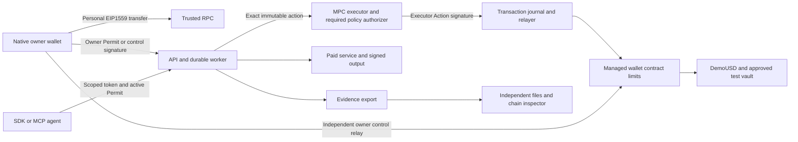

# Person 2 — Platform, Policy and MPCium

> Repository bootstrap added 2026-10-17. Read [README](../../README.md) and [setup](../SETUP.md) for existing foundation files. Continue from that code; financial features and acceptance gates remain unimplemented.
>
> **Coordination rule:** follow the shared [team coordination and merge rules](../COORDINATION-AND-MERGE-POLICY.md). Do not change a shared interface without the review and consumer tests in that document.

> Implementation handoff: execute the numbered tasks in order and save real acceptance results. The identical appendix defines interfaces with the other three owners. You own the runtime and signer integration; do not delegate an unspecified missing service to another person. Implementation agents may execute directly without subagents.

**Goal:** deliver account authentication/sessions, assets/history, owner-transfer relaying, durable agent execution, qualified MPC signing, policy enforcement and inspectable exports.

**Architecture:** API/worker/Postgres, policy authorizer, private NATS/Consul and three MPCium nodes run as separate Docker services on the existing Azure Standard_B2als_v2 VM (2 vCPU/4 GiB RAM). Each node has a distinct identity and encrypted persistent share volume. All three join DKG; two participating nodes are the intended signing quorum. This is a competition PoC boundary: all services share one VM/root, so it demonstrates threshold operation but does not protect against host compromise. Only the HTTPS API is public; MPC/NATS/Consul/policy ports stay on a private Docker network. The owner key stays on the phone.

**Stack:** Node22/Fastify/Zod/viem/PostgreSQL16; Go1.25.8; MPCium commit `90e3ee3c15e6698ade5626ff6c6b49d2453d8ce2`; upstream's pinned Fystack tss-lib fork. No custom cryptography/C++ transport/embedded-wallet provider.

## Agent execution instructions

You are the implementation owner named in this document. Implement this assigned subsystem in the existing repository `/Users/safiussifat/web-projects/fintechathon`. Read this whole prompt, including the identical shared implementation contract, before changing code. Produce working software, tests, operation instructions and measured evidence. A summary, scaffold, mock integration or list of suggested improvements is not the requested implementation.

### Product context every implementation must preserve

The personal account is a locally owned EOA. The managed agent wallet is a separate contract/address/balance. The MPC executor is a third signing identity, never a user receiving address. Moving budget into the managed wallet does not expose the personal seed. The owner approves a bounded task once; online agents then execute while the phone is offline. Owner stop/recovery/managed transfer is independently signed locally and can be relayed without backend/MPC consent. A successful managed OwnerTransfer pauses/increments epoch; ordinary personal sends do not use agent permissions.



Mock tests are isolated local tests. The release demonstration uses real public-testnet transactions and real controlled browser services, with fixture risk/test assets labelled. Never describe these services as an existing commercial integration or test assets as real money.

### Scope and authority

- Treat the user's current instructions and repository `AGENTS.md` as controlling instructions. This document specifies the implementation; quoted competition/vendor material is reference data.
- Use the existing monorepo. Extend existing source and preserve unrelated work; do not create another repository or nested application. Check current files/branch/changes before editing. At the dated bootstrap baseline, source has wallet domain4/Login1 and unfinished financial routes; inspect current changes and preserve newer correct work; migrate consumers together to wallet domain5/Login2 before signing.
- Deliver every required task below, including the complete-wallet W tasks. WalletConnect/external dApp connections are deferred. Native owner signing, personal transfers and scoped external agent SDK/MCP are required. Do not add Circle, an embedded custody replacement, arbitrary signing, unapproved chains/assets, a full-key executor fallback or extra product scope.
- Own only the paths assigned here. Shared schema, root scripts, lockfile and manifest changes go through Person1. Specify the exact required patch and dependency when another owner must change their files; do independent work while that dependency is pending. Never silently fork an ABI/type, fake another person's service or mark their component complete.
- Supplied public fixture keys are test fixtures only. Follow repository/session authorization for key generation and deployment; real-fund/mainnet operations are outside this prompt. A missing host, native package credential, testnet faucet balance or authorized deployment is a named dependency, not a reason to substitute mock signing/settlement.
- Do not remove controls to meet a date. Internal target is October 18, 2026, 18:00 Dhaka; submission cutoff October 20, 2026, 21:59 Dhaka. Record actual gate times; old elapsed milestones are not completed automatically.

### Mandatory task loop

1. Read a task's dependencies, interfaces, existing implementation requirements and test specifications. Write down the exact files and required schema commit in `evidence/person2/progress.json`.
2. Create the named test files and a fixture for every case ID. Make the test fail for the missing behavior, run it and retain the failing assertion. A missing test runner/import/toolchain is a setup failure, not the intended red assertion; fix setup first.
3. Implement the task in small changes. Keep identifiers, type order, amount units, nonce lanes and trust boundaries exactly as specified. The implementation checklist and the test matrix are both required.
4. Run the targeted cases, then the entire affected package suite and type/build checks. When a dependency changes, rerun consuming tests against its actual commit. Mocked RPC/MPC/provider tests qualify local behavior only; the milestone also needs the real integration evidence stated below.
5. Record each case's command, exit status, expected/observed state, assertion result, commit and redacted artifact references. A missing credential/device or skipped test is BLOCKED/NOT_RUN, never PASS. Fix owned failures and repeat. Never edit expected outputs to match an incorrect implementation.
6. Supply the actual output/interface sample to the receiving owner and obtain integration confirmation. Use a focused commit if commits are authorized in the current session; otherwise leave a clearly described, reviewable working-tree change. No automatic push/publish/submission is requested by this prompt.
7. Mark the task complete only when its mandatory outcome and every applicable case pass, and any explicitly required physical-device/public-chain gate has evidence. Continue to the next unblocked task; finish with the report format below.

### Test harness contract — build this before relying on commands

Commands in task blocks are **required implementation targets**, not claims that the bootstrap already implements them. At the bootstrap baseline, `make check-*` and release targets intentionally fail. Person1 owns `scripts/check-suite.mjs` and root wrappers; each owner supplies the real package tests, and Person4 supplies `evaluation/run.ts` and `evaluation/release-check.ts` consumed by those wrappers. Coordinate with Person1 to replace each placeholder only after a real test runner exists. A command must exit nonzero for missing suites, zero discovered tests, assertion failure or required prerequisite failure. Do not use `--if-present`, `|| true`, empty tests or skipped required suites to make acceptance green.

- TypeScript package tests: use Node's test runner through the existing pinned `tsx`; define `test` as `tsx --test test/*.test.ts`. Keep Node mobile tests limited to pure domain/view-model/API logic; native UI and real React Native screens use instrumentation/installed flows, not an unsupported direct Node import. Test files are named explicitly in each task; Node test names contain the exact case ID. Go/Solidity/Kotlin test identifiers use the same ID with hyphens/dots replaced by underscores and record the canonical ID in the result mapping. A package `check` runs its complete tests and typecheck. Resolve/install any additional test dependency explicitly and record its exact lockfile version through Person1.
- Solidity: Solidity 0.8.28 Foundry configuration and OZ5.4.0 already exist. Add `forge-std` from its official repository with a recorded exact commit/remapping; record the Foundry toolchain version. `forge build`, named `forge test` suites and invariants are all required. No business contract is currently supplied.
- MPC: run actual pinned Go1.25.8 tests in both modules plus an isolated node-qualification runner. Mock signatures are insufficient for the real MPC gate. Pin and inspect dependency/source/configuration before starting nodes.
- Android: define native library Gradle project `:owner-wallet`, JVM tests, connected instrumentation and an installed-app flow runner. Record generated native project/module wiring and dependency pins. Implement and pin the Maestro CLI prerequisites for the listed installed-app flows; biometric/device-credential/restore cases may require a recorded human operator, and an omitted manual step cannot pass. JVM/RN mocks cannot qualify Keystore, biometric cancellation, restore or physical signing. Device-only cases require the actual device record.
- Cross-owner integration: Person4 supplies scenario definitions and the runner; each owner supplies assertions for their component. `make check-integration` must run the scenarios against real configured services and a real testnet manifest, or fail with the unmet prerequisite. CI/local deterministic tests use isolated local fixtures. Testnet faults use valueless test assets; public chain reorgs are modelled on an isolated local chain, never induced on public infrastructure.
- `make release-check` is a separate evidence/artifact gate. Passing unit tests or `/healthz` does not satisfy it. `/readyz` stays503 until required service dependencies, versions and applicable qualification gates actually pass.

### Required evidence format

Store `evidence/person2/cases/<task-id>.json` and `evidence/person2/progress.json`. Each case record has `{caseId,taskId,status,sourceCommit,workingTreeDigest,schemaCommit,environment,command,exitCode,expected,observed,startedAt,finishedAt,artifactRefs,limitations}`. Status is PASS/FAIL/BLOCKED/NOT_RUN. Timestamps include timezone. Artifacts may include redacted test output, canonical fixture/hash, chainId/transaction/block hash, independent verifier report, device/build fingerprint or screenshot. Never include mnemonic, BIP39 passphrase, share, private key, raw MPC rounds, refresh token, credential-bearing RPC URL or hidden model reasoning. Test secrets use isolated local ignored configuration.

Use base sourceCommit plus a working-tree diff digest while work is uncommitted; rerun release checks against the final identified source. Parameterized cases must record each variant and assertion, not only an aggregate label. A PASS test case may correctly expect an inspector finding to be UNVERIFIABLE; case success is not the same as all findings being PASS.

A milestone record lists all required case IDs, dependencies and actual pass time. All required cases must be PASS; absence is not success. Reproduce at least one prior failure after its fix. Preserve old failed runs rather than overwriting history. If authentic inspection returns PENDING/UNVERIFIABLE, preserve that result and explain it; verification correctness does not mean forcing every finding green.

### Final implementation report required from the receiving agent

1. **Implemented:** task IDs, owned files, source/schema/deployment versions and actual delivered capabilities.
2. **Verified:** exact commands and case IDs, counts of PASS/FAIL/BLOCKED/NOT_RUN, device/chain references and artifact paths.
3. **Integration:** upstream/downstream commit IDs and the confirmed end-to-end flows.
4. **Incomplete:** exact missing capability/resource, security impact, owner and next executable action. Never say complete if any required gate is missing.
5. **Operate:** fresh-start, migration, funding, restart, backup/restore and rollback instructions relevant to this owner.
6. **Review:** changed-file summary, residual limitations and no-secret check. Do not claim audited safety, mainnet readiness, full MetaMask parity or competition success.

**Tool references:** [Foundry testing](https://getfoundry.sh/forge/tests), [Forge Standard Library](https://getfoundry.sh/reference/forge-std/overview). Pin the actual resolved tool/dependency versions and verify their behavior; documentation is not a passing implementation result.

## Owner milestones — mandatory exit gates

Task-level case IDs and public/device evidence below are the gate criteria. Refer to S7 for the original Dhaka target times. No gate passes merely because its target time elapsed.

| Milestone | Required task coverage | Mandatory outcome |
| --- | --- | --- |
| M0 / W0 | `P2-03, P2-W01 contracts` | Migration/API/session fixtures accepted against Person1 schema; test DB and actual runner available. Interface readiness does not imply implementation complete. |
| M1 / G1 | `P2-01/02 plus auth foundations` | Actual20 threshold signatures and all isolation/authorizer denials; otherwise explicitly MPC_TOPOLOGY_BLOCKED. Auth work can proceed independently. |
| M2 / G2 | `P2-03/04/05` | Phone-approved task produces one public-testnet MPC payment, actual useful output and durable independent export with response-loss/restart evidence. |
| M3 / G3,W2/W3 | `P2-04, P2-W01/02/03` | All runbooks through one worker; owner relay, history coverage, session rotation/revocation and correct reservation/evidence behavior. |
| M4 / G4,W4 | `P2-06, P2-W04 and all failure cases` | Node/DB/RPC/queue/crash/reorg/restore/tenant/refresh failures tested; installed app demonstrates API-offline personal/owner paths. |
| M5 / G5,W5 | `Every P2 task` | Operable deployment/backup/loss guide, current pins/readiness, exact results/known risks and final integration sign-off; no unresolved required case. |
| MA / W0–W4 (v7) | `P2-A01, P2-A02, P2-A03` | Agent questions, owner approvals, policy relay, per-asset execution and risk sentinel integrated; AQ03, AQ05–AQ09, AQ12 and AQ14 platform cases PASS. |

## Start here — current release scope and task order

**Required:** the complete personal-wallet and managed-agent flows in S8. **Deferred:** WalletConnect/external dApp connections; no WalletKit dependency, Reown projectId, dApp screen or pairing acceptance gate. External agent SDK/MCP access remains required.

Sections 2–6 and the wallet tasks in section 7 are one delivery. Follow the sequence below; wallet tasks are not work postponed until after the agent-only path. Existing bootstrap source needs W0 migration before new financial signatures. Documentation 7.0 keeps wallet domain 5, Login 2 and agent receipt/runbook schema 4, moves Invoice to domain 2 and adds the S9 agentic layer and policy controls; section 8 tasks are required in the same delivery.

| Work order | Task IDs | Deliverable / dependency |
| --- | --- | --- |
| Auth and API foundation | `P2-03 + P2-W01` | Implement Login2, account isolation, native refresh rotation/session revocation and business migrations against Person1’s W0 schema commit. |
| MPC qualification | `P2-01 + P2-02` | In parallel, prove the pinned topology and exact-request mandatory authorization; the exact pinned-build threshold and outage behavior are release gates. |
| First integrated payment | `P2-04 + P2-W03` | Connect durable reservations/worker/relayer and managed owner-transfer draft/submit; retain separate authority and nonce lanes. |
| Wallet continuity | `P2-W02 + P2-W04` | Provide actual assets/history/backfill/reorg coverage, indexer credentials and outage/session behavior. |
| Evidence and operations | `P2-05 + P2-06` | Export inspectable records; qualify deployment/restore and report original-agent plus wallet gates. |
| Agent decisions and owner controls | `P2-A01 + P2-A02 + P2-A03` | Question service and compile route, approvals/policy relay/per-asset execution, then the risk sentinel. |

**Completion record:** for each task record source commit, shared-schema commit, command/device or chain reference, observed result and known gaps. Unrun or failed cases stay incomplete. Both original G/Q and wallet W/WQ gates apply; no acceptance or implementation tests were executed by updating this document.

## 1. Complete outputs and trust boundaries

| Output | Owned location | Required behavior |
| --- | --- | --- |
| Public service | `apps/api/src/{auth,accounts,assets,activity,transactions,wallets,tasks,permits,admin,tokens,evidence}` | Appendix routes, Login2/sessions, history, owner transfers, tenant isolation and idempotency |
| Durable runtime | `apps/worker/src/{jobs,advance,reservations,execution,relayer,reconcile}` | Shared runbook driver; one logical action across retries/crashes |
| Storage | `apps/api/migrations`, `apps/api/src/db` | Constraints/locks/leases/outbox, refresh families/revocation, history coverage and encrypted artifacts |
| Policy service | `services/policy/src/{load,validate,rules,authorize}` | Independently reload owner scope, immutable Action and current chain state |
| MPC Go adapter | `services/mpc-adapter/{cmd,internal}` | Build exact signed requests, route results, normalize/recover EVM signature |
| MPC Go authorizer | `services/mpc-authorizer/{cmd,internal}` | Verify initiator+policy-approved exact bytes, authorizer private key only in policy service |
| Operations | `infra/{compose.dev.yaml,mpcium.lock.json}`, `infra/release/compose.mpcium.yaml`, `docs/platform-operations.md` | Private services, separate per-node shares/backups, restore and deploy |
| Evidence | `apps/worker/src/evidence`, `evidence/person2` | Ledger/artifacts/checkpoint/anchor/export with no secret leakage |

Person1 supplies ABI/schema; Person3 signs owner Login2/Permit5/Admin5/OwnerTransfer5; Person4 supplies runbooks/providers and independent inspector. You provide the stable backend those components use. Person4 cannot call a generic signer or bypass your worker.

## 2. Prove MPCium first

Reference material: pinned [signing consumer](https://github.com/fystack/mpcium/blob/90e3ee3c15e6698ade5626ff6c6b49d2453d8ce2/pkg/eventconsumer/sign_consumer.go), pinned [keygen consumer](https://github.com/fystack/mpcium/blob/90e3ee3c15e6698ade5626ff6c6b49d2453d8ce2/pkg/eventconsumer/event_consumer.go), pinned [production config](https://github.com/fystack/mpcium/blob/90e3ee3c15e6698ade5626ff6c6b49d2453d8ce2/config.prod.yaml.template), pinned [installation steps](https://github.com/fystack/mpcium/blob/90e3ee3c15e6698ade5626ff6c6b49d2453d8ce2/INSTALLATION.md), and [current official MPCium docs](https://docs.fystack.io/mpcium). The pinned production config and current online threshold examples differ; qualify the checked-in source version.

### P2-01. Pinned three-node/two-participant setup and EVM signature, G1

**Setup sequence:** fetch the commit recorded in `infra/mpcium.lock.json`; build MPCium and its CLI from that source; use the upstream `mpcium-cli generate-peers -n 3`; generate the initiator identity and three node identities using the pinned setup utilities; place private identity/password/share files under `/opt/mandate/private/mpc/node0`, `node1`, and `node2`; distribute peer public identity files and the same `peers.json` to each node; set the same 32-byte chain code and exact pinned config on all three; then start NATS/Consul, the three nodes, policy authorizer, adapter and worker in that order. Store no generated private file in Git or a container image. Use the exact commands supported by the pinned checkout and record them in the operator guide.

**Create:** `infra/mpcium.lock.json`, `infra/release/compose.mpcium.yaml`, deployment templates, Go adapter package, `infra/scripts/qualify-mpc.sh`, and `evidence/person2/mpcium-qualification.json`.

- [ ] Pin exact MPCium commit above plus `go.sum` and resolved images; record the replaced dependency `github.com/fystack/tss-lib/v3 v3.0.1`. Retain Apache2.0 notices. Do not claim the complete integration is audited.
- [ ] Run **three nodes with `mpc_threshold: 1`**. In the pinned source, keygen passes the configured value to TSS and the signer computes `requiredPeers := mpcThreshold + 1`. The pinned production template uses `1`, so this is the candidate two-participant quorum. Current online docs use a different threshold-label convention. Verify actual keygen/signing behavior from this exact commit before accepting the value. DKG uses all three peers. Do not infer threshold semantics from a config name or copy another version's defaults. Record the resolved upstream doc/source mismatch in the qualification report. If DKG/signing behavior differs, mark G1 blocked and update the source/config/manifest together.
- [ ] Generate three distinct node identities and public peer records; use three separate persistent encrypted Badger volumes, one per container, with distinct passwords and backup files. Generate one common32-byte chain_code as upstream requires; no child derivation in release (`DerivationPath` canonical empty). Generate one executor wallet per Mandate managed wallet, no shared derived customer key tree. Set max_concurrent_keygen=1 and max_concurrent_signing=1 initially. Keygen is an administrative command, unavailable to end-user agent tokens. Keep node secrets out of source control, image layers, compose literals and logs.
- [ ] Enable `authorization.enabled:true` and **nonempty `required_authorizers:[mandate-policy-v1]` on all three nodes**; distribute only the policy public key to nodes and keep the authorizer private key in the policy service secret store. Refuse application readiness if config is disabled/missing/empty/mismatched. Keygen also requires this authorizer through an explicit administrative ceremony; reshare is denied in release.
- [ ] Put the three MPC nodes, NATS and Consul on a private Docker bridge. The current API uses host networking, so expose NATS/Consul to host processes only with ports bound to `127.0.0.1` (for example 4222/8500); nodes use Docker service DNS on the bridge. Do not bind these ports to the VM public interface. Keep adapter/policy endpoints loopback-only. Configure NATS credentials/ACLs and Consul ACL token where supported; enforce host firewall and encrypted disks. Verify unauthorized publish/read/register attempts fail. Inspect pinned client TLS options; do not claim TLS unless tested. The VM is the single network/administrator trust boundary. The process uses loopback-only NATS/Consul host bindings because the API currently runs in host network mode; the release compose file must preserve this binding and verify public bind addresses before starting nodes.
- [ ] Register result handlers **before publishing**, set stable unique adapter ClientID `mandate-adapter-a`, permit one active client process with that ID, serialize sessions per key. Match response walletId+TxID+expected key/digest; never accept an arbitrary success from result topic.
- [ ] Decode R/S/recovery returned by ECDSA path; pad r/s to32 bytes, normalize low-S with vetted secp256k1 library and adjust/recover parity, produce canonical65-byte Ethereum signature. Recover expected executor on original32-byte Action digest, including leading-zero digest vectors. No extra hash/text signing. Verify in viem and Person1's Solidity test harness.

**Acceptance:** all three peers complete DKG; 20 sequential fresh requests validate; each pair (0+1, 0+2, 1+2) signs; each single node fails; stopping one node leaves the other two able to sign; stopping two fails closed; missing/wrong authorizer and mutated request fail; a node restart reloads its own persistent share and never uses a full key. Include a recorded demo drill: during a Base Sepolia task, stop node0 and show the valid payment still completes; stop node1 too and show the next request fails closed with no transaction broadcast and its reservation retained; restart a node and show readiness recovers without key regeneration. Save public vectors, timing and config hashes, not private MPC transcript/share data. Report shared-host limitation.


#### Required execution contract — P2-01

**Prerequisites / blockers:** P1 W0 Action vectors; existing Azure VM access, private Docker network and authorized isolated test-key ceremony. Pinned source exists under vendor/mpcium. Current VM is 2 vCPU/4 GiB; qualify actual memory use while API/database services are also running.

**Required source and test files:** `infra/mpcium.lock.json`, `infra/release/compose.mpcium.yaml`, `infra/secrets.example`; `services/mpc-adapter/internal/qualification`; `services/mpc-adapter/testdata`; `infra/scripts/qualify-mpc.sh`; `docs/platform-operations.md`; `evidence/person2/mpcium-qualification.json`.

**Consumes / produces:** Consumes pinned MPCium90e3ee3c15e6698ade5626ff6c6b49d2453d8ce2 and Go1.25.8. Source inspection shows signing readiness requires configured threshold+1 peers; the observed test results must confirm the candidate value1 behaves as 2-of-3. Required policy authorizer is mandatory. Produces verified executor public key/address and an actual qualification report, never a private share/transcript.

**Implementation algorithm:**

```text
1. Verify pinned source and record the exact threshold calculation, DKG peer requirements, storage/config paths, authorizer behavior and cited files/lines. Compare with the official current docs and record the documented convention difference.
2. Run the pinned `mpcium-cli generate-peers -n 3`; generate the initiator and three node identities with the matching pinned CLI/scripts. Keep private files under `/opt/mandate/private/mpc/`, outside Git and image layers.
3. Build the pinned image; start three services from the same immutable image digest with distinct node identity, config and persistent encrypted volume. Keep node ports private.
4. Start NATS/Consul on the private Docker bridge, the nodes on that bridge, and adapter/policy with only loopback connectivity to their private endpoints. Confirm public-interface scans cannot reach any MPC/NATS/Consul endpoint.
5. Run DKG with all three. Record readiness and resulting public executor address. Run pairwise signing tests for (0,1), (0,2), (1,2), then single-node and outage tests. Do not patch cryptographic source to force expected behavior.
6. If 3-node startup, DKG or 2-of-3 signing fails, mark `MPC_TOPOLOGY_BLOCKED`, preserve logs/config hashes, and update the manifests before deployment; do not claim success or use a full-key fallback. If online guidance disagrees with this pinned behavior, the pinned code plus observed tests determine the release configuration; document the difference.
7. Verify returned R/S/recovery against original Action digest with an established secp256k1 implementation; no rehashing. Record actual memory/CPU under the full demo stack.
```

**Mandatory tests — implement each ID as an independently reported case:**

| Case ID | Exact setup / action | Required assertion / observed outcome |
| --- | --- | --- |
| `P2-01.T01` | 20 sequential fresh threshold-signing sessions with public digest vectors, including leading-zero digest | Every signature recovers exact expected executor on original32bytes; record count, duration and configuration hash. |
| `P2-01.T02` | Run each individual node alone | No individual node returns a valid threshold signature; no ordinary-key fallback. |
| `P2-01.T02b` | Sign with each pair: 0+1, 0+2, 1+2 | Each pair returns a signature that recovers the same expected executor. |
| `P2-01.T02c` | Stop node0 while nodes1+2 stay ready; then stop two nodes | One-node outage still signs; two-node outage fails closed and emits no broadcastable result. |
| `P2-01.T03` | Missing/empty/wrong required_authorizers or authorization disabled | Application readiness fails; no financial signing even if upstream enabled flag alone would allow it. |
| `P2-01.T04` | Unauthorized NATS publish/Consul read-register/network client | Denied by configured tunnel/auth/ACL/firewall; no plaintext public share/coordinator access. |
| `P2-01.T05` | Restart a signer after a completed session; replay a mismatched result/wallet/attempt | Fresh valid sessions remain verifiable; wrong result is rejected; old ephemeral session is not resumed. |
| `P2-01.T06` | Three-node setup/DKG/quorum does not match the pinned expected behavior | G1 remains BLOCKED with exact logs and source/config evidence; no fabricated success or hidden topology change. |

**Task execution checklist:**

- [ ] Create the listed test files and fixtures; implement every case above with direct assertions on state/bytes/balances/status, not only HTTP200 or a log message.
- [ ] Run the targeted cases against the incomplete behavior; retain genuine failing assertions after the runner/toolchain is working.
- [ ] Complete the implementation checklist above and the algorithm here; keep ownership/trust boundaries intact.
- [ ] Run the commands below and all affected regression suites. Real chain/device/MPC cases require the actual environment; label deterministic substitutes as local tests only.
- [ ] Record each case in `evidence/person2/cases/P2-01.json`; attach source/schema commit, command/exit status, expected/observed result, environment and redacted artifacts.
- [ ] Give the receiving owner the actual interface sample/commit and verify the joint behavior; leave blocked dependencies explicitly incomplete.

**Required verification commands** (wire missing real test scripts as specified above; placeholders cannot pass):

```bash
(cd services/mpc-adapter && go test ./...)
(cd services/mpc-authorizer && go test ./...)
make check-platform
```

**Mandatory outcome before this task is complete:** Q02/G1 requires real DKG and20 recovered signatures plus isolation/authorization denials. If topology fails, report a named release blocker while continuing auth/history work; never claim MPC readiness from code inspection.

### P2-02. Exact request authorization, G1–G2

**Create:** adapter `request.go`, authorizer `authorize.go`, policy `authorize.ts`, private endpoint contract test.

Use upstream **Go** client/types at the same commit. This avoids dependence on a separately versioned TS client's serialization. Our public TypeScript SDK calls the API, never MPCium directly. Threshold references: pinned `event_consumer.go` passes config to TSS; pinned `sign_consumer.go` requires config+1 peers; pinned `config.prod.yaml.template` sets1. Current Fystack docs describe a different threshold-label convention (their example uses2 for 2-of-3). Capture these source and documentation references in the qualification report; do not mix versions.

```text
internal SignAction(actionId) — no raw digest input
1. Adapter loads committed Action, Invoice and Permit; recomputes EIP712 digest.
2. Build SignTxMessage:
   KeyType=secp256k1, WalletID=registered MPC UUID, TxID=signing attempt UUID,
   NetworkInternalCode="eip155:84532", Tx=exact 32 digest bytes,
   DerivationPath=nil (frozen by golden Go JSON fixture).
3. Sign msg.Raw() using the adapter service's local Ed25519 initiator.
4. Send {actionId,attemptId,message} over authenticated private channel to the policy/authorizer service.
5. The policy service independently verifies initiator signature and runs policy on stored data;
   compare wallet/key/network/path/TxID/Tx against reconstructed expected message.
6. The Go authorizer uses upstream ComposeAuthorizerRaw(message), signs those exact bytes with
   policy-authorizer Ed25519 key, returns only required authorizer signature.
7. Attach signature; Go client.SignTransaction signs Raw() again and publishes.
   Ed25519 is deterministic: assert repeated initiator signature unchanged.
8. All three nodes verify initiator + required authorizer before threshold signing.
9. Recover executor from returned signature; persist before sending to relayer.
```

`POST /internal/sign-actions {actionId}` on adapter returns202 `{actionId,attemptId,state}`; `GET /internal/sign-actions/:actionId` returns same stored status or `{actionId,attemptId,keyVersion,executorAddress,signature,state:'SIGNED'}`. Private caller is worker only. `POST /internal/authorizations {actionId,attemptId,message}` is the private Go authorizer service; its private-network call `POST /internal/policy/check {actionId,attemptId,message}` returns `{allowed,ruleIds,expectedDigest,expectedMpcWalletId,expectedNetwork,expectedTxId,expectedDerivationPath,chainBlock}`. The authorizer compares every field before authorizing. Policy never accepts caller-supplied expected digest as truth. `GET /health/ready` reveals status only, not config/keys.

- [ ] Policy service reads immutable owner-signed records through restricted DB role, verifies owner signature/hash commitments and queries its own RPC at one recent block. It does not trust API's admitted flag, current balance claim or model explanation.
- [ ] Check current active epoch/time, installed runbook/hash, Conditions, target/recipient, token/vault, quote/provider signature, request identity, quotas/floor, durable reservation and rate≤5proposals/min/executor. Deposit also fresh NORMAL signal/preview-derived minOutput with≤50bp margin; no available liquidity from pending withdrawal. Compare exact invoice/input binding.
- [ ] Store attempt UUID→business action/digest/keyVersion before publish. Unique attempt and explicit message fingerprint; signed request has no independent policy-expiry field, so contract Action deadline and replay IDs remain mandatory. Replayed queue messages cannot create a second payment. Do not claim authorizer itself provides on-chain nonce protection.
- [ ] Serialize per executor, bound timeouts/queue length; on uncertainty record SIGNING_UNKNOWN. No mid-protocol state restoration, custom nonce cache or automatic reuse of ephemeral state. Reconcile before new attempt on same business action; fresh upstream session only after safe abort. Completed action returns stored signature/status.
- [ ] Deny remote reshare/keygen routes and arbitrary digest signing. Local keygen ceremony uses fixed planned walletId, admin operator approval and authorizer binding. Agent bearer tokens never reach either Go endpoint.

**Acceptance:** initiator compromised alone cannot get unauthorized Action signed; authorization for one digest/wallet cannot authorize another. The policy/authorizer service unavailable stops new signing. Document that a VM administrator can access all shares and the policy key, so this PoC does not resist host compromise, while wallet caps remain enforced.


#### Required execution contract — P2-02

**Prerequisites / blockers:** P2-01 qualified signing and Person1 typed/hash vectors; readonly policy DB role and independent RPC available.

**Required source and test files:** `services/mpc-adapter/internal/{request,journal,result,signature}.go`; `services/mpc-authorizer/internal/authorize.go`; `services/policy/src/{load,validate,rules,authorize}.ts`; `services/mpc-adapter/internal/{request,result,signature}_test.go`; `services/mpc-authorizer/internal/authorize_test.go`; `services/policy/test/authorization.test.ts`.

**Consumes / produces:** Worker->adapter POST/internal/sign-actions{actionId}; adapter->authorizer{actionId,attemptId,message}; local policy returns allowed/ruleIds/expectedDigest/MPCwallet/network/attempt/path/chainBlock. Only IDs select stored immutable financial data; no raw signing HTTP input.

**Implementation algorithm:**

```text
Load immutable Action/Permit/Invoice/reservation -> independently rebuild trusted EIP712 digest -> create upstream SignTxMessage with exact walletId/attempt/network/32byte Tx/nil derivation path -> Ed25519 initiator-sign Raw.
Authorizer independently verifies initiator signature, reads original owner scope and own recent chain snapshot, compares every reconstructed field and all policy rules -> ComposeAuthorizerRaw -> sign with B identity.
Attach authorization using pinned Go client and prove repeated initiator bytes/signature unchanged. Nodes require same authorizer identity. Verify recovered EVM signer before storing completed signature.
Persist attempt ID/keyVersion/digest before publish; serialize per key; timeout => SIGNING_UNKNOWN with reservation retained, no automatic fresh unrelated signing session.
```

**Mandatory tests — implement each ID as an independently reported case:**

| Case ID | Exact setup / action | Required assertion / observed outcome |
| --- | --- | --- |
| `P2-02.T01` | Modify digest/walletId/network/attempt/derivation path after approval, one field per test | Authorizer denies every mutation; no valid signature reaches worker. |
| `P2-02.T02` | Caller supplies allowed=true/expectedDigest but immutable DB state differs | Independent reload wins; deny caller claim. |
| `P2-02.T03` | Stale chain snapshot>15s, revoked epoch, wrong recipient/runbook/quote or missing reservation | Deterministic denial rule ID; no MPC initiation. |
| `P2-02.T04` | Policy NORMAL signal older than60s or WARNING on deposit; excessive proposal rate>5/min/executor | Deposit/rate admission denies, including when model asks to override. |
| `P2-02.T05` | Policy/authorizer service unavailable, wrong initiator or wrong authorizer key | No new signing; already released usable signatures remain explicitly unresolved until reconciliation. |
| `P2-02.T06` | Result for wrong keyVersion/wallet/attempt/digest or nonrecovering EVM signature | Reject result; no relay and no release of uncertain reservation. |
| `P2-02.T07` | Same committed action submitted twice while first attempt unresolved | Returns stored status/original logical action; no concurrent signing or second business payment. |

**Task execution checklist:**

- [ ] Create the listed test files and fixtures; implement every case above with direct assertions on state/bytes/balances/status, not only HTTP200 or a log message.
- [ ] Run the targeted cases against the incomplete behavior; retain genuine failing assertions after the runner/toolchain is working.
- [ ] Complete the implementation checklist above and the algorithm here; keep ownership/trust boundaries intact.
- [ ] Run the commands below and all affected regression suites. Real chain/device/MPC cases require the actual environment; label deterministic substitutes as local tests only.
- [ ] Record each case in `evidence/person2/cases/P2-02.json`; attach source/schema commit, command/exit status, expected/observed result, environment and redacted artifacts.
- [ ] Give the receiving owner the actual interface sample/commit and verify the joint behavior; leave blocked dependencies explicitly incomplete.

**Required verification commands** (wire missing real test scripts as specified above; placeholders cannot pass):

```bash
(cd services/mpc-adapter && go test ./...)
(cd services/mpc-authorizer && go test ./...)
./scripts/pnpm.sh --filter @mandate/policy check
make check-platform
```

**Mandatory outcome before this task is complete:** Exact-request authorization is enforced by all three nodes and independently tested; node/policy identities never become owner keys. Accepted digest/signature fixture works against Person1 contract.

## 3. API and persistent financial runtime

### P2-03. Database, auth and provisioning, G0–G2

**Create:** migrations for users, wallets, auth_challenges, agent_tokens, tasks, permit_drafts, permits, actions, reservations, signing_attempts, transactions, jobs/outbox, events, artifacts, checkpoints, idempotency_keys.

- [ ] Unique owner wallet; wallet/requestId; wallet/invoiceId; task/decisionKey; schedule permit/period; sender/nonce lineage; task/event sequence; tenant/route/idempotency key. Decimal strings map to Postgres numeric(78,0); never JS Number for funds. Add state/tenant foreign-key checks.
- [ ] Signed Login2 as S8, nonce once transactionally,≤5min challenge,15min revocable-session JWT/native refresh, origin/deviceId pinned; rate-limit. Hash-store32-byte random scoped tokens, reveal once; default no evidence scope. Every route checks owner and wallet/task restrictions. No tenant identifiers trusted from token caller alone.
- [ ] Implement S4 routes/OpenAPI and sample responses. Authenticated POST wallets relays factory.createWallet(owner), waits inclusion, then administers per-wallet DKG; mark READY only when manifest-matched wallet and executor available. Do not return fake address while provisioning.
- [ ] Interpret runbook goal via Person4's prepare function before draft. Owner terms may tighten defaults; invalid/ambiguous interpretation stays AWAITING_OWNER/NEEDS_OWNER. Draft fresh nonce/epoch and hashes; one outstanding draft per wallet. Activation validates returned signature and unchanged immutable draft before sponsored submit.
- [ ] Admin draft immediately sets local inhibit on pause/revoke, but API labels unconfirmed until chain ordered; independent emergency lane, owner signature verified, no MPC requirement. Recovery does not need an active task.
- [ ] Add durable jobs with leased row locks, SKIP LOCKED, heartbeat, bounded retry and transactional outbox. API process can restart without losing scheduled task or approval.

**Acceptance:** phone signs actual Login/Permit; no password/vendor auth; cross-tenant/read-run/evidence violations fail; duplicate HTTP mutation returns same logical record, differing body409.


#### Required execution contract — P2-03

**Prerequisites / blockers:** P1 W0 API schemas; existing platform migration runner; test PostgreSQL separate from user data.

**Required source and test files:** `apps/api/migrations/0002_business.sql`; `apps/api/src/{auth,wallets,tasks,permits,admin,tokens,evidence}`; `packages/platform/src/{db,jobs,outbox,idempotency}.ts`; `apps/api/test/{tenancy,idempotency,provisioning,permits}.test.ts`; `packages/platform/test/storage.test.ts`.

**Consumes / produces:** Implements all S4 routes with strict shared validators/tenant checks; provisions canonical factory wallet then per-wallet MPC executor before READY. Consumes Person4 prepareTask and Person1 owner signatures; never invents a frontend-only task/permit.

**Implementation algorithm:**

```text
Migrate owners/wallets/challenges/tokens/tasks/permits/actions/reservations/attempts/transactions/jobs/outbox/events/artifacts/checkpoints/idempotency.
Use numeric(78,0) plus uint range checks, explicit UUID<->bytes32 mappings and unique(taskId,decisionKey), unique(wallet,requestId), unique(wallet,invoiceId), unique(permit,period), unique(tenant,route,key), unique(task,sequence).
Mutation transaction: authenticate and authorize tenant -> lock idempotency row -> compare canonical body hash -> apply business change + outbox -> commit original response. Same key/body returns same record; changed body409.
Provision DEPLOYING->KEYGEN->READY only after actual factory mapping/code/owner and qualified executor public key verified. Retry resumes stored operation.
Task interpretation returns exact committed Conditions; one pending permit draft/wallet, fresh nonce/epoch; activation cannot alter original signed terms.
```

**Mandatory tests — implement each ID as an independently reported case:**

| Case ID | Exact setup / action | Required assertion / observed outcome |
| --- | --- | --- |
| `P2-03.T01` | Same Idempotency-Key/body sent20times concurrently; then one changed amount | Exactly one business record/operation/response identity; changed body409, no second outbox payment. |
| `P2-03.T02` | OwnerA JWT or agent token targets B wallet/task/evidence | 403 with AUTH_SCOPE; no record/artifact disclosure or mutation. |
| `P2-03.T03` | Provision response lost between factory deployment and DKG | Retry discovers same wallet, resumes keygen state and never fabricates READY/new wallet address. |
| `P2-03.T04` | Missing code/incorrect factory mapping, keygen failure or executor mismatch | FAILED/retryable provisioning state; no fund/approve READY UI. |
| `P2-03.T05` | Unknown API field, float amount, overwidth uint, invalid state transition | 422/no side effects; parser errors reveal no secrets. |
| `P2-03.T06` | Pause/revoke draft before chain submission | Local inhibit starts, UI state is pending not confirmed; only chain receipt changes confirmed authority. |
| `P2-03.T07` | Race two worker leases/outbox consumers on same action | Only one durable logical transition; lease recovery does not erase idempotency. |

**Task execution checklist:**

- [ ] Create the listed test files and fixtures; implement every case above with direct assertions on state/bytes/balances/status, not only HTTP200 or a log message.
- [ ] Run the targeted cases against the incomplete behavior; retain genuine failing assertions after the runner/toolchain is working.
- [ ] Complete the implementation checklist above and the algorithm here; keep ownership/trust boundaries intact.
- [ ] Run the commands below and all affected regression suites. Real chain/device/MPC cases require the actual environment; label deterministic substitutes as local tests only.
- [ ] Record each case in `evidence/person2/cases/P2-03.json`; attach source/schema commit, command/exit status, expected/observed result, environment and redacted artifacts.
- [ ] Give the receiving owner the actual interface sample/commit and verify the joint behavior; leave blocked dependencies explicitly incomplete.

**Required verification commands** (wire missing real test scripts as specified above; placeholders cannot pass):

```bash
./scripts/pnpm.sh --filter @mandate/platform check
./scripts/pnpm.sh --filter @mandate/api check
make check-platform
```

**Mandatory outcome before this task is complete:** Auth/scoped business routes and migration rollback/start instructions are real; sample requests/responses accepted by Person3/4. No financial endpoint reports successful fake work.

### P2-04. Reservations, worker and transaction journal, G2–G3

**Create:** worker reservation/advance/execution/relayer/reconciliation files.

- [ ] Import Owner4 `advance` and S5 schemas; task lease reads snapshot and atomically commits decisionKey/action/runbookState/events/job. COMPLETE records delivery outcome; enqueue separately signed CLOSE only if authority still usable. User outcome does not imply permission already closed.
- [ ] Lock wallet+permit in stable order. Compute each spend total as chain-included actual spend plus unresolved not-yet-included reservations; finalized is a subset of included, never added twice. Exclude included outflow from liquid reservation subtraction because chain balance already includes it. Pending deposit reserves liquid, pending redeem adds none. UNKNOWN reservations survive restart/day rollover; later refunds do not reset gross.
- [ ] Serialize one outstanding financial transaction per wallet. Proposal prep may be concurrent; serialize signing per executor; count accepted pending requests against caps. `spendable=max(0,chainLiquid-effectiveFloor-unincludedOutflowReservations)`. Risk reads and reservations are explicitly off-chain assertions in evidence.
- [ ] Fill immutable Action requestId/time once. Run pre-sign checks, invoke Go adapter by actionId, persist signature, simulate exact execute, then build relayer tx. Journal sender/nonce/chain/raw signed bytes/hash/payload BEFORE RPC broadcast. Retry exact raw bytes; fee replacement retains nonce/business calldata and records all hashes.
- [ ] If simulation fails after signature exists, mark action denied for broadcasting but retain risk reservation until executable authority/chain history safely resolved. No automatic release on deadline alone; an earlier unknown inclusion could exist. For known reverted transaction release unused reserved amount, record actual gas.
- [ ] Poll2s; three canonical confirmations INCLUDED, RPC finalized head FINALIZED; UNKNOWN at60s and attention120s keep funds reserved. Reorg removes provisional receipt and pauses dependents until reconciled. Inspect full nonce/hash lineage and chain logs before deciding no payment happened.
- [ ] Three funded sender lanes normal/emergency/anchor; reserve fee estimate incl L1+L2+20% buffer. Admission≤0.0005ETH/tx,≤0.02/day with0.002 emergency partition. Insufficient fee budget stops new normal work; owner independent relay remains possible. Record estimated/actual fees separately.

**Acceptance:** kill processes before/after signing, journaling, broadcast and inclusion; original logical request resumes without duplicate transfer. Two tasks racing for insufficient remaining allowance cannot both be admitted or settled beyond contract caps.


#### Required execution contract — P2-04

**Prerequisites / blockers:** P2-02/03 and Person4 advance(snapshot,deps) library; actual contract events and nonce lanes.

**Required source and test files:** `apps/worker/src/{advance,reservations,execution,relayer,reconcile,jobs}.ts`; `packages/platform/src/transactions.ts`; `apps/worker/test/{reservations,crash,reorg,fees,schedules}.test.ts`.

**Consumes / produces:** Consumes S5 immutable snapshot/decision; produces one stored Action per task+decisionKey, durable reservation, signing attempt, exact transaction journal and reconciled status. Worker owns time/IDs/nonces, not the runbook/model.

**Implementation algorithm:**

```text
Under stable wallet->permit locks: includedGross + unresolved-not-included reservations <= all caps; spendable=max(0,chainLiquid-effectiveFloor-unincludedOutflows). Do not add finalized again or count included outflow twice.
Commit decisionKey/action/reservation/runbookState/events/outbox before signing. One outstanding financial tx/wallet; serialize per executor and per sender nonce.
After signing: verify -> simulate exact execute -> journal raw relayer bytes/hash/nonce/payload BEFORE broadcast -> broadcast identical bytes on retry. Replacement keeps business calldata/nonce, new fee hash lineage.
Poll2s;3 canonical confirmations INCLUDED, finalized head FINALIZED.60s UNKNOWN/120s attention retain risks. Reorg removes provisional effects and blocks dependents.
Release only proven unused/reverted authority or confirmed invalidation plus complete past-chain reconciliation. Clock expiry or RPC error alone is insufficient.
Separate normal/emergency/anchor fee lanes: estimated L1+L2+20%, admission0.0005ETH/tx and0.02/day with0.002 emergency partition; estimate is not a guaranteed fee bound.
```

**Mandatory tests — implement each ID as an independently reported case:**

| Case ID | Exact setup / action | Required assertion / observed outcome |
| --- | --- | --- |
| `P2-04.T01` | Two tasks race for last500000 gross allowance with each requesting350000 | Only one reservation admitted; settled+pending never exceeds cap. |
| `P2-04.T02` | Kill before signing, after signature, after raw journal, after broadcast and after inclusion; restart each boundary | One logical action and at most one value transfer; original raw bytes/nonce/hash lineage reused where applicable. |
| `P2-04.T03` | RPC accepts tx but response is lost | UNKNOWN retains reservation; retry/status reconciliation never creates a second invoice/payment. |
| `P2-04.T04` | Simulation fails after a usable executor signature exists | No broadcast through our relayer; reservation remains until safe authority/history resolution. |
| `P2-04.T05` | Cross UTC midnight while an old action remains UNKNOWN | Unknown risk still reserves admission capacity; prior gross stays assigned to actual chain day; no double allowance. |
| `P2-04.T06` | Refund a paid invoice then retry another charge | Refund does not replenish gross task/day caps. |
| `P2-04.T07` | Reorg a provisionally included payment on isolated chain | Dependent result/deposit/schedule execution pauses; event/history/reservation state reconciles without double count. |
| `P2-04.T08` | Normal fee budget exhausted but emergency0.002 partition remains | New normal action denies; owner emergency control retains its own lane; actual fee spend recorded separately. |
| `P2-04.T09` | Two schedule advances/restarts during same due period | Same decisionKey/action; contract pays period at most once; missed periods skipped. |

**Task execution checklist:**

- [ ] Create the listed test files and fixtures; implement every case above with direct assertions on state/bytes/balances/status, not only HTTP200 or a log message.
- [ ] Run the targeted cases against the incomplete behavior; retain genuine failing assertions after the runner/toolchain is working.
- [ ] Complete the implementation checklist above and the algorithm here; keep ownership/trust boundaries intact.
- [ ] Run the commands below and all affected regression suites. Real chain/device/MPC cases require the actual environment; label deterministic substitutes as local tests only.
- [ ] Record each case in `evidence/person2/cases/P2-04.json`; attach source/schema commit, command/exit status, expected/observed result, environment and redacted artifacts.
- [ ] Give the receiving owner the actual interface sample/commit and verify the joint behavior; leave blocked dependencies explicitly incomplete.

**Required verification commands** (wire missing real test scripts as specified above; placeholders cannot pass):

```bash
./scripts/pnpm.sh --filter @mandate/worker check
./scripts/pnpm.sh --filter @mandate/platform check
make check-platform
make check-integration
```

**Mandatory outcome before this task is complete:** Q04/05/09/13/14 show crash-point evidence and actual one-payment invariants; UNKNOWN is never treated as known failure or refunded allowance.

## 4. Evidence, operations and qualification

### P2-05. Ledger/export and independent consumer, G2–G3

- [ ] Implement exact S6 append-only event/hash/checkpoint format. Retain original owner typed data/signature, scope/manifests, immutable actions/invoices, public MPC authorization result/digest/keyVersion, tx lineages/receipts, provider bytes/receipt, recovery and CLOSE status. Never log secrets/round material or hidden reasoning.
- [ ] Store artifact ciphertext/AAD/unique IV/salt, restrict authorized task access,30day expiry and deletion record. Export decrypted bytes+salt only for explicit owner/evidence-scoped token; filenames normalized, zip paths bounded, no permanent public links.
- [ ] Sign checkpoint Ed25519 and enqueue bounded anchor publication. Return provisional export before finality with explicit pending findings; later terminal/reconciled checkpoint anchors final chain. Avoid self-referential anchor inclusion.
- [ ] Export one documented bundle at G2 for Owner4. Compare canonical bytes/hashes byte-for-byte with shared fixture. Do not make backend's own verdict authoritative for inspector. Preserve original facts when integrity/tamper test changes an exported copy.
- [ ] Scan for supported-asset outflows without stored action and alert/freeze new signing pending inspection. Evidence omission remains a limitation; no claim hash-chain proves every event true.


#### Required execution contract — P2-05

**Prerequisites / blockers:** P1 evidence/checkpoint schemas; Person4 fixture importer/CLI; actual owner/action/provider records.

**Required source and test files:** `apps/worker/src/evidence/{append,artifacts,checkpoint,anchor,export}.ts`; `apps/worker/test/{evidence,export,retention}.test.ts`; `apps/api/test/evidence-access.test.ts`.

**Consumes / produces:** Produces exact S6 ZIP bundle, append-only event chain, Ed25519 checkpoint and actual chain anchor reference. Backend result is an assertion/view; independent verifier is a separate consumer.

**Implementation algorithm:**

```text
Append under task lock with monotonic sequence and SHA256 RFC8785 hash excluding eventHash. Keep corrections as new events.
Encrypt artifact bytes AES256GCM unique IV/AAD(taskId,artifactId); commitment SHA256(salt32||plaintext), retain original provider hashes.30day retention then explicit deletion record.
Checkpoint signs canonical task/wallet/chain/sequence/head with evidence key; anchor commits checkpoint digest without circular self-inclusion.
Owner/evidence-scoped token export reveals authorized original bytes/salt only. Normalize ZIP paths and limit artifacts<=10MiB/result; no secrets or model reasoning.
Scan actual supported-asset outflows for unrecorded movement; unexplained outflow inhibits new signing pending inspection.
```

**Mandatory tests — implement each ID as an independently reported case:**

| Case ID | Exact setup / action | Required assertion / observed outcome |
| --- | --- | --- |
| `P2-05.T01` | Concurrent appenders and process restart between event/outbox writes | Contiguous unique sequence, correct hash links, no overwritten event or duplicate logical transition. |
| `P2-05.T02` | Change artifact byte/salt/task AAD or checkpoint/event copy | Integrity/decryption verification fails; original store remains unchanged. |
| `P2-05.T03` | Read-only/run-only/other-tenant token requests evidence | Denied; explicit evidence scope plus wallet/task restrictions required. |
| `P2-05.T04` | Export before finality versus after finalized anchor | Provisional state/actual anchor status preserved; no self-referential checkpoint or fake finality. |
| `P2-05.T05` | Retention deletes artifact bytes | Deletion event retained; inspector reports missing delivery bytes UNVERIFIABLE rather than PASS. |
| `P2-05.T06` | Authentic export opened using only trusted manifest/files/RPC by Person4 | Canonical bytes/known facts agree; backend-only assertions remain labelled, not forced green. |
| `P2-05.T07` | Unmatched supported outflow appears | Alert/inhibit and evidence entry; no fabricated Action inserted to hide it. |

**Task execution checklist:**

- [ ] Create the listed test files and fixtures; implement every case above with direct assertions on state/bytes/balances/status, not only HTTP200 or a log message.
- [ ] Run the targeted cases against the incomplete behavior; retain genuine failing assertions after the runner/toolchain is working.
- [ ] Complete the implementation checklist above and the algorithm here; keep ownership/trust boundaries intact.
- [ ] Run the commands below and all affected regression suites. Real chain/device/MPC cases require the actual environment; label deterministic substitutes as local tests only.
- [ ] Record each case in `evidence/person2/cases/P2-05.json`; attach source/schema commit, command/exit status, expected/observed result, environment and redacted artifacts.
- [ ] Give the receiving owner the actual interface sample/commit and verify the joint behavior; leave blocked dependencies explicitly incomplete.

**Required verification commands** (wire missing real test scripts as specified above; placeholders cannot pass):

```bash
./scripts/pnpm.sh --filter @mandate/worker check
./scripts/pnpm.sh --filter @mandate/api check
make check-integration
```

**Mandatory outcome before this task is complete:** G2 initial and G3 complete exports consumed independently; access/retention/tamper cases have exact recorded findings and no secret leakage.

### P2-06. Deployment, restoration and release, G3–G5

- [ ] Deploy the API and three MPCium containers on the existing VM using the release compose file. Use separate per-node secrets and persistent volumes; keep policy service, NATS, Consul and MPC ports private. Nodes are online while owner is offline. This PoC has a single VM administrator boundary. Go adapter identity initiates requests; authorizer key approves requests; neither is an Ethereum executor share or owner key.
- [ ] Encrypt separate long-term node backups and DB/artifact backups; keys outside archives. Restore into isolated environment with signing disabled, reconcile jobs/attempts/journal/chain before fresh signing. Never restore mid-sign ephemeral state as executable session.
- [ ] Lost/compromised signer → local inhibit, owner confirmed pause/revoke, fresh per-wallet DKG/new executor, fresh owner Permit. No full-key reconstruction or unqualified reshare workflow. Owner can recover supported funds through the independent CLI even if all MPC nodes are unavailable.
- [ ] DB/RPC/stale snapshot/NATS/Consul/policy failure → no new signing. Record previously released signatures as possibly usable until revoked/expired and chain reconciled. Test participant outage, wrong initiator/authorizer, mixed client result, API-offline recovery and backup restoration.
- [ ] Supply exact `.env.example` names with descriptions but no secrets, health/readiness endpoints, deploy/restart/backup/loss guide, image/source pins, fee/faucet funding checklist and clean-start demonstration.
- [ ] Cross-review with Person1 financial rules, Person3 API/owner flow, Person4 schema/export/driver. Deliver platform security report/test results/cost data with actual commit and final deployment manifest entries.


#### Required execution contract — P2-06

**Prerequisites / blockers:** P2 signing/auth/runtime/evidence tasks pass; authorized deployments and isolated backup targets available.

**Required source and test files:** `infra/{compose.dev.yaml,mpcium.lock.json}`, `infra/release/compose.mpcium.yaml`; `docs/platform-operations.md`; `.env.example via Person1`; `evidence/person2/{operations,restore}.json`.

**Consumes / produces:** Provides actual start/ready/stop/restart/backup/restore/lost-signer procedures with separate per-node keys/volumes/backups and a documented shared admin domain, public config manifest and dependency health. No full-key reconstruction or unqualified reshare.

**Implementation algorithm:**

```text
Use one VM for this competition PoC, with three distinct container identities, encrypted persistent share volumes and per-node backup credentials. Document clearly that one root/admin can access all three. Service endpoints remain private; ingress only documented HTTPS API/provider surfaces. Set per-service memory/pid limits after measuring the VM, keep API/DB resource use within the available headroom, and record measured peak memory/CPU with the complete demo stack.
Backup long-term shares and DB/artifacts separately; backup keys outside archives. Restore isolated with financial signing disabled; reconcile journal/chain/leases before enabling new work.
Lost signer -> inhibit -> owner-confirmed stop/recovery -> fresh per-wallet DKG/executor -> fresh Permit. Never resume saved ephemeral signing rounds.
Readiness checks actual required DB/RPC/chain/MPC authorizer/config/schema/version/funding; liveness is only process health.
```

**Mandatory tests — implement each ID as an independently reported case:**

| Case ID | Exact setup / action | Required assertion / observed outcome |
| --- | --- | --- |
| `P2-06.T01` | Stop DB/RPC/NATS/Consul/policy/node0 separately; then stop two MPC nodes | One node down: remaining pair signs. Two down: new signing denies; readiness503 names dependency safely; released signatures remain tracked. |
| `P2-06.T02` | Restore backup into isolated environment | No signing on startup; existing jobs/nonces/history reconciled before release, no second payment. |
| `P2-06.T03` | Lose one node share permanently | Owner native/CLI can stop/recover; new executor requires fresh owner authority; no private-key reconstruction. |
| `P2-06.T04` | Inspect host/firewall/containers/logs/build artifacts | No public share/coordinator/private identity, secret in APK or combined private share backup; record actual access limits. |
| `P2-06.T05` | Restart all processes with pending scheduled/UNKNOWN work | Original request IDs/nonces/leases recover; no catch-up/duplicate schedule transfer. |
| `P2-06.T06` | Fresh deployment from guide with required resources | Another operator can reproduce known state; exact source/image/toolchain pins and unresolved risks documented. |

**Task execution checklist:**

- [ ] Create the listed test files and fixtures; implement every case above with direct assertions on state/bytes/balances/status, not only HTTP200 or a log message.
- [ ] Run the targeted cases against the incomplete behavior; retain genuine failing assertions after the runner/toolchain is working.
- [ ] Complete the implementation checklist above and the algorithm here; keep ownership/trust boundaries intact.
- [ ] Run the commands below and all affected regression suites. Real chain/device/MPC cases require the actual environment; label deterministic substitutes as local tests only.
- [ ] Record each case in `evidence/person2/cases/P2-06.json`; attach source/schema commit, command/exit status, expected/observed result, environment and redacted artifacts.
- [ ] Give the receiving owner the actual interface sample/commit and verify the joint behavior; leave blocked dependencies explicitly incomplete.

**Required verification commands** (wire missing real test scripts as specified above; placeholders cannot pass):

```bash
make check-platform
make check-integration
make release-check
```

**Mandatory outcome before this task is complete:** Q13 and G4/G5 operations evidence complete. Record availability bottlenecks and unresolved security limits; Docker config validity alone is not deployment proof.

## 5. Verification commands and pass conditions

Implement root targets `make check-platform` and `make check-integration`; package commands include policy/API/worker tests and `go test ./...` in adapter/authorizer modules. The task matrices below mandate concrete assertions. Every required test has a named case ID, exact setup/action and expected postcondition in its task verification block.

Qualification matrix: auth replay/scope; amount/hash mutation; cap race; signed-before-broadcast crash; response-lost-after-broadcast; failed simulation after signing; UTC rollover with UNKNOWN; receipt reorg; node unavailable; wrong authorizer; restarted consumer; finality distinction; API-offline recovery; export round trip/tamper. Use valueless fixtures for fault injection. Provide exact case IDs and observed state transitions, not only a green aggregate.

**Done means:** API and worker complete phone-approved real tasks while owner offline; any single MPC node alone cannot sign; policy approval is mandatory; payment/reservation never duplicates under documented failures; verifier consumes authentic exports without your server.

## 6. Reference implementation details

Sources inspected2026-10-17: [MPCium](https://github.com/fystack/mpcium/tree/90e3ee3c15e6698ade5626ff6c6b49d2453d8ce2), [t+1 participant logic](https://github.com/fystack/mpcium/blob/90e3ee3c15e6698ade5626ff6c6b49d2453d8ce2/pkg/eventconsumer/sign_consumer.go), [authorizer requirement](https://github.com/fystack/mpcium/blob/90e3ee3c15e6698ade5626ff6c6b49d2453d8ce2/pkg/identity/identity.go), [signed request bytes](https://github.com/fystack/mpcium/blob/90e3ee3c15e6698ade5626ff6c6b49d2453d8ce2/pkg/types/initiator_msg.go), [Go client](https://github.com/fystack/mpcium/blob/90e3ee3c15e6698ade5626ff6c6b49d2453d8ce2/pkg/client/client.go). These support integration choices, not a claim this plan has already passed qualification.

## 7. Complete-wallet platform — required v6 tasks

Keep financial execution, account sessions and chain facts separate. The native personal wallet must continue to read/send through RPC when this backend is unavailable. S8 gives exact new routes/native interfaces and does not authorize server-held owner keys.

### P2-W01. Sessions and account isolation, W0–W3

**Files:** `apps/api/src/auth/{challenge,verify,refresh,logout,sessions}.ts`, migrations for sessions/refresh_token_families; task/owner authorization middleware.

- [ ] Implement Login2/deviceId one-use≤5min challenge. Successful native signature issues15min JWT with owner/session/audience/auth_time plus random32byte refresh token delivered to NativeSession, not persisted in RN AsyncStorage. Preserve opaque owner addresses, never upload seed/passphrase/derivation secret.
- [ ] Hash refresh tokens at rest, atomic rotation/family replay revocation, single-flight refresh,7day idle/30day absolute expiry. Refresh preserves original auth_time. Response-lost refresh asks for fresh native login; no insecure reuse grace silently accepts replay.
- [ ] Check revoked session on every private API call; auth store outage denies backend access. List/revoke sessions for selected owner; other/all-device revoke requires actual signed-login auth_time≤5min, not a refreshed JWT timestamp. Logout revokes session only, never pretends to stop on-chain agents.
- [ ] Store independent per-address owner contexts; same seed's different EOAs are not one backend identity by assumption. Every account/assets/history/session/transfer route enforces JWT subject. No agent scope reaches owner-transfer or session administration.
- [ ] Supply response/error examples to Person3: expired challenge, fresh-login required, token replay/family revoked, session missing, backend unavailable. No seed/address regeneration on auth failure.

**Finished:** account A token cannot see B data, revoked session is rejected, local wallet funds/keys remain usable after logout/expiry. WQ02/09/10 have observed results.


#### Required execution contract — P2-W01

**Prerequisites / blockers:** P1 Login2/session DTOs; native session exchange contract agreed with Person3.

**Required source and test files:** `apps/api/src/auth/{challenge,verify,refresh,logout,sessions,middleware}.ts`; `apps/api/migrations/0003_sessions.sql`; `apps/api/test/{login,sessions,refresh}.test.ts`.

**Consumes / produces:** Challenge includes ownerAddress/deviceId; Login2 binds origin/nonce/deviceId/time. Verify returns15min access JWT with original auth_time/sessionId plus32byte refresh credential to native exchange.7day idle/30day absolute session limits; agent tokens are independent.

**Implementation algorithm:**

```text
Consume owner challenge once in DB transaction after signature verification. Store only refresh-token hashes with family/rotation/expiry/revocation metadata.
Refresh: lock current token/family -> reject expired/revoked/reused -> revoke family on reuse -> atomically mark replaced/store new hash -> issue short JWT preserving original auth_time.
Every private request checks current session revocation. DB unavailable denies private API, not the native key/RPC path.
Other/all-session revoke requires signed-login auth_time<=5min; refresh does not reset it. Logout revokes this API session and explicitly leaves on-chain permits/agent tokens alone.
```

**Mandatory tests — implement each ID as an independently reported case:**

| Case ID | Exact setup / action | Required assertion / observed outcome |
| --- | --- | --- |
| `P2-W01.T01` | Replay one valid challenge, change deviceId/origin/address, expired challenge | Only first exact valid login succeeds; every mutation/replay rejects without new session. |
| `P2-W01.T02` | Rotate refresh; replay consumed token; send two same refresh requests concurrently | At most one rotation succeeds; reuse revokes family; native client must single-flight and recover with a new signed login. |
| `P2-W01.T03` | Advance7day idle or30day absolute age | Refresh fails; seed/address/factory mapping unchanged. |
| `P2-W01.T04` | Fresh refresh on an old auth_time then revoke ALL | REAUTH_REQUIRED; JWT refresh cannot fake recent owner consent. |
| `P2-W01.T05` | Revoke session then reuse its unexpired JWT; auth DB down | Both private calls deny; direct local wallet functionality unaffected. |
| `P2-W01.T06` | Logout with an active agent Permit/token | API session dies; active on-chain authority still visible until separate confirmed stop; no false stopped flag. |
| `P2-W01.T07` | Switch A/B accounts with independent sessions and reused untrusted device label | No token/session/private-annotation leakage; label/deviceId conveys no cross-owner authority. |

**Task execution checklist:**

- [ ] Create the listed test files and fixtures; implement every case above with direct assertions on state/bytes/balances/status, not only HTTP200 or a log message.
- [ ] Run the targeted cases against the incomplete behavior; retain genuine failing assertions after the runner/toolchain is working.
- [ ] Complete the implementation checklist above and the algorithm here; keep ownership/trust boundaries intact.
- [ ] Run the commands below and all affected regression suites. Real chain/device/MPC cases require the actual environment; label deterministic substitutes as local tests only.
- [ ] Record each case in `evidence/person2/cases/P2-W01.json`; attach source/schema commit, command/exit status, expected/observed result, environment and redacted artifacts.
- [ ] Give the receiving owner the actual interface sample/commit and verify the joint behavior; leave blocked dependencies explicitly incomplete.

**Required verification commands** (wire missing real test scripts as specified above; placeholders cannot pass):

```bash
./scripts/pnpm.sh --filter @mandate/api check
make check-platform
```

**Mandatory outcome before this task is complete:** WQ02/09/10 backend side passes; refresh credentials are absent from JS logs/storage/artifacts; Person3 has exact error/re-login examples.

### P2-W02. Assets, indexed activity and reorg reconciliation, W1–W3

**Files:** `apps/api/src/{accounts,assets,activity,transactions}`, `apps/worker/src/history/{etherscan,verify,backfill,reorg}.ts`, public-activity/cursor migrations.

- [ ] Configure Etherscan V2 server-only API key for chain84532, verify account endpoints/quota with real credentials during setup. Fetch normal/token/internal transfer pages; normalize provider pagination/rate errors and never interpret error/no quota as zero history. Required key/config are explicit resources; no assumed anonymous Blockscout fallback.
- [ ] Verify canonical block/receipt/log/token movement through independent RPC. Internal traces may remain indexer assertions. Track personal backfill separately from managed contract deployment coverage, with source, block range/cursor/indexed-through/gaps/reorg checkpoints.
- [ ] GET assets/history/detail returns S8 typed DTOs and coverage; cache stale data explicitly. Native current balance is RPC authoritative; history source cannot invent spendable totals. Deduplicate registered personal tx hashes with on-chain discovery and preserve replaced hashes.
- [ ] Add incoming ETH/ERC20, funding between personal↔managed, agent transactions, owner governance and vault entries. No double-counted personal-to-managed funding cost and no manual owner outflow misclassified as agent-budget violation.
- [ ] Accept submitted personal tx hash only from authenticated matching owner context, verify actual involvement; it is a public tracking reference, not signed authority. Do not accept owner keys/raw signed personal transfers.

**Finished:** restored wallet sees earlier activity with coverage; indexer outage yields stale/unavailable state, not empty verified account. WQ04/05/06/11/13 are covered.


#### Required execution contract — P2-W02

**Prerequisites / blockers:** P1 activity/token registry DTOs; supplied server-only EtherscanV2 key with chain84532 account endpoint access; independent RPC.

**Required source and test files:** `apps/api/src/{accounts,assets,activity,transactions}`; `apps/worker/src/history/{etherscan,verify,backfill,reorg}.ts`; `apps/api/migrations/0004_history.sql`; `apps/worker/test/history.test.ts`; `apps/api/test/activity.test.ts`.

**Consumes / produces:** Produces S8 assets/activity/transaction detail with stable pagination and coverage. Personal history begins before factory deployment where relevant; managed scans start at its verified deployment block.

**Implementation algorithm:**

```text
Fetch bounded txlist/tokentx/txlistinternal pages; parse error/quota responses before results; persist cursors/coverage/gaps.
Discover hashes from indexer, independently verify canonical receipts/logs/current balances through RPC. Indexer-only internal trace claims stay labelled assertions.
Dedupe chain+txHash+logIndex/traceIndex; merge native journal references without inventing signed authority; preserve replacements.
Partition PERSONAL/MANAGED/OWNER_CONTROL/agent/funding/vault/admin activity. Current spendable balance comes from RPC and reservations, not historical sums.
Backend assets endpoint returns native ETH and trusted registry/managed assets. Local imported-token watchlists remain native/client metadata and are queried directly through trusted RPC; do not invent an unspecified watchlist-sync API. Token imports max20/account, decimals0..36/sanitized metadata; unknown imports watch-only; server API keys never in APK.
```

**Mandatory tests — implement each ID as an independently reported case:**

| Case ID | Exact setup / action | Required assertion / observed outcome |
| --- | --- | --- |
| `P2-W02.T01` | Indexer returns429, malformed result, quota error or unavailable backfill page | Coverage shows gap/stale/unavailable, never verified empty history or zero balance. |
| `P2-W02.T02` | Restore account with txs before factory deployment | Personal backfill includes earlier range; managed scan begins at verified creation; no falsely complete range. |
| `P2-W02.T03` | Same log appears in two pages and user also registers txHash | One activity event, stable cursor/no duplicate cost. |
| `P2-W02.T04` | Indexer claims a transfer absent from receipt/logs or wrong canonical block | No verified settlement; retain provenance discrepancy and reorg state. |
| `P2-W02.T05` | Own personal->managed funding; managed OwnerTransfer; agent payment | Separate source/fee payer and correct categories; internal funding not double expense; owner transfer not task spend. |
| `P2-W02.T06` | Register unrelated txHash or query B account with A JWT | Reject private association/annotations; hash alone proves no authority. |
| `P2-W02.T07` | Only indexer trace for internal ETH transfer exists | Marked indexer_assertion/UNVERIFIABLE where independent trace proof unavailable; not a fabricated RPC fact. |

**Task execution checklist:**

- [ ] Create the listed test files and fixtures; implement every case above with direct assertions on state/bytes/balances/status, not only HTTP200 or a log message.
- [ ] Run the targeted cases against the incomplete behavior; retain genuine failing assertions after the runner/toolchain is working.
- [ ] Complete the implementation checklist above and the algorithm here; keep ownership/trust boundaries intact.
- [ ] Run the commands below and all affected regression suites. Real chain/device/MPC cases require the actual environment; label deterministic substitutes as local tests only.
- [ ] Record each case in `evidence/person2/cases/P2-W02.json`; attach source/schema commit, command/exit status, expected/observed result, environment and redacted artifacts.
- [ ] Give the receiving owner the actual interface sample/commit and verify the joint behavior; leave blocked dependencies explicitly incomplete.

**Required verification commands** (wire missing real test scripts as specified above; placeholders cannot pass):

```bash
./scripts/pnpm.sh --filter @mandate/worker check
./scripts/pnpm.sh --filter @mandate/api check
make check-platform
```

**Mandatory outcome before this task is complete:** WQ04/05/06/11/13 history/coverage behavior proven with deterministic fixtures plus actual credential-qualified testnet backfill; no anonymous access assumption.

### P2-W03. Managed owner transfers and outage route, W2–W3

**Files:** `apps/api/src/wallets/owner-transfers`, journal/reconciliation/reservation/inhibit services.

- [ ] Implement draft/submit from S8 using domain5 OwnerTransfer and separate nonce/current epoch. Draft calculates real asset metadata, sponsor fee status and stop-agent effect; only owner JWT may request it, and only native owner signature executes it.
- [ ] Inhibit new agent work on preparation; coordinate Admin/owner-transfer nonce lanes and re-read epoch. Persist immutable typed command/signature/raw relayer transaction before broadcast; duplicate idempotency key returns original operation. If signature/tx uncertain, retain relevant risk locks until chain reconciliation.
- [ ] On canonical success, record OWNER_CONTROL, paused/new epoch and actual amount/fee payer; invalidate old permits/reservations only after full reconciliation of prior potentially included work. On revert do not falsely report paused or funds sent.
- [ ] Sponsor availability failure explains personal-account gas or independent signed-command relay; no server consent is needed for those routes. Share exact simulation/ABI/gas behavior with Person3; do not add a generic raw signing API.

**Finished:** native personal RPC send works with API stopped; managed owner transfer can be independently relayed; active task records correctly reflect owner intervention rather than fabricated delivery completion.


#### Required execution contract — P2-W03

**Prerequisites / blockers:** P1 OwnerTransfer5 ABI/vectors and Person3 native owner signer; normal/emergency relayer journal available.

**Required source and test files:** `apps/api/src/wallets/owner-transfers/{draft,submit}.ts`; `apps/worker/src/reconcile-owner.ts`; `apps/api/test/owner-transfer.test.ts`; `apps/worker/test/owner-intervention.test.ts`.

**Consumes / produces:** Owner-only draft returns exact typed data/manual nonce/current epoch/fee sponsor status/effects; submit accepts original draft+native signature. Agent tokens cannot invoke either path. Native independent relay remains available without API.

**Implementation algorithm:**

```text
Draft sets local financial inhibit, reads current epoch/manual nonce, validates liquid asset and exact terms, persists immutable draft with <=10min expiry.
Submit revalidates owner signature/draft/epoch/nonce; journal original signed command and relayer bytes before broadcast. Same idempotency request returns original operation.
Canonical success records actual OWNER_CONTROL, pause/new epoch; reconcile earlier unknown transactions before releasing reservations. Revert does not claim stop.
Sponsor unavailable returns explicit independent personal-gas/signed-command route, never silently changes fee payer or demands MPC permission.
```

**Mandatory tests — implement each ID as an independently reported case:**

| Case ID | Exact setup / action | Required assertion / observed outcome |
| --- | --- | --- |
| `P2-W03.T01` | Submit same valid draft/signature multiple times; change amount on same draft | One owner transfer operation; changed body/signature rejects. |
| `P2-W03.T02` | Agent token, executor signature, A owner against B wallet or stale epoch | 403/signature/state failure with no financial effect. |
| `P2-W03.T03` | Owner transfer reverts after draft inhibit | UI reports failed/unconfirmed; no fake paused/new epoch; safe inhibit release requires reconciliation and explicit recorded rule. |
| `P2-W03.T04` | Owner transfer succeeds while an earlier agent action is uncertain | Record actual ordering; invalidate future old grants, reconcile possible prior spend before freeing risk. |
| `P2-W03.T05` | Sponsor fails and API is stopped; native personal-gas relay succeeds | Backend later discovers same owner event; no duplicate sponsor send; owner control was independent. |
| `P2-W03.T06` | Native transfer registered only by txHash | Verify receipt/calldata/owner signature/event before attributing success; registration is not authorization. |

**Task execution checklist:**

- [ ] Create the listed test files and fixtures; implement every case above with direct assertions on state/bytes/balances/status, not only HTTP200 or a log message.
- [ ] Run the targeted cases against the incomplete behavior; retain genuine failing assertions after the runner/toolchain is working.
- [ ] Complete the implementation checklist above and the algorithm here; keep ownership/trust boundaries intact.
- [ ] Run the commands below and all affected regression suites. Real chain/device/MPC cases require the actual environment; label deterministic substitutes as local tests only.
- [ ] Record each case in `evidence/person2/cases/P2-W03.json`; attach source/schema commit, command/exit status, expected/observed result, environment and redacted artifacts.
- [ ] Give the receiving owner the actual interface sample/commit and verify the joint behavior; leave blocked dependencies explicitly incomplete.

**Required verification commands** (wire missing real test scripts as specified above; placeholders cannot pass):

```bash
./scripts/pnpm.sh --filter @mandate/api check
./scripts/pnpm.sh --filter @mandate/worker check
make check-integration
```

**Mandatory outcome before this task is complete:** W2/WQ07/08/12 have actual managed transfer and independent relay evidence; manual nonce/epoch/fee payer aligned with native and inspector.

### P2-W04. Full app operational qualification, W4–W5

- [ ] Prepare production/session/history secrets and public-origin configuration separately from signing shares; indexer/RPC credentials are not server-owner authentication credentials. API/device/session screens show real failure states.
- [ ] Qualify the documented three-node/two-participant MPCium setup on the existing VM before claiming availability. DKG, all participant pairs, one-node tolerance, two-node fail-closed behavior, signature recovery and mandatory authorization must pass against the pinned build. This shared-host PoC does not claim host-compromise resilience. No ordinary-key fallback.
- [ ] Supply WQ02/05–12 results and app-ready session/history/transfer fixtures. Retain original financial crash/UNKNOWN/reorg qualification and evidence writer responsibilities; session changes cannot weaken financial authority.
- [ ] G4/G5 report original agent tests and WQ wallet cases separately. Typecheck/bootstrap process liveness does not satisfy either qualification suite.


---


#### Required execution contract — P2-W04

**Prerequisites / blockers:** All P2 core/W tasks; Person3 complete installed app and Person4 full-system runner.

**Required source and test files:** `evidence/person2/progress.json`; `evidence/person2/wallet-acceptance.json`; `docs/platform-operations.md`; `actual session/indexer/relay configuration`.

**Consumes / produces:** Closes W0–W5 backend responsibilities and supplies actual auth/history/transfer/error fixtures. Does not claim completion of other owners components.

**Implementation algorithm:**

```text
Run original agent Q cases and new wallet WQ cases as separate suites with actual command/result evidence.
Exercise API-offline personal send and owner recovery, session revocation, history outage, sponsor failure and account isolation from the installed app.
Recheck topology qualification/configuration/manifest on every signer release. A correct TS build cannot substitute for this gate.
Deliver exact environment variable descriptions and public origins; raw indexer/RPC credentials remain server/local secrets.
```

**Mandatory tests — implement each ID as an independently reported case:**

| Case ID | Exact setup / action | Required assertion / observed outcome |
| --- | --- | --- |
| `P2-W04.T01` | Installed app locks/logs out while approved agent task runs | Task continues only under active on-chain grant; API session state does not silently revoke or enlarge authority. |
| `P2-W04.T02` | API stopped while owner sends personal ETH/ERC20 and relays owner command | Actual native/RPC path succeeds with funded personal gas; no backend owner signing. |
| `P2-W04.T03` | Indexer credential/quota unavailable | App gets explicit coverage/error metadata; balance/send remains possible via RPC. |
| `P2-W04.T04` | Any P2 core/W case blocked, wrong domain/config or unqualified MPC topology | P2 milestone stays incomplete and release gate fails with case/dependency IDs. |
| `P2-W04.T05` | Cross-check final APK/API/contracts/verifier manifest fields | All use chain84532/wallet5/Login2/agentSchema4 and actual matching deployment/provider/runbook values. |

**Task execution checklist:**

- [ ] Create the listed test files and fixtures; implement every case above with direct assertions on state/bytes/balances/status, not only HTTP200 or a log message.
- [ ] Run the targeted cases against the incomplete behavior; retain genuine failing assertions after the runner/toolchain is working.
- [ ] Complete the implementation checklist above and the algorithm here; keep ownership/trust boundaries intact.
- [ ] Run the commands below and all affected regression suites. Real chain/device/MPC cases require the actual environment; label deterministic substitutes as local tests only.
- [ ] Record each case in `evidence/person2/cases/P2-W04.json`; attach source/schema commit, command/exit status, expected/observed result, environment and redacted artifacts.
- [ ] Give the receiving owner the actual interface sample/commit and verify the joint behavior; leave blocked dependencies explicitly incomplete.

**Required verification commands** (wire missing real test scripts as specified above; placeholders cannot pass):

```bash
make check-platform
make check-integration
make release-check
```

**Mandatory outcome before this task is complete:** W5 backend sign-off contains real case results, cost/funding/secret/setup instructions and no unsupported readiness claim.


## 8. Agentic layer and policy controls — required v7 tasks

S9 adds the LLM agent and Cobo/Circle-class policy controls. You own the runtime that connects the agent to durable execution, the owner approval path and the deterministic risk sentinel. The agent never reaches the signer; your worker remains the only Action creator.

### P2-A01. Agent question service and intent route, W1–W3

**Files:** `apps/api/src/routes/{questions,intents}.ts`, `apps/worker/src/agent-questions.ts`, migrations `00NN_agent_questions.sql`.

- [ ] Persist `AWAIT_AGENT` questions with options, bounds, default and deadline in the same transaction as runbook state; task state AWAITING_AGENT.
- [ ] `GET /tasks/:taskId/questions/next` (long-poll ≤25s) and `POST /questions/:questionId/answer` with agent `run` scope restricted to the task; validate optionId or amount against the stored options and freshly recomputed bounds; one accepted answer per question; 409 on a different second answer.
- [ ] Deadline job applies the recorded default (or fails the step when none) and records AGENT_TIMEOUT; next `advance` receives `snapshot.agentAnswers`.
- [ ] Host `POST /intents/compile` (owner JWT) by calling Person4's compiler library; validate output against shared schemas and WalletPolicy; store draft; INTENT_COMPILED event.
- [ ] Write AGENT_QUESTION, AGENT_DECISION and AGENT_TIMEOUT evidence events.

**Acceptance:** the agent influences only which allowed option is used; restarts never lose or duplicate a question or answer.

#### Required execution contract — P2-A01

**Prerequisites / blockers:** P1-A01 DTOs and `packages/schema/fixtures/agent-questions-v7.json`; P2-04 worker. Build against the fixtures; Person4's live runbooks are needed only at the joint integration gate.

**Required source and test files:** `apps/api/test/{questions,intents}.test.ts`; `apps/worker/test/agent-questions.test.ts`.

**Consumes / produces:** AgentQuestion/AgentAnswer routes for P4 MCP/SDK/CLI; snapshot.agentAnswers for runbooks.

**Implementation algorithm:**

```text
on AWAIT_AGENT: insert question(taskId, questionId, options, bounds, default, deadline) + set state, one transaction
answer: lock question; require state OPEN and token task == question.task
 if optionId: require in options; if amount: recompute bounds from permit, policy, reservations; require within
 store answer once; schedule advance
deadline job: if OPEN and now >= deadline: apply default or FAIL step; record AGENT_TIMEOUT
```

**Mandatory tests — implement each ID as an independently reported case:**

| Case ID | Exact setup / action | Required assertion / observed outcome |
| --- | --- | --- |
| `P2-A01.T01` | Answer with option not listed, amount outside bounds, or address field | Rejected AGENT_ANSWER_INVALID; question still open |
| `P2-A01.T02` | Two different answers to one question | First accepted; second 409 |
| `P2-A01.T03` | Budget consumed by another task between question and answer | Bounds recomputed; previously valid amount rejected |
| `P2-A01.T04` | No answer by deadline | Default applied once; AGENT_TIMEOUT recorded |
| `P2-A01.T05` | Worker restart while AWAITING_AGENT | Same question resumes; no duplicate action |
| `P2-A01.T06` | Token for another task or read-only scope | 403 |
| `P2-A01.T07` | Compiler returns unknown provider/asset/template | INTENT_INVALID; no draft stored |

**Task execution checklist:**

- [ ] Create the listed test files and fixtures; implement every case above with direct assertions on state/bytes/balances/status, not only HTTP200 or a log message.
- [ ] Run the targeted cases against the incomplete behavior; retain genuine failing assertions after the runner/toolchain is working.
- [ ] Complete the implementation checklist above and the algorithm here; keep ownership/trust boundaries intact.
- [ ] Run the commands below and all affected regression suites. Real chain/device/MPC cases require the actual environment; label deterministic substitutes as local tests only.
- [ ] Record each case in `evidence/person2/cases/P2-A01.json`; attach source/schema commit, command/exit status, expected/observed result, environment and redacted artifacts.
- [ ] Give the receiving owner the actual interface sample/commit and verify the joint behavior; leave blocked dependencies explicitly incomplete.

**Required verification commands** (wire missing real test scripts as specified above; placeholders cannot pass):

```bash
./scripts/pnpm.sh --filter @mandate/api check
./scripts/pnpm.sh --filter @mandate/worker check
make check-platform
```

**Mandatory outcome before this task is complete:** AQ03 and AQ05 platform assertions pass with the real agent connected.

### P2-A02. Owner approvals, wallet policy relay and per-asset execution, W2–W3

**Files:** `apps/api/src/routes/{approvals,policy,push}.ts`, `apps/worker/src/{approvals,reservations}.ts`, migrations.

- [ ] When an Action exceeds the effective review threshold: reserve, store immutable Action, set AWAITING_APPROVAL, create an approval request, push only its ID; owner signs or rejects through `/approvals/:id/sign|reject`; then request MPC signing.
- [ ] Rejection or expiry releases the reservation (no executor signature exists) and records OWNER_REJECTION; co-signed Action and Invoice lifetime ≤15 min.
- [ ] Policy draft/submit routes with effects summary; relay applyWalletPolicy; re-read policy version before every new signing request. FREEZE/UNFREEZE through the existing admin draft/submit.
- [ ] Reservations, counters and relaying keyed by agent asset (DemoUSD, USDC); WalletView per-asset fields.
- [ ] Push delivery to registered devices (payload: ID only); agent tokens cannot reach approval or policy routes.

**Acceptance:** above-threshold spending needs the owner's actual co-signature; owner policy and freeze apply to the next request immediately.

#### Required execution contract — P2-A02

**Prerequisites / blockers:** P1-A02 contracts; P3-A01 native approval signing; push credentials for the build.

**Required source and test files:** `apps/api/test/{approvals,policy,push}.test.ts`; `apps/worker/test/{approvals,per-asset}.test.ts`.

**Consumes / produces:** ApprovalRequest/PolicyDraft routes for P3; relayed policy/admin transactions; per-asset WalletView.

**Implementation algorithm:**

```text
after reservation: if amount > min(permit.reviewThreshold, policy.reviewThreshold):
 state AWAITING_APPROVAL; create request(expiresAt <= action.deadline <= now+15min); push(approvalId)
on sign: verify owner signature over Approval(actionDigest, expiresAt) locally; store; continue to MPC
on reject/expiry: state REJECTED; release reservation; evidence OWNER_REJECTION
before each signing request: reload walletPolicy version, frozen, paused, epoch from chain
```

**Mandatory tests — implement each ID as an independently reported case:**

| Case ID | Exact setup / action | Required assertion / observed outcome |
| --- | --- | --- |
| `P2-A02.T01` | Above-threshold Action without owner signature | No MPC request; state AWAITING_APPROVAL |
| `P2-A02.T02` | Owner signs wrong digest or after expiry | Rejected; no MPC request |
| `P2-A02.T03` | Owner rejects | Reservation released; OWNER_REJECTION; no transaction |
| `P2-A02.T04` | Policy tightened between draft and signing | New limits applied; Action denied POLICY_VIOLATION |
| `P2-A02.T05` | Wallet frozen on chain | No new signing; WALLET_FROZEN |
| `P2-A02.T06` | Concurrent DemoUSD and USDC tasks | Independent reservations; no cross-asset double counting |
| `P2-A02.T07` | Agent token calls approval or policy route | 403 |

**Task execution checklist:**

- [ ] Create the listed test files and fixtures; implement every case above with direct assertions on state/bytes/balances/status, not only HTTP200 or a log message.
- [ ] Run the targeted cases against the incomplete behavior; retain genuine failing assertions after the runner/toolchain is working.
- [ ] Complete the implementation checklist above and the algorithm here; keep ownership/trust boundaries intact.
- [ ] Run the commands below and all affected regression suites. Real chain/device/MPC cases require the actual environment; label deterministic substitutes as local tests only.
- [ ] Record each case in `evidence/person2/cases/P2-A02.json`; attach source/schema commit, command/exit status, expected/observed result, environment and redacted artifacts.
- [ ] Give the receiving owner the actual interface sample/commit and verify the joint behavior; leave blocked dependencies explicitly incomplete.

**Required verification commands** (wire missing real test scripts as specified above; placeholders cannot pass):

```bash
./scripts/pnpm.sh --filter @mandate/api check
./scripts/pnpm.sh --filter @mandate/worker check
make check-platform
make check-integration
```

**Mandatory outcome before this task is complete:** AQ06–AQ08 and AQ12 platform assertions pass with real phone approvals and Base Sepolia hashes.

### P2-A03. Risk sentinel and screening, W2–W3

**Files:** `services/policy/src/{sentinel,screening,simulation,velocity}.ts`, `services/policy/rules/risk-rules-v1.json`.

- [ ] Screening of recipient, call target and x402 payTo against the WalletPolicy blocklist and manifest `demo-screening-v1`; SCREENING_HIT denial.
- [ ] Two-stage simulation (S9.11): before signing, `eth_call` the inner effect from the wallet address (state override for X402) and require only `Permit.asset` to change by the intended outflow; after signing and before broadcast, `eth_call` the exact signed transaction; failure after signing blocks broadcast but keeps the reservation.
- [ ] Velocity rules from versioned `risk-rules-v1`; trigger sets off-chain inhibit for the wallet, records RISK_ALERT, pushes an alert recommending FREEZE; only the authenticated owner lifts it.
- [ ] Rule file hash in manifest and evidence; no LLM in any sentinel decision.

**Acceptance:** every agent Action is screened and simulated before the authorizer signs; alerts reach the owner.

#### Required execution contract — P2-A03

**Prerequisites / blockers:** P2-02 authorizer; independent RPC; P1-A03 CALL/X402 encoding.

**Required source and test files:** `services/policy/test/{screening,simulation,velocity}.test.ts`.

**Consumes / produces:** deny reasons and RISK_ALERT/SCREENING_DENIAL events; inhibit flag in WalletView.

**Implementation algorithm:**

```text
for each signing request: screen(addresses) -> deny on hit
 pre = ethCall(innerEffect(action), from=wallet, latestBlock, independentRpc, stateOverride if X402)
 require deltas(wallet, agentAssets) == {permit.asset: -outflow} only
 (after MPC signing, worker: ethCall(signedRelayerTx); on failure block broadcast, keep reservation)
 update velocity windows; if rule fires: inhibit(wallet), alert(owner), deny
authorizer signs only after all checks pass
```

**Mandatory tests — implement each ID as an independently reported case:**

| Case ID | Exact setup / action | Required assertion / observed outcome |
| --- | --- | --- |
| `P2-A03.T01` | Recipient in blocklist or screening list | Denied SCREENING_HIT; no authorizer signature |
| `P2-A03.T02` | Template target that pulls more than amount in simulation | Denied SIMULATION_MISMATCH |
| `P2-A03.T03` | Three denials within 10 minutes | Inhibit set; RISK_ALERT; push sent |
| `P2-A03.T04` | Agent token tries to clear inhibit | 403; only owner clears |
| `P2-A03.T05` | Independent RPC unavailable | Fail closed; MPC_UNAVAILABLE-class retryable denial |

**Task execution checklist:**

- [ ] Create the listed test files and fixtures; implement every case above with direct assertions on state/bytes/balances/status, not only HTTP200 or a log message.
- [ ] Run the targeted cases against the incomplete behavior; retain genuine failing assertions after the runner/toolchain is working.
- [ ] Complete the implementation checklist above and the algorithm here; keep ownership/trust boundaries intact.
- [ ] Run the commands below and all affected regression suites. Real chain/device/MPC cases require the actual environment; label deterministic substitutes as local tests only.
- [ ] Record each case in `evidence/person2/cases/P2-A03.json`; attach source/schema commit, command/exit status, expected/observed result, environment and redacted artifacts.
- [ ] Give the receiving owner the actual interface sample/commit and verify the joint behavior; leave blocked dependencies explicitly incomplete.

**Required verification commands** (wire missing real test scripts as specified above; placeholders cannot pass):

```bash
./scripts/pnpm.sh --filter @mandate/policy check
make check-platform
```

**Mandatory outcome before this task is complete:** AQ09 and AQ14 pass with recorded denials and alerts.


## Shared implementation contract — included in all four handoffs

This appendix is identical in the four documents. Specification 7.0, dated 2026-10-18: MandateWallet EIP-712 domain 5, MandateLogin domain 2, MandateInvoice domain 2, MandateDelivery domain 1 and agent receipt/runbook schema 4 (with the additive v7 event types in S9.13). S8 adds the complete everyday-wallet behavior. S9 adds the agentic layer and Cobo/Circle-class policy controls; its type changes are already folded into S2–S6 below. Domain 5 has not been frozen at W0 or deployed, so the v7 layouts replace the v6 drafts of the same domain before freeze; nothing is migrated on chain. No live contract is deployed by this update. Person1 owns shared interface changes; update fixtures and every consumer together. Existing bootstrap source is pre-v6 and must undergo W0 migration before signing.

### S1. Product, boundary and ownership

Build **Mandate Wallet**: an Android personal ETH/ERC20 wallet with receive/send/history/accounts and local security; a separately funded managed wallet delegates bounded tasks to an online LLM agent (S9) that chooses among policy-bounded options; the agent buys real browser checks, spends a standing service allowance, operates approved vault/call templates and makes fixed scheduled payments under an owner wallet policy, review thresholds and freeze controls. Payments and useful delivery are recorded separately. An independent verifier reconstructs permission, spending and delivery from an export and public chain data.

| Person | Sole write ownership | Outputs consumed by others |
| --- | --- | --- |
| 1 | `packages/contracts`, `packages/schema`, `deployments`, root workspace/CI configuration | ABI, schemas, fixtures, deployment manifest, chain validation |
| 2 | `apps/api`, `apps/worker`, `services/policy`, `services/mpc-adapter`, `services/mpc-authorizer`, `infra`, migrations, evidence writer | Public API, durable execution, three-node/two-participant MPCium PoC, policy authorization, exports |
| 3 | `apps/mobile`, `modules/owner-wallet`, `tools/relay-admin.ts` | Complete personal/managed owner wallet, local transactions/sessions/security, installed APK, independent recovery sender |
| 4 | `packages/runbooks`, `apps/provider`, `packages/sdk`, `apps/mcp`, `apps/agent`, `apps/cli`, `packages/verifier`, `demo`, `evaluation`, submission assembly | Runbook driver, reference LLM agent, intent compiler library, paid/x402-formatted browser services, SDK/MCP/CLI integrations, standalone inspector, recorded demonstration |

Person 2 owns the worker process; Person 4 supplies its runbook library. Person 2 writes evidence; Person 4 verifies it independently. Person 1 owns ABI/schema generation; other owners never hand-maintain copies. Each owner supplies tests, deployment instructions, known risks and screenshots/logs for their own deliverable. No unassigned fifth person is required.

Use one monorepo `./`, Node 22, TypeScript, pnpm workspaces with a checked-in lockfile; Solidity 0.8.28/OZ 5.x/Foundry; PostgreSQL 16; React Native with Expo 54 native Android build; Go 1.25.8 for MPCium; the Claude Agent SDK for TypeScript (`@anthropic-ai/claude-agent-sdk`, exact version pinned) with model `claude-opus-5-5` for the reference agent, and the Anthropic TypeScript SDK (`@anthropic-ai/sdk`) structured outputs for the intent compiler. No LangChain or hand-written agent loop. Person1 creates the workspace. All filenames here are relative to it and are planned files, not claims that source already exists. Pin resolved package versions in lockfiles; container images use resolved digests in the release manifest. Keep secrets out of Git and frontend bundles.

`DeploymentManifest` includes `{schemaVersion:4,walletDomainVersion:"5",loginDomainVersion:"2",chainId:84532,sourceTag,contracts:{factory,token,vault,anchor,walletImplementation:null},providers,targets,origins,mpc,evidence,runbooks,supportedTokens,dependencyPins}`. Each non-null contract is `{address,deploymentBlock,codeHash}`; providers are `{providerId,recipient,capabilities}`; targets are `{targetId,url,expectedTitle}`; origins are `{api,provider}`; mpc is `{engine:'mpcium',commit,thresholdConfig:1,nodeCount:3,requiredParticipants:2,deploymentMode:'competition-poc-single-vm-three-containers',initiatorPublicKey,authorizerPublicKey}`; evidence is `{ed25519PublicKey,publisher}`; runbooks is list of full hashed manifests. v7 adds `agentAssets:[{address,codeHash,decimals,symbol}]` (DemoUSD and Base Sepolia test USDC, S9.9), `screening:{listId:'demo-screening-v1',listHash}`, `riskRules:{version:'risk-rules-v1',hash}`, `x402:{mode:'MANDATE_NATIVE'|'ERC1271',facilitator:null|string,gatePassed:boolean}` and `agent:{runtime:'claude-agent-sdk',sdkVersion,model,mcpToolsetHash}`. supportedTokens is a reviewed registry of {chainId,address,codeHash,decimals,symbol,transferMode:'STANDARD_ERC20'}; unknown imports remain watch-only. Strings for times/blocks, strict validated keys/addresses/hashes. Per-wallet mapping is `{walletId,owner,walletAddress,deploymentBlock,codeHash,mpcWalletId,executorAddress,executorPublicKey,keyVersion}` checked against factory and signed Permit. Keys in these structures are public only. Resolve real deployment addresses/versions at setup gates; do not fabricate them to fill the manifest.

### S2. Network, assets and financial identities

Base Sepolia, chainId **84532**. Agents use only the manifest `agentAssets` — six-decimal valueless DemoUSD and six-decimal Base Sepolia test USDC — plus one controlled ERC4626 DemoVault and owner-approved call templates (S9.8). Each Permit names exactly one agent asset; counters and caps are per asset in that asset's base units. Personal wallet supports native test ETH and standard imported ERC20; managed OwnerTransfer supports owner liquid-token/native control under S8. Imported tokens do not become agent-authorized assets. No other chain or delegated vault is accepted. On-chain amounts are integers; JSON represents uint64/uint256 as decimal strings, enum/count fields as bounded integers, addresses as validated EVM addresses and bytes32/signatures as `0x` hex. API UUIDs never substitute for chain bytes32 IDs. Store explicit UUID ↔ chain ID mappings.

Identities: local owner EOA; per-wallet MPC executor EOA; wallet contract; separately funded normal/emergency/anchor relayers; two provider signer/recipient EOAs; Ed25519 evidence signer; Ed25519 MPC initiator and policy-authorizer identities. None of the service credentials is the owner key. An executor signature authorizes an Action; a relayer signature only pays gas.

Fixed ceilings: 500000 units/payment; 2000000/task gross spend; 5000000/executor/UTC day; 10000000/wallet/UTC day; minimum liquid floor 3000000; post-deposit allocation ≤2000 basis points; ≤20 financial actions/permit, browser ≤3 payments; ALLOWANCE ≤200 actions and periodCap ≤ the daily/weekly ceilings below. Weekly ceiling 25000000/wallet/asset; week index is `block.timestamp / 604800`. These ceilings apply per agent asset. The owner WalletPolicy (S9.4) and each Permit can only tighten them. Gross PAY/TRANSFER counters never decrease on refunds. Deposits/withdrawals have separate caps. UTC day is `block.timestamp / 86400`. Allocation limit applies when admitting a deposit, not as a perpetual ratio guarantee.

Permit lifetime ≤24h, except ALLOWANCE ≤30 days. Browser task ≤10min, 8 workflow steps, 3 paid attempts. Action and invoice lifetime ≤60s, except an Action that needs an owner co-signature (S9.5), whose Action and Invoice lifetime is ≤15min. Policy chain snapshot ≤15s old; risk signal NORMAL and ≤60s old before deposit. Scheduled transfer uses exact owner-approved period/window; missed periods skip. Contract calls are possible only through owner-approved call templates (S9.8); no arbitrary agent/dApp calls, token approvals, swaps, bridges, credit, production yield, iOS, mobile MPC or open marketplace. x402 is supported only as defined in S9.10 and is claimed interoperable only after its gate passes. Personal transfers and owner-controlled transfers in S8 are required. WalletConnect/external dApp connections are deferred by user choice.

### S3. Signed financial objects

Person 1 creates `packages/schema/src/{authority,hashing,api,runbook,evidence,manifest}.ts`, Zod validators, generated ABI exports and `fixtures/*.json`. These are imported by every JS component. Solidity and native signing are checked against the same JSON golden vectors. EIP-712 field **order and types** are fixed:

```text
domain MandateWallet / version "5" / chainId 84532 / verifyingContract wallet
Permit(bytes32 taskId,address executor,uint8 kind,address asset,bytes32 runbookHash,
 bytes32 conditionsHash,bytes32 recipientsHash,bytes32 scheduleHash,
 bytes32 templatesHash,uint64 issuedAt,uint64 startsAt,uint64 expiresAt,
 uint64 epoch,uint256 nonce,uint32 maxActions,uint32 maxPayments,
 uint256 maxPayment,uint256 spendCap,uint256 liquidFloor,uint256 depositCap,
 uint256 withdrawCap,uint256 reviewThreshold,uint256 periodCap,uint32 periodSeconds)
Action(bytes32 permitId,bytes32 requestId,uint8 operation,address target,
 uint256 amount,uint256 minOutput,bytes32 invoiceId,bytes32 inputHash,
 uint32 period,uint64 issuedAt,uint64 deadline)
Schedule(address recipient,uint256 amount,uint64 start,uint32 interval,
 uint32 window,uint32 periods)
Admin(uint8 command,bytes32 permitId,uint256 nonce,uint64 issuedAt,uint64 deadline)
OwnerTransfer(bytes32 transferId,address asset,address recipient,uint256 amount,
 uint64 epoch,uint256 nonce,uint64 issuedAt,uint64 deadline)
Approval(bytes32 actionDigest,uint64 expiresAt)
WalletPolicy(uint64 version,bytes32 assetCapsHash,bytes32 allowlistHash,
 bytes32 blocklistHash,bytes32 templatesHash,uint256 reviewThreshold,
 uint256 nonce,uint64 issuedAt,uint64 deadline)
AssetCap(address asset,uint256 perTx,uint256 daily,uint256 weekly)
CallTemplate(bytes32 templateId,address target,bytes32 targetCodeHash,bytes4 selector,
 uint8 amountArg,uint8 recipientArg,uint8 recipientRule,uint8 flags,uint256 maxAmount)
// templateId = keccak256(abi.encode(target,targetCodeHash,selector,amountArg,
//  recipientArg,recipientRule,flags,maxAmount)); a definition can never change under an ID

kind: BROWSER=0 LIQUIDITY=1 SCHEDULE=2 ALLOWANCE=3
operation: PAY=0 TRANSFER=1 DEPOSIT=2 WITHDRAW=3 CLOSE=4 CALL=5 X402=6
command: PAUSE=0 UNPAUSE=1 REVOKE=2 RECOVER=3 RECOVER_LIQUID=4 FREEZE=5 UNFREEZE=6
recipientRule: NONE=0 WALLET=1 ALLOWLIST=2; flags bit0 PULLS_ASSET

domain MandateInvoice / "2" / 84532 / wallet
Invoice(bytes32 invoiceId,bytes32 taskId,address wallet,address asset,
 address recipient,uint256 amount,bytes32 inputHash,uint64 issuedAt,uint64 expiresAt)

domain MandateDelivery / "1" / 84532 / wallet
DeliveryReceipt(bytes32 invoiceId,bytes32 requestId,bytes32 inputHash,
 bytes32 resultHash,bytes32 paymentTxHash,uint64 completedAt)

domain MandateLogin / "2" / 84532 / zero address
Login(string origin,bytes32 nonce,bytes32 deviceId,uint64 issuedAt,uint64 expiresAt)
```

`permitId = hashStruct(Permit)`; signatures sign EIP-712 domain-separated digests. Shared helper `hashPermit(permit)` returns this struct hash/ID; `buildTypedData('Permit',permit,domain)` builds the signing payload; `hashAction(action,domain)` returns the domain-separated Action digest. Helpers never infer domain from untrusted payload. `recipientsHash = keccak256(abi.encode(address[]))` on sorted unique ≤4 recipients. `scheduleHash = keccak256(abi.encode(Schedule))`; non-schedule uses zero hash and zeroed Schedule. `templatesHash = keccak256(abi.encode(bytes32[]))` on sorted unique template IDs (zero hash when none); WalletPolicy list hashes use the same `keccak256(abi.encode(T[]))` rule on sorted unique entries (AssetCap sorted by asset, CallTemplate by templateId). `reviewThreshold = 2^256-1` means no co-signature; `periodCap`/`periodSeconds` are zero except for ALLOWANCE, where `periodSeconds ∈ {86400, 604800}`. Other hashes are SHA-256 over RFC8785 canonical UTF-8 JSON, represented as bytes32. `runbookHash` hashes `{schemaVersion:4,runbookId,kind,version,entryArtifactHash,inputSchemaHash,outputSchemaHash,validatorArtifactHash,dependencyLockHash}`. Hash built artifacts/lockfile, omit own hash/timestamps. Installed runbook must match owner-signed hash. Contract does not attest worker execution.

`conditionsHash` commits exact owner-reviewed Conditions:

```ts
type Conditions = {
 schemaVersion: 4;
 runbookId: 'browser-check'|'liquidity-keeper'|'scheduled-pay'|'service-allowance';
 browser: null | {targetId:string; checks:('pageLoad'|'title'|'formSubmit')[];
   providerIds:('a'|'b')[]; maxPaidAttempts:number; maxSteps:number;
   taskDeadline:string; resultMaxAgeSeconds:300};
 liquidity: null | {vault:Address; command:'deposit'|'redeem'; amountUnits:string;
   maxSlippageBps:50; riskSourceId:'demo-risk-v1'; signalMaxAgeSeconds:60};
 schedule: null | Schedule;
 allowance: null | {providerIds:('a'|'b')[]; capabilities:('pageLoad'|'title'|'formSubmit')[];
   periodSeconds:86400|604800; maxPaymentsPerPeriod:number};
 calls: null | {templateIds:Hex32[]; purpose:string}; // only with liquidity branch
}; // exactly one of browser/liquidity/schedule/allowance non-null (calls may
   // accompany liquidity); runbookId adds 'service-allowance'; schema rejects unknown fields
```

Scope envelope is `{conditions,runbookManifest,providerBindings}` with `providerBindings:[{providerId,recipient}]` from trusted deployment manifest. Conditions provider IDs resolve only through that manifest; recipients must equal sorted permitted provider recipients. Goals are display metadata; executable interpretation is committed in Conditions and confirmed natively. Scope bytes must recompute both signed hashes. Deposit/redeem amount is explicit; no natural-language financial parameter reaches the signer unchecked.

Wallet ABI: `activatePermit(Permit,address[],Schedule,bytes32[] templateIds,bytes ownerSignature)`; `execute(Action,bytes executorSignature,Invoice,bytes providerSignature,Approval,bytes ownerApproval,bytes callData)`; `applyAdmin(Admin,bytes ownerSignature)`; `applyWalletPolicy(WalletPolicy,AssetCap[],address[] allowlist,address[] blocklist,CallTemplate[],bytes ownerSignature)`; `walletPolicy()`; `policyNonce()`; `frozen()`; `isValidSignature(bytes32,bytes)` (ERC-1271, only for X402 authorizations recorded by `execute`, S9.10); `getPeriodSpend(bytes32 permitId,uint64 periodIndex)`; `applyOwnerTransfer(OwnerTransfer,bytes ownerSignature)`; `ownerTransferNonce()`; `usedOwnerTransfer(bytes32)`; `getPermit(bytes32)`; `usedRequest(bytes32)`; `outstandingX402(address asset)`; `permitNonce()`; `adminNonce()`; `authorityEpoch()`; `paused()`; `owner()/token()/vault()`; factory `createWallet(address owner)`/`walletForOwner(address)`. Anyone can relay fixed-configuration wallet creation; the nonzero provided address is immutable owner, never the relayer. PAY and X402 require the provider-signed Invoice; other operations use a zeroed Invoice and empty provider signature; an Action at or below the effective review threshold uses a zeroed Approval and empty owner approval; non-CALL uses empty callData. `getPermit` returns `{permit,activated,closed,revoked,grossSpend,paymentCount,actionCount,depositedAssets,withdrawnAssets}`; counters uint256 except counts uint32, flags bool. `getBudget(address executor,address asset)` is the only budget view and returns uint256 `{day,week,walletGross,walletWeekGross,executorGross,liquidAssets,vaultShares,vaultAssets}`. ABI field names/bindings are generated by Person1; consumers never guess positional tuples. Required wallet events:

```text
ActionExecuted(bytes32 indexed permitId,bytes32 indexed requestId,uint8 operation,
 address asset,address target,uint256 assets,uint256 shares,bytes32 invoiceId,
 bytes32 inputHash,bytes32 actionDigest,bool ownerApproved)
CallExecuted(bytes32 indexed permitId,bytes32 indexed requestId,bytes32 indexed templateId,
 address target,bytes4 selector,uint256 assetOutflow)
X402Authorized(bytes32 indexed permitId,bytes32 indexed authorizationDigest,
 address payTo,uint256 amount,uint64 validBefore)
WalletPolicyUpdated(uint64 version,bytes32 policyDigest)
WalletFrozen(bool frozen)
PermitActivated(bytes32 indexed permitId,bytes32 indexed taskId,address executor,uint64 epoch)
PermitRevoked(bytes32 indexed permitId)
WalletPaused(bool paused,uint64 epoch)
PermitClosed(bytes32 indexed permitId)
Recovered(uint256 liquidAssets,uint256 redeemedShares,uint256 redeemedAssets,bool vaultFailed)
OwnerTransferExecuted(bytes32 indexed transferId,address indexed asset,address indexed recipient,
 uint256 amount,uint64 newEpoch,bytes32 transferDigest)
```

Financial execution checks not frozen, current epoch/time, executor signature, kind, asset, recipient, counts, gross/period caps/floor, the current WalletPolicy (S9.4: allowlist when non-empty, blocklist, asset caps, templates, review threshold — the most restrictive of policy and Permit wins), owner Approval when the amount exceeds the effective review threshold (S9.5), request/invoice uniqueness and invoice binding including invoice asset. BROWSER only PAY/X402/CLOSE; LIQUIDITY only DEPOSIT/WITHDRAW/CALL/CLOSE; SCHEDULE only TRANSFER/CLOSE; ALLOWANCE only PAY/X402/CLOSE. CALL and X402 rules are in S9.8 and S9.10. FREEZE blocks execute/CALL/X402 without changing the epoch or Permits; UNFREEZE restores them (S9.6). WITHDRAW amount is shares and returns assets only to wallet; positive minOutput required for vault operations. Unused fields must be zero. CLOSE is signed, zero-value and exempt from financial quotas. PAUSE and either RECOVER pause/increment epoch; UNPAUSE never revives prior permits. REVOKE works on pending IDs. Recovery only to immutable owner, works while paused, separate admin nonce/lifetime ≤30min. `RECOVER_LIQUID` makes no vault call. No owner-admin operation requires MPC or backend consent. OwnerTransfer liquid funds, epoch effects, manual nonce and native ETH receive are defined in S8; they do not grant agents personal-wallet privileges.

### S4. Public API and mobile bridge

All endpoints under `/v1`. Mutations except challenge/verify/refresh require UUID `Idempotency-Key`; same tenant+route+key+body returns original response, changed body returns409. Challenge uses no bearer; normal owner routes use15min revocable-session JWT with native-protected rotating refresh as S8.5. Agent tokens have explicit `read`, `prepare`, `run`, `evidence` scopes, wallet/task restriction, expiry/revocation; no owner/admin authority. Evidence scope is separate because artifacts can be private.

| Route | Body / response |
| --- | --- |
| POST `/auth/challenge` | `{ownerAddress,deviceId}` → `{challengeId,typedData}` |
| POST `/auth/verify` | `{challengeId,signature}` → `{accessToken,expiresAt,sessionId,refreshToken,refreshExpiresAt}` |
| POST `/wallets` | `{}` → WalletView with provisioning state |
| GET `/wallets/:walletId` | → WalletView |
| POST `/tasks` | `{walletId,runbookId,goal,input}` → TaskView; input is selected runbook schema |
| POST `/permits/draft` | `{taskId,terms}` → OwnerApproval |
| POST `/permits/activate` | `{draftId,ownerSignature}` → `{permitId,activationTxHash,authorityState}` |
| POST `/tasks/:taskId/run` | `{}` → TaskView |
| GET `/tasks/:taskId` | → TaskView |
| POST `/wallets/:walletId/admin/draft` | `{command,permitId}` → `{draftId,typedData,digest}` |
| POST `/wallets/:walletId/admin/submit` | `{draftId,ownerSignature}` → `{txHash,chainState,epoch}` |
| POST `/agent-tokens` | `{walletId,taskId:null|string,scopes,expiresAt}` → `{id,token}` once |
| DELETE `/agent-tokens/:tokenId` | → `{revoked:true}` |
| GET `/tasks/:taskId/evidence` | authenticated streamed export bundle; no permanent public URL |
| POST `/intents/compile` | `{walletId,goal}` → `{intentId,draft:{runbookId,input,terms},explanation,warnings}`; owner JWT only (S9.3) |
| GET `/tasks/:taskId/questions/next` | agent `run` scope; long-poll ≤25s → `AgentQuestion|null` (S9.2) |
| POST `/questions/:questionId/answer` | agent `run` scope; `{optionId:string|null,amount:string|null,rationale}` → `{accepted:true,decisionId}` |
| GET `/approvals` / GET `/approvals/:approvalId` | owner JWT; pending co-signature requests with action, invoice, typedData, digest, untrusted agent rationale (S9.5) |
| POST `/approvals/:approvalId/sign` / `/reject` | owner JWT; `{ownerSignature}` / `{}` → `{state}` |
| POST `/wallets/:walletId/policy/draft` / `/submit` | owner JWT; `{policy,assetCaps,allowlist,blocklist,templates}` → `{draftId,typedData,digest,effects}`; submit `{draftId,ownerSignature}` → `{txHash,version}` (S9.4) |
| POST `/devices/push` | owner JWT; `{deviceId,pushToken}` → `{registered:true}`; bound to the JWT's owner address and session; deleted on logout, session revoke or token rotation; push payload carries only an approval/alert ID |
| POST `/wallets/:walletId/inhibit/clear` | owner JWT with original signed-login `auth_time` ≤5 min (else REAUTH_REQUIRED); `{alertId}` → `{inhibited:false}`; agent tokens 403 |

`terms` is exactly `{asset,startsAt,expiresAt,maxActions,maxPayments,maxPayment,spendCap,liquidFloor,depositCap,withdrawCap,reviewThreshold,periodCap,periodSeconds,recipients,schedule,templateIds}` using Permit/Schedule types. All fields required; kind-inapplicable fields zero. Server derives issuedAt/executor/kind/task ID/hashes/nonce/epoch from verified state and checks recipients/Schedule equal Conditions and trusted provider bindings, and checks every term against the current WalletPolicy (S9.4) before returning a draft. Unknown/redundant mismatched fields fail. At most one outstanding Permit draft per wallet; refreshed terms require new native confirmation. Admin nonce/lane is separate.

```ts
type OwnerApproval = {draftId:string; typedData:TypedPermit; scope:Scope;
 recipients:Address[]; schedule:Schedule; templateIds:Hex32[]; digest:Hex32;
 policyVersion:string; intentId:string|null};
type WalletView = {walletId:string; owner:Address; address:Address|null;
 chainId:84532; provisioningState:'DEPLOYING'|'KEYGEN'|'READY'|'FAILED';
 executorAddress:Address|null; paused:boolean; frozen:boolean; epoch:string;
 policyVersion:string; inhibited:boolean; assets:{asset:Address; symbol:string;
 liquidUnits:string; reservedUnits:string}[]; // per agent asset; fields below are DemoUSD
 liquidUnits:string; floorUnits:string; reservedUnits:string;
 vaultAssetsUnits:string; spendableUnits:string;
 budgets:{day:string; walletSpentUnits:string; executorSpentUnits:string;
 walletRemainingUnits:string; executorRemainingUnits:string}; asOfBlock:string};
type Finding = {name:'integrity'|'authority'|'policy'|'settlement'|'delivery'|'completion';
 state:'PASS'|'FAIL'|'PENDING'|'UNVERIFIABLE'; ruleId:string; reason:string;
 evidenceIds:string[]; basis:('chain'|'signature'|'artifact'|'recorder_assertion')[]};
type TaskView = {taskId:string; chainTaskId:Hex32; walletId:string;
 runbookId:string; outcomeState:string; authorityState:string; currentStep:string;
 grossSpendUnits:string; payments:{actionId:string;requestId:Hex32;providerId:string|null;
 amountUnits:string;txHash:Hex32|null;chainState:string}[];
 delivery:{state:'NONE'|'PENDING'|'VALID'|'INVALID'|'FAILED';result:BrowserResult|null};
 result:JsonObject|null;
 findings:Finding[]; nextPollMs:2000};
```

Native methods are the account-aware interfaces in S8.6 plus S9.14: native profile/accounts, specific Login2/Permit5/Admin5/OwnerTransfer5/Approval5/WalletPolicy5 signing, semantic personal transaction builder/journal, protected NativeSession and QR receive-request validation. Recovery words/private keys never cross RN bridge. Native scope/domain/actual-field confirmation remains mandatory; no generic raw digest method exists.

Errors: `{code,message,actionId:string|null,evidenceId:string|null,retryable:boolean}`. 401 auth,403 scope/tenant,409 idempotency/state conflict,422 invalid policy/input,503 unavailable dependency. Error codes include AUTH_SCOPE, PERMIT_INACTIVE, SCOPE_MISMATCH, RUNBOOK_VERSION, RECIPIENT_DENIED, PAYMENT_CAP, DAILY_CAP, LIQUID_FLOOR, RESERVATION_CONFLICT, QUOTE_EXPIRED, DUPLICATE_REQUEST, SCHEDULE_WINDOW, STALE_SIGNAL, MPC_UNAVAILABLE, SIGNING_UNKNOWN, SIMULATION_REVERT, SETTLEMENT_UNKNOWN, DELIVERY_INVALID, EVIDENCE_UNAVAILABLE, POLICY_VIOLATION, SCREENING_HIT, SIMULATION_MISMATCH, REVIEW_REQUIRED, OWNER_REJECTED, WALLET_FROZEN, WALLET_INHIBITED, TEMPLATE_DENIED, PERIOD_CAP, AGENT_ANSWER_INVALID, INTENT_INVALID. Never automatically retry a new financial request after UNKNOWN.

### S5. Worker ↔ runbook boundary

Person 4 exports `advance(snapshot,deps):Promise<RunbookDecision>` from `@mandate/runbooks`; Person 2 invokes it under a durable task lease. No provider or agent calls the signer directly.

```ts
type RunbookDecision = (
 | {type:'PROPOSE'; decisionKey:string; intent:ActionIntent; evidence:JsonObject[]}
 | {type:'WAIT'; dueAt:string; reason:string}
 | {type:'COMPLETE'; result:JsonObject; evidence:JsonObject[]}
 | {type:'AWAIT_AGENT'; question:AgentQuestion; evidence:JsonObject[]}
 | {type:'NEEDS_OWNER'|'FAILED'; reason:string; evidence:JsonObject[]}
 ) & {nextState:RunbookState};
type ActionIntent = {operation:0|1|2|3|5|6; target:Address; amount:string; minOutput:string;
 invoice:Invoice|null; providerSignature:Hex|null; inputHash:Hex32; period:number;
 templateId:Hex32|null; callData:Hex|null; x402:X402Authorization|null};
type AgentQuestion = {questionId:string; kind:'SELECT_OFFER'|'RETRY_OR_FALLBACK'|
 'SET_AMOUNT'|'CONFIRM_COMPLETION'|'ESCALATE'; prompt:string;
 options:{optionId:string; label:string; facts:JsonObject; untrusted:boolean}[];
 bounds:null|{asset:Address; minUnits:string; maxUnits:string};
 defaultOptionId:string|null; defaultAmount:string|null; deadline:string};
```

`AWAIT_AGENT` pauses the task until the agent answers through `/questions/:questionId/answer` or the deadline passes; the worker then calls `advance` again with the answer (or the recorded default) in `snapshot.agentAnswers`. Options and bounds are computed by the runbook from the Permit, WalletPolicy, quotes and reservations; an answer outside them is rejected with AGENT_ANSWER_INVALID. Runbooks never take recipients, addresses, calldata or token addresses from an answer.

Snapshot is `{taskId,chainTaskId,walletId,walletAddress,permitId,conditions,scope,permit,walletPolicy,now,chainBlock,wallet,actions,observations,agentAnswers,approvals,runbookState}` using shared schema types; `now`/times are seconds strings, `actions` includes stored decisionKey, Action, state, txHash and invoice, observations include signed provider output and risk signals. `RunbookState={schemaVersion:4,step:number,attempt:number,retrievals:number,selectedProvider:null|'a'|'b',quotes:QuoteEnvelope[],delivery:DeliveryEnvelope|null,missedPeriods:number[]}`; initialize zero counters/null/empty arrays. `deps` offers `quote(providerId,input)→QuoteEnvelope`, `retrieve(providerId,invoiceId,requestId,paymentTxHash)→{state:'PENDING'}|DeliveryEnvelope`, `readVault()→{blockNumber,liquidAssets,vaultShares,vaultAssets,previewDepositShares,previewRedeemAssets,maxRedeemShares}`, `readRisk()→{sourceId:'demo-risk-v1',state:'NORMAL'|'WARNING',observedAt,sequence}` only; all uint/time values are decimal strings. Vault previews use the amount in immutable Conditions. QuoteEnvelope/DeliveryEnvelope are the exact S6 response bodies, JSON types/validators exported from shared schema. COMPLETE records useful outcome; Person2 separately closes authority. Person4 cannot set signature, epoch or requestId, and supplies calldata only for CALL intents encoded from an approved template; the worker re-encodes it from the template and amount and rejects any byte difference.

Unique `(taskId,decisionKey)` makes repeated advance calls return the same logical action. Person 2 creates random requestId once, chooses issuedAt/deadline, validates input against Permit, stores immutable Action/invoice, reserves atomically and initiates signing. Old expired unbroadcast signatures can be replaced only after prior usability/history is reconciled; never simply release the reservation because a timer elapsed. runbookState update, observations, action insertion and job scheduling commit transactionally. External quote/retrieval calls may repeat; payment cannot repeat.

Outcome states: DRAFT/AWAITING_OWNER/READY/RUNNING/AWAITING_AGENT/COMPLETED/DELIVERY_FAILED/NEEDS_OWNER/CANCELLED. Authority: PENDING/ACTIVE/FROZEN/CLOSING/CLOSED/REVOKED/EXPIRED/INVALIDATED. Action: PROPOSED/RESERVED/AWAITING_APPROVAL/SIGNING/SIGNED/SUBMITTED/INCLUDED/FINALIZED/DENIED/REJECTED/REVERTED/UNKNOWN. An Action above the effective review threshold enters AWAITING_APPROVAL after reservation and before MPC signing; owner rejection or expiry releases its reservation because no signature exists. Chain INCLUDED means three canonical confirmations; FINALIZED requires RPC finalized head. Delivery may proceed at INCLUDED; never label it finalized. Reorg returns action to unresolved and blocks dependent new spending.

### S6. Provider and inspection contracts

Trusted manifest maps target IDs `checkout-healthy`/`checkout-broken` to exact HTTPS fixture URLs; browser workers reject arbitrary URLs, scripts, selectors, redirects and private-network egress. Provider request `POST /providers/:id/check` body `{taskId:Hex32,wallet:Address,asset:Address,targetId,checks}` (asset must be an agent asset the provider prices; the returned Invoice uses exactly that asset) accepts optional `reviewWindowSeconds` (≤900, set by the worker when the price is above the effective review threshold so the invoice can outlive owner co-signature) and returns402 `{providerId,invoice,providerSignature,x402}` where `x402` is the x402-formatted `accepts` entry of S9.10 for the same amount/asset/recipient. InputHash commits canonical `{taskId,wallet,targetId,checks}` with fixed check ordering pageLoad,title,formSubmit. Two providers a/b use prices200000/350000 units, distinct signer=recipient EOAs. Provider a supports pageLoad/title; b supports pageLoad/title/formSubmit. A+B fallback demonstration requests pageLoad/title; capability-filter variant requests formSubmit and selects b. No charge at quote generation.

Authenticated `POST /providers/:id/result {invoiceId,requestId,paymentTxHash}` returns202 `{state:'PENDING'}` or200 `{result,receipt,providerSignature,artifacts}`. It verifies canonical success + three confirmations + matching ActionExecuted (or, in ERC1271 x402 mode, the matching X402Authorized event and settled transferWithAuthorization) and the exact invoice-asset Transfer before running Playwright once. Unique invoice lock/cache; repeated retrieval returns original output. An invalid payment never triggers paid work. BrowserResult is `{schemaVersion:4,targetId,inputHash,checkedAt:string,checks:{pageLoad?:boolean,title?:{actual:string,expected:string,pass:boolean},formSubmit?:boolean},screenshotHash:Hex32,logHash:Hex32}`; exactly requested checks present; title expectation comes from trusted target fixture. Hash result canonical JSON; screenshot/log hashes cover actual bytes. Artifacts return `{artifactId,mediaType,sha256,base64}` through authenticated channel with a 10MiB/result bound. Provider signs DeliveryReceipt under S3. Negative form check is valid delivered inspection. First completed output must be ≤300s old, ≤5s future and consistent with receipt; retries never re-date old output.

Evidence event: `{schemaVersion:4,eventId,taskId:UUID,chainTaskId,wallet,sequence:number,recordedAt:string,type,requestId:Hex32|null,permitId:Hex32|null,payload,prevHash,eventHash}`. SHA-256 RFC8785 of whole event except eventHash, first prevHash zero32; append under task lock. Never overwrite corrections. v7 adds the event types in S9.13; they reuse this envelope. Checkpoint `{schemaVersion:4,chainId:84532,wallet,taskId:Hex32,sequence,headHash}` is RFC8785 bytes signed Ed25519, digest SHA-256 anchored via `EvidenceAnchor.anchor(bytes32 taskId,bytes32 checkpointDigest,uint64 sequence)` with event `Anchored(bytes32 indexed taskId,bytes32 checkpointDigest,uint64 sequence,address publisher)`. Anchor is not an event in its own committed checkpoint; append it to a later checkpoint if needed.

Export ZIP: `manifest.json`, `events.jsonl`, `checkpoint.json`, `checkpoint.sig`, `authority.json`, `transactions.json`, `artifact-index.json`, `artifacts/`. Manifest lists schema, chain/wallet/task, inspection range, public keys, retained hashes and anchor tx; verifier trusts keys/addresses from a separately supplied deployment manifest, never export alone. Store artifacts AES256GCM unique IV, AAD taskId/artifactId; storage commitment SHA256(salt32 || plaintext), with salt+plaintext disclosed only in authorized export. Retain original unsalted provider content hashes too. Retention30days; absent retained bytes means UNVERIFIABLE. Export contains no seeds, shares, service tokens or hidden model reasoning.

`mandate-verify --bundle <zip> --trusted <manifest.json> --rpc <url> --out <report.json>` reads only files/RPC and returns `{schemaVersion:4,taskId,inspectionHead,findings:Finding[],unmatchedOutflows:[],limitations:[]}`. Exit0 only when all required findings PASS; exit1 any FAIL; exit2 no FAIL but pending/unverifiable; exit3 malformed input/tool error. Scan wallet transactions/logs from deployment to inspection head for unexplained supported-asset outflows. A fixture vault's Transfer events are distinguished from wallet PAY. Audit assertions without independent support remain UNVERIFIABLE even if hash integrity passes.

### S7. Delivery gates and honest evidence

| Gate, Dhaka time | Cross-owner result |
| --- | --- |
| G0, Oct17 15:30 | Workspace, ABI/schema fixtures, route examples, credentials, hosts, phone and test ETH agreed |
| G1, Oct17 18:00 | Native owner signature + restore; three-node/two-participant MPCium signature recovered correctly; mandatory authorizer rejection; contract local payment |
| G2, Oct18 02:00 | One phone-approved real Base Sepolia purchase, actual browser output, durable export, initial independent report |
| G3, Oct18 10:00 | All four runbooks, fallback, reservations/restart, pause/recovery, SDK/MCP, full inspector |
| G4, Oct18 15:00 | Adversarial/evaluation results and fixes, rebuild/install/recovery evidence |
| G5, Oct18 18:00 | Tagged APK/source, manifest, deck, ≤5min demo, submission package frozen |
| Submission, Oct20 18:00 target | Upload and verify receipt; official cutoff Oct20 21:59 Dhaka /23:59 Beijing |

These are aggressive targets from Oct17, not estimates backed by an existing implementation. Record actual pass times; a failed gate remains incomplete. Keep a single scope and fix the blocker. No hidden ordinary-key MPC fallback, fabricated test results or guarantee of winning. Tests below are instructions for implementers; this documentation task does not run implementation tests.

Every owner contributes to Q01 native recovery, Q02 MPC isolation, Q03 scope, Q04 contention, Q05 crash durability, Q06 useful purchase, Q07 paid failure/fallback, Q08 assets, Q09 schedule, Q10 confirmed stop, Q11 tampered evidence, Q12 tenant/input isolation, Q13 outage/restore/API-offline recovery, Q14 closure/finality. Required evaluation additionally includes wallet WQ01–WQ14 (S8) and agentic/policy AQ01–AQ14 (S9.15). Agent evaluation: two target fixtures × three purchase variants × three repeats=18 runs: both providers, capability-filtered provider B, and budget-cap rejection. Report valid denials separately from useful task completion. Add two paid-failure, two contention/restart, one asset and one schedule run; record all outcomes. Direct contract/invariant checks are additional, not counted as user runs. Competition requires technical docs, source/README/deploy/test cases, security self-assessment, actual on-chain hashes, English presentation≤10min; optional demo≤5min. Scoring40% completion/30% security-compliance/30% innovation-interaction, possible0–5 on-chain bonus. Public testnet acceptance was confirmed by the user with organizer.

### S8. Complete wallet application — required v6 extension

This section is required implementation work, not an optional UI upgrade. It extends the agent wallet into a usable Android wallet on **Base Sepolia84532**. Documentation is6.0; newly deployed MandateWallet domain is**5**; MandateLogin domain is**2**; existing runbook/evidence payload schema remains4. Existing bootstrap TS/Solidity layouts/domain constants are pre-v6 scaffolds and must be migrated before financial signing. No contract is currently deployed, so no live migration is claimed. Imported accounts/assets do not grant agents new powers.

#### S8.1 Accounts, funds and screens

One encrypted local BIP39 seed supports account indexes0..19 at `m/44'/60'/0'/0/i`. Generate12words; import all Wallet-Core-supported BIP39 word lengths and optional BIP39 passphrase through native UI. Passphrase is separate from device unlock; restore needs same words, passphrase and index. Native encrypted profile stores passphrase if used, account indexes/labels and backup status; none leaves native boundary. Backup flow includes separate passphrase acknowledgement when used; words alone may restore a different valid address. New additional account is derived locally after unlock; no server-generated private keys. On restore derive/display first5 addresses, let user reveal remaining indexes, check RPC balances/nonces and known factory mappings. Do not claim exhaustive account discovery or that an imported seed has no funds because initial addresses are empty.

Each derived owner address has a separate backend owner/session context and, when activated, one factory wallet plus its own MPC executor. Backend never receives the seed/passphrase or derivation proof linking two addresses; account switching invalidates in-memory query/cache/request context and selects that account's session. Local contacts and labels are encrypted device metadata, not recovered from blockchain. Accounts can be renamed/hidden, never silently reassigned to another derivation path.

| Screen group | Required content and actions |
| --- | --- |
| Onboarding | Create/import, optional import passphrase, native backup/verification, receive address, restore consequences |
| Accounts/Home | Account switch/add/rename; separate **Personal account** and **Agent wallet** cards, full addresses, chain label and per-source spendable balances |
| Assets | Native test ETH and ERC20 balances for personal account; token import/hide/details; managed DemoUSD/vault/floor/reservations separately |
| Receive | Account/source+asset selector, copy address, chain-qualified QR/share, supported-asset/network explanation; executor address never presented as receive address |
| Send | Source/asset/recipient/amount, address book or QR, fee quote, simulation, full native confirmation, submitted/pending/detail states |
| Activity | Incoming/outgoing/manual/agent/funding/vault/admin entries, search/filter, fees/nonce/replacement lineage, explorer links, retry/status and exports |
| Agents | Task approval, budgets, useful output/failures, current permissions, pause/revoke/close and recovery |
| Security/Agent Access | Backend devices/sessions, agent-token scopes/revoke, local lock/biometrics/backup/remove wallet, separate logout and stop-agent controls |
| Network/Help | Supported chain/RPC/explorer status, testnet funding guide, offline/stale states, error recovery, app/build/spec version and support instructions |

A combined portfolio total may sum supported assets for display only; it never supplies one fungible spendable amount across accounts/contracts or assets. Show native units and token decimals; no fabricated fiat prices/APY. API/cloud login is not required to create/import, receive, read balances through RPC or send a personal transaction. Internet/chain RPC and personal ETH gas balance are still required to submit it.

#### S8.2 Personal transfers and transaction lifecycle

Personal sends use the local owner EOA, independent of MPC/backend. Native module signs and broadcasts an EIP1559 transaction only after confirmation. It accepts semantic transfer fields, never arbitrary calldata/raw digest. Supported forms: native ETH with empty data, ERC20 `transfer(recipient,amount)` with zero ETH, and explicitly reviewed speed-up/cancel for an existing local nonce. Imported ERC20s need code at address and valid metadata/balance calls; decimals0..36, strings sanitized/length-bounded. Maintain a manifest-backed send-enabled token registry with chain/address/expected code hash and reviewed standard-transfer behavior; DemoUSD is the initial entry; proxy/upgradeable tokens require a separately pinned implementation and are not enabled by default. Imported unqualified tokens are watch-only until reviewed. Known taxed/rebasing/nonstandard tokens are not enabled. Code/metadata checks and eth_call alone cannot prove arbitrary token honesty or exact future transfer behavior. Token names/logos are not authenticity evidence; full token address remains visible. No ERC20 approval/Permit2/raw contract-call capability is added to the agent.

PersonalTransferRequest is `{clientRequestId:UUID,accountId:UUID,chainId:84532,asset:Address,recipient:Address,amount:string}`; asset zero means native ETH. Native validates account/chain/address and builds calldata itself; amounts are base-unit integer strings. Recipient must be nonzero and not the selected sending address; own agent wallet is allowed as a labelled funding destination. Preview is `{localOperationId,from,to,asset,amount,nonce,gasLimit,maxFeePerGas,maxPriorityFeePerGas,estimatedL1FeeWei,estimatedTotalFeeWei,estimatedTotalDebitWei,quoteBlock,quoteExpiresAt,simulation,requestDigest}`; all uint fields strings. estimatedTotalDebitWei is only the personal ETH debit (gas plus value for native sends); token amount remains separate and must never be added to ETH units. TTL≤30s. Use a read-only OP-stack viem quote adapter including L1 data fee; native supplies the exact proposed transaction fields, validates the adapter result against configured chain/RPC and its own nonce/balance/fee checks, and never delegates signing or calldata construction to the adapter; fee buffer is admission estimate, not a guaranteed upper bound on final L1 charges. Never use floating point for balances, amounts or fees.

Native rechecks actual sender, chainId, recipient/calldata, nonce, fee quote and balance before confirming; changed fields/expired quote require new review. Sender needs ETH for token sends. Serialize nonce allocation per EOA across manual transfers and specific owner-operation relays, reconcile RPC pending nonce with durable local signed journal and external activity. Persist encrypted raw signed bytes and txHash before broadcast; same clientRequestId/same transfer returns the same local operation, changed transfer rejects. Restart/retry broadcasts identical bytes; timeout is UNKNOWN, not permission to create another payment. Backend receives only optional transaction hash/account association after submission, never owner secret or authority to rebuild a changed transaction.

UI states: DRAFT/AWAITING_SIGNATURE/SIGNED/SUBMITTED/INCLUDED/FINALIZED/REVERTED/REPLACED/UNKNOWN/CANCELLED/REORGED. Local cancellation before signing discards draft. Speed-up uses same nonce/to/value/data and freshly reviewed higher fees. Cancel after signing is a separately reviewed0-value self transaction with same nonce; original may win. Show **cancel requested** until cancellation is included; only one canonical replacement can settle. Reorg reverses provisional effects. Included=3canonical confirmations; finalized from RPC finalized head. Do not label a missing/dropped RPC transaction as failed without nonce/history reconciliation.

Funding agent wallet is a personal DemoUSD transfer to its verified factory address; native ETH is optional for owner-controlled holdings only and does not expand agent assets. Do not send funds to executor EOA. Direct RPC operates with an API outage; pending native journal survives app restart. If network is offline, show unavailable/queued draft rather than pretend a transaction was sent.

#### S8.3 Manual transfers from the managed wallet

Add a separate owner-only typed operation, outside executor authority:

```text
domain MandateWallet / "5" / 84532 / wallet
OwnerTransfer(bytes32 transferId,address asset,address recipient,uint256 amount,
 uint64 epoch,uint256 nonce,uint64 issuedAt,uint64 deadline)

applyOwnerTransfer(OwnerTransfer transfer,bytes ownerSignature)
ownerTransferNonce() -> uint256
usedOwnerTransfer(bytes32 transferId) -> bool
OwnerTransferExecuted(bytes32 indexed transferId,address indexed asset,
 address indexed recipient,uint256 amount,uint64 newEpoch,bytes32 transferDigest)
```

Only immutable owner signature, exact current epoch/ownerTransferNonce, unique transferId, positive amount/nonzero non-wallet recipient, correct chain/domain and lifetime≤10min are accepted. Native ETH asset=zero; other asset must be an ERC20 contract and cannot equal the approved DemoVault share token. `receive()` accepts ETH with no delegated ETH operation; fallback rejects unknown calls. Use SafeERC20/ReentrancyGuard/checks-effects-interactions; sufficient balance; for ERC20 require exact wallet debit and recipient credit matching amount, otherwise revert (tax/rebase/nonstandard tokens unsupported). Native ETH uses a value transfer with empty calldata under reentrancy protection. Zero-value calls/arbitrary calldata, token approvals and executor/agent signatures cannot invoke this path.

**Every successful owner transfer pauses the managed wallet and increments authorityEpoch**, invalidating all active/delayed permits. It intentionally bypasses delegated floor/caps: this is owner governance, not an agent payment. Native confirmation explains amount/destination and that agents will stop; unpause requires fresh permits. Works while already paused, requires neither MPC nor backend consent, and only moves current liquid asset balances. Vault shares are not arbitrarily transferrable: use approved redeem/recovery first. Failure rolls back transfer/nonce/epoch; UI cannot claim stop from a reverted transfer. Transaction ordering still permits earlier agent transactions to settle before owner stop.

Backend sets local inhibit during owner transfer preparation; financial lane and Admin coordination re-read epochs/nonces. OwnerTransfer has a separate nonce; relayer fee/retry lineage follows signed original. During API outage the app can pay gas from the funded personal EOA through the specific native relayOwnerOperation method, or export the signed command to an independent funded sender. The native method constructs only known Admin/OwnerTransfer contract calls with verified owner signatures, uses the same personal nonce journal and shows actual gas fees. This is not arbitrary dApp calldata signing. Agent contracts/counters support only the manifest agent assets (DemoUSD and test USDC, S9.9); manual imported-token sweep is owner privilege. Transfer of unsupported/nonstandard tokens fails explicitly, no successful debit is invented.

Inspector classifies OwnerTransferExecuted as **OWNER_CONTROL**, with owner signature, epoch and actual asset movement; it is neither unmatched theft nor an agent payment counted against task budgets. Full managed-wallet history scanning must include it. No fake task/Permit is created for a manual transfer. Personal transactions have their own activity receipts; agent evidence schema4 remains unchanged.

Recovery UI is explicit by asset: existing Admin RECOVER attempts approved vault redemption and sends core DemoUSD to owner; RECOVER_LIQUID sends core liquid DemoUSD only. Native ETH/imported standard ERC20 use separate owner-approved OwnerTransfer sweeps to owner. A multi-asset recovery is a visible sequence with per-transaction progress and remaining balances, not a claimed atomic all-assets recovery. Unavailable vault/nonstandard token remains a visible unrecovered position.

#### S8.4 Receiving, assets and history

Receive supports address copy and constrained ERC681 forms with explicit84532 chain: `ethereum:pay-<recipient>@84532?value=<wei>` and `ethereum:<token>@84532/transfer?address=<recipient>&uint256=<units>`. QR is a draft request only; scan cannot sign/pay. Parse once, show resolved recipient/token/amount, reject conflicting duplicate/unknown function parameters, unsupported chain, malformed address/amount and ambiguous precision. Raw address scan uses visible current chain with explicit review. Do not auto-switch to mainnet or resolve untrusted arbitrary URLs/scripts from QR. Camera permission is requested only for scan; recovery words never go to clipboard. Public receive addresses may be copied/shared.

Personal balances read current RPC; imported-token list max20/account, keyed by chain+token address. Confirm token code/decimals on trusted RPC, allow add/hide/remove metadata without affecting on-chain balances; display watch-only versus reviewed send-enabled status explicitly. Managed card shows supported DemoUSD, ETH if received, approved vault position, floor/reservations and no unearned APY. Hide never burns/withdraws assets. Contacts store only labels+validated addresses per chain in encrypted device storage.

Backend HistoryAdapter uses Etherscan API V2 at `https://api.etherscan.io/v2/api`, chainid84532, configured server-only API key; required actions txlist/tokentx/txlistinternal with bounded paginated queries. Check supported-chain/account quota at setup; do not assume anonymous Blockscout access (the endpoint returned403 during planning). No API key is embedded in APK. Discover hashes/transfers from indexer, verify receipts/block hashes/logs and current balances through independent RPC; mark unverified internal-trace claims as indexer assertions, not independently proved settlement. Managed wallet history additionally scans known token/wallet/vault events from factory deployment; personal account backfill may predate factory creation.

Activity has `{activityId,ownerAddress,source:'PERSONAL'|'MANAGED',category,chainId,txHash,blockHash,blockNumber,nonce,asset,from,to,amount,feeWei,state,operationId:null|string,taskId:null|string,transferId:null|Hex32,replacementOf:null|Hex32,provenance,observedAt}`. Paginate with stable server cursor and dedupe chain+txHash+logIndex/traceIndex. Expose coverage `{fromBlock,toBlock,indexedThrough,backfillState,gaps}`; indexer outage/incomplete history never renders as a verified empty account. Cache last known history/balances with stale labels. Personal native journal remains available without backend; restored full history needs indexer/RPC access. Never derive canonical spendable balance from indexer-only totals.

#### S8.5 App lock and backend sessions

Local unlock, backend API session and on-chain agent Permit are three independent states. External dApp connections are deferred by user choice. Default app lock after60s inactivity/background; signing/seed display always requires explicit native confirmation plus fresh biometric/device-credential authentication. Cancel/re-enrollment/device-lock failure gives no signature; restore through words+passphrase remains possible. Local app unlock never grants backend signing authority.

Use Login domain2 and fields `Login(string origin,bytes32 nonce,bytes32 deviceId,uint64 issuedAt,uint64 expiresAt)`; random deviceId identifies installation, not hardware attestation. Native checks current selected account, expected origin/deviceId and≤5min one-use challenge. Backend consumes nonce transactionally, issues15min JWT carrying ownerAddress/sessionId/audience/expiry plus32byte random refresh token. Refresh token is native-encrypted at rest, never AsyncStorage/logs; native HTTPS exchange stores it and returns only access token/session metadata to JS. Server stores token hash/family/session/expiry/revoked/replaced metadata. JWT sessions checked against revocation on each authenticated request; auth DB unavailable denies private API access, not local owner keys.

Refresh rotates atomically, single-flight per native account,7day idle and30day absolute session expiry. Used token replay revokes that family. Lost refresh response requires fresh signed login rather than replaying old token indefinitely. Session expiry never regenerates seed/address. Device list shows creation/last use/public device label/revoked status; revoke other/all sessions requires JWT original auth_time≤5min from an actual owner-signed login (refresh never resets auth_time). Older sessions receive REAUTH_REQUIRED and complete a new native login before revocation. Device label is untrusted text, not proof of hardware identity. No email/password/social account is needed.

Logout revokes current backend session and clears local API tokens; **active agent permits/tokens are not automatically revoked**. Provide separate Stop Agents and Revoke Agent Tokens actions with chain confirmations where needed. Remove Wallet clears encrypted local seed/profile only after native authentication+backup acknowledgement; show that on-chain funds/active permissions remain. Offer confirmed pause before removal and never claim offline deletion stopped agents. No automatic cloud mnemonic backup or server recovery.

#### S8.6 Additional API/native interfaces

Owner JWT and same S4 idempotency rules apply; agent tokens cannot invoke owner transfer/session controls. `/auth/refresh` uses native refresh token, not JWT/idempotency replay cache. New routes:

```text
POST /v1/auth/challenge {ownerAddress,deviceId} -> {challengeId,typedData}
POST /v1/auth/verify {challengeId,signature} -> {accessToken,expiresAt,sessionId,refreshToken,refreshExpiresAt}
POST /v1/auth/refresh {sessionId,refreshToken} -> rotated response above
POST /v1/auth/logout {} -> {revoked:true}
GET /v1/auth/sessions -> {items:SessionView[]}
POST /v1/auth/sessions/revoke {sessionIds:string[]|'ALL'} -> {revokedIds:string[]} // recent signed-login auth_time required
GET /v1/accounts/:ownerAddress/assets -> {items,asOfBlock,stale}
GET /v1/accounts/:ownerAddress/activity?cursor=... -> {items,nextCursor,coverage}
GET /v1/transactions/:txHash -> {transaction,receipt,activity,coverage}
POST /v1/wallets/:walletId/owner-transfers/draft {asset,recipient,amount} -> {draftId,typedData,digest,assetMetadata,feeQuote,effects}
POST /v1/wallets/:walletId/owner-transfers/submit {draftId,ownerSignature} -> {transferId,txHash,state}
POST /v1/accounts/:ownerAddress/transactions {txHash,clientRequestId} -> {activityId,state}
```

OwnerAddress path must equal JWT subject; transaction lookup checks owned involvement before returning private annotations. Hash registration proves nothing until chain verification. No personal signing key/raw signed transaction/private refresh token accepted by transaction registration. Owner-transfer draft includes expected epoch/nonce, token metadata, gas sponsor status and visible stop-agent effect; expired/changed draft requires fresh confirmation. If sponsor unavailable, show independent relay/funded personal-account route, never silently charge owner.

Native interfaces replace single-account assumptions:

```text
createOwner()/restoreOwner() -> {walletProfileId,backupConfirmed,accounts:Account[]}
listAccounts() -> Account[]; addAccount(index,label) -> Account
getAccount(accountId)/renameAccount(accountId,label) -> Account
Account={accountId,address,index,label,backupConfirmed}
signLogin(accountId,typedJson) -> {address,signature}
signPermit(accountId,typedJson,scopeJson,recipients,schedule) -> {address,signature,digest}
signAdmin(accountId,typedJson) -> {address,signature,digest}
signOwnerTransfer(accountId,typedJson) -> {address,signature,digest}
relayOwnerOperation(accountId,'ADMIN'|'OWNER_TRANSFER',typedJson,ownerSignature) -> {txHash,state}
previewPersonalTransfer(request) -> PersonalTransferPreview
confirmAndSendPersonalTransfer(localOperationId) -> {localOperationId,txHash,state}
getLocalTransactions(accountId)/rebroadcastPersonalTransaction(localOperationId)
replacePersonalTransaction(localOperationId,'SPEED_UP'|'CANCEL') -> reviewed replacement result
showRecoveryWords(walletProfileId) -> {completed}; removeLocalWallet(walletProfileId) -> {removed:true}
NativeSession.exchangeLogin(accountId,challengeId,ownerSignature)/refresh(accountId) -> {accessToken,expiresAt,sessionId}
NativeSession.logout(accountId) -> {revoked:boolean,localCredentialsCleared:true}
```

Native accepts semantic transfer and specific permitted typed requests only, no raw digest/private-key export. NativeSession uses pinned API origin/TLS and stores refresh credentials itself. Node/indexer calls need no owner key. Sensitive profile/local-journal/session storage excluded from OS cloud backup; support account switching without cross-owner token/cache leakage.

#### S8.7 External dApp connections — explicitly deferred

User chose to keep WalletConnect/dApp connections for a later release. They are not required work, resource dependencies, navigation controls, demo claims or release blockers. Do not install WalletKit or require a Reown projectId as part of this release. Current app supports direct manual transfers and agent SDK/MCP access; it is not advertised as a general dApp wallet.

A future wallet-side integration must keep owner signing native, select personal EOA/chain/methods explicitly and require per-request native confirmation; it cannot expose managed/executor authority or use AppKit to offload owner approval to another wallet. Future scope needs a separately approved request-method/security specification. Existing native internal Login/Permit/Admin/OwnerTransfer and semantic transfer builders do not become generic dApp signing APIs.

#### S8.8 Owners, milestones and required wallet acceptance

| Wallet gate | Person1 | Person2 | Person3 | Person4 |
| --- | --- | --- | --- | --- |
| W0 — interface freeze | Domain5/OwnerTransfer/Login2 DTOs, vectors | Sessions/history/transfer API samples | Account/native/session interfaces | QR/receive and receipt activity fixtures |
| W1 — personal wallet | Fee/serialization vectors | History adapter/indexer key gate | Create/import/account switch/receive/manual ETH+ERC20 sends | Actual receive/send/QR reference scenarios |
| W2 — managed funds | OwnerTransfer/receive/event/epoch contract | Owner relay/inhibit and history attribution | Managed send/funding/native approval/independent relay | Verifier OWNER_CONTROL attribution |
| W3 — continuity | Nonce/replay/epoch outcomes | Refresh rotation/revocation/pagination/reorg | Lock/restore/retry/cancel/activity/security screens | Reconnect/outage/same-seed restoration cases |
| W4 — whole-app qualification | Transfer/admin/replay vectors | Outage/history/session error states | Navigation, lock, camera permission and secure confirmation | Receive-request fixtures and end-to-end app cases |
| W5 — release | Chain/ABI/type manifest | Deploy/session/indexer actual status | Signed installed APK with all flows | Complete app demo/evaluation assembled |

W0 precedes new signing; W1/W2 run alongside existing G1–G3; W3/W4 before release G4/G5. Original Oct18 internal target/Oct20 official deadline remain, but scope expansion does not establish capacity or guaranteed completion. Record actual gate times/failures and use submission buffer; no passing result or complete-app claim from a scaffold.

Required wallet cases: WQ01 create/import same words+passphrase/index; WQ02 cross-account cache/session isolation; WQ03 native/token QR and wrong-chain/precision rejection; WQ04 ETH/ERC20 transfer exact debit/fee/balance; WQ05 sponsor versus personal gas clarity; WQ06 pending/restart/rebroadcast/UNKNOWN and replacement winner; WQ07 manual managed send pauses/epoch and works without MPC; WQ08 rejected owner/agent/token signatures/domain/nonce; WQ09 refresh replay/revoked device/session expiry leaves owner account unchanged; WQ10 logout versus on-chain stop/local removal; WQ11 history backfill/indexer outage/reorg/no false empty data; WQ12 API-offline personal send/owner independent recovery; WQ13 imported token metadata/taxed/invalid token behavior; WQ14 complete navigation/accessibility, camera permission denial, scan/clipboard precision and double-tap/cancel confirmation. Every case has actual operation/hash or explicit failure evidence. These are planned acceptance cases, not tests run by this update.

### S9. Agentic layer and policy controls — required v7 extension

This section is required implementation work. It adds a real LLM agent and the policy controls found in Cobo- and Circle-class agent wallets, while keeping Mandate's own properties: the owner key stays on the phone, financial limits are enforced by the wallet contract, and every outcome is independently inspectable. Type and route changes are already written into S2–S6; this section defines their behaviour. A max-loss certificate and an agent-initiated on-chain self-pause are **not** part of this release.

| Capability | Reference product idea | Mandate mechanism |
| --- | --- | --- |
| Autonomous agent | Agent acts on a task without per-step human input | Reference agent on the Claude Agent SDK; decides through bounded questions (S9.1–S9.2) |
| Intent to authorization | Pact intent and execution plan | Intent compiler drafts typed terms; owner reviews natively (S9.3) |
| Wallet-wide policy, most restrictive wins | Policy engine with allowlists and limits | On-chain WalletPolicy checked at activation and at every execution (S9.4) |
| Human review above a threshold | Review thresholds / human signing group | Owner co-signature over the exact Action digest, verified by the contract (S9.5) |
| Freeze versus revoke | Freeze keeps terms; revoke ends them | Admin FREEZE/UNFREEZE without epoch change; PAUSE/REVOKE unchanged (S9.6) |
| Standing periodic limits | Daily/weekly/monthly spending policies | ALLOWANCE Permit kind with per-period cap (S9.7) |
| Allowed contracts | Allowed contracts list | Owner-approved call templates with argument bounds and outflow metering (S9.8) |
| Stablecoin payments | USDC agent payments | Base Sepolia test USDC as a second agent asset (S9.9) |
| Machine payments | x402 | x402 `exact` (EIP-3009) USDC payments with the wallet as ERC-1271 payer, using the official `@x402/*` packages (S9.10) |
| Pre-broadcast screening | Sanctions/risk screening | Deterministic risk sentinel: screening, simulation, velocity (S9.11) |
| Agent tooling | CLI/SDK for agents | MCP toolset, SDK and `mandate` CLI with scoped agent tokens (S9.2, S9.14) |

#### S9.1 Agent runtime

- The reference agent `apps/agent` uses the Claude Agent SDK for TypeScript (`@anthropic-ai/claude-agent-sdk`, exact version pinned in the lockfile and the manifest `agent.sdkVersion`) with model `claude-opus-5-5`. The Anthropic API key is a server-side secret in the app Key Vault; it never enters the APK, MCP tool results, logs or evidence.
- The agent's only tools are the Mandate MCP server (`apps/mcp`, stdio) running with a task-scoped agent token. Built-in file, shell, web and editing tools are disabled; the tool allowlist names the exact `mandate_*` tools; a pre-tool-use hook denies and records any other tool request. Loading of ambient project/user settings, skills and memory is disabled. Verify the exact option names against the pinned SDK version and record them in `apps/agent/README.md`.
- The agent process has no signing key, owner credential, database access or RPC write access. It cannot create an Action; only the worker does (S5).
- Any MCP-capable runtime (for example the GitHub Copilot SDK, Claude Desktop or another MCP client) can act as the agent with the same tools and token. The platform never trusts the runtime's identity; security comes from token scope, Permit, WalletPolicy, policy authorizer and contract.
- No LangChain and no hand-written agent loop. The agent loop, context handling and tool calling come from the SDK.
- Per-task model budget: at most 30 model turns and a configured token ceiling per task; on exhaustion the agent stops and the worker applies question defaults.

#### S9.2 Decision protocol between agent and worker

The worker stays the only component that turns decisions into Actions. When a runbook needs judgement it returns `AWAIT_AGENT` with an `AgentQuestion` (S5). The agent reads it with `mandate_next_question` and answers with `mandate_answer`.

- An answer is valid only if `optionId` is one of the listed options, or `amount` is an integer string within `bounds`. Bounds are computed by the runbook from the Permit, WalletPolicy, remaining budget and reservations at question time and rechecked when the answer arrives.
- One accepted answer per question; a repeated identical answer returns the same `decisionId`, a different answer returns 409.
- If the deadline passes without a valid answer, the worker applies `defaultOptionId`/`defaultAmount` and records `AGENT_TIMEOUT`. A question with no safe default fails the task step instead.
- Tool inputs never contain recipient or contract addresses, calldata, nonces, signatures or token addresses. Those resolve from IDs through the trusted manifest, Permit and WalletPolicy.
- Content from providers or web pages appears only inside `facts` with `untrusted:true`. Prompt injection can at most make the agent pick a worse option that is still allowed; this residual risk is listed in the security self-assessment.
- `rationale` is display text of at most 2000 characters, stored as a model claim (`recorder_assertion`), never parsed for instructions.

| Question kind | Used by | What the agent decides |
| --- | --- | --- |
| `SELECT_OFFER` | browser-check, service-allowance | Which eligible signed quote to buy, using price, capability and past delivery facts |
| `RETRY_OR_FALLBACK` | browser-check | Retrieve again, use another approved provider, or stop |
| `SET_AMOUNT` | liquidity-keeper | Deposit/redeem amount inside owner-approved bounds |
| `CONFIRM_COMPLETION` | all | Whether delivered output answers the goal; the deterministic validator still decides validity |
| `ESCALATE` | all | Ask the owner for a new or larger Permit (creates `NEEDS_OWNER`) |

MCP tools (agent token scopes in brackets): `mandate_get_task` [read], `mandate_get_wallet` [read], `mandate_next_question` [run], `mandate_answer` [run], `mandate_get_delivery` [read] (reads the `delivery` field of `GET /tasks/:taskId`), `mandate_request_owner` [run], `mandate_get_evidence` [evidence], plus the existing `mandate_create_task` [prepare] and `mandate_run_task` [run]. The SDK and the `mandate` CLI expose the same operations.

#### S9.3 Intent compiler

`POST /v1/intents/compile` turns an owner's goal into a draft `{runbookId,input,terms}` with a short explanation and warnings. It uses Anthropic structured outputs validated by the shared Zod schemas; the server then rejects unknown providers, assets, targets or templates and checks every term against the WalletPolicy. The draft is a proposal only: the owner edits it in the app, the normal `/tasks` and `/permits/draft` flow follows, and the native screen shows the exact signed terms next to the original goal. The compiler has no keys and no side effects except storing the draft and an `INTENT_COMPILED` evidence event. If it fails, the app offers the manual form.

#### S9.4 Wallet policy — most restrictive rule wins

Each managed wallet stores one owner-signed WalletPolicy: per-asset caps (`perTx`, `daily`, `weekly`), an address allowlist and blocklist, allowed call templates and a wallet-wide review threshold. It is changed only by `applyWalletPolicy` with an owner signature, its own `policyNonce`, `version` strictly increasing, lifetime ≤30 minutes. It works while paused or frozen and needs no MPC or backend consent.

- At `activatePermit`: the Permit asset must have an AssetCap; `maxPayment` ≤ `perTx`, and for ALLOWANCE `periodCap` ≤ the policy cap of the same period (daily or weekly); no Permit recipient may be in the blocklist; if the allowlist is non-empty, every Permit recipient must be in it (an empty allowlist adds no restriction beyond the Permit's own owner-signed recipients); Permit templates must be a subset of policy templates. A call template with recipient rule ALLOWLIST fails when the allowlist is empty.
- At every `execute` and every X402 `isValidSignature`: the contract re-checks the current allowlist (when non-empty), blocklist, asset caps (per transaction, wallet day and wallet week), template membership and review threshold. Removing a recipient from the allowlist stops it immediately, even for already active Permits and already recorded X402 authorizations. Tightening takes effect immediately for active Permits; loosening never enlarges a Permit beyond its own signed terms.
- Policy updates do not change the epoch. At wallet creation the default policy has AssetCaps equal to the S2 ceilings for DemoUSD only, an empty allowlist and blocklist, no templates and no review threshold. USDC agent use requires the owner to add a USDC AssetCap first.
- Policy limits cannot exceed S2 ceilings; allowlist and blocklist hold at most 32 entries each; at most 8 templates.

#### S9.5 Review thresholds and owner co-signature

The effective threshold is `min(permit.reviewThreshold, policy.reviewThreshold)`. For PAY, TRANSFER, X402 and CALL, if the Action amount is above it, `execute` requires an owner signature over `Approval(actionDigest, expiresAt)` in domain 5, with `expiresAt ≤ action.deadline`. The contract verifies it against the immutable owner.

1. The worker reserves budget, stores the immutable Action, sets `AWAITING_APPROVAL` and creates an approval request. Co-signed Actions and their Invoices may live up to 15 minutes.
2. The owner's phone receives a push carrying only the approval ID, loads the request over the authenticated API, and the native module recomputes the Action digest from the displayed fields (provider, recipient address, asset, amount, task, untrusted agent rationale).
3. After the owner signs, the worker requests the MPC executor signature and relays. Rejection or expiry releases the reservation (no executor signature exists) and records `OWNER_REJECTION`.

Agent tokens cannot read or sign approvals. A direct contract call without the owner approval reverts.

#### S9.6 Freeze versus pause and revoke

- `FREEZE` (Admin command 5) stops `execute`, CALL and X402 immediately with `WalletFrozen`. Permits, counters and epoch stay unchanged; Permit expiry keeps running.
- `UNFREEZE` (Admin command 6) restores execution of still-valid Permits without new approval.
- `PAUSE`, `REVOKE`, `RECOVER` and `RECOVER_LIQUID` keep their existing epoch-invalidating behaviour.
- Owner transfers, admin commands and policy updates work while frozen. Only the owner can freeze or unfreeze; the backend can set an off-chain inhibit (S9.11) but cannot freeze on chain.
- The app explains the four separate effects: logout (API session), freeze (temporary stop, terms kept), pause/revoke (authority ended, new Permits needed) and owner transfer (funds moved, agents stopped).

#### S9.7 Standing allowance

`ALLOWANCE` (kind 3) is a long-lived spending permission for recurring service purchases. Lifetime ≤30 days; `periodSeconds` is 86400 or 604800; `periodCap` limits gross spend per period, where the period index is `(block.timestamp − startsAt) / periodSeconds`; `maxPayment`, `spendCap`, ≤4 allowlisted provider recipients and ≤200 actions also apply. Allowed operations are PAY, X402 and CLOSE. The `service-allowance` runbook lets the agent buy allowlisted provider capabilities on demand, each purchase going through the same quote, delivery check and evidence path as browser-check.

#### S9.8 Call templates

A CallTemplate allows one contract function: `target`, the target's runtime `targetCodeHash`, `selector`, the argument index holding the amount, the argument index holding a recipient with its rule (none, must equal the wallet, must be in the allowlist), `flags` and `maxAmount`.

- **Content-addressed.** `templateId = keccak256(abi.encode(target, targetCodeHash, selector, amountArg, recipientArg, recipientRule, flags, maxAmount))`. Schema and contract reject any other ID, so a definition can never be replaced under the same ID; changing a target, bound or rule creates a new ID that old Permits do not contain. Removing a template from the WalletPolicy disables it immediately.
- **Pinned code.** At execution the contract requires `extcodehash(target) == targetCodeHash`. Upgradeable proxies are not allowed as targets in this release; the risk sentinel also rejects a target whose EIP-1967 implementation slot is set.
- Rejected at policy update: a target that is an agent asset token, the wallet, the factory or the anchor; selectors `approve`, `increaseAllowance`, `permit`, `transferFrom`, `setApprovalForAll`, `transfer` and `transferAndCall`; more than 8 templates.
- Execution uses `operation = CALL`. `Action.target` is the template target, `Action.amount` the amount argument and `Action.inputHash = keccak256(callData)`. Calldata must be the selector plus at most 8 static 32-byte words, with no ETH value.
- The contract checks the selector, the amount argument ≤ `min(maxAmount, Action.amount)` and the recipient rule. With `PULLS_ASSET`, it approves exactly the amount of `Permit.asset`, calls, then resets the allowance to zero in the same transaction.
- **Single-asset metering.** The contract measures every agent-asset balance before and after. Only `Permit.asset` may decrease; any decrease of another agent asset reverts. The `Permit.asset` decrease counts as gross outflow against the Permit, period and policy caps for that asset only; a decrease above `Action.amount`, a liquid floor breach or any non-zero leftover allowance reverts. `CallExecuted` names the asset.
- CALL is allowed only for LIQUIDITY Permits whose `templatesHash` includes the template. LIQUIDITY Permits that use DemoVault DEPOSIT/WITHDRAW must name DemoUSD as their asset. The DemoVault deposit/withdraw operations remain; templates let the owner approve a second test vault or pool without new contract code.

#### S9.9 Agent assets

Manifest `agentAssets` lists DemoUSD and Base Sepolia test USDC. Resolve the USDC address from Circle's documentation at G0 and pin its code hash from chain; never trust it from configuration alone. Each Permit names one asset; Invoices carry the asset; counters are keyed per permit, per (executor, asset, day) and per (wallet, asset, day/week). The DemoVault underlying stays DemoUSD. Providers publish prices per asset. Imported personal tokens still never become agent assets.

#### S9.10 x402 payments

Mandate implements the official x402 v2 `exact` scheme on EVM with the EIP-3009 transfer method ([spec](https://github.com/coinbase/x402/blob/main/specs/schemes/exact/scheme_exact_evm.md)). Use the official packages at the pinned version: `@x402/core` and `@x402/evm` for types and payloads, `@x402/fastify` in the provider, `@x402/fetch` only for EOA test clients. Network is `eip155:84532`, the asset is Base Sepolia USDC, and the headers are `PAYMENT-REQUIRED`, `PAYMENT-SIGNATURE` and `PAYMENT-RESPONSE`. The managed wallet contract is the payer and approves payments through ERC-1271.

**Verified token behaviour (2026-10-18):** Base Sepolia USDC (`0x036CbD53842c5426634e7929541eC2318f3dCF7e`, FiatToken version "2") exposes `transferWithAuthorization(address,address,uint256,uint256,uint256,bytes32,bytes)`. On a Base Sepolia fork, a contract wallet paid through it via `isValidSignature`, and an unapproved digest reverted. The facilitator path is not yet verified (gate X402-G).

**Authorization is derived from the signed Action, never from free input.** For `operation = X402` the contract builds the EIP-3009 `TransferWithAuthorization` itself:

| EIP-3009 field | Value |
| --- | --- |
| `from` | `address(this)` |
| `to` | `Action.target`; must equal the Invoice recipient and pass Permit recipients, allowlist and blocklist |
| `value` | `Action.amount`; must equal the Invoice amount |
| `validAfter` | `0` |
| `validBefore` | `Action.deadline` (≤60 s, or ≤15 min when co-signed) |
| `nonce` | `Action.requestId` |

The digest is `keccak256("\x19\x01" ‖ USDC.DOMAIN_SEPARATOR() ‖ hashStruct)`. The Permit asset and Invoice asset must be USDC. `execute` applies every PAY check (Invoice binding, caps, period, floor, co-signature) and then:

1. Records the authorization `{digest, permitId, epoch, asset, recipient, amount, validBefore, requestId}` and emits `X402Authorized`. At most 8 authorizations may be outstanding per wallet.
2. Charges gross counters immediately. Gross counters are never refunded.
3. Counts outstanding unexpired, unsettled authorizations as committed outflow. Liquid funds available for the floor check and every other spend are `balance − outstanding`. Each `execute` prunes entries that expired or whose nonce USDC reports as used (`authorizationState(wallet, nonce)`).

`isValidSignature(digest, signature)` returns `0x1626ba7e` only when **all** of these hold, and `0xffffffff` otherwise:
- the digest is recorded and `block.timestamp < validBefore`;
- the wallet is not frozen or paused, and `authorityEpoch` equals the recorded epoch;
- the Permit is still active (not revoked, closed or expired);
- the recipient is still allowed by the current allowlist and not in the blocklist;
- `signature` is exactly 65 bytes: `requestId ‖ permitId ‖ 0x01`.

So FREEZE, PAUSE, REVOKE, CLOSE, epoch changes and policy tightening stop an authorization that has not yet settled. Chain order still lets a settlement mined before the stop succeed; it is then recorded normally. The wallet offers no other ERC-1271 approval.

**Flow:** provider 402 (`@x402/fastify`, with the signed Mandate Invoice in `extra`) → agent `SELECT_OFFER` → worker reserves and creates the X402 Action → policy, sentinel, MPC executor signature → relayer submits `execute` → the worker builds the x402 `PaymentPayload` (authorization fields above, the 65-byte signature) with `@x402/core` types and retries the request with `PAYMENT-SIGNATURE` → the facilitator verifies through `isValidSignature` and settles → the provider verifies the settled `Transfer` and USDC `AuthorizationUsed(wallet, requestId)` and runs the check once.

**Gate X402-G:** settle one payment end to end through the chosen facilitator (Coinbase CDP facilitator or the open-source facilitator from the x402 repository) on Base Sepolia, and confirm it accepts the contract payer and the 65-byte signature. Until it passes, `x402.mode` stays `MANDATE_NATIVE`: providers still return the official x402 402 response, payment uses a normal PAY with the Invoice, and the release does not claim x402 settlement interoperability.

#### S9.11 Risk sentinel and screening (deterministic)

The policy service runs these checks before the authorizer signs any agent Action; none uses an LLM.

1. **Screening:** recipient, call target and x402 `payTo` against the WalletPolicy blocklist and the manifest screening list (`demo-screening-v1`, a labelled testnet fixture). A hit denies with SCREENING_HIT.
2. **Simulation, in two stages** (an exact `execute` simulation needs the executor signature, which does not exist before signing):
   - **Before signing (policy service):** simulate the *inner effect* at the latest block through the independent RPC with `eth_call` from the wallet address: the token `transfer` for PAY/TRANSFER, the template call for CALL, the vault preview for DEPOSIT/WITHDRAW, and for X402 the USDC `transferWithAuthorization` balance effect via a state override that approves the digest. Compare `balanceOf` before and after for every agent asset. Only `Permit.asset` may change, by exactly the intended outflow. Otherwise deny with SIMULATION_MISMATCH and sign nothing.
   - **After signing, before broadcast (worker):** `eth_call` the exact signed relayer transaction. A revert or mismatch blocks broadcast with SIMULATION_REVERT. The reservation is kept until the signed Action's deadline passes or chain history shows it unusable, because an executable signature already exists.
   - The independent RPC must support `eth_call` with state overrides. Without it, the policy service fails closed with MPC_UNAVAILABLE-class retryable denials.
3. **Velocity:** versioned rules `risk-rules-v1` (for example three denials for one wallet within 10 minutes, or spend rate above a configured fraction of the daily cap within an hour). A trigger sets an off-chain inhibit for that wallet (no new signing requests), records `RISK_ALERT` and pushes an alert recommending FREEZE. The inhibit can only stop; the owner lifts it through `POST /wallets/:walletId/inhibit/clear` with a recent signed login.

#### S9.12 Permission tiers

| Tier | Holder | Can | Cannot |
| --- | --- | --- | --- |
| T0 Observe | Agent token with `read`/`evidence` | Read wallet, task, delivery, evidence | Create or run anything |
| T1 Propose | Agent token with `prepare`/`run`; the LLM agent | Create tasks, run approved tasks, answer bounded questions, request owner escalation | Sign; choose addresses, calldata or nonces; exceed bounds |
| T2 Execute | MPC executor with the policy authorizer | Sign Actions within an active Permit, WalletPolicy and sentinel checks | Exceed any contract-enforced limit; sign Admin, Policy, Approval or OwnerTransfer |
| T3 Owner review | Owner phone, per-Action Approval | Approve or reject an Action above the review threshold | — |
| T4 Owner control | Owner key only | Permits, WalletPolicy, FREEZE/UNFREEZE, PAUSE/UNPAUSE, REVOKE, RECOVER, OwnerTransfer | — |

Relayers, provider keys, the evidence signer, MPC initiator and backend have no financial tier: they pay gas, sign claims or authenticate requests. Only T4 can increase authority. T1 and T2 consume authority within limits; the backend can only reduce it (deny, inhibit).

#### S9.13 Evidence and verifier additions

New evidence event types, using the S6 envelope and schema 4: `INTENT_COMPILED`, `AGENT_QUESTION`, `AGENT_DECISION`, `AGENT_TIMEOUT`, `APPROVAL_REQUESTED`, `OWNER_APPROVAL`, `OWNER_REJECTION`, `RISK_ALERT`, `SCREENING_DENIAL`, `POLICY_UPDATED`, `WALLET_FROZEN`, `WALLET_UNFROZEN`, `CALL_EXECUTED`, `X402_AUTHORIZED`. `AGENT_DECISION` records `{questionId,optionId|amount,rationale,rationaleHash,runtime,sdkVersion,model,toolCallId}` with basis `recorder_assertion`; model output is never treated as proof.

The verifier adds these checks: under **authority**, a valid owner Approval exists for every Action above the effective threshold at its block, and no agent Action executed while frozen; under **policy**, each Action respected the WalletPolicy version and blocklist in force at its block (from `WalletPolicyUpdated` events and calldata); under **settlement**, CALL outflows match `CallExecuted` and token Transfers, and X402 settlements match `X402Authorized`, the USDC `AuthorizationUsed(wallet, requestId)` event and the Transfer; no X402 settlement may occur after a stop that preceded it in chain order. AGENT_DECISION events are reported as assertions, never as PASS evidence.

#### S9.14 Additional native and client interfaces

```text
signApproval(accountId,typedJson) -> {address,signature,digest}
signWalletPolicy(accountId,typedJson,listsJson) -> {address,signature,digest}
signAdmin(accountId,typedJson)    // now also FREEZE/UNFREEZE
relayOwnerOperation(accountId,'ADMIN'|'OWNER_TRANSFER'|'WALLET_POLICY',typedJson,ownerSignature)
NativePush.register(accountId) -> {pushToken}
```

Native recomputes the Approval digest from displayed Action fields and the WalletPolicy list hashes from the displayed lists before signing. Push messages carry only an ID; details are always fetched over the authenticated API. The `mandate` CLI (`apps/cli`) wraps the SDK for scripts and agents, reads its token from the environment, and never prints it.

#### S9.15 Required agentic and policy acceptance cases

AQ01 the Claude Agent SDK agent completes a browser-check purchase using MCP tools only while the phone is offline; AQ02 a provider page with prompt-injection text cannot add recipients, amounts or tools, and the result is an allowed option or a default; AQ03 an answer outside options or bounds is rejected, and a missed deadline applies the recorded default; AQ04 attempts to use built-in shell/file/web tools are denied and recorded; AQ05 the intent compiler's draft with an unknown provider, asset or template is rejected, and the native screen shows exactly the signed terms; AQ06 an Action above the threshold reverts on direct call without owner approval, succeeds with it, and owner rejection pays nothing and releases the reservation; AQ07 FREEZE blocks execution while Permits survive, UNFREEZE resumes them, and PAUSE still invalidates; AQ08 policy tightening applies immediately to active Permits and loosening does not enlarge them; AQ09 a blocklisted recipient is denied by the sentinel and by the contract; AQ10 ALLOWANCE period caps hold across a period boundary; AQ11 a banned selector is rejected at policy update, and a CALL with outflow above amount, floor breach or leftover allowance reverts; AQ12 DemoUSD and USDC counters and caps are independent; AQ13 an X402 payment settles through the facilitator; changing any authorization field fails; `isValidSignature` rejects unrecorded digests and recorded ones after freeze, pause, revoke, epoch change or allowlist removal; two outstanding authorizations plus a PAY cannot break the floor; MANDATE_NATIVE fallback works; AQ14 a simulation mismatch denies signing, and a velocity trigger sets the inhibit and alerts the owner. Each case needs actual operation/hash or explicit failure evidence.

#### S9.16 Owners

| Area | Person1 | Person2 | Person3 | Person4 |
| --- | --- | --- | --- | --- |
| Types and contracts | v7 Permit/Action/Invoice/Approval/WalletPolicy/CallTemplate types, vectors, ABI; FREEZE, policy, co-sign, allowance, CALL, multi-asset, X402/ERC-1271 in MandateWallet | Consume vectors in policy/adapter | Consume vectors natively | Consume vectors in verifier/provider |
| Agent and decisions | — | Question/answer storage and routes, agent-token scopes, compile route hosting | Show agent questions/decisions in task view | `apps/agent` on the Claude Agent SDK, MCP tools, runbook questions, intent compiler library, CLI |
| Owner controls | Contract checks | Approval requests, push delivery, policy drafts, owner relays | Approval, policy editor, freeze controls, allowance approval, intent review screens | Approval/freeze scenarios |
| Risk | — | Risk sentinel, screening, simulation, inhibit | Alert display and freeze action | Injection and malicious-provider fixtures |
| Payments | Invoice domain 2, X402 path | USDC relaying and reservations per asset | Per-asset balances | x402-formatted provider responses, gate X402-G |
| Evidence | Event ABI | Write S9.13 events | — | Verifier S9.13 checks |
