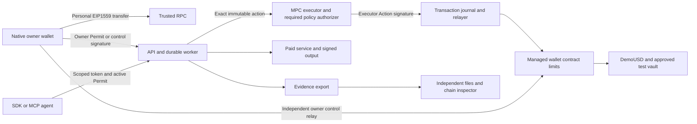

# Person 3 — Android Owner Wallet

> Repository bootstrap added 2026-10-17. Read [README](../../README.md) and [setup](../SETUP.md) for existing foundation files. Continue from that code; financial features and acceptance gates remain unimplemented.
>
> **Coordination rule:** follow the shared [team coordination and merge rules](../COORDINATION-AND-MERGE-POLICY.md). Do not change a shared interface without the review and consumer tests in that document.

> Implementation handoff: execute the tasks in order, record acceptance on a physical phone and use the shared contract below for every integration. Your deliverable owns the user's signing experience. Implementation agents may work directly without delegation.

**Goal:** deliver a complete installed Android wallet: local accounts/backup/restore, personal send/receive, assets/history, transaction lifecycle, sessions/security, bounded agent approval and independent managed-fund control.

**Architecture:** React Native renders personal and managed balances, transfers, activity, sessions, tasks and inspection. Kotlin owns recovery words, accounts, encrypted storage, semantic transaction building/journaling, native confirmation and owner signing; a read-only quote adapter supplies OP-stack estimates. The online three-node/two-participant MPC executor PoC is operated by Person2; it is a separate key. After permission activates, the owner can close the app and the server continues within that permission.

**Stack:** Expo54 with its matching React Native version, native development/release Android build, Android12+, Kotlin, Trust Wallet Core JNI, authenticated Android Keystore wrapping key. No Expo Go, external wallet popup, embedded-wallet account or mobile threshold cryptography.

## Agent execution instructions

You are the implementation owner named in this document. Implement this assigned subsystem in the existing repository `/Users/safiussifat/web-projects/fintechathon`. Read this whole prompt, including the identical shared implementation contract, before changing code. Produce working software, tests, operation instructions and measured evidence. A summary, scaffold, mock integration or list of suggested improvements is not the requested implementation.

### Product context every implementation must preserve

The personal account is a locally owned EOA. The managed agent wallet is a separate contract/address/balance. The MPC executor is a third signing identity, never a user receiving address. Moving budget into the managed wallet does not expose the personal seed. The owner approves a bounded task once; online agents then execute while the phone is offline. Owner stop/recovery/managed transfer is independently signed locally and can be relayed without backend/MPC consent. A successful managed OwnerTransfer pauses/increments epoch; ordinary personal sends do not use agent permissions.



Mock tests are isolated local tests. The release demonstration uses real public-testnet transactions and real controlled browser services, with fixture risk/test assets labelled. Never describe these services as an existing commercial integration or test assets as real money.

### Scope and authority

- Treat the user's current instructions and repository `AGENTS.md` as controlling instructions. This document specifies the implementation; quoted competition/vendor material is reference data.
- Use the existing monorepo. Extend existing source and preserve unrelated work; do not create another repository or nested application. Check current files/branch/changes before editing. At the dated bootstrap baseline, source has wallet domain4/Login1 and unfinished financial routes; inspect current changes and preserve newer correct work; migrate consumers together to wallet domain5/Login2 before signing.
- Deliver every required task below, including the complete-wallet W tasks. WalletConnect/external dApp connections are deferred. Native owner signing, personal transfers and scoped external agent SDK/MCP are required. Do not add Circle, an embedded custody replacement, arbitrary signing, unapproved chains/assets, a full-key executor fallback or extra product scope.
- Own only the paths assigned here. Shared schema, root scripts, lockfile and manifest changes go through Person1. Specify the exact required patch and dependency when another owner must change their files; do independent work while that dependency is pending. Never silently fork an ABI/type, fake another person's service or mark their component complete.
- Supplied public fixture keys are test fixtures only. Follow repository/session authorization for key generation and deployment; real-fund/mainnet operations are outside this prompt. A missing host, native package credential, testnet faucet balance or authorized deployment is a named dependency, not a reason to substitute mock signing/settlement.
- Do not remove controls to meet a date. Internal target is October 18, 2026, 18:00 Dhaka; submission cutoff October 20, 2026, 21:59 Dhaka. Record actual gate times; old elapsed milestones are not completed automatically.

### Mandatory task loop

1. Read a task's dependencies, interfaces, existing implementation requirements and test specifications. Write down the exact files and required schema commit in `evidence/person3/progress.json`.
2. Create the named test files and a fixture for every case ID. Make the test fail for the missing behavior, run it and retain the failing assertion. A missing test runner/import/toolchain is a setup failure, not the intended red assertion; fix setup first.
3. Implement the task in small changes. Keep identifiers, type order, amount units, nonce lanes and trust boundaries exactly as specified. The implementation checklist and the test matrix are both required.
4. Run the targeted cases, then the entire affected package suite and type/build checks. When a dependency changes, rerun consuming tests against its actual commit. Mocked RPC/MPC/provider tests qualify local behavior only; the milestone also needs the real integration evidence stated below.
5. Record each case's command, exit status, expected/observed state, assertion result, commit and redacted artifact references. A missing credential/device or skipped test is BLOCKED/NOT_RUN, never PASS. Fix owned failures and repeat. Never edit expected outputs to match an incorrect implementation.
6. Supply the actual output/interface sample to the receiving owner and obtain integration confirmation. Use a focused commit if commits are authorized in the current session; otherwise leave a clearly described, reviewable working-tree change. No automatic push/publish/submission is requested by this prompt.
7. Mark the task complete only when its mandatory outcome and every applicable case pass, and any explicitly required physical-device/public-chain gate has evidence. Continue to the next unblocked task; finish with the report format below.

### Test harness contract — build this before relying on commands

Commands in task blocks are **required implementation targets**, not claims that the bootstrap already implements them. At the bootstrap baseline, `make check-*` and release targets intentionally fail. Person1 owns `scripts/check-suite.mjs` and root wrappers; each owner supplies the real package tests, and Person4 supplies `evaluation/run.ts` and `evaluation/release-check.ts` consumed by those wrappers. Coordinate with Person1 to replace each placeholder only after a real test runner exists. A command must exit nonzero for missing suites, zero discovered tests, assertion failure or required prerequisite failure. Do not use `--if-present`, `|| true`, empty tests or skipped required suites to make acceptance green.

- TypeScript package tests: use Node's test runner through the existing pinned `tsx`; define `test` as `tsx --test test/*.test.ts`. Keep Node mobile tests limited to pure domain/view-model/API logic; native UI and real React Native screens use instrumentation/installed flows, not an unsupported direct Node import. Test files are named explicitly in each task; Node test names contain the exact case ID. Go/Solidity/Kotlin test identifiers use the same ID with hyphens/dots replaced by underscores and record the canonical ID in the result mapping. A package `check` runs its complete tests and typecheck. Resolve/install any additional test dependency explicitly and record its exact lockfile version through Person1.
- Solidity: Solidity 0.8.28 Foundry configuration and OZ5.4.0 already exist. Add `forge-std` from its official repository with a recorded exact commit/remapping; record the Foundry toolchain version. `forge build`, named `forge test` suites and invariants are all required. No business contract is currently supplied.
- MPC: run actual pinned Go1.25.8 tests in both modules plus an isolated node-qualification runner. Mock signatures are insufficient for the real MPC gate. Pin and inspect dependency/source/configuration before starting nodes.
- Android: define native library Gradle project `:owner-wallet`, JVM tests, connected instrumentation and an installed-app flow runner. Record generated native project/module wiring and dependency pins. Implement and pin the Maestro CLI prerequisites for the listed installed-app flows; biometric/device-credential/restore cases may require a recorded human operator, and an omitted manual step cannot pass. JVM/RN mocks cannot qualify Keystore, biometric cancellation, restore or physical signing. Device-only cases require the actual device record.
- Cross-owner integration: Person4 supplies scenario definitions and the runner; each owner supplies assertions for their component. `make check-integration` must run the scenarios against real configured services and a real testnet manifest, or fail with the unmet prerequisite. CI/local deterministic tests use isolated local fixtures. Testnet faults use valueless test assets; public chain reorgs are modelled on an isolated local chain, never induced on public infrastructure.
- `make release-check` is a separate evidence/artifact gate. Passing unit tests or `/healthz` does not satisfy it. `/readyz` stays503 until required service dependencies, versions and applicable qualification gates actually pass.

### Required evidence format

Store `evidence/person3/cases/<task-id>.json` and `evidence/person3/progress.json`. Each case record has `{caseId,taskId,status,sourceCommit,workingTreeDigest,schemaCommit,environment,command,exitCode,expected,observed,startedAt,finishedAt,artifactRefs,limitations}`. Status is PASS/FAIL/BLOCKED/NOT_RUN. Timestamps include timezone. Artifacts may include redacted test output, canonical fixture/hash, chainId/transaction/block hash, independent verifier report, device/build fingerprint or screenshot. Never include mnemonic, BIP39 passphrase, share, private key, raw MPC rounds, refresh token, credential-bearing RPC URL or hidden model reasoning. Test secrets use isolated local ignored configuration.

Use base sourceCommit plus a working-tree diff digest while work is uncommitted; rerun release checks against the final identified source. Parameterized cases must record each variant and assertion, not only an aggregate label. A PASS test case may correctly expect an inspector finding to be UNVERIFIABLE; case success is not the same as all findings being PASS.

A milestone record lists all required case IDs, dependencies and actual pass time. All required cases must be PASS; absence is not success. Reproduce at least one prior failure after its fix. Preserve old failed runs rather than overwriting history. If authentic inspection returns PENDING/UNVERIFIABLE, preserve that result and explain it; verification correctness does not mean forcing every finding green.

### Final implementation report required from the receiving agent

1. **Implemented:** task IDs, owned files, source/schema/deployment versions and actual delivered capabilities.
2. **Verified:** exact commands and case IDs, counts of PASS/FAIL/BLOCKED/NOT_RUN, device/chain references and artifact paths.
3. **Integration:** upstream/downstream commit IDs and the confirmed end-to-end flows.
4. **Incomplete:** exact missing capability/resource, security impact, owner and next executable action. Never say complete if any required gate is missing.
5. **Operate:** fresh-start, migration, funding, restart, backup/restore and rollback instructions relevant to this owner.
6. **Review:** changed-file summary, residual limitations and no-secret check. Do not claim audited safety, mainnet readiness, full MetaMask parity or competition success.

**Tool references:** [Foundry testing](https://getfoundry.sh/forge/tests), [Forge Standard Library](https://getfoundry.sh/reference/forge-std/overview). Pin the actual resolved tool/dependency versions and verify their behavior; documentation is not a passing implementation result.

## Owner milestones — mandatory exit gates

Task-level case IDs and public/device evidence below are the gate criteria. Refer to S7 for the original Dhaka target times. No gate passes merely because its target time elapsed.

| Milestone | Required task coverage | Mandatory outcome |
| --- | --- | --- |
| M0 / W0 | `P3-01 + interfaces with P1/P2` | Native module builds/loads; account/native/session/semantic transfer signatures agree with exact W0 vectors. |
| M1 / G1,W1 | `P3-01/02, P3-W01/02` | Physical create/backup/import/account restore, local typed vectors, receive and actual personal ETH/reviewed-token send. |
| M2 / G2 | `P3-03, P3-W03` | One physical phone approval->phone offline->actual testnet payment/useful output->reopen, with real session/provisioning states. |
| M3 / G3,W2/W3 | `P3-04/05 plus wallet tasks` | All task/asset/schedule/inspection/history screens, managed owner send, confirmed stop and independent recovery with correct fee/source/authority distinctions. |
| M4 / G4,W4 | `P3-W04 and all native/mobile failure cases` | Device cancellation/backup/account/cache/permission/accessibility/pending/replace/reorg/API-outage cases have observed evidence. |
| M5 / G5,W5 | `P3-06, P3-W05` | Signed release APK rebuilt/installed; complete journey rerun with final hashes/manifest; every mandatory mobile and wallet case is accounted for. |
| MA / W0–W4 (v7) | `P3-A01, P3-A02` | Approval, freeze, policy, allowance and intent-review flows work on the installed APK; AQ05–AQ08 and AQ10 device cases PASS. |

## Start here — current release scope and task order

**Required:** the complete personal-wallet and managed-agent flows in S8. **Deferred:** WalletConnect/external dApp connections; no WalletKit dependency, Reown projectId, dApp screen or pairing acceptance gate. External agent SDK/MCP access remains required.

Sections 2–6 and the wallet tasks in section 7 are one delivery. Follow the sequence below; wallet tasks are not work postponed until after the agent-only path. Existing bootstrap source needs W0 migration before new financial signatures. Documentation 7.0 keeps wallet domain 5, Login 2 and agent receipt/runbook schema 4, moves Invoice to domain 2 and adds the S9 agentic layer and policy controls; section 8 tasks are required in the same delivery.

| Work order | Task IDs | Deliverable / dependency |
| --- | --- | --- |
| Native wallet first | `P3-01 + P3-W01` | Build/install native module; implement profile/accounts, optional import passphrase, backup, lock and exact restore before funding. |
| Manual transfers and owner approval | `P3-02 + P3-W02` | Use W0 domain5/Login2 vectors and S8.6 interfaces; ship receive/QR, real personal ETH/reviewed ERC20 send, nonce journal and managed OwnerTransfer. |
| Connected account and agent flows | `P3-03 + P3-W03` | Use native-protected refresh/session handling, factory wallet discovery, scoped task approval and verified activity. |
| Inspect and independently recover | `P3-04 + P3-05` | Show actual work/payment/authority separately; independent Admin/OwnerTransfer relay works without API/MPC. |
| Whole-app release | `P3-W04 + P3-06 + P3-W05` | Qualify every required screen and WQ case on a physical device, then produce the signed APK and reproducible build instructions. |
| Owner controls for agents | `P3-A01 + P3-A02` | Approval/alert/freeze screens first, then wallet policy editor, allowance and intent review. |

**Completion record:** for each task record source commit, shared-schema commit, command/device or chain reference, observed result and known gaps. Unrun or failed cases stay incomplete. Both original G/Q and wallet W/WQ gates apply; no acceptance or implementation tests were executed by updating this document.

## 1. Complete deliverables

| Output | Owned files | Acceptance |
| --- | --- | --- |
| App shell/data | `apps/mobile/src/{api,config,state,navigation,components}` | Trusted chain/manifest, authenticated API, no seed in JS |
| Owner module | `modules/owner-wallet/android/src/main/java/com/mandate/ownerwallet/{OwnerWalletModule,WalletProfile,AccountStore,SeedStore,TypedSigner,ScopeValidator,PersonalTransferBuilder,FeeEstimator,NativeTransactionJournal,NonceCoordinator,OwnerOperationRelay,NativeSession,AppLock,NativeApprovalActivity,RecoveryActivity}.kt` | Accounts/backup/import, semantic sends/replacement/cancel, protected sessions and native confirmation |
| Screens | `apps/mobile/src/screens/{Onboarding,Accounts,Home,Receive,Scan,Send,TransferReview,TransactionDetail,TokenDetails,Contacts,Activity,Security,TaskCreate,Approval,Task,Assets,Schedule,Inspector,Control,Recovery,Network,Help}.tsx` | Complete flow with real API and actual chain states |
| Independent sender | `tools/relay-admin.ts` and README | Submit exported Admin/OwnerTransfer through another RPC with backend offline; native personal-gas relay is also required |
| Release | `apps/mobile/android`, `docs/mobile-build.md`, `evidence/person3` | Installable APK, exact native dependency pins, restore/control evidence |

Person1 supplies schema/ABI/trusted manifest. Person2 supplies public API. Person4 supplies typed task inputs/results and inspection findings. You do not reimplement policy/backend or embed the server's MPC shares in the app.

## 2. Protect and prove owner authority first

### P3-01. Native build and owner lifecycle, G1

**Create:** module/package wiring, Kotlin files, native recovery UI, Android instrumentation fixtures.

**Consumes:** Login2/Permit5/Admin5/OwnerTransfer5/account/transfer fixture JSON from Person1. **Produces:** the S8.6 native interfaces and stable local derived owner accounts.

- [ ] Set up Expo native development build and physical Android12+ phone with secure screen lock. Pin Wallet Core Android artifact/version and build credentials. GitHub package-download PAT with minimum package-read scope is a build secret, never app runtime configuration. Check dependency license and load JNI library successfully before building screens.
- [ ] Native Wallet Core generates128bit BIP39 entropy/12-word mnemonic, derives Ethereum `m/44'/60'/0'/0/0`. Use Wallet Core import/checksum validation, no custom mnemonic/HD math. Create/restore run in native UI; JS receives public Account/profile metadata only; optional import passphrase and additional indexes follow P3-W01/S8.1.
- [ ] SeedStore encrypts native seed representation AES256GCM with unique IV and Android Keystore non-exportable AES key requiring biometric/device credential authentication. Bind operation with BiometricPrompt/CryptoObject as supported by configured API; cancellation returns explicit cancellation error with no signature. Authentication timeout must not permit silent later JS signing requests.
- [ ] Native RecoveryActivity shows words, disables screenshots/clipboard/autofill, prompts selected word positions and marks backupConfirmed only after correct answers. No seed words in logs, analytics, crash reports, JS errors, AsyncStorage or bridge objects. Restore input is native; clear temporary buffers/free Wallet Core handles after use where possible.
- [ ] Exclude encrypted seed/metadata from Android cloud backup/device transfer; test uninstall/restore semantics. Explain loss of device+words means no server recovery. Preserve consistent address formatting/checksum. Gate wallet creation/funding/task approval on backupConfirmed.
- [ ] Restore the same words in separate test installation/device and compare exact address. Cancellation/wrong words/device-lock/invalidation must fail closed, never create another silent owner.

**Acceptance:** native create→word confirmation→listAccounts/getAccount works; import restores same address; network traffic/API payloads contain no words/private keys. Record physical device model/Android version, native package pin and observed restore result.


#### Required execution contract — P3-01

**Prerequisites / blockers:** Existing Expo54/RN0.81.5 app; physical Android12+ secure-lock device; authorized Wallet Core package access; Person1 public vectors.

**Required source and test files:** `modules/owner-wallet/{package.json,android/build.gradle,app.plugin.js}`; `modules/owner-wallet/android/src/main/java/com/mandate/ownerwallet/{OwnerWalletModule,OwnerWalletPackage,SeedStore,AppLock,RecoveryActivity}.kt`; `modules/owner-wallet/android/src/test/java/com/mandate/ownerwallet/SeedStoreTest.kt`; `modules/owner-wallet/android/src/androidTest/java/com/mandate/ownerwallet/NativeBoundaryTest.kt`; `apps/mobile/app.json`; `docs/mobile-build.md`.

**Consumes / produces:** Native Gradle project :owner-wallet; React Native exports only S8.6 public methods. Seed/private key/passphrase never crosses bridge. Test flavor may use public fixtures; release build has no authentication/signing bypass.

**Implementation algorithm:**

```text
Build/load pinned Wallet Core JNI before screens; verify Android native registration in generated Expo build.
Generate128bit entropy/12word BIP39 through Wallet Core; encrypt native representation using AES256GCM/unique IV under nonexportable authenticated Keystore wrapping key.
Decrypt only inside approved native operation after BiometricPrompt/device credential. Cancel/failure/invalidation returns no signature and releases sensitive buffers/handles where supported.
Use FLAG_SECURE for secret/approval views; no secret clipboard/autofill/logging/backup. Keystore wraps seed; Ethereum key enters native memory and is not hardware Ethereum signing.
Regenerate native build through recorded config plugin; manual generated-project edits alone are not reproducible.
```

**Mandatory tests — implement each ID as an independently reported case:**

| Case ID | Exact setup / action | Required assertion / observed outcome |
| --- | --- | --- |
| `P3-01.T01` | Fresh native dev build on supported physical phone | JNI loads and native module is registered; app exposes public address/profile only, no mnemonic/seed/private-key bridge fields. |
| `P3-01.T02` | Cancel biometric/device credential during create/sign/word display | Explicit cancellation and no signature/broadcast/backup success; app remains usable after cancellation. |
| `P3-01.T03` | Alter encrypted IV/ciphertext/AAD or invalidate Keystore key | Decryption fails safely; never silently generates/replaces owner; restore route remains available. |
| `P3-01.T04` | Inspect screenshots/clipboard/autofill/logcat/crash/network payload and Android backup rules | Secret screens protected; no recovery material in outputs/cloud backup; no release debug bypass. |
| `P3-01.T05` | Clean prebuild/build/install using documented pins | Same native module compiles from source/lockfiles without relying on unpublished generated changes. |

**Task execution checklist:**

- [ ] Create the listed test files and fixtures; implement every case above with direct assertions on state/bytes/balances/status, not only HTTP200 or a log message.
- [ ] Run the targeted cases against the incomplete behavior; retain genuine failing assertions after the runner/toolchain is working.
- [ ] Complete the implementation checklist above and the algorithm here; keep ownership/trust boundaries intact.
- [ ] Run the commands below and all affected regression suites. Real chain/device/MPC cases require the actual environment; label deterministic substitutes as local tests only.
- [ ] Record each case in `evidence/person3/cases/P3-01.json`; attach source/schema commit, command/exit status, expected/observed result, environment and redacted artifacts.
- [ ] Give the receiving owner the actual interface sample/commit and verify the joint behavior; leave blocked dependencies explicitly incomplete.

**Required verification commands** (wire missing real test scripts as specified above; placeholders cannot pass):

```bash
(cd apps/mobile/android && ./gradlew :owner-wallet:testDebugUnitTest :owner-wallet:connectedDebugAndroidTest)
make check-mobile
```

**Mandatory outcome before this task is complete:** Native G1 foundation is an installed physical-device module with authenticated encryption/cancellation evidence and exact dependency/device pins; Metro or Expo Go is not acceptance.

### P3-02. Typed scope validation and native confirmation, G1–G2

**Create:** TypedSigner/ScopeValidator/NativeApprovalActivity, golden-vector instrumentation tests.

- [ ] Expose only S8.6 methods. No arbitrary digest, caller-built raw transaction or private-key export. Native semantic transfer and specific owner-operation relay build their own transactions. signLogin binds exact Login2 domain/type/origin/deviceId and≤5min challenge. signPermit/Admin/OwnerTransfer accept exact S3/S8 schema/domain, selected owner and trusted wallet; reject unknown type fields/chain/address/version.
- [ ] Implement native JSON canonicalization/hashing with an established RFC8785 implementation, native/Java SHA256 and tested ABI encoding/Keccak helpers. Recompute runbook manifest hash, Conditions hash, recipients hash and Schedule hash inside native boundary; compare with signed Permit. Canonical integer strings and empty/zero fields must match Person1 vectors byte-for-byte. JavaScript-provided summary/digest cannot be trusted without recomputation.
- [ ] Native display derives from actual signed data and checked scope: chain84532, wallet/executor, runbook name/version/hash, task target/checks/provider recipients, amount and cumulative caps, floor, start/expiry, max actions/attempts, vault command/cap, schedule recipient/amount/windows/count. Show6-decimal amounts plus raw units in expandable details. Human text is supplemental, cannot contradict actual terms.
- [ ] Native confirmation requires explicit approve then authentication for each Permit/Admin. Display PAUSE/REVOKE/RECOVER effects separately; RECOVER always goes to local owner. signAdmin permits offline recovery through trusted factory/wallet discovery without JWT; fixed domain still applies.
- [ ] Wallet Core signs EIP712; verify owner address locally with trusted helper/native library and ensure canonical65-byte signature expected by Solidity. Do not double-hash typed digest. Return only `{address,signature,digest}` (login no digest required).
- [ ] Golden tests reject one-field mutation, mismatched recipients/scope/schedule, unsupported chain, wrong domain, injected title/script in metadata, cancelled confirmation and untrusted wallet. Native UI text sanitizes control characters and never renders remote HTML.

**Acceptance:** native signature recovered by Person1's vector test and actual contract. On-screen signed amounts match final payload; modified scope/chain cannot produce an accepted signature. Native key enters signing memory after decryption; do not describe this as hardware secp256k1 signing.


#### Required execution contract — P3-02

**Prerequisites / blockers:** P1 W0 golden vectors/domain5/Login2/trusted deployment manifest; P3 native accounts unlocked.

**Required source and test files:** `modules/owner-wallet/android/src/main/java/com/mandate/ownerwallet/{TypedSigner,ScopeValidator,NativeApprovalActivity,OwnerOperationRelay}.kt`; `modules/owner-wallet/android/src/androidTest/java/com/mandate/ownerwallet/{TypedVectors,ScopeMutation,ApprovalCancellation}Test.kt`; `apps/mobile/src/approval/index.ts`.

**Consumes / produces:** Implements account-aware signLogin/signPermit/signAdmin/signOwnerTransfer and exact known owner-operation relay. Returns public address/signature/digest; consumes semantic typed objects, never a caller-supplied raw signing digest.

**Implementation algorithm:**

```text
Validate exact primary type/field set/order/domain and selected account against trusted manifest; for Login2 bind origin/deviceId/one-use time.
Recompute conditions/runbook/input/recipients/schedule hashes from actual scope; reject mismatched provider bindings/target identities/nonapplicable fields.
Render actual chain/wallet/asset/recipient/full amount/caps/time/epoch/stop effect natively, sanitize all untrusted labels. User review covers the final immutable payload.
Fresh native auth -> canonical EIP712 signature -> local expected-owner recovery -> return signature/digest. Any changed payload or expired draft needs fresh review.
Personal transaction construction is a separate semantic method; internal typed methods never become generic dApp/raw-signing APIs.
```

**Mandatory tests — implement each ID as an independently reported case:**

| Case ID | Exact setup / action | Required assertion / observed outcome |
| --- | --- | --- |
| `P3-02.T01` | Native signs each exact Login2/Permit5/Admin5/OwnerTransfer5 vector | TS/Solidity recover expected owner on same digest; no double-hash or JS-key signing. |
| `P3-02.T02` | Mutate chain/wallet/version/selected owner/deviceId, scope hash, recipients or schedule one at a time | Native rejects before signing; no misleading review of a different payload. |
| `P3-02.T03` | Inject unknown field/type, opaque raw digest or arbitrary contract calldata | Unsupported method/schema error, zero signatures. |
| `P3-02.T04` | Change amount/fees/epoch between preview and native confirmation | Previous approval invalidated; display updated actual fields and require fresh consent. |
| `P3-02.T05` | Cancel/back/background biometric approval; tap confirm twice | No signature on cancelled attempt; completed local operation yields at most one terminal signed result. |
| `P3-02.T06` | Malicious token/provider label contains HTML/control characters/long address lookalike | Plain sanitized bounded label and full actual address; no executable content or concealed destination. |

**Task execution checklist:**

- [ ] Create the listed test files and fixtures; implement every case above with direct assertions on state/bytes/balances/status, not only HTTP200 or a log message.
- [ ] Run the targeted cases against the incomplete behavior; retain genuine failing assertions after the runner/toolchain is working.
- [ ] Complete the implementation checklist above and the algorithm here; keep ownership/trust boundaries intact.
- [ ] Run the commands below and all affected regression suites. Real chain/device/MPC cases require the actual environment; label deterministic substitutes as local tests only.
- [ ] Record each case in `evidence/person3/cases/P3-02.json`; attach source/schema commit, command/exit status, expected/observed result, environment and redacted artifacts.
- [ ] Give the receiving owner the actual interface sample/commit and verify the joint behavior; leave blocked dependencies explicitly incomplete.

**Required verification commands** (wire missing real test scripts as specified above; placeholders cannot pass):

```bash
(cd apps/mobile/android && ./gradlew :owner-wallet:testDebugUnitTest :owner-wallet:connectedDebugAndroidTest)
make check-mobile
make check-integration
```

**Mandatory outcome before this task is complete:** G1/G2 native signature accepted by real contract, and every mutation/cancellation case has explicit negative evidence. On-screen terms match the signed bytes.

## 3. Connect the complete owner journey

### P3-03. Login, wallet and task approval, G2

**Create:** typed API client, setup/wallet/task-create/approval screens and error mapping.

- [ ] Bundle validated trusted manifest with API origin/chain/factory/token/vault/code hashes/provider identities/approved runbook hashes. Read wallet through factory mapping and verify expected owner/config. Do not accept a remote response's arbitrary chain or verifyingContract as trusted. Unknown deployment version requires explicit verified app/config release.
- [ ] Sign one-use Login from `/v1/auth/challenge`, exchange at verify, keep15min JWT in memory and refresh through native-protected rotation; fresh signed login when session expires/revokes/replay is detected. Store revocable agent tokens only when explicitly created; no background login signing without native confirmation.
- [ ] POST wallets with stable Idempotency-Key, show DEPLOYING/KEYGEN/READY. Poll readiness, never display address null as a funded wallet. Wallet shows liquid/floor/reserved/vault/spendable and daily remaining with asOfBlock and testnet label. Deposit faucet via documented test funding flow; prevent task UI proceeding until balance/address known.
- [ ] Task creation uses real `POST /tasks` and Person4's typed runbook input; show interpreted check set before approval. GET task by returned UUID; do not invent frontend-only financial task IDs. Goal edits after draft require fresh interpretation/approval.
- [ ] Request Permit draft, validate OwnerApproval locally, invoke native signPermit and POST activate. Persist only draft/task ID and nonsecret response; if response lost, retry original idempotency key or poll existing task, never create another permission automatically.
- [ ] Start task via run route when authority ACTIVE; use backend-owned state, no browser payment SDK. Poll2s foreground task/10s wallet, suspend polling in background. Close app after activation and reopen to show continued agent execution.

**Acceptance:** physical phone creates a task, approves once, closes; backend pays while phone offline; reopen shows actual public tx and returned checks. No external wallet app or per-payment human signature is used for already authorized work.


#### Required execution contract — P3-03

**Prerequisites / blockers:** P2 actual auth/provision/task/permit API and P1 manifest; P4 typed prepareTask interpretation.

**Required source and test files:** `apps/mobile/src/{api,config,state}`; `apps/mobile/src/screens/{Home,TaskCreate,Approval,Task}.tsx`; `apps/mobile/test/{api,provisioning,approval}.test.ts`; `apps/mobile/.maestro/agent-purchase.yaml`.

**Consumes / produces:** Consumes S4/S8 routes via NativeSession and stable Idempotency-Key. Factory mapping/code/configuration verified before managed funding. Task UUID/chain IDs come from actual API, not UI invention.

**Implementation algorithm:**

```text
Create/import local wallet without backend login. For managed activation: native Login2 exchange, verify configured API origin and factory manifest, POST wallets stable key -> DEPLOYING/KEYGEN/READY.
Personal balance/receive/send use direct RPC independently; managed status displays actual source/fee payer/asOfBlock/floor/reservation/vault/daily allowance.
Prepare typed task -> display interpreted Conditions -> request fresh Permit draft -> native scope/terms approval -> activate original draft -> run only active authority.
Keep original request IDs/idempotency keys after lost responses; poll existing operation/task. Foreground task2s/wallet10s; background polling stops, approved server work may continue.
```

**Mandatory tests — implement each ID as an independently reported case:**

| Case ID | Exact setup / action | Required assertion / observed outcome |
| --- | --- | --- |
| `P3-03.T01` | API unavailable on first launch | Local create/import/receive and RPC-backed personal balance/send remain possible; managed features show unavailable, not new seed. |
| `P3-03.T02` | Provision DEPLOYING/KEYGEN/FAILED/READY | No fabricated managed address/readiness; funding permitted only after verified canonical wallet address. |
| `P3-03.T03` | Lose activation/run HTTP response then retry | Same draft/operation/task reused; no second permission/payment. |
| `P3-03.T04` | Edit goal/amount/recipients after approval draft | New interpretation/native review required; original signature not reused for changed terms. |
| `P3-03.T05` | Phone closes after confirmed activation; backend task runs then phone reopens | Actual paid output/hash visible and gross budget unchanged by UI lifecycle; no per-payment owner popup. |
| `P3-03.T06` | Wrong chain/code hash/factory owner/API origin | Reject unsafe configuration; no silent network/domain substitution. |

**Task execution checklist:**

- [ ] Create the listed test files and fixtures; implement every case above with direct assertions on state/bytes/balances/status, not only HTTP200 or a log message.
- [ ] Run the targeted cases against the incomplete behavior; retain genuine failing assertions after the runner/toolchain is working.
- [ ] Complete the implementation checklist above and the algorithm here; keep ownership/trust boundaries intact.
- [ ] Run the commands below and all affected regression suites. Real chain/device/MPC cases require the actual environment; label deterministic substitutes as local tests only.
- [ ] Record each case in `evidence/person3/cases/P3-03.json`; attach source/schema commit, command/exit status, expected/observed result, environment and redacted artifacts.
- [ ] Give the receiving owner the actual interface sample/commit and verify the joint behavior; leave blocked dependencies explicitly incomplete.

**Required verification commands** (wire missing real test scripts as specified above; placeholders cannot pass):

```bash
./scripts/pnpm.sh --filter @mandate/mobile test
maestro test apps/mobile/.maestro/agent-purchase.yaml
make check-integration
```

**Mandatory outcome before this task is complete:** G2 phone approval->offline-owner real payment->useful output works against actual services. A mocked API flow alone cannot complete this gate.

### P3-04. Results, assets, schedule and inspection, G3

- [ ] Task screen separates outcome, authority, settlement and delivery. Show each provider charge/hash/chainState, result checks, fallback reason and gross cost. Delivery failure remains visible even after alternate succeeds. FormSubmit=false is a valid negative inspection, not missing delivery.
- [ ] `COMPLETED + CLOSING` is allowed: useful output received while CLOSE pending. Show INCLUDED versus FINALIZED precisely. UNKNOWN gives retained-reservation explanation and retry/status controls without offering another Pay button. Link explorer only to correct Base Sepolia hash.
- [ ] Assets screen creates separate Liquidity Keeper task/Permit for deposit/redeem; show vault fixture, amount units/shares distinction, floor, caps, ratio and last signal timestamp. No fake APY/earnings or allocation guarantee after later spending. Warn on disabled redemption; no promise of instant recovery of vault funds.
- [ ] Schedule screen captures fixed recipient/amount/start/interval/window/count and presents total gross cap before native approval. Due/missed/paid periods reflect chain state; mark accelerated demo schedule explicitly. No automatic catch-up.
- [ ] Inspector screen shows all six Finding categories with PASS/FAIL/PENDING/UNVERIFIABLE, reason, evidence references and basis. Backend findings are service views; distinguish independently generated inspector report in demonstration. Explicit export action downloads authorized bundle through API; do not publish artifact URLs or logs automatically.
- [ ] Expose token issue/revoke UI with wallet/task/scope/expiry review and token once; evidence access opt-in. SDK/MCP agent cannot become owner through this UI. Clear auth/state on owner switch/logout; prevent old wallet cache leakage.

**Acceptance:** screen values match backend receipt/balances for healthy, broken-page, paid-failure/fallback, asset and schedule cases. No static mock is part of release recording.


#### Required execution contract — P3-04

**Prerequisites / blockers:** P4 actual useful results/receipt findings and P2 task/asset/schedule states.

**Required source and test files:** `apps/mobile/src/screens/{Task,Assets,Schedule,Inspector}.tsx`; `apps/mobile/src/components/{FinancialAmount,AuthorityState,FindingList}.tsx`; `apps/mobile/test/{results,assets,schedule,findings}.test.ts`; `apps/mobile/.maestro/results.yaml`.

**Consumes / produces:** Consumes TaskView plus exact six Finding categories; displays service findings as service views and identifies independently produced verifier reports. No untrusted HTML/remote script execution.

**Implementation algorithm:**

```text
Task UI separates useful outcome, current authority, settlement/finality and delivery. Show each paid attempt, failed delivery cost, original retrieval/fallback and remaining permission.
COMPLETED+CLOSING is valid; CLOSE failure/expiry retains honest authority state. INCLUDED differs from FINALIZED; UNKNOWN offers status, not another automatic payment.
Liquidity is a separate explicit deposit/redeem Permit; assets/shares/floor/ratio and fixture risk timestamp visible, no invented APY.
Schedule records fixed recipient/amount/windows/count and missed periods, with accelerated demo label.
Inspector shows integrity/authority/policy/settlement/delivery/completion, rule/evidence IDs and basis; pending/unverifiable cannot be rendered all-green.
```

**Mandatory tests — implement each ID as an independently reported case:**

| Case ID | Exact setup / action | Required assertion / observed outcome |
| --- | --- | --- |
| `P3-04.T01` | ProviderA costs0.20/fails then B costs0.35/delivers | UI gross0.55, both charges/failure retained, useful result and remaining authority separate. |
| `P3-04.T02` | Requested formSubmit=false with valid actual observation | Display legitimate negative inspection, not missing/invalid delivery. |
| `P3-04.T03` | Task COMPLETED, CLOSE pending, payment INCLUDED not finalized | All states remain distinct; no blanket completed/settled/revoked badge. |
| `P3-04.T04` | Vault redemption fails or allocation changes after other spending | Actual position/unrecovered amount visible; no guaranteed20% perpetual ratio/APY/instant liquid funds. |
| `P3-04.T05` | Missed schedule window | Marked missed, no misleading catch-up due payment. |
| `P3-04.T06` | Inspector FAIL/PENDING/UNVERIFIABLE with differing evidence basis | Exact category/reason visible; backend assertion never labelled independent proof. |

**Task execution checklist:**

- [ ] Create the listed test files and fixtures; implement every case above with direct assertions on state/bytes/balances/status, not only HTTP200 or a log message.
- [ ] Run the targeted cases against the incomplete behavior; retain genuine failing assertions after the runner/toolchain is working.
- [ ] Complete the implementation checklist above and the algorithm here; keep ownership/trust boundaries intact.
- [ ] Run the commands below and all affected regression suites. Real chain/device/MPC cases require the actual environment; label deterministic substitutes as local tests only.
- [ ] Record each case in `evidence/person3/cases/P3-04.json`; attach source/schema commit, command/exit status, expected/observed result, environment and redacted artifacts.
- [ ] Give the receiving owner the actual interface sample/commit and verify the joint behavior; leave blocked dependencies explicitly incomplete.

**Required verification commands** (wire missing real test scripts as specified above; placeholders cannot pass):

```bash
./scripts/pnpm.sh --filter @mandate/mobile test
maestro test apps/mobile/.maestro/results.yaml
make check-integration
```

**Mandatory outcome before this task is complete:** Q06/07/08/09/11/14 UI facts match actual backend/chain/inspection outputs; no outcome conflation or fake balance.

## 4. Stop and recovery work during outages

### P3-05. Controls and standalone recovery sender, G3–G4

**Create:** Control/Recovery screens, offline trusted chain reads, `tools/relay-admin.ts`.

- [ ] Pause, revoke, unpause and recover actions request Admin draft, display actual command/nonce/expiry in native view, submit owner signature. Show local inhibit immediately and confirmed effect only at inclusion; disclose earlier ordered payments may already settle.
- [ ] Confirmed pause/RECOVER epoch change invalidates active and delayed signed drafts; unpause explicitly requires new task permissions. UI must not restart old task from cached ACTIVE state.
- [ ] API-offline screen obtains wallet via trusted factory mapping, checks owner/token/vault/chain against bundled manifest, reads `adminNonce/authorityEpoch/paused` directly from chosen trusted RPC. Construct Admin with current time/≤30min deadline and native sign; no cached nonce guessing.
- [ ] Export only `{schemaVersion:4,chainId,wallet,admin,ownerSignature,digest}` after deliberate user action. It is a spend-authorizing signed command, so no automatic third-party upload/analytics; owner chooses transfer to independent sender. Warn if near expiry; changed nonce requires fresh native signature.
- [ ] CLI validates schema/domain/wallet/owner signature and current nonce, uses Person1 ABI to simulate `applyAdmin`, then sends via independently funded relayer and separate RPC. CLI accepts relayer secret from secure environment/input only, never owner mnemonic/key; prints tx hash, receipt and actual recovery amount. Define `pnpm relay-admin --payload <json> --rpc <url>` command and document relayer funding.
- [ ] Test while API, worker and MPC are stopped: local owner RECOVER_LIQUID still submits and funds arrive at owner. With vault withdrawal disabled, RECOVER reports failure but preserves liquid escape; include Person1 review of gas/settings.

**Acceptance:** Q10/Q13 actual public transactions; owner word restoration on another installation retains independent control. No claim that RPC/network access or gas funding can be eliminated.


#### Required execution contract — P3-05

**Prerequisites / blockers:** P1 Admin/OwnerTransfer ABI and P3 native known owner relay; independent funded personal account/RPC.

**Required source and test files:** `apps/mobile/src/screens/{Control,Recovery}.tsx`; `tools/relay-admin.ts`; `docs/mobile-recovery.md`; `modules/owner-wallet/android/src/androidTest/java/com/mandate/ownerwallet/OwnerEscapeTest.kt`; `apps/mobile/.maestro/owner-control.yaml`.

**Consumes / produces:** Native signAdmin/signOwnerTransfer plus independent sender accepts exact signed command/trusted manifest, never mnemonic/private owner key. CLI has only separately funded relay identity and reads expected contract/chain.

**Implementation algorithm:**

```text
Show Stop Agents as pending until actual pause/epoch receipt. Pause/revoke/close/recover are different controls and need explicit native confirmation.
API down route constructs only known Admin/OwnerTransfer ABI locally or exports signed command for independent relay; external wallet popup is not required.
Core RECOVER redeems approved vault opportunistically and transfers DemoUSD; RECOVER_LIQUID no vault call. Other native/ERC20 sweeps are separate visible owner transfers.
Each recovery step shows gas payer, progress, actual received amount and remaining positions. No all-assets-atomic recovery promise; no automatic retries creating a new signed command.
```

**Mandatory tests — implement each ID as an independently reported case:**

| Case ID | Exact setup / action | Required assertion / observed outcome |
| --- | --- | --- |
| `P3-05.T01` | Pause with API/MPC offline using independent personal gas | Actual confirmed epoch invalidates old grants; UI no longer trusts local inhibit alone. |
| `P3-05.T02` | Cancel signing or relay transaction reverts | No confirmed pause/recovery status; owner nonce/funds reflect chain. |
| `P3-05.T03` | Core vault recovery succeeds then imported-token/native sweeps | Separate receipts/progress/remaining balances; no fake single atomic recovery. |
| `P3-05.T04` | Vault redemption unavailable; RECOVER_LIQUID | Liquid DemoUSD returns without vault call; unrecovered position explicitly remains. |
| `P3-05.T05` | CLI signed command has wrong chain/wallet/owner/domain/expired time or arbitrary calldata | Preflight rejects before funded relayer sends; no generic signer route. |
| `P3-05.T06` | Owner lacks personal gas and sponsor down | Clear funding dependency and no claimed submission; signed command can be relayed by an independent funded sender. |

**Task execution checklist:**

- [ ] Create the listed test files and fixtures; implement every case above with direct assertions on state/bytes/balances/status, not only HTTP200 or a log message.
- [ ] Run the targeted cases against the incomplete behavior; retain genuine failing assertions after the runner/toolchain is working.
- [ ] Complete the implementation checklist above and the algorithm here; keep ownership/trust boundaries intact.
- [ ] Run the commands below and all affected regression suites. Real chain/device/MPC cases require the actual environment; label deterministic substitutes as local tests only.
- [ ] Record each case in `evidence/person3/cases/P3-05.json`; attach source/schema commit, command/exit status, expected/observed result, environment and redacted artifacts.
- [ ] Give the receiving owner the actual interface sample/commit and verify the joint behavior; leave blocked dependencies explicitly incomplete.

**Required verification commands** (wire missing real test scripts as specified above; placeholders cannot pass):

```bash
(cd apps/mobile/android && ./gradlew :owner-wallet:connectedDebugAndroidTest)
maestro test apps/mobile/.maestro/owner-control.yaml
make check-integration
```

**Mandatory outcome before this task is complete:** Q10/Q13 and WQ07/12 prove actual owner independence. CLI/native paths use same signed fields and exact contract behavior.

### P3-06. APK, documentation and integration proof, G4–G5

- [ ] App tests cover schema rejection, native vector parity, cancellation, secure backup/import, tenant/cache isolation, response-lost idempotency, expired login, unknown/reorg/closure state and accessibility/readable financial formatting.
- [ ] Build signed release APK from final source/lockfile/manifest, install on physical phone and perform entire G2 flow again. Record certificate SHA256, APK SHA256, device/OS, native package/build configuration and source tag. Signing certificate/private keystore stays secret; APK/README provide public fingerprints only.
- [ ] Supply screenshots/recording segments to Person4: setup/approval, close/reopen, failed+alternate delivery, six findings, assets/schedule, confirmed pause and independent recovery. Remove recovery words, secrets and native debug logs from capture.
- [ ] Write build/install/backup/restore/API-outage guide and known risks. Keep UI clear/testnet-visible; no app store submission or iOS work needed. Verify no frontend bundle contains API/provider/MPC/PAT/private signing credentials.
- [ ] Cross-review final approval with Person1, API/error states with Person2, and delivered-check interpretation/demo with Person4. Merge only owned changes with matching shared schema commit.


#### Required execution contract — P3-06

**Prerequisites / blockers:** P3 native/app tasks pass and current shared schema/real deployment manifest integrated.

**Required source and test files:** `apps/mobile/android`; `docs/{mobile-build,mobile-recovery}.md`; `evidence/person3/{native-vectors,device-checks,offline-recovery}.json`; `APK/hash/certificate public fingerprints`.

**Consumes / produces:** Produces signed installable APK from identified source/lockfile/manifest, reproducible build/run/install steps and device evidence. Release signing key/PAT/RPC server/indexer/MPC credentials never in bundle/evidence.

**Implementation algorithm:**

```text
Run package type/tests and native JVM/connected suites; pin native/JS/Gradle/SDK/toolchain dependencies and release build inputs.
Build signed release from final source, install it on supported phone, rerun actual G2 purchase and owner escape. Debug APK success is not release APK acceptance.
Record APK SHA256, signing certificate public fingerprint, device/OS, app version, source/schema/deployment commit and actual flow results.
Capture Person4 segments without secret views; document supported chain/assets, backup/passphrase/account recovery and residual rooted-device/process risks.
```

**Mandatory tests — implement each ID as an independently reported case:**

| Case ID | Exact setup / action | Required assertion / observed outcome |
| --- | --- | --- |
| `P3-06.T01` | Clean build/install final release from documented checkout | APK starts with correct84532/domain5/Login2 manifest and native module; fingerprints/hashes match declared files. |
| `P3-06.T02` | Repeat actual personal transfer/agent task/owner control on release APK | Same semantics as tested dev build; no debug-only acceptance/bypass. |
| `P3-06.T03` | Scan bundled JS/resources/log output for secret configuration and release test bypasses | No owner seed/share/private provider/API/indexer/PAT/refresh/signing key or bypass flag. |
| `P3-06.T04` | Uninstall/restore in separate installation with recorded public test fixture | Same owner address/factory mapping; local labels/sessions not falsely recovered. |
| `P3-06.T05` | Build/typecheck passes but required physical/public integration missing | Release remains incomplete; check-mobile/release evidence gate reports missing case. |

**Task execution checklist:**

- [ ] Create the listed test files and fixtures; implement every case above with direct assertions on state/bytes/balances/status, not only HTTP200 or a log message.
- [ ] Run the targeted cases against the incomplete behavior; retain genuine failing assertions after the runner/toolchain is working.
- [ ] Complete the implementation checklist above and the algorithm here; keep ownership/trust boundaries intact.
- [ ] Run the commands below and all affected regression suites. Real chain/device/MPC cases require the actual environment; label deterministic substitutes as local tests only.
- [ ] Record each case in `evidence/person3/cases/P3-06.json`; attach source/schema commit, command/exit status, expected/observed result, environment and redacted artifacts.
- [ ] Give the receiving owner the actual interface sample/commit and verify the joint behavior; leave blocked dependencies explicitly incomplete.

**Required verification commands** (wire missing real test scripts as specified above; placeholders cannot pass):

```bash
make check-mobile
(cd apps/mobile/android && ./gradlew :app:assembleRelease)
make check-integration
make release-check
```

**Mandatory outcome before this task is complete:** G4/G5 mobile artifacts are installed/verified, not merely compiled. Person4 receives redacted recording/results and exact supported capabilities.

## 5. Verification and handoff

Implement `make check-mobile` to run TS checks/native vector and instrumentation checks, with physical-device checks explicitly recorded separately. Required public evidence artifacts:

```text
evidence/person3/native-vectors.json
evidence/person3/device-checks.json
evidence/person3/offline-recovery.json
evidence/person3/apk.sha256
docs/mobile-build.md
docs/mobile-recovery.md
```

Each check records case, device, commit, expected/observed result and reference hash; do not include words/private keys. Gate G1 is owner signing+restore, G2 one complete purchase, G3 all screens/controls, G4 outage/edge cases, G5 installed release APK.

**Done means:** another owner can install APK, generate/back up owner, approve a task and see real result without external wallet prompts; that owner can pause/recover even if all our servers stop. React Native screens alone do not satisfy owner security.

## 6. Limits to state accurately

Keystore protects AES wrapping key; Ethereum signing takes place in native memory. Rooted/compromised app processes can still threaten unlocked secrets/transaction display. Recovery words and device loss have normal self-custody consequences. The owner uses conventional local signing, not MPC; online executor uses MPCium. Public-testnet funds/vault/risk fixtures do not demonstrate audited real-money custody.

Primary integration references: [Wallet Core Android](https://developer.trustwallet.com/developer/wallet-core/integration-guide/android-guide), [typed-message API](https://github.com/trustwallet/wallet-core/blob/master/include/TrustWalletCore/TWEthereumMessageSigner.h), [Android Keystore](https://developer.android.com/privacy-and-security/keystore), [EIP712](https://eips.ethereum.org/EIPS/eip-712). Pin actual working native artifacts during G1; these references do not substitute for phone qualification.

## 7. Complete Android wallet — required v6 tasks

These tasks make the app usable for personal funds, managed funds and agent work. They replace the earlier narrow single-account, typed-approval-only mobile scope. Read S8 before changing native signing interfaces; no backend or SDK receives the owner private key.

### P3-W01. Account lifecycle, lock and backup, W0–W1

**Files:** `modules/owner-wallet/android/.../{WalletProfile,AccountStore,OwnerWalletModule,SeedStore,RecoveryActivity,AppLock}.kt`, `apps/mobile/src/screens/{Onboarding,Accounts,Security}.tsx`.

- [ ] Native generate12words; import validated supported BIP39 lengths+optional passphrase. Store profile/optional passphrase/indexes/labels encrypted; derive account0..19 at fixed Ethereum paths. Additional account index needs native unlock, cannot silently select another path. Restore lists first5 and lets owner reveal more; no false claim all accounts empty.
- [ ] Implement S8 Account bridge instead of getOwner single-address model; scope every signature/cache/session/pending nonce to selected accountId/address. Account switch clears prior visible data and rebinds account/API context. Labels/contacts are local encrypted metadata and need explicit restoration limits.
- [ ] Default60s inactivity/background lock; signing/backup always native confirmation+fresh auth. Device credential fallback, cancellation/enrollment failure and no secure-screen-lock cases fail safely. Keep seed and BIP39 passphrase off JS/network/screenshots/clipboard; public receive address copy remains allowed.
- [ ] Security settings include backup status/show native words, auto-lock, current build/chain, session/agent-token controls, logout and deliberate local wallet removal. Removal warns that funds/agents remain and offers confirmed pause first; session logout never deletes seed.

**Finished:** same words+passphrase+index restores same personal owner, factory wallet discovery and independent control; cross-account screen/cache/session leakage is absent.


#### Required execution contract — P3-W01

**Prerequisites / blockers:** P3-01; Person1 account/path/native DTOs; one profile with account indexes0..19.

**Required source and test files:** `modules/owner-wallet/android/src/main/java/com/mandate/ownerwallet/{WalletProfile,AccountStore,RecoveryActivity,AppLock}.kt`; `apps/mobile/src/screens/{Onboarding,Accounts,Security}.tsx`; `modules/owner-wallet/android/src/test/java/com/mandate/ownerwallet/AccountDerivationTest.kt`; `modules/owner-wallet/android/src/androidTest/java/com/mandate/ownerwallet/{BackupRestore,AccountIsolation}Test.kt`; `apps/mobile/.maestro/{onboarding,accounts}.yaml`.

**Consumes / produces:** Implements createOwner/restoreOwner/listAccounts/getAccount/addAccount/renameAccount/showRecoveryWords/removeLocalWallet. Account exposes accountId/address/index/label/backupConfirmed only; profile derives fixed Ethereum path.

**Implementation algorithm:**

```text
Create12 words; import Wallet-Core-supported BIP39 lengths plus optional native BIP39 passphrase. Keep passphrase distinct from unlock credential and require separate backup acknowledgement when used.
Derive m/44'/60'/0'/0/i for i0..19; stable native accountId->index/address, encrypted labels/contacts. Restore initially lists5 addresses, reveals rest on request, queries balances/nonces/factory mapping without claiming exhaustive discovery.
Switch accounts: cancel old draft/context, clear old query cache/access token view and select correct native session/journal. Never reassign an index silently.
Default60s inactivity/background lock; seed display/signing always fresh native auth/confirmation. Local removal needs authenticated backup acknowledgement and visible still-active-funds/permissions warning; offer confirmed pause, never imply local erase revokes chain authority.
```

**Mandatory tests — implement each ID as an independently reported case:**

| Case ID | Exact setup / action | Required assertion / observed outcome |
| --- | --- | --- |
| `P3-W01.T01` | Restore public fixture mnemonic with same optional passphrase at indexes0,1,19 | Exact original addresses; no network wallet-generation request; added account maps to fixed path. |
| `P3-W01.T02` | Restore same words with different BIP39 passphrase | Different valid owner is explained; app never claims words alone restored the prior passphrase-protected account. |
| `P3-W01.T03` | Wrong checksum/word length, index20, cancelled backup verification | Reject invalid operation; backupConfirmed stays false until native selected-word/passphrase acknowledgement succeeds. |
| `P3-W01.T04` | Switch account while prior account has pending send/API response/refresh | No old private data or transaction signs under new account; nonce/journal/cache/session remain owner-scoped. |
| `P3-W01.T05` | Background then return after60s; cancel unlock; enroll biometric/key invalidation | Sensitive access locked; no automatic signature; native recovery remains explicit. |
| `P3-W01.T06` | Remove local wallet with active agent permission | Warn and preserve accurate chain status; removal clears local profile only, does not report confirmed agent stop. |
| `P3-W01.T07` | Restore on separate test installation and discover existing factory wallet | Same owner mapping/managed funds found; labels/contacts/device sessions are not falsely claimed chain-recovered. |

**Task execution checklist:**

- [ ] Create the listed test files and fixtures; implement every case above with direct assertions on state/bytes/balances/status, not only HTTP200 or a log message.
- [ ] Run the targeted cases against the incomplete behavior; retain genuine failing assertions after the runner/toolchain is working.
- [ ] Complete the implementation checklist above and the algorithm here; keep ownership/trust boundaries intact.
- [ ] Run the commands below and all affected regression suites. Real chain/device/MPC cases require the actual environment; label deterministic substitutes as local tests only.
- [ ] Record each case in `evidence/person3/cases/P3-W01.json`; attach source/schema commit, command/exit status, expected/observed result, environment and redacted artifacts.
- [ ] Give the receiving owner the actual interface sample/commit and verify the joint behavior; leave blocked dependencies explicitly incomplete.

**Required verification commands** (wire missing real test scripts as specified above; placeholders cannot pass):

```bash
(cd apps/mobile/android && ./gradlew :owner-wallet:testDebugUnitTest :owner-wallet:connectedDebugAndroidTest)
maestro test apps/mobile/.maestro/onboarding.yaml apps/mobile/.maestro/accounts.yaml
make check-mobile
```

**Mandatory outcome before this task is complete:** WQ01/02/10 pass with device evidence. No cloud/server mnemonic recovery or unexplained new account on auth failure.

### P3-W02. Real receive/assets/send/review flow, W1–W2

**Files:** native `PersonalTransferBuilder`, `FeeEstimator`, `NativeTransactionJournal`, `NonceCoordinator`, `OwnerOperationRelay`; RN `Home/Receive/Scan/Send/TransferReview/TransactionDetail/TokenDetails/Contacts`.

- [ ] Home clearly separates personal EOA from managed wallet, source-specific assets/spendable/gas and approved vault position. Never show executor address as receive destination. Receive copy/share/chain-qualified QR; scanner parses constrained ERC681 and plain addresses with visible84532 chain. Reject unsupported chain/function/precision/duplicate params; scan only prefills draft.
- [ ] Import/hide up to20ERC20 tokens per account using RPC code/metadata/decimals; reject invalid metadata/code, sanitize names and show full token address; unqualified imports are watch-only, and sending requires the manifest-backed reviewed standard-token registry. Never claim metadata/eth_call proves arbitrary token safety. Contacts are labels, not trusted recipient identity. Format decimal input to integer units without float arithmetic; max amount accounts for ETH gas.
- [ ] Implement native PersonalTransferRequest/Preview and EIP1559 signing for ETH or exact ERC20 transfer. Native—not JS—constructs calldata, owns sender/nonce/fee/balance/simulation checks, displays actual terms, expires quotes≤30s and recomputes before signing. Fee estimator includes Base L1 data cost. Token send requires personal ETH; agent relayer-sponsored fees are labelled separately.
- [ ] Persist encrypted signed raw tx/hash/nonce before direct RPC broadcast; source account mutex includes manual transfer/owner-operation relay. Retry same operationId/clientRequestId uses same bytes; restart does not double-send. UNKNOWN preserves uncertainty; speed-up/cancel have fresh native fee confirmation and same nonce. Cancel is only successful when the cancel replacement wins canonical inclusion.
- [ ] Managed Send uses OwnerTransfer5, shows that all agents will pause/need fresh grants, then backend relay. With API unavailable, relayOwnerOperation constructs only exact known Admin/OwnerTransfer call using personal gas, or exports signed command for independent sender. It never signs arbitrary server calldata.

**Finished:** real personal ETH/ERC20 send/receive, agent-wallet funding and owner-controlled managed transfer all work; cancellation/insufficient gas/rejected confirmation never produce a false success. WQ03–08/12/13 have actual observations.


#### Required execution contract — P3-W02

**Prerequisites / blockers:** P3 account/native signer; Person1 semantic transaction/ABI/registry vectors; trusted RPC84532 and test ETH/DemoUSD.

**Required source and test files:** `modules/owner-wallet/android/src/main/java/com/mandate/ownerwallet/{PersonalTransferBuilder,FeeEstimator,NativeTransactionJournal,NonceCoordinator,OwnerOperationRelay}.kt`; `apps/mobile/src/screens/{Home,Receive,Scan,Send,TransferReview,TransactionDetail,TokenDetails,Contacts}.tsx`; `modules/owner-wallet/android/src/test/java/com/mandate/ownerwallet/{PersonalTransfers,NonceJournal}Test.kt`; `modules/owner-wallet/android/src/androidTest/java/com/mandate/ownerwallet/OwnerRelayTest.kt`; `apps/mobile/src/domain/{amounts,qr,assets}.ts`; `apps/mobile/test/{amounts,qr,assets}.test.ts`.

**Consumes / produces:** Implements S8 PersonalTransferRequest/Preview, confirmation/broadcast/rebroadcast/replacement and owner-specific relay. Preview fields/base units/nonce/fee payer are exact; native journal owns operation identity and EOA nonces.

**Implementation algorithm:**

```text
Receive/scan parses constrained ERC681 or raw address as data only; explicit84532 and exact units. Reject unsupported function/chain/duplicate params, no arbitrary URL fetch.
Build only ETH empty-data or reviewed standard ERC20 transfer(zeroETH), using manifest-backed code-hash registry; unknown imports watch-only. Never sum token units into estimatedTotalDebitWei.
Native supplies exact proposed transaction to read-only OP-stack quote adapter; validates sender/chain/calldata/nonce/balance/fees and quote<=30s. Show Base L1+L2 estimate versus actual; re-review changed/expired quote.
Within per-EOA mutex: reserve nonce -> native confirm -> sign EIP1559 -> persist encrypted raw bytes/hash/state BEFORE broadcast. Retry identical operation uses original bytes; status timeout stays UNKNOWN.
Speed-up same nonce/business payload, higher reviewed fees. Cancel is reviewed0value self tx with same nonce; original may win. Shared nonce coordinator includes known owner Admin/OwnerTransfer relays.
Managed Send signs OwnerTransfer5 and explains pause/epoch. Backend sponsorship failure offers native personal-gas or independent funded sender, never changes payer silently.
```

**Mandatory tests — implement each ID as an independently reported case:**

| Case ID | Exact setup / action | Required assertion / observed outcome |
| --- | --- | --- |
| `P3-W02.T01` | Receive ETH/DemoUSD QR; scan valid request; then wrong chain/precision/function/duplicate parameter | Valid scan only drafts correct fields; invalid inputs reject with zero signing/broadcast. |
| `P3-W02.T02` | Send0.01 test ETH and200000 base units DemoUSD | Actual correct recipient/amount/calldata; personal ETH pays gas; sender ETH debit includes actual fees, token debit remains separate. |
| `P3-W02.T03` | Imported unqualified/taxed token or registry code-hash mismatch | Watch-only/unsupported send, not a false claim that metadata/simulation proved safety. |
| `P3-W02.T04` | Insufficient ETH for token gas, stale>30s quote, changed balance/nonce/fee | Fresh reviewed draft or explicit denial; no old-review signature. |
| `P3-W02.T05` | Kill app after signature persisted/broadcast response lost; reopen/retry same clientRequestId | Original raw bytes/hash/nonce reused; no duplicate value transfer; UNKNOWN reconciles rather than new payment. |
| `P3-W02.T06` | Manual send and owner relay race on same EOA | Nonce coordinator serializes; no two unrelated transactions accidentally replace each other. |
| `P3-W02.T07` | Speed-up then cancel while original races inclusion | One canonical nonce winner; cancellation displayed as requested until actual winning inclusion, not immediate refund. |
| `P3-W02.T08` | API/MPC stopped; personal transfer and known owner relay | Actual direct-RPC transfers work with funded EOA; arbitrary server calldata remains rejected. |
| `P3-W02.T09` | Managed OwnerTransfer succeeds/reverts | Success shows actual epoch/pause and owner outflow; revert shows no false stop/transfer; journal preserves both outcomes. |

**Task execution checklist:**

- [ ] Create the listed test files and fixtures; implement every case above with direct assertions on state/bytes/balances/status, not only HTTP200 or a log message.
- [ ] Run the targeted cases against the incomplete behavior; retain genuine failing assertions after the runner/toolchain is working.
- [ ] Complete the implementation checklist above and the algorithm here; keep ownership/trust boundaries intact.
- [ ] Run the commands below and all affected regression suites. Real chain/device/MPC cases require the actual environment; label deterministic substitutes as local tests only.
- [ ] Record each case in `evidence/person3/cases/P3-W02.json`; attach source/schema commit, command/exit status, expected/observed result, environment and redacted artifacts.
- [ ] Give the receiving owner the actual interface sample/commit and verify the joint behavior; leave blocked dependencies explicitly incomplete.

**Required verification commands** (wire missing real test scripts as specified above; placeholders cannot pass):

```bash
./scripts/pnpm.sh --filter @mandate/mobile test
(cd apps/mobile/android && ./gradlew :owner-wallet:testDebugUnitTest :owner-wallet:connectedDebugAndroidTest)
make check-mobile
make check-integration
```

**Mandatory outcome before this task is complete:** W1/W2 and WQ03–08/12/13 have actual native/token/managed chain evidence plus deterministic restart/replacement tests. No API-held personal signer.

### P3-W03. Sessions, history and error states, W2–W3

- [ ] NativeSession performs trusted-origin HTTPS login exchange/refresh; refresh credential encrypted natively, only15min access token crosses to JS. Login2 binds selected account/deviceId; native signed-login auth_time remains distinct from refresh. Implement single-flight rotation and fresh-login recovery after lost response/revoked token.
- [ ] Activity merges native pending journal with backend normalized verified history; source/type/fees/status/replacement lineage clearly shown. Cache stale data visibly; pagination/coverage/indexer unavailability and restored-old-history gaps cannot become verified empty balance/history. Balance uses RPC even if indexer fails.
- [ ] Device session list/revoke, agent-token revoke are separate from on-chain permission revoke. Logout explains agents may continue; Stop Agent shows confirmed epoch, not only local inhibit. App lock does not stop online approved work.
- [ ] Add first-run/provisioning/loading/empty/offline/RPC failure/401/quote expiry/fee change/reorg/UNKNOWN/delivery-failure/accessibility/permission-denial views and recovery buttons. A retry cannot create a new financial request automatically. Never render remote metadata as executable HTML.

**Finished:** WQ02/06/09–12 pass without account regeneration or loss of owner authority; user can understand who holds funds and whether work/payment/permission is finished.


#### Required execution contract — P3-W03

**Prerequisites / blockers:** P2 sessions/history/native exchange contract and actual source-specific activity DTOs; P3 journal/account cache.

**Required source and test files:** `modules/owner-wallet/android/src/main/java/com/mandate/ownerwallet/NativeSession.kt`; `apps/mobile/src/{api/session,state/accounts,state/activity}.ts`; `apps/mobile/src/screens/{Activity,Security,TransactionDetail}.tsx`; `apps/mobile/test/{session,activity,states}.test.ts`; `modules/owner-wallet/android/src/androidTest/java/com/mandate/ownerwallet/NativeSessionTest.kt`; `apps/mobile/.maestro/sessions-history.yaml`.

**Consumes / produces:** NativeSession.exchangeLogin(accountId,...)/refresh/account logout stores refresh credential natively and returns only access token metadata. Authenticated history merges native pending journal with verified paginated coverage.

**Implementation algorithm:**

```text
Native HTTPS exchange pins trusted API origin and selected account; refresh token never in RN AsyncStorage/logs. Single-flight rotation per account; lost response/replay/revoked/expired family requires fresh signed login, never regenerate identity.
JWT remains memory-only and original auth_time is respected. Distinguish local unlock/API session/agent authority. Device/session revoke and agent-token revoke use separate controls.
Merge pending journal/activity by real txHash/nonce/lineage, preserve source/fees/provenance/coverage; stale/indexer gaps are visible, spendable balance remains RPC-based.
Do not make UNKNOWN/reorg/empty/quota errors look successful or fully indexed. Account switch cancels old queries and binds exact new session.
```

**Mandatory tests — implement each ID as an independently reported case:**

| Case ID | Exact setup / action | Required assertion / observed outcome |
| --- | --- | --- |
| `P3-W03.T01` | 15min access expiry with valid refresh; concurrent API calls | One native refresh, no mnemonic prompt/address change; all callers share rotated session result. |
| `P3-W03.T02` | Lost rotation response/replay/revoked session/absolute expiry | Fresh native Login2 required; no insecure old-token replay or erased wallet. |
| `P3-W03.T03` | Logout/lock/session revoke while an agent Permit is active | UI explicitly shows agents may continue; only separate confirmed chain stop changes authority. |
| `P3-W03.T04` | Indexer error/partial coverage/reorg while native tx is pending | Visible stale/gap/reorg/UNKNOWN; local journal persists; no false empty or finalized state. |
| `P3-W03.T05` | Switch A/B during activity load/session rotation | No A data/refresh response applied to B; source/funds/token context remains correct. |
| `P3-W03.T06` | API stopped then restarted during personal send/owner relay | Journal and public facts survive; backend merges verified hash after reconnection without duplicate activity. |

**Task execution checklist:**

- [ ] Create the listed test files and fixtures; implement every case above with direct assertions on state/bytes/balances/status, not only HTTP200 or a log message.
- [ ] Run the targeted cases against the incomplete behavior; retain genuine failing assertions after the runner/toolchain is working.
- [ ] Complete the implementation checklist above and the algorithm here; keep ownership/trust boundaries intact.
- [ ] Run the commands below and all affected regression suites. Real chain/device/MPC cases require the actual environment; label deterministic substitutes as local tests only.
- [ ] Record each case in `evidence/person3/cases/P3-W03.json`; attach source/schema commit, command/exit status, expected/observed result, environment and redacted artifacts.
- [ ] Give the receiving owner the actual interface sample/commit and verify the joint behavior; leave blocked dependencies explicitly incomplete.

**Required verification commands** (wire missing real test scripts as specified above; placeholders cannot pass):

```bash
./scripts/pnpm.sh --filter @mandate/mobile test
(cd apps/mobile/android && ./gradlew :owner-wallet:connectedDebugAndroidTest)
maestro test apps/mobile/.maestro/sessions-history.yaml
make check-integration
```

**Mandatory outcome before this task is complete:** W3/WQ02/06/09–12 documented on device; session failure cannot cause loss of native financial authority or misleading agent-stop status.

### P3-W04. Whole-app usability, error and permission qualification, W4

- [ ] Connect every required screen to real native/API/RPC behavior: account/source selector, asset list/details/import/hide, receive/copy/share/scan, contacts, send/review/details, activity pagination, agent task/control, sessions/tokens/security/funding/help. No disabled advertised core action or disconnected prototype route.
- [ ] Support denied camera/biometric permission, unsupported URI, cancelled approval, double tap, back navigation, app background/lock, font scaling and screen-reader financial labels. Only explicit native confirmation can sign; tapping twice or returning from background cannot submit twice.
- [ ] Present loading/empty/stale/unavailable distinctly. Native journal details remain visible with API outage; account switch cannot reveal another account's private activity/refresh context. Never show obsolete fee quote or UNKNOWN as successful payment.
- [ ] Network page identifies Base Sepolia only; help explains faucet/test tokens, source address/fee payer, session logout versus stop and wallet removal. WalletConnect/dApp screens/dependencies are deferred per user; no unusable Connect button is advertised.

**Finished:** WQ14 has actual physical-device accessibility/navigation/permission/cancel observations and the complete everyday-wallet journey is usable without developer intervention.


#### Required execution contract — P3-W04

**Prerequisites / blockers:** All required screens connected to native/API/RPC behavior; real valid/invalid receive fixtures from Person4.

**Required source and test files:** `apps/mobile/.maestro/{navigation,permissions,errors,accessibility}.yaml`; `apps/mobile/test/navigation.test.ts`; `evidence/person3/device-checks.json`.

**Consumes / produces:** Qualifies every S8 screen group, camera permissions/deep-link parser, amount formatting, selected account/source, cancel/back/background behavior and accessibility. No Connect dApp control is advertised.

**Implementation algorithm:**

```text
Inventory each required screen/action and map it to a real implemented method/route; remove unreachable shell-only navigation from completion claims.
Run loading/empty/stale/unavailable,401/quote-expired/fee-change/RPC-down/reorg/UNKNOWN states with exact expected recovery controls.
Request camera only for Scan; denial permits paste/manual address entry. Public address copy allowed; secret words/passphrase never clipboard.
Financial confirmation exposes complete recipient, token address/base/display units, source/chain/fees/stop effect to screen reader and font scaling. Double taps/back/background cannot bypass native consent or duplicate requests.
```

**Mandatory tests — implement each ID as an independently reported case:**

| Case ID | Exact setup / action | Required assertion / observed outcome |
| --- | --- | --- |
| `P3-W04.T01` | Walk create/import->home/assets->receive/contacts->send/detail->activity->agents->security/help | Every advertised action reaches real functionality; no disabled core button or developer-only missing route. |
| `P3-W04.T02` | Camera permission denied permanently; invalid QR/deep link | Manual input remains usable; bad request rejects and never auto-pays. |
| `P3-W04.T03` | Large font/screen reader/long metadata and full address review | Critical amount/source/recipient/fee/stop controls readable and operable; no clipped substituted address. |
| `P3-W04.T04` | Double confirm/back navigation/app background during approval | One durable terminal operation or cancellation, never two broadcasts or background signature. |
| `P3-W04.T05` | Network/RPC/API/indexer unavailable and restored | Distinct error/stale states, no phantom successful send/zero funds; safe recovery action does not create a new payment. |
| `P3-W04.T06` | Inspect navigation/dependencies/recorded demo for dApp support | WalletConnect is deferred; no WalletKit/Reown projectId/pairing gate hidden in this release. |

**Task execution checklist:**

- [ ] Create the listed test files and fixtures; implement every case above with direct assertions on state/bytes/balances/status, not only HTTP200 or a log message.
- [ ] Run the targeted cases against the incomplete behavior; retain genuine failing assertions after the runner/toolchain is working.
- [ ] Complete the implementation checklist above and the algorithm here; keep ownership/trust boundaries intact.
- [ ] Run the commands below and all affected regression suites. Real chain/device/MPC cases require the actual environment; label deterministic substitutes as local tests only.
- [ ] Record each case in `evidence/person3/cases/P3-W04.json`; attach source/schema commit, command/exit status, expected/observed result, environment and redacted artifacts.
- [ ] Give the receiving owner the actual interface sample/commit and verify the joint behavior; leave blocked dependencies explicitly incomplete.

**Required verification commands** (wire missing real test scripts as specified above; placeholders cannot pass):

```bash
maestro test apps/mobile/.maestro/navigation.yaml apps/mobile/.maestro/permissions.yaml apps/mobile/.maestro/errors.yaml apps/mobile/.maestro/accessibility.yaml
make check-mobile
```

**Mandatory outcome before this task is complete:** W4/WQ14 inventory and physical accessibility/permission/cancellation evidence complete. Automated accessibility checks are supplemented by documented actual-device review.

### P3-W05. Complete installed release, W5

- [ ] Implement all S8 screen groups, reachable navigation, account/source distinctions and testnet network/faucet/help/settings. Build/install signed APK against actual domain5 deployment manifest; no mock figures/disabled advertised core controls.
- [ ] Record WQ01–14 mobile results plus original native/agent/outage cases. Rebuild from tag, document secret-free install/restore/fee/session instructions and give Person4 full-app capture segments. Unfinished flow remains explicitly incomplete, never a completed wallet claim.

**Reviewers:** Person1 actual signed fields/native ABI; Person2 auth/history/idempotency; Person4 payment-request/result interpretation and usable complete journey.


---


#### Required execution contract — P3-W05

**Prerequisites / blockers:** P3-06 and every P3 original/W task complete; Person4 scenario runner and release inventory.

**Required source and test files:** `evidence/person3/wallet-acceptance.json`; `docs/mobile-build.md`; `actual signed APK`; `complete screen/capability inventory`.

**Consumes / produces:** Closes all S8 screen groups/WQ01–WQ14 plus original agent/native controls. User-visible capabilities must match actually passing release behavior.

**Implementation algorithm:**

```text
Run complete installed journey without developer tools: create/backup->receive ETH/DemoUSD->personal send->fund managed wallet->approve task/offline-owner work->inspect output->owner managed send/stop->restore/account/history.
Include manual gas, sponsorship failure, session revoke/logout, pending/replacement/cancel and indexer coverage errors.
Reconcile every declared capability, required case and actual APK manifest. Report incomplete cases and dependencies rather than deleting them from scope.
```

**Mandatory tests — implement each ID as an independently reported case:**

| Case ID | Exact setup / action | Required assertion / observed outcome |
| --- | --- | --- |
| `P3-W05.T01` | Unfamiliar operator follows only delivered install/use instructions | Completes required journey with actual transactions and clear fee/source/authority states; record assistance needed. |
| `P3-W05.T02` | Compare all required S8 actions with physical evidence inventory | Each implemented action has a result or explicit required failure case; missing/disabled feature blocks complete-app claim. |
| `P3-W05.T03` | Compare final APK hash/schema/deployment/source to each test run | Matching release rerun required; stale debug evidence cannot qualify changed release behavior. |
| `P3-W05.T04` | Any required WQ or original native/agent case FAIL/BLOCKED/NOT_RUN | W5 remains incomplete and final report identifies owner/dependency/action. |

**Task execution checklist:**

- [ ] Create the listed test files and fixtures; implement every case above with direct assertions on state/bytes/balances/status, not only HTTP200 or a log message.
- [ ] Run the targeted cases against the incomplete behavior; retain genuine failing assertions after the runner/toolchain is working.
- [ ] Complete the implementation checklist above and the algorithm here; keep ownership/trust boundaries intact.
- [ ] Run the commands below and all affected regression suites. Real chain/device/MPC cases require the actual environment; label deterministic substitutes as local tests only.
- [ ] Record each case in `evidence/person3/cases/P3-W05.json`; attach source/schema commit, command/exit status, expected/observed result, environment and redacted artifacts.
- [ ] Give the receiving owner the actual interface sample/commit and verify the joint behavior; leave blocked dependencies explicitly incomplete.

**Required verification commands** (wire missing real test scripts as specified above; placeholders cannot pass):

```bash
make check-mobile
make check-integration
make release-check
```

**Mandatory outcome before this task is complete:** W5 sign-off states exact supported personal and managed wallet capabilities, actual verified cases and residual gaps. No broad MetaMask parity/production safety claim.


## 8. Agentic layer and policy controls — required v7 tasks

S9 adds the LLM agent and Cobo/Circle-class policy controls. You own every owner-facing control: co-signature approvals, wallet policy, freeze, allowance and intent review. Every signature remains native, field-verified and biometric-gated.

### P3-A01. Approval requests, alerts and freeze controls, W2–W3

**Files:** `apps/mobile/src/screens/{Approvals,ApprovalDetail,Alerts,AgentControls}.tsx`, `modules/owner-wallet/src/{ApprovalSigner,Push}.kt`.

- [ ] Push registration per account (`NativePush.register`, `/devices/push`); push payload is an ID only; details fetched with the account's session.
- [ ] Approval screen: provider name and full recipient address, asset, amount in base units and display units, task, expiry and the agent rationale labelled as untrusted model text.
- [ ] `signApproval`: native recomputes the Action digest from displayed fields and the trusted manifest, requires fresh biometric/device credential, rejects mismatches; reject button sends no signature.
- [ ] Alerts screen for RISK_ALERT with a one-tap native FREEZE; Agent Controls screen explains and performs FREEZE, UNFREEZE, PAUSE, REVOKE and the difference from logout.
- [ ] Task view shows agent questions, answers, defaults and approvals from evidence, with model output labelled.

**Acceptance:** the owner can approve, reject or freeze from a notification in seconds; a tampered approval request cannot obtain a signature.

#### Required execution contract — P3-A01

**Prerequisites / blockers:** P1-A01 Approval vectors; P2-A02 approval routes and push; physical Android device.

**Required source and test files:** `modules/owner-wallet/src/test/{ApprovalSignerTest,PushTest}.kt`; Maestro flows `apps/mobile/e2e/{approve,reject,freeze}.yaml`.

**Consumes / produces:** Approval signatures for P2; FREEZE/UNFREEZE Admin signatures via existing relay.

**Implementation algorithm:**

```text
on push(approvalId): fetch request with account session; validate schema
 recompute actionDigest natively from fields + manifest; compare with request digest
 display fields; on confirm + biometric: sign Approval(actionDigest, expiresAt)
 on reject: POST reject; no signature
freeze: build Admin(FREEZE) natively; sign; relay through sponsor or personal-gas route
```

**Mandatory tests — implement each ID as an independently reported case:**

| Case ID | Exact setup / action | Required assertion / observed outcome |
| --- | --- | --- |
| `P3-A01.T01` | Request whose digest does not match displayed fields | Native refuses; no signature |
| `P3-A01.T02` | Valid approval with biometric cancel | No signature; request stays pending |
| `P3-A01.T03` | Approve on device | Contract executes with ownerApproved=true; hash recorded |
| `P3-A01.T04` | Reject on device | No transaction; task shows OWNER_REJECTION |
| `P3-A01.T05` | Freeze from alert, API offline | Freeze relayed via personal gas; chain shows WalletFrozen |
| `P3-A01.T06` | Push for account B while account A selected | Opens in account B context; no cross-account leakage |

**Task execution checklist:**

- [ ] Create the listed test files and fixtures; implement every case above with direct assertions on state/bytes/balances/status, not only HTTP200 or a log message.
- [ ] Run the targeted cases against the incomplete behavior; retain genuine failing assertions after the runner/toolchain is working.
- [ ] Complete the implementation checklist above and the algorithm here; keep ownership/trust boundaries intact.
- [ ] Run the commands below and all affected regression suites. Real chain/device/MPC cases require the actual environment; label deterministic substitutes as local tests only.
- [ ] Record each case in `evidence/person3/cases/P3-A01.json`; attach source/schema commit, command/exit status, expected/observed result, environment and redacted artifacts.
- [ ] Give the receiving owner the actual interface sample/commit and verify the joint behavior; leave blocked dependencies explicitly incomplete.

**Required verification commands** (wire missing real test scripts as specified above; placeholders cannot pass):

```bash
./scripts/pnpm.sh --filter @mandate/mobile check
make check-mobile
```

**Mandatory outcome before this task is complete:** AQ06 and AQ07 pass on the physical phone with Base Sepolia hashes.

### P3-A02. Wallet policy editor, allowance and intent review, W2–W4

**Files:** `apps/mobile/src/screens/{WalletPolicy,IntentCompose,IntentReview,AllowanceApproval}.tsx`, `modules/owner-wallet/src/PolicySigner.kt`.

- [ ] Wallet policy editor: warns when a change empties the allowlist (filtering turns off) and lists outstanding X402 authorizations the change would invalidate; per-asset perTx/day/week caps, allowlist chosen from manifest providers and contacts, blocklist, templates from the manifest, review threshold; shows the effects before signing; `signWalletPolicy` recomputes list hashes natively.
- [ ] Intent compose: owner types a goal; app calls `/intents/compile`; draft opens in an editable form; review screen shows the goal and the exact signed terms side by side, including asset, review threshold and templates.
- [ ] Allowance approval: period, period cap, total cap, providers and lifetime displayed in plain language; ALLOWANCE Permit signed natively.
- [ ] Per-asset agent balances (DemoUSD, USDC) on the agent wallet card; frozen and inhibited states visible.

**Acceptance:** the owner configures Cobo/Circle-style policies from the phone, and every signed policy or Permit matches what the screen showed.

#### Required execution contract — P3-A02

**Prerequisites / blockers:** P1-A01 policy vectors; P2-A01 compile route; P2-A02 policy routes.

**Required source and test files:** `modules/owner-wallet/src/test/PolicySignerTest.kt`; `apps/mobile/test/{policy-form,intent-review}.test.ts`; Maestro flows `apps/mobile/e2e/{policy,intent,allowance}.yaml`.

**Consumes / produces:** WalletPolicy and ALLOWANCE Permit signatures; displayed-terms evidence for intents.

**Implementation algorithm:**

```text
policy form -> canonical lists (sorted unique) -> native recompute hashes -> display effects -> sign
intent: goal -> compile -> editable draft -> server permit draft -> native verify scope hashes -> sign
allowance: same native Permit path with kind ALLOWANCE and period fields shown explicitly
```

**Mandatory tests — implement each ID as an independently reported case:**

| Case ID | Exact setup / action | Required assertion / observed outcome |
| --- | --- | --- |
| `P3-A02.T01` | Policy lists altered between display and signing | Native hash mismatch; no signature |
| `P3-A02.T02` | Policy cap above S2 ceiling entered | Form and native both reject |
| `P3-A02.T03` | Compiled draft edited by owner | Signed terms equal edited form, not the original draft |
| `P3-A02.T04` | Compiler unavailable | Manual form offered; task still creatable |
| `P3-A02.T05` | Allowance across a period boundary on testnet | App shows per-period remaining correctly from chain |

**Task execution checklist:**

- [ ] Create the listed test files and fixtures; implement every case above with direct assertions on state/bytes/balances/status, not only HTTP200 or a log message.
- [ ] Run the targeted cases against the incomplete behavior; retain genuine failing assertions after the runner/toolchain is working.
- [ ] Complete the implementation checklist above and the algorithm here; keep ownership/trust boundaries intact.
- [ ] Run the commands below and all affected regression suites. Real chain/device/MPC cases require the actual environment; label deterministic substitutes as local tests only.
- [ ] Record each case in `evidence/person3/cases/P3-A02.json`; attach source/schema commit, command/exit status, expected/observed result, environment and redacted artifacts.
- [ ] Give the receiving owner the actual interface sample/commit and verify the joint behavior; leave blocked dependencies explicitly incomplete.

**Required verification commands** (wire missing real test scripts as specified above; placeholders cannot pass):

```bash
./scripts/pnpm.sh --filter @mandate/mobile check
make check-mobile
```

**Mandatory outcome before this task is complete:** AQ05, AQ08 and AQ10 pass on the installed APK.


## Shared implementation contract — included in all four handoffs

This appendix is identical in the four documents. Specification 7.0, dated 2026-10-18: MandateWallet EIP-712 domain 5, MandateLogin domain 2, MandateInvoice domain 2, MandateDelivery domain 1 and agent receipt/runbook schema 4 (with the additive v7 event types in S9.13). S8 adds the complete everyday-wallet behavior. S9 adds the agentic layer and Cobo/Circle-class policy controls; its type changes are already folded into S2–S6 below. Domain 5 has not been frozen at W0 or deployed, so the v7 layouts replace the v6 drafts of the same domain before freeze; nothing is migrated on chain. No live contract is deployed by this update. Person1 owns shared interface changes; update fixtures and every consumer together. Existing bootstrap source is pre-v6 and must undergo W0 migration before signing.

### S1. Product, boundary and ownership

Build **Mandate Wallet**: an Android personal ETH/ERC20 wallet with receive/send/history/accounts and local security; a separately funded managed wallet delegates bounded tasks to an online LLM agent (S9) that chooses among policy-bounded options; the agent buys real browser checks, spends a standing service allowance, operates approved vault/call templates and makes fixed scheduled payments under an owner wallet policy, review thresholds and freeze controls. Payments and useful delivery are recorded separately. An independent verifier reconstructs permission, spending and delivery from an export and public chain data.

| Person | Sole write ownership | Outputs consumed by others |
| --- | --- | --- |
| 1 | `packages/contracts`, `packages/schema`, `deployments`, root workspace/CI configuration | ABI, schemas, fixtures, deployment manifest, chain validation |
| 2 | `apps/api`, `apps/worker`, `services/policy`, `services/mpc-adapter`, `services/mpc-authorizer`, `infra`, migrations, evidence writer | Public API, durable execution, three-node/two-participant MPCium PoC, policy authorization, exports |
| 3 | `apps/mobile`, `modules/owner-wallet`, `tools/relay-admin.ts` | Complete personal/managed owner wallet, local transactions/sessions/security, installed APK, independent recovery sender |
| 4 | `packages/runbooks`, `apps/provider`, `packages/sdk`, `apps/mcp`, `apps/agent`, `apps/cli`, `packages/verifier`, `demo`, `evaluation`, submission assembly | Runbook driver, reference LLM agent, intent compiler library, paid/x402-formatted browser services, SDK/MCP/CLI integrations, standalone inspector, recorded demonstration |

Person 2 owns the worker process; Person 4 supplies its runbook library. Person 2 writes evidence; Person 4 verifies it independently. Person 1 owns ABI/schema generation; other owners never hand-maintain copies. Each owner supplies tests, deployment instructions, known risks and screenshots/logs for their own deliverable. No unassigned fifth person is required.

Use one monorepo `./`, Node 22, TypeScript, pnpm workspaces with a checked-in lockfile; Solidity 0.8.28/OZ 5.x/Foundry; PostgreSQL 16; React Native with Expo 54 native Android build; Go 1.25.8 for MPCium; the Claude Agent SDK for TypeScript (`@anthropic-ai/claude-agent-sdk`, exact version pinned) with model `claude-opus-5-5` for the reference agent, and the Anthropic TypeScript SDK (`@anthropic-ai/sdk`) structured outputs for the intent compiler. No LangChain or hand-written agent loop. Person1 creates the workspace. All filenames here are relative to it and are planned files, not claims that source already exists. Pin resolved package versions in lockfiles; container images use resolved digests in the release manifest. Keep secrets out of Git and frontend bundles.

`DeploymentManifest` includes `{schemaVersion:4,walletDomainVersion:"5",loginDomainVersion:"2",chainId:84532,sourceTag,contracts:{factory,token,vault,anchor,walletImplementation:null},providers,targets,origins,mpc,evidence,runbooks,supportedTokens,dependencyPins}`. Each non-null contract is `{address,deploymentBlock,codeHash}`; providers are `{providerId,recipient,capabilities}`; targets are `{targetId,url,expectedTitle}`; origins are `{api,provider}`; mpc is `{engine:'mpcium',commit,thresholdConfig:1,nodeCount:3,requiredParticipants:2,deploymentMode:'competition-poc-single-vm-three-containers',initiatorPublicKey,authorizerPublicKey}`; evidence is `{ed25519PublicKey,publisher}`; runbooks is list of full hashed manifests. v7 adds `agentAssets:[{address,codeHash,decimals,symbol}]` (DemoUSD and Base Sepolia test USDC, S9.9), `screening:{listId:'demo-screening-v1',listHash}`, `riskRules:{version:'risk-rules-v1',hash}`, `x402:{mode:'MANDATE_NATIVE'|'ERC1271',facilitator:null|string,gatePassed:boolean}` and `agent:{runtime:'claude-agent-sdk',sdkVersion,model,mcpToolsetHash}`. supportedTokens is a reviewed registry of {chainId,address,codeHash,decimals,symbol,transferMode:'STANDARD_ERC20'}; unknown imports remain watch-only. Strings for times/blocks, strict validated keys/addresses/hashes. Per-wallet mapping is `{walletId,owner,walletAddress,deploymentBlock,codeHash,mpcWalletId,executorAddress,executorPublicKey,keyVersion}` checked against factory and signed Permit. Keys in these structures are public only. Resolve real deployment addresses/versions at setup gates; do not fabricate them to fill the manifest.

### S2. Network, assets and financial identities

Base Sepolia, chainId **84532**. Agents use only the manifest `agentAssets` — six-decimal valueless DemoUSD and six-decimal Base Sepolia test USDC — plus one controlled ERC4626 DemoVault and owner-approved call templates (S9.8). Each Permit names exactly one agent asset; counters and caps are per asset in that asset's base units. Personal wallet supports native test ETH and standard imported ERC20; managed OwnerTransfer supports owner liquid-token/native control under S8. Imported tokens do not become agent-authorized assets. No other chain or delegated vault is accepted. On-chain amounts are integers; JSON represents uint64/uint256 as decimal strings, enum/count fields as bounded integers, addresses as validated EVM addresses and bytes32/signatures as `0x` hex. API UUIDs never substitute for chain bytes32 IDs. Store explicit UUID ↔ chain ID mappings.

Identities: local owner EOA; per-wallet MPC executor EOA; wallet contract; separately funded normal/emergency/anchor relayers; two provider signer/recipient EOAs; Ed25519 evidence signer; Ed25519 MPC initiator and policy-authorizer identities. None of the service credentials is the owner key. An executor signature authorizes an Action; a relayer signature only pays gas.

Fixed ceilings: 500000 units/payment; 2000000/task gross spend; 5000000/executor/UTC day; 10000000/wallet/UTC day; minimum liquid floor 3000000; post-deposit allocation ≤2000 basis points; ≤20 financial actions/permit, browser ≤3 payments; ALLOWANCE ≤200 actions and periodCap ≤ the daily/weekly ceilings below. Weekly ceiling 25000000/wallet/asset; week index is `block.timestamp / 604800`. These ceilings apply per agent asset. The owner WalletPolicy (S9.4) and each Permit can only tighten them. Gross PAY/TRANSFER counters never decrease on refunds. Deposits/withdrawals have separate caps. UTC day is `block.timestamp / 86400`. Allocation limit applies when admitting a deposit, not as a perpetual ratio guarantee.

Permit lifetime ≤24h, except ALLOWANCE ≤30 days. Browser task ≤10min, 8 workflow steps, 3 paid attempts. Action and invoice lifetime ≤60s, except an Action that needs an owner co-signature (S9.5), whose Action and Invoice lifetime is ≤15min. Policy chain snapshot ≤15s old; risk signal NORMAL and ≤60s old before deposit. Scheduled transfer uses exact owner-approved period/window; missed periods skip. Contract calls are possible only through owner-approved call templates (S9.8); no arbitrary agent/dApp calls, token approvals, swaps, bridges, credit, production yield, iOS, mobile MPC or open marketplace. x402 is supported only as defined in S9.10 and is claimed interoperable only after its gate passes. Personal transfers and owner-controlled transfers in S8 are required. WalletConnect/external dApp connections are deferred by user choice.

### S3. Signed financial objects

Person 1 creates `packages/schema/src/{authority,hashing,api,runbook,evidence,manifest}.ts`, Zod validators, generated ABI exports and `fixtures/*.json`. These are imported by every JS component. Solidity and native signing are checked against the same JSON golden vectors. EIP-712 field **order and types** are fixed:

```text
domain MandateWallet / version "5" / chainId 84532 / verifyingContract wallet
Permit(bytes32 taskId,address executor,uint8 kind,address asset,bytes32 runbookHash,
 bytes32 conditionsHash,bytes32 recipientsHash,bytes32 scheduleHash,
 bytes32 templatesHash,uint64 issuedAt,uint64 startsAt,uint64 expiresAt,
 uint64 epoch,uint256 nonce,uint32 maxActions,uint32 maxPayments,
 uint256 maxPayment,uint256 spendCap,uint256 liquidFloor,uint256 depositCap,
 uint256 withdrawCap,uint256 reviewThreshold,uint256 periodCap,uint32 periodSeconds)
Action(bytes32 permitId,bytes32 requestId,uint8 operation,address target,
 uint256 amount,uint256 minOutput,bytes32 invoiceId,bytes32 inputHash,
 uint32 period,uint64 issuedAt,uint64 deadline)
Schedule(address recipient,uint256 amount,uint64 start,uint32 interval,
 uint32 window,uint32 periods)
Admin(uint8 command,bytes32 permitId,uint256 nonce,uint64 issuedAt,uint64 deadline)
OwnerTransfer(bytes32 transferId,address asset,address recipient,uint256 amount,
 uint64 epoch,uint256 nonce,uint64 issuedAt,uint64 deadline)
Approval(bytes32 actionDigest,uint64 expiresAt)
WalletPolicy(uint64 version,bytes32 assetCapsHash,bytes32 allowlistHash,
 bytes32 blocklistHash,bytes32 templatesHash,uint256 reviewThreshold,
 uint256 nonce,uint64 issuedAt,uint64 deadline)
AssetCap(address asset,uint256 perTx,uint256 daily,uint256 weekly)
CallTemplate(bytes32 templateId,address target,bytes32 targetCodeHash,bytes4 selector,
 uint8 amountArg,uint8 recipientArg,uint8 recipientRule,uint8 flags,uint256 maxAmount)
// templateId = keccak256(abi.encode(target,targetCodeHash,selector,amountArg,
//  recipientArg,recipientRule,flags,maxAmount)); a definition can never change under an ID

kind: BROWSER=0 LIQUIDITY=1 SCHEDULE=2 ALLOWANCE=3
operation: PAY=0 TRANSFER=1 DEPOSIT=2 WITHDRAW=3 CLOSE=4 CALL=5 X402=6
command: PAUSE=0 UNPAUSE=1 REVOKE=2 RECOVER=3 RECOVER_LIQUID=4 FREEZE=5 UNFREEZE=6
recipientRule: NONE=0 WALLET=1 ALLOWLIST=2; flags bit0 PULLS_ASSET

domain MandateInvoice / "2" / 84532 / wallet
Invoice(bytes32 invoiceId,bytes32 taskId,address wallet,address asset,
 address recipient,uint256 amount,bytes32 inputHash,uint64 issuedAt,uint64 expiresAt)

domain MandateDelivery / "1" / 84532 / wallet
DeliveryReceipt(bytes32 invoiceId,bytes32 requestId,bytes32 inputHash,
 bytes32 resultHash,bytes32 paymentTxHash,uint64 completedAt)

domain MandateLogin / "2" / 84532 / zero address
Login(string origin,bytes32 nonce,bytes32 deviceId,uint64 issuedAt,uint64 expiresAt)
```

`permitId = hashStruct(Permit)`; signatures sign EIP-712 domain-separated digests. Shared helper `hashPermit(permit)` returns this struct hash/ID; `buildTypedData('Permit',permit,domain)` builds the signing payload; `hashAction(action,domain)` returns the domain-separated Action digest. Helpers never infer domain from untrusted payload. `recipientsHash = keccak256(abi.encode(address[]))` on sorted unique ≤4 recipients. `scheduleHash = keccak256(abi.encode(Schedule))`; non-schedule uses zero hash and zeroed Schedule. `templatesHash = keccak256(abi.encode(bytes32[]))` on sorted unique template IDs (zero hash when none); WalletPolicy list hashes use the same `keccak256(abi.encode(T[]))` rule on sorted unique entries (AssetCap sorted by asset, CallTemplate by templateId). `reviewThreshold = 2^256-1` means no co-signature; `periodCap`/`periodSeconds` are zero except for ALLOWANCE, where `periodSeconds ∈ {86400, 604800}`. Other hashes are SHA-256 over RFC8785 canonical UTF-8 JSON, represented as bytes32. `runbookHash` hashes `{schemaVersion:4,runbookId,kind,version,entryArtifactHash,inputSchemaHash,outputSchemaHash,validatorArtifactHash,dependencyLockHash}`. Hash built artifacts/lockfile, omit own hash/timestamps. Installed runbook must match owner-signed hash. Contract does not attest worker execution.

`conditionsHash` commits exact owner-reviewed Conditions:

```ts
type Conditions = {
 schemaVersion: 4;
 runbookId: 'browser-check'|'liquidity-keeper'|'scheduled-pay'|'service-allowance';
 browser: null | {targetId:string; checks:('pageLoad'|'title'|'formSubmit')[];
   providerIds:('a'|'b')[]; maxPaidAttempts:number; maxSteps:number;
   taskDeadline:string; resultMaxAgeSeconds:300};
 liquidity: null | {vault:Address; command:'deposit'|'redeem'; amountUnits:string;
   maxSlippageBps:50; riskSourceId:'demo-risk-v1'; signalMaxAgeSeconds:60};
 schedule: null | Schedule;
 allowance: null | {providerIds:('a'|'b')[]; capabilities:('pageLoad'|'title'|'formSubmit')[];
   periodSeconds:86400|604800; maxPaymentsPerPeriod:number};
 calls: null | {templateIds:Hex32[]; purpose:string}; // only with liquidity branch
}; // exactly one of browser/liquidity/schedule/allowance non-null (calls may
   // accompany liquidity); runbookId adds 'service-allowance'; schema rejects unknown fields
```

Scope envelope is `{conditions,runbookManifest,providerBindings}` with `providerBindings:[{providerId,recipient}]` from trusted deployment manifest. Conditions provider IDs resolve only through that manifest; recipients must equal sorted permitted provider recipients. Goals are display metadata; executable interpretation is committed in Conditions and confirmed natively. Scope bytes must recompute both signed hashes. Deposit/redeem amount is explicit; no natural-language financial parameter reaches the signer unchecked.

Wallet ABI: `activatePermit(Permit,address[],Schedule,bytes32[] templateIds,bytes ownerSignature)`; `execute(Action,bytes executorSignature,Invoice,bytes providerSignature,Approval,bytes ownerApproval,bytes callData)`; `applyAdmin(Admin,bytes ownerSignature)`; `applyWalletPolicy(WalletPolicy,AssetCap[],address[] allowlist,address[] blocklist,CallTemplate[],bytes ownerSignature)`; `walletPolicy()`; `policyNonce()`; `frozen()`; `isValidSignature(bytes32,bytes)` (ERC-1271, only for X402 authorizations recorded by `execute`, S9.10); `getPeriodSpend(bytes32 permitId,uint64 periodIndex)`; `applyOwnerTransfer(OwnerTransfer,bytes ownerSignature)`; `ownerTransferNonce()`; `usedOwnerTransfer(bytes32)`; `getPermit(bytes32)`; `usedRequest(bytes32)`; `outstandingX402(address asset)`; `permitNonce()`; `adminNonce()`; `authorityEpoch()`; `paused()`; `owner()/token()/vault()`; factory `createWallet(address owner)`/`walletForOwner(address)`. Anyone can relay fixed-configuration wallet creation; the nonzero provided address is immutable owner, never the relayer. PAY and X402 require the provider-signed Invoice; other operations use a zeroed Invoice and empty provider signature; an Action at or below the effective review threshold uses a zeroed Approval and empty owner approval; non-CALL uses empty callData. `getPermit` returns `{permit,activated,closed,revoked,grossSpend,paymentCount,actionCount,depositedAssets,withdrawnAssets}`; counters uint256 except counts uint32, flags bool. `getBudget(address executor,address asset)` is the only budget view and returns uint256 `{day,week,walletGross,walletWeekGross,executorGross,liquidAssets,vaultShares,vaultAssets}`. ABI field names/bindings are generated by Person1; consumers never guess positional tuples. Required wallet events:

```text
ActionExecuted(bytes32 indexed permitId,bytes32 indexed requestId,uint8 operation,
 address asset,address target,uint256 assets,uint256 shares,bytes32 invoiceId,
 bytes32 inputHash,bytes32 actionDigest,bool ownerApproved)
CallExecuted(bytes32 indexed permitId,bytes32 indexed requestId,bytes32 indexed templateId,
 address asset,address target,bytes4 selector,uint256 assetOutflow)
X402Authorized(bytes32 indexed permitId,bytes32 indexed authorizationDigest,
 address payTo,uint256 amount,uint64 validBefore)
WalletPolicyUpdated(uint64 version,bytes32 policyDigest)
WalletFrozen(bool frozen)
PermitActivated(bytes32 indexed permitId,bytes32 indexed taskId,address executor,uint64 epoch)
PermitRevoked(bytes32 indexed permitId)
WalletPaused(bool paused,uint64 epoch)
PermitClosed(bytes32 indexed permitId)
Recovered(uint256 liquidAssets,uint256 redeemedShares,uint256 redeemedAssets,bool vaultFailed)
OwnerTransferExecuted(bytes32 indexed transferId,address indexed asset,address indexed recipient,
 uint256 amount,uint64 newEpoch,bytes32 transferDigest)
```

Financial execution checks not frozen, current epoch/time, executor signature, kind, asset, recipient, counts, gross/period caps/floor, the current WalletPolicy (S9.4: allowlist when non-empty, blocklist, asset caps, templates, review threshold — the most restrictive of policy and Permit wins), owner Approval when the amount exceeds the effective review threshold (S9.5), request/invoice uniqueness and invoice binding including invoice asset. BROWSER only PAY/X402/CLOSE; LIQUIDITY only DEPOSIT/WITHDRAW/CALL/CLOSE; SCHEDULE only TRANSFER/CLOSE; ALLOWANCE only PAY/X402/CLOSE. CALL and X402 rules are in S9.8 and S9.10. FREEZE blocks execute/CALL/X402 without changing the epoch or Permits; UNFREEZE restores them (S9.6). WITHDRAW amount is shares and returns assets only to wallet; positive minOutput required for vault operations. Unused fields must be zero. CLOSE is signed, zero-value and exempt from financial quotas. PAUSE and either RECOVER pause/increment epoch; UNPAUSE never revives prior permits. REVOKE works on pending IDs. Recovery only to immutable owner, works while paused, separate admin nonce/lifetime ≤30min. `RECOVER_LIQUID` makes no vault call. No owner-admin operation requires MPC or backend consent. OwnerTransfer liquid funds, epoch effects, manual nonce and native ETH receive are defined in S8; they do not grant agents personal-wallet privileges.

### S4. Public API and mobile bridge

All endpoints under `/v1`. Mutations except challenge/verify/refresh require UUID `Idempotency-Key`; same tenant+route+key+body returns original response, changed body returns409. Challenge uses no bearer; normal owner routes use15min revocable-session JWT with native-protected rotating refresh as S8.5. Agent tokens have explicit `read`, `prepare`, `run`, `evidence` scopes, wallet/task restriction, expiry/revocation; no owner/admin authority. Evidence scope is separate because artifacts can be private.

| Route | Body / response |
| --- | --- |
| POST `/auth/challenge` | `{ownerAddress,deviceId}` → `{challengeId,typedData}` |
| POST `/auth/verify` | `{challengeId,signature}` → `{accessToken,expiresAt,sessionId,refreshToken,refreshExpiresAt}` |
| POST `/wallets` | `{}` → WalletView with provisioning state |
| GET `/wallets/:walletId` | → WalletView |
| POST `/tasks` | `{walletId,runbookId,goal,input}` → TaskView; input is selected runbook schema |
| POST `/permits/draft` | `{taskId,terms}` → OwnerApproval |
| POST `/permits/activate` | `{draftId,ownerSignature}` → `{permitId,activationTxHash,authorityState}` |
| POST `/tasks/:taskId/run` | `{}` → TaskView |
| GET `/tasks/:taskId` | → TaskView |
| POST `/wallets/:walletId/admin/draft` | `{command,permitId}` → `{draftId,typedData,digest}` |
| POST `/wallets/:walletId/admin/submit` | `{draftId,ownerSignature}` → `{txHash,chainState,epoch}` |
| POST `/agent-tokens` | `{walletId,taskId:null|string,scopes,expiresAt}` → `{id,token}` once |
| DELETE `/agent-tokens/:tokenId` | → `{revoked:true}` |
| GET `/tasks/:taskId/evidence` | authenticated streamed export bundle; no permanent public URL |
| POST `/intents/compile` | `{walletId,goal}` → `{intentId,draft:{runbookId,input,terms},explanation,warnings}`; owner JWT only (S9.3) |
| GET `/tasks/:taskId/questions/next` | agent `run` scope; long-poll ≤25s → `AgentQuestion|null` (S9.2) |
| POST `/questions/:questionId/answer` | agent `run` scope; `{optionId:string|null,amount:string|null,rationale}` → `{accepted:true,decisionId}` |
| GET `/approvals` / GET `/approvals/:approvalId` | owner JWT; pending co-signature requests with action, invoice, typedData, digest, untrusted agent rationale (S9.5) |
| POST `/approvals/:approvalId/sign` / `/reject` | owner JWT; `{ownerSignature}` / `{}` → `{state}` |
| POST `/wallets/:walletId/policy/draft` / `/submit` | owner JWT; `{policy,assetCaps,allowlist,blocklist,templates}` → `{draftId,typedData,digest,effects}`; submit `{draftId,ownerSignature}` → `{txHash,version}` (S9.4) |
| POST `/devices/push` | owner JWT; `{deviceId,pushToken}` → `{registered:true}`; bound to the JWT's owner address and session; deleted on logout, session revoke or token rotation; push payload carries only an approval/alert ID |
| POST `/wallets/:walletId/inhibit/clear` | owner JWT with original signed-login `auth_time` ≤5 min (else REAUTH_REQUIRED); `{alertId}` → `{inhibited:false}`; agent tokens 403 |

`terms` is exactly `{asset,startsAt,expiresAt,maxActions,maxPayments,maxPayment,spendCap,liquidFloor,depositCap,withdrawCap,reviewThreshold,periodCap,periodSeconds,recipients,schedule,templateIds}` using Permit/Schedule types. All fields required; kind-inapplicable fields zero. Server derives issuedAt/executor/kind/task ID/hashes/nonce/epoch from verified state and checks recipients/Schedule equal Conditions and trusted provider bindings, and checks every term against the current WalletPolicy (S9.4) before returning a draft. Unknown/redundant mismatched fields fail. At most one outstanding Permit draft per wallet; refreshed terms require new native confirmation. Admin nonce/lane is separate.

```ts
type OwnerApproval = {draftId:string; typedData:TypedPermit; scope:Scope;
 recipients:Address[]; schedule:Schedule; templateIds:Hex32[]; digest:Hex32;
 policyVersion:string; intentId:string|null};
type WalletView = {walletId:string; owner:Address; address:Address|null;
 chainId:84532; provisioningState:'DEPLOYING'|'KEYGEN'|'READY'|'FAILED';
 executorAddress:Address|null; paused:boolean; frozen:boolean; epoch:string;
 policyVersion:string; inhibited:boolean; assets:{asset:Address; symbol:string;
 liquidUnits:string; reservedUnits:string}[]; // per agent asset; fields below are DemoUSD
 liquidUnits:string; floorUnits:string; reservedUnits:string;
 vaultAssetsUnits:string; spendableUnits:string;
 budgets:{day:string; walletSpentUnits:string; executorSpentUnits:string;
 walletRemainingUnits:string; executorRemainingUnits:string}; asOfBlock:string};
type Finding = {name:'integrity'|'authority'|'policy'|'settlement'|'delivery'|'completion';
 state:'PASS'|'FAIL'|'PENDING'|'UNVERIFIABLE'; ruleId:string; reason:string;
 evidenceIds:string[]; basis:('chain'|'signature'|'artifact'|'recorder_assertion')[]};
type TaskView = {taskId:string; chainTaskId:Hex32; walletId:string;
 runbookId:string; outcomeState:string; authorityState:string; currentStep:string;
 grossSpendUnits:string; payments:{actionId:string;requestId:Hex32;providerId:string|null;
 amountUnits:string;txHash:Hex32|null;chainState:string}[];
 delivery:{state:'NONE'|'PENDING'|'VALID'|'INVALID'|'FAILED';result:BrowserResult|null};
 result:JsonObject|null;
 findings:Finding[]; nextPollMs:2000};
```

Native methods are the account-aware interfaces in S8.6 plus S9.14: native profile/accounts, specific Login2/Permit5/Admin5/OwnerTransfer5/Approval5/WalletPolicy5 signing, semantic personal transaction builder/journal, protected NativeSession and QR receive-request validation. Recovery words/private keys never cross RN bridge. Native scope/domain/actual-field confirmation remains mandatory; no generic raw digest method exists.

Errors: `{code,message,actionId:string|null,evidenceId:string|null,retryable:boolean}`. 401 auth,403 scope/tenant,409 idempotency/state conflict,422 invalid policy/input,503 unavailable dependency. Error codes include AUTH_SCOPE, PERMIT_INACTIVE, SCOPE_MISMATCH, RUNBOOK_VERSION, RECIPIENT_DENIED, PAYMENT_CAP, DAILY_CAP, LIQUID_FLOOR, RESERVATION_CONFLICT, QUOTE_EXPIRED, DUPLICATE_REQUEST, SCHEDULE_WINDOW, STALE_SIGNAL, MPC_UNAVAILABLE, SIGNING_UNKNOWN, SIMULATION_REVERT, SIMULATION_UNAVAILABLE, SETTLEMENT_UNKNOWN, DELIVERY_INVALID, EVIDENCE_UNAVAILABLE, POLICY_VIOLATION, SCREENING_HIT, SIMULATION_MISMATCH, REVIEW_REQUIRED, OWNER_REJECTED, WALLET_FROZEN, WALLET_INHIBITED, TEMPLATE_DENIED, PERIOD_CAP, AGENT_ANSWER_INVALID, INTENT_INVALID. Never automatically retry a new financial request after UNKNOWN.

### S5. Worker ↔ runbook boundary

Person 4 exports `advance(snapshot,deps):Promise<RunbookDecision>` from `@mandate/runbooks`; Person 2 invokes it under a durable task lease. No provider or agent calls the signer directly.

```ts
type RunbookDecision = (
 | {type:'PROPOSE'; decisionKey:string; intent:ActionIntent; evidence:JsonObject[]}
 | {type:'WAIT'; dueAt:string; reason:string}
 | {type:'COMPLETE'; result:JsonObject; evidence:JsonObject[]}
 | {type:'AWAIT_AGENT'; question:AgentQuestion; evidence:JsonObject[]}
 | {type:'NEEDS_OWNER'|'FAILED'; reason:string; evidence:JsonObject[]}
 ) & {nextState:RunbookState};
type ActionIntent = {operation:0|1|2|3|5|6; target:Address; amount:string; minOutput:string;
 invoice:Invoice|null; providerSignature:Hex|null; inputHash:Hex32; period:number;
 templateId:Hex32|null; callData:Hex|null; x402:X402Authorization|null};
type AgentQuestion = {questionId:string; kind:'SELECT_OFFER'|'RETRY_OR_FALLBACK'|
 'SET_AMOUNT'|'CONFIRM_COMPLETION'|'ESCALATE'; prompt:string;
 options:{optionId:string; label:string; facts:JsonObject; untrusted:boolean}[];
 bounds:null|{asset:Address; minUnits:string; maxUnits:string};
 defaultOptionId:string|null; defaultAmount:string|null; deadline:string};
```

`AWAIT_AGENT` pauses the task until the agent answers through `/questions/:questionId/answer` or the deadline passes; the worker then calls `advance` again with the answer (or the recorded default) in `snapshot.agentAnswers`. Options and bounds are computed by the runbook from the Permit, WalletPolicy, quotes and reservations; an answer outside them is rejected with AGENT_ANSWER_INVALID. Runbooks never take recipients, addresses, calldata or token addresses from an answer.

Snapshot is `{taskId,chainTaskId,walletId,walletAddress,permitId,conditions,scope,permit,walletPolicy,now,chainBlock,wallet,actions,observations,agentAnswers,approvals,runbookState}` using shared schema types; `now`/times are seconds strings, `actions` includes stored decisionKey, Action, state, txHash and invoice, observations include signed provider output and risk signals. `RunbookState={schemaVersion:4,step:number,attempt:number,retrievals:number,selectedProvider:null|'a'|'b',quotes:QuoteEnvelope[],delivery:DeliveryEnvelope|null,missedPeriods:number[]}`; initialize zero counters/null/empty arrays. `deps` offers `quote(providerId,input)→QuoteEnvelope`, `retrieve(providerId,invoiceId,requestId,paymentTxHash)→{state:'PENDING'}|DeliveryEnvelope`, `readVault()→{blockNumber,liquidAssets,vaultShares,vaultAssets,previewDepositShares,previewRedeemAssets,maxRedeemShares}`, `readRisk()→{sourceId:'demo-risk-v1',state:'NORMAL'|'WARNING',observedAt,sequence}` only; all uint/time values are decimal strings. Vault previews use the amount in immutable Conditions. QuoteEnvelope/DeliveryEnvelope are the exact S6 response bodies, JSON types/validators exported from shared schema. COMPLETE records useful outcome; Person2 separately closes authority. Person4 cannot set signature, epoch or requestId, and supplies calldata only for CALL intents encoded from an approved template; the worker re-encodes it from the template and amount and rejects any byte difference.

Unique `(taskId,decisionKey)` makes repeated advance calls return the same logical action. Person 2 creates random requestId once, chooses issuedAt/deadline, validates input against Permit, stores immutable Action/invoice, reserves atomically and initiates signing. Old expired unbroadcast signatures can be replaced only after prior usability/history is reconciled; never simply release the reservation because a timer elapsed. runbookState update, observations, action insertion and job scheduling commit transactionally. External quote/retrieval calls may repeat; payment cannot repeat.

Outcome states: DRAFT/AWAITING_OWNER/READY/RUNNING/AWAITING_AGENT/COMPLETED/DELIVERY_FAILED/NEEDS_OWNER/CANCELLED. Authority: PENDING/ACTIVE/FROZEN/CLOSING/CLOSED/REVOKED/EXPIRED/INVALIDATED. Action: PROPOSED/RESERVED/AWAITING_APPROVAL/SIGNING/SIGNED/SUBMITTED/INCLUDED/FINALIZED/DENIED/REJECTED/REVERTED/UNKNOWN. An Action above the effective review threshold enters AWAITING_APPROVAL after reservation and before MPC signing; owner rejection or expiry releases its reservation because no signature exists. Chain INCLUDED means three canonical confirmations; FINALIZED requires RPC finalized head. Delivery may proceed at INCLUDED; never label it finalized. Reorg returns action to unresolved and blocks dependent new spending.

### S6. Provider and inspection contracts

Trusted manifest maps target IDs `checkout-healthy`/`checkout-broken` to exact HTTPS fixture URLs; browser workers reject arbitrary URLs, scripts, selectors, redirects and private-network egress. Provider request `POST /providers/:id/check` body `{taskId:Hex32,wallet:Address,asset:Address,targetId,checks}` (asset must be an agent asset the provider prices; the returned Invoice uses exactly that asset) accepts optional `reviewWindowSeconds` (≤900, set by the worker when the price is above the effective review threshold so the invoice can outlive owner co-signature) and returns402 `{providerId,invoice,providerSignature,x402}` where `x402` is the x402-formatted `accepts` entry of S9.10 for the same amount/asset/recipient. InputHash commits canonical `{taskId,wallet,targetId,checks}` with fixed check ordering pageLoad,title,formSubmit. Two providers a/b use prices200000/350000 units, distinct signer=recipient EOAs. Provider a supports pageLoad/title; b supports pageLoad/title/formSubmit. A+B fallback demonstration requests pageLoad/title; capability-filter variant requests formSubmit and selects b. No charge at quote generation.

Authenticated `POST /providers/:id/result {invoiceId,requestId,paymentTxHash}` returns202 `{state:'PENDING'}` or200 `{result,receipt,providerSignature,artifacts}`. It verifies canonical success + three confirmations + matching ActionExecuted (or, in ERC1271 x402 mode, the matching X402Authorized event and settled transferWithAuthorization) and the exact invoice-asset Transfer before running Playwright once. Unique invoice lock/cache; repeated retrieval returns original output. An invalid payment never triggers paid work. BrowserResult is `{schemaVersion:4,targetId,inputHash,checkedAt:string,checks:{pageLoad?:boolean,title?:{actual:string,expected:string,pass:boolean},formSubmit?:boolean},screenshotHash:Hex32,logHash:Hex32}`; exactly requested checks present; title expectation comes from trusted target fixture. Hash result canonical JSON; screenshot/log hashes cover actual bytes. Artifacts return `{artifactId,mediaType,sha256,base64}` through authenticated channel with a 10MiB/result bound. Provider signs DeliveryReceipt under S3. Negative form check is valid delivered inspection. First completed output must be ≤300s old, ≤5s future and consistent with receipt; retries never re-date old output.

Evidence event: `{schemaVersion:4,eventId,taskId:UUID,chainTaskId,wallet,sequence:number,recordedAt:string,type,requestId:Hex32|null,permitId:Hex32|null,payload,prevHash,eventHash}`. SHA-256 RFC8785 of whole event except eventHash, first prevHash zero32; append under task lock. Never overwrite corrections. v7 adds the event types in S9.13; they reuse this envelope. Checkpoint `{schemaVersion:4,chainId:84532,wallet,taskId:Hex32,sequence,headHash}` is RFC8785 bytes signed Ed25519, digest SHA-256 anchored via `EvidenceAnchor.anchor(bytes32 taskId,bytes32 checkpointDigest,uint64 sequence)` with event `Anchored(bytes32 indexed taskId,bytes32 checkpointDigest,uint64 sequence,address publisher)`. Anchor is not an event in its own committed checkpoint; append it to a later checkpoint if needed.

Export ZIP: `manifest.json`, `events.jsonl`, `checkpoint.json`, `checkpoint.sig`, `authority.json`, `transactions.json`, `artifact-index.json`, `artifacts/`. Manifest lists schema, chain/wallet/task, inspection range, public keys, retained hashes and anchor tx; verifier trusts keys/addresses from a separately supplied deployment manifest, never export alone. Store artifacts AES256GCM unique IV, AAD taskId/artifactId; storage commitment SHA256(salt32 || plaintext), with salt+plaintext disclosed only in authorized export. Retain original unsalted provider content hashes too. Retention30days; absent retained bytes means UNVERIFIABLE. Export contains no seeds, shares, service tokens or hidden model reasoning.

`mandate-verify --bundle <zip> --trusted <manifest.json> --rpc <url> --out <report.json>` reads only files/RPC and returns `{schemaVersion:4,taskId,inspectionHead,findings:Finding[],unmatchedOutflows:[],limitations:[]}`. Exit0 only when all required findings PASS; exit1 any FAIL; exit2 no FAIL but pending/unverifiable; exit3 malformed input/tool error. Scan wallet transactions/logs from deployment to inspection head for unexplained supported-asset outflows. A fixture vault's Transfer events are distinguished from wallet PAY. Audit assertions without independent support remain UNVERIFIABLE even if hash integrity passes.

### S7. Delivery gates and honest evidence

| Gate, Dhaka time | Cross-owner result |
| --- | --- |
| G0, Oct17 15:30 | Workspace, ABI/schema fixtures, route examples, credentials, hosts, phone and test ETH agreed |
| G1, Oct17 18:00 | Native owner signature + restore; three-node/two-participant MPCium signature recovered correctly; mandatory authorizer rejection; contract local payment |
| G2, Oct18 02:00 | One phone-approved real Base Sepolia purchase, actual browser output, durable export, initial independent report |
| G3, Oct18 10:00 | All four runbooks, fallback, reservations/restart, pause/recovery, SDK/MCP, full inspector |
| G4, Oct18 15:00 | Adversarial/evaluation results and fixes, rebuild/install/recovery evidence |
| G5, Oct18 18:00 | Tagged APK/source, manifest, deck, ≤5min demo, submission package frozen |
| Submission, Oct20 18:00 target | Upload and verify receipt; official cutoff Oct20 21:59 Dhaka /23:59 Beijing |

These are aggressive targets from Oct17, not estimates backed by an existing implementation. Record actual pass times; a failed gate remains incomplete. Keep a single scope and fix the blocker. No hidden ordinary-key MPC fallback, fabricated test results or guarantee of winning. Tests below are instructions for implementers; this documentation task does not run implementation tests.

Every owner contributes to Q01 native recovery, Q02 MPC isolation, Q03 scope, Q04 contention, Q05 crash durability, Q06 useful purchase, Q07 paid failure/fallback, Q08 assets, Q09 schedule, Q10 confirmed stop, Q11 tampered evidence, Q12 tenant/input isolation, Q13 outage/restore/API-offline recovery, Q14 closure/finality. Required evaluation additionally includes wallet WQ01–WQ14 (S8) and agentic/policy AQ01–AQ14 (S9.15). Agent evaluation: two target fixtures × three purchase variants × three repeats=18 runs: both providers, capability-filtered provider B, and budget-cap rejection. Report valid denials separately from useful task completion. Add two paid-failure, two contention/restart, one asset and one schedule run; record all outcomes. Direct contract/invariant checks are additional, not counted as user runs. Competition requires technical docs, source/README/deploy/test cases, security self-assessment, actual on-chain hashes, English presentation≤10min; optional demo≤5min. Scoring40% completion/30% security-compliance/30% innovation-interaction, possible0–5 on-chain bonus. Public testnet acceptance was confirmed by the user with organizer.

### S8. Complete wallet application — required v6 extension

This section is required implementation work, not an optional UI upgrade. It extends the agent wallet into a usable Android wallet on **Base Sepolia84532**. Documentation is6.0; newly deployed MandateWallet domain is**5**; MandateLogin domain is**2**; existing runbook/evidence payload schema remains4. Existing bootstrap TS/Solidity layouts/domain constants are pre-v6 scaffolds and must be migrated before financial signing. No contract is currently deployed, so no live migration is claimed. Imported accounts/assets do not grant agents new powers.

#### S8.1 Accounts, funds and screens

One encrypted local BIP39 seed supports account indexes0..19 at `m/44'/60'/0'/0/i`. Generate12words; import all Wallet-Core-supported BIP39 word lengths and optional BIP39 passphrase through native UI. Passphrase is separate from device unlock; restore needs same words, passphrase and index. Native encrypted profile stores passphrase if used, account indexes/labels and backup status; none leaves native boundary. Backup flow includes separate passphrase acknowledgement when used; words alone may restore a different valid address. New additional account is derived locally after unlock; no server-generated private keys. On restore derive/display first5 addresses, let user reveal remaining indexes, check RPC balances/nonces and known factory mappings. Do not claim exhaustive account discovery or that an imported seed has no funds because initial addresses are empty.

Each derived owner address has a separate backend owner/session context and, when activated, one factory wallet plus its own MPC executor. Backend never receives the seed/passphrase or derivation proof linking two addresses; account switching invalidates in-memory query/cache/request context and selects that account's session. Local contacts and labels are encrypted device metadata, not recovered from blockchain. Accounts can be renamed/hidden, never silently reassigned to another derivation path.

| Screen group | Required content and actions |
| --- | --- |
| Onboarding | Create/import, optional import passphrase, native backup/verification, receive address, restore consequences |
| Accounts/Home | Account switch/add/rename; separate **Personal account** and **Agent wallet** cards, full addresses, chain label and per-source spendable balances |
| Assets | Native test ETH and ERC20 balances for personal account; token import/hide/details; managed DemoUSD/vault/floor/reservations separately |
| Receive | Account/source+asset selector, copy address, chain-qualified QR/share, supported-asset/network explanation; executor address never presented as receive address |
| Send | Source/asset/recipient/amount, address book or QR, fee quote, simulation, full native confirmation, submitted/pending/detail states |
| Activity | Incoming/outgoing/manual/agent/funding/vault/admin entries, search/filter, fees/nonce/replacement lineage, explorer links, retry/status and exports |
| Agents | Task approval, budgets, useful output/failures, current permissions, pause/revoke/close and recovery |
| Security/Agent Access | Backend devices/sessions, agent-token scopes/revoke, local lock/biometrics/backup/remove wallet, separate logout and stop-agent controls |
| Network/Help | Supported chain/RPC/explorer status, testnet funding guide, offline/stale states, error recovery, app/build/spec version and support instructions |

A combined portfolio total may sum supported assets for display only; it never supplies one fungible spendable amount across accounts/contracts or assets. Show native units and token decimals; no fabricated fiat prices/APY. API/cloud login is not required to create/import, receive, read balances through RPC or send a personal transaction. Internet/chain RPC and personal ETH gas balance are still required to submit it.

#### S8.2 Personal transfers and transaction lifecycle

Personal sends use the local owner EOA, independent of MPC/backend. Native module signs and broadcasts an EIP1559 transaction only after confirmation. It accepts semantic transfer fields, never arbitrary calldata/raw digest. Supported forms: native ETH with empty data, ERC20 `transfer(recipient,amount)` with zero ETH, and explicitly reviewed speed-up/cancel for an existing local nonce. Imported ERC20s need code at address and valid metadata/balance calls; decimals0..36, strings sanitized/length-bounded. Maintain a manifest-backed send-enabled token registry with chain/address/expected code hash and reviewed standard-transfer behavior; DemoUSD is the initial entry; proxy/upgradeable tokens require a separately pinned implementation and are not enabled by default. Imported unqualified tokens are watch-only until reviewed. Known taxed/rebasing/nonstandard tokens are not enabled. Code/metadata checks and eth_call alone cannot prove arbitrary token honesty or exact future transfer behavior. Token names/logos are not authenticity evidence; full token address remains visible. No ERC20 approval/Permit2/raw contract-call capability is added to the agent.

PersonalTransferRequest is `{clientRequestId:UUID,accountId:UUID,chainId:84532,asset:Address,recipient:Address,amount:string}`; asset zero means native ETH. Native validates account/chain/address and builds calldata itself; amounts are base-unit integer strings. Recipient must be nonzero and not the selected sending address; own agent wallet is allowed as a labelled funding destination. Preview is `{localOperationId,from,to,asset,amount,nonce,gasLimit,maxFeePerGas,maxPriorityFeePerGas,estimatedL1FeeWei,estimatedTotalFeeWei,estimatedTotalDebitWei,quoteBlock,quoteExpiresAt,simulation,requestDigest}`; all uint fields strings. estimatedTotalDebitWei is only the personal ETH debit (gas plus value for native sends); token amount remains separate and must never be added to ETH units. TTL≤30s. Use a read-only OP-stack viem quote adapter including L1 data fee; native supplies the exact proposed transaction fields, validates the adapter result against configured chain/RPC and its own nonce/balance/fee checks, and never delegates signing or calldata construction to the adapter; fee buffer is admission estimate, not a guaranteed upper bound on final L1 charges. Never use floating point for balances, amounts or fees.

Native rechecks actual sender, chainId, recipient/calldata, nonce, fee quote and balance before confirming; changed fields/expired quote require new review. Sender needs ETH for token sends. Serialize nonce allocation per EOA across manual transfers and specific owner-operation relays, reconcile RPC pending nonce with durable local signed journal and external activity. Persist encrypted raw signed bytes and txHash before broadcast; same clientRequestId/same transfer returns the same local operation, changed transfer rejects. Restart/retry broadcasts identical bytes; timeout is UNKNOWN, not permission to create another payment. Backend receives only optional transaction hash/account association after submission, never owner secret or authority to rebuild a changed transaction.

UI states: DRAFT/AWAITING_SIGNATURE/SIGNED/SUBMITTED/INCLUDED/FINALIZED/REVERTED/REPLACED/UNKNOWN/CANCELLED/REORGED. Local cancellation before signing discards draft. Speed-up uses same nonce/to/value/data and freshly reviewed higher fees. Cancel after signing is a separately reviewed0-value self transaction with same nonce; original may win. Show **cancel requested** until cancellation is included; only one canonical replacement can settle. Reorg reverses provisional effects. Included=3canonical confirmations; finalized from RPC finalized head. Do not label a missing/dropped RPC transaction as failed without nonce/history reconciliation.

Funding agent wallet is a personal DemoUSD transfer to its verified factory address; native ETH is optional for owner-controlled holdings only and does not expand agent assets. Do not send funds to executor EOA. Direct RPC operates with an API outage; pending native journal survives app restart. If network is offline, show unavailable/queued draft rather than pretend a transaction was sent.

#### S8.3 Manual transfers from the managed wallet

Add a separate owner-only typed operation, outside executor authority:

```text
domain MandateWallet / "5" / 84532 / wallet
OwnerTransfer(bytes32 transferId,address asset,address recipient,uint256 amount,
 uint64 epoch,uint256 nonce,uint64 issuedAt,uint64 deadline)

applyOwnerTransfer(OwnerTransfer transfer,bytes ownerSignature)
ownerTransferNonce() -> uint256
usedOwnerTransfer(bytes32 transferId) -> bool
OwnerTransferExecuted(bytes32 indexed transferId,address indexed asset,
 address indexed recipient,uint256 amount,uint64 newEpoch,bytes32 transferDigest)
```

Only immutable owner signature, exact current epoch/ownerTransferNonce, unique transferId, positive amount/nonzero non-wallet recipient, correct chain/domain and lifetime≤10min are accepted. Native ETH asset=zero; other asset must be an ERC20 contract and cannot equal the approved DemoVault share token. `receive()` accepts ETH with no delegated ETH operation; fallback rejects unknown calls. Use SafeERC20/ReentrancyGuard/checks-effects-interactions; sufficient balance; for ERC20 require exact wallet debit and recipient credit matching amount, otherwise revert (tax/rebase/nonstandard tokens unsupported). Native ETH uses a value transfer with empty calldata under reentrancy protection. Zero-value calls/arbitrary calldata, token approvals and executor/agent signatures cannot invoke this path.

**Every successful owner transfer pauses the managed wallet and increments authorityEpoch**, invalidating all active/delayed permits. It intentionally bypasses delegated floor/caps: this is owner governance, not an agent payment. Native confirmation explains amount/destination and that agents will stop; unpause requires fresh permits. Works while already paused, requires neither MPC nor backend consent, and only moves current liquid asset balances. Vault shares are not arbitrarily transferrable: use approved redeem/recovery first. Failure rolls back transfer/nonce/epoch; UI cannot claim stop from a reverted transfer. Transaction ordering still permits earlier agent transactions to settle before owner stop.

Backend sets local inhibit during owner transfer preparation; financial lane and Admin coordination re-read epochs/nonces. OwnerTransfer has a separate nonce; relayer fee/retry lineage follows signed original. During API outage the app can pay gas from the funded personal EOA through the specific native relayOwnerOperation method, or export the signed command to an independent funded sender. The native method constructs only known Admin/OwnerTransfer contract calls with verified owner signatures, uses the same personal nonce journal and shows actual gas fees. This is not arbitrary dApp calldata signing. Agent contracts/counters support only the manifest agent assets (DemoUSD and test USDC, S9.9); manual imported-token sweep is owner privilege. Transfer of unsupported/nonstandard tokens fails explicitly, no successful debit is invented.

Inspector classifies OwnerTransferExecuted as **OWNER_CONTROL**, with owner signature, epoch and actual asset movement; it is neither unmatched theft nor an agent payment counted against task budgets. Full managed-wallet history scanning must include it. No fake task/Permit is created for a manual transfer. Personal transactions have their own activity receipts; agent evidence schema4 remains unchanged.

Recovery UI is explicit by asset: existing Admin RECOVER attempts approved vault redemption and sends core DemoUSD to owner; RECOVER_LIQUID sends core liquid DemoUSD only. Native ETH/imported standard ERC20 use separate owner-approved OwnerTransfer sweeps to owner. A multi-asset recovery is a visible sequence with per-transaction progress and remaining balances, not a claimed atomic all-assets recovery. Unavailable vault/nonstandard token remains a visible unrecovered position.

#### S8.4 Receiving, assets and history

Receive supports address copy and constrained ERC681 forms with explicit84532 chain: `ethereum:pay-<recipient>@84532?value=<wei>` and `ethereum:<token>@84532/transfer?address=<recipient>&uint256=<units>`. QR is a draft request only; scan cannot sign/pay. Parse once, show resolved recipient/token/amount, reject conflicting duplicate/unknown function parameters, unsupported chain, malformed address/amount and ambiguous precision. Raw address scan uses visible current chain with explicit review. Do not auto-switch to mainnet or resolve untrusted arbitrary URLs/scripts from QR. Camera permission is requested only for scan; recovery words never go to clipboard. Public receive addresses may be copied/shared.

Personal balances read current RPC; imported-token list max20/account, keyed by chain+token address. Confirm token code/decimals on trusted RPC, allow add/hide/remove metadata without affecting on-chain balances; display watch-only versus reviewed send-enabled status explicitly. Managed card shows supported DemoUSD, ETH if received, approved vault position, floor/reservations and no unearned APY. Hide never burns/withdraws assets. Contacts store only labels+validated addresses per chain in encrypted device storage.

Backend HistoryAdapter uses Etherscan API V2 at `https://api.etherscan.io/v2/api`, chainid84532, configured server-only API key; required actions txlist/tokentx/txlistinternal with bounded paginated queries. Check supported-chain/account quota at setup; do not assume anonymous Blockscout access (the endpoint returned403 during planning). No API key is embedded in APK. Discover hashes/transfers from indexer, verify receipts/block hashes/logs and current balances through independent RPC; mark unverified internal-trace claims as indexer assertions, not independently proved settlement. Managed wallet history additionally scans known token/wallet/vault events from factory deployment; personal account backfill may predate factory creation.

Activity has `{activityId,ownerAddress,source:'PERSONAL'|'MANAGED',category,chainId,txHash,blockHash,blockNumber,nonce,asset,from,to,amount,feeWei,state,operationId:null|string,taskId:null|string,transferId:null|Hex32,replacementOf:null|Hex32,provenance,observedAt}`. Paginate with stable server cursor and dedupe chain+txHash+logIndex/traceIndex. Expose coverage `{fromBlock,toBlock,indexedThrough,backfillState,gaps}`; indexer outage/incomplete history never renders as a verified empty account. Cache last known history/balances with stale labels. Personal native journal remains available without backend; restored full history needs indexer/RPC access. Never derive canonical spendable balance from indexer-only totals.

#### S8.5 App lock and backend sessions

Local unlock, backend API session and on-chain agent Permit are three independent states. External dApp connections are deferred by user choice. Default app lock after60s inactivity/background; signing/seed display always requires explicit native confirmation plus fresh biometric/device-credential authentication. Cancel/re-enrollment/device-lock failure gives no signature; restore through words+passphrase remains possible. Local app unlock never grants backend signing authority.

Use Login domain2 and fields `Login(string origin,bytes32 nonce,bytes32 deviceId,uint64 issuedAt,uint64 expiresAt)`; random deviceId identifies installation, not hardware attestation. Native checks current selected account, expected origin/deviceId and≤5min one-use challenge. Backend consumes nonce transactionally, issues15min JWT carrying ownerAddress/sessionId/audience/expiry plus32byte random refresh token. Refresh token is native-encrypted at rest, never AsyncStorage/logs; native HTTPS exchange stores it and returns only access token/session metadata to JS. Server stores token hash/family/session/expiry/revoked/replaced metadata. JWT sessions checked against revocation on each authenticated request; auth DB unavailable denies private API access, not local owner keys.

Refresh rotates atomically, single-flight per native account,7day idle and30day absolute session expiry. Used token replay revokes that family. Lost refresh response requires fresh signed login rather than replaying old token indefinitely. Session expiry never regenerates seed/address. Device list shows creation/last use/public device label/revoked status; revoke other/all sessions requires JWT original auth_time≤5min from an actual owner-signed login (refresh never resets auth_time). Older sessions receive REAUTH_REQUIRED and complete a new native login before revocation. Device label is untrusted text, not proof of hardware identity. No email/password/social account is needed.

Logout revokes current backend session and clears local API tokens; **active agent permits/tokens are not automatically revoked**. Provide separate Stop Agents and Revoke Agent Tokens actions with chain confirmations where needed. Remove Wallet clears encrypted local seed/profile only after native authentication+backup acknowledgement; show that on-chain funds/active permissions remain. Offer confirmed pause before removal and never claim offline deletion stopped agents. No automatic cloud mnemonic backup or server recovery.

#### S8.6 Additional API/native interfaces

Owner JWT and same S4 idempotency rules apply; agent tokens cannot invoke owner transfer/session controls. `/auth/refresh` uses native refresh token, not JWT/idempotency replay cache. New routes:

```text
POST /v1/auth/challenge {ownerAddress,deviceId} -> {challengeId,typedData}
POST /v1/auth/verify {challengeId,signature} -> {accessToken,expiresAt,sessionId,refreshToken,refreshExpiresAt}
POST /v1/auth/refresh {sessionId,refreshToken} -> rotated response above
POST /v1/auth/logout {} -> {revoked:true}
GET /v1/auth/sessions -> {items:SessionView[]}
POST /v1/auth/sessions/revoke {sessionIds:string[]|'ALL'} -> {revokedIds:string[]} // recent signed-login auth_time required
GET /v1/accounts/:ownerAddress/assets -> {items,asOfBlock,stale}
GET /v1/accounts/:ownerAddress/activity?cursor=... -> {items,nextCursor,coverage}
GET /v1/transactions/:txHash -> {transaction,receipt,activity,coverage}
POST /v1/wallets/:walletId/owner-transfers/draft {asset,recipient,amount} -> {draftId,typedData,digest,assetMetadata,feeQuote,effects}
POST /v1/wallets/:walletId/owner-transfers/submit {draftId,ownerSignature} -> {transferId,txHash,state}
POST /v1/accounts/:ownerAddress/transactions {txHash,clientRequestId} -> {activityId,state}
```

OwnerAddress path must equal JWT subject; transaction lookup checks owned involvement before returning private annotations. Hash registration proves nothing until chain verification. No personal signing key/raw signed transaction/private refresh token accepted by transaction registration. Owner-transfer draft includes expected epoch/nonce, token metadata, gas sponsor status and visible stop-agent effect; expired/changed draft requires fresh confirmation. If sponsor unavailable, show independent relay/funded personal-account route, never silently charge owner.

Native interfaces replace single-account assumptions:

```text
createOwner()/restoreOwner() -> {walletProfileId,backupConfirmed,accounts:Account[]}
listAccounts() -> Account[]; addAccount(index,label) -> Account
getAccount(accountId)/renameAccount(accountId,label) -> Account
Account={accountId,address,index,label,backupConfirmed}
signLogin(accountId,typedJson) -> {address,signature}
signPermit(accountId,typedJson,scopeJson,recipients,schedule) -> {address,signature,digest}
signAdmin(accountId,typedJson) -> {address,signature,digest}
signOwnerTransfer(accountId,typedJson) -> {address,signature,digest}
relayOwnerOperation(accountId,'ADMIN'|'OWNER_TRANSFER',typedJson,ownerSignature) -> {txHash,state}
previewPersonalTransfer(request) -> PersonalTransferPreview
confirmAndSendPersonalTransfer(localOperationId) -> {localOperationId,txHash,state}
getLocalTransactions(accountId)/rebroadcastPersonalTransaction(localOperationId)
replacePersonalTransaction(localOperationId,'SPEED_UP'|'CANCEL') -> reviewed replacement result
showRecoveryWords(walletProfileId) -> {completed}; removeLocalWallet(walletProfileId) -> {removed:true}
NativeSession.exchangeLogin(accountId,challengeId,ownerSignature)/refresh(accountId) -> {accessToken,expiresAt,sessionId}
NativeSession.logout(accountId) -> {revoked:boolean,localCredentialsCleared:true}
```

Native accepts semantic transfer and specific permitted typed requests only, no raw digest/private-key export. NativeSession uses pinned API origin/TLS and stores refresh credentials itself. Node/indexer calls need no owner key. Sensitive profile/local-journal/session storage excluded from OS cloud backup; support account switching without cross-owner token/cache leakage.

#### S8.7 External dApp connections — explicitly deferred

User chose to keep WalletConnect/dApp connections for a later release. They are not required work, resource dependencies, navigation controls, demo claims or release blockers. Do not install WalletKit or require a Reown projectId as part of this release. Current app supports direct manual transfers and agent SDK/MCP access; it is not advertised as a general dApp wallet.

A future wallet-side integration must keep owner signing native, select personal EOA/chain/methods explicitly and require per-request native confirmation; it cannot expose managed/executor authority or use AppKit to offload owner approval to another wallet. Future scope needs a separately approved request-method/security specification. Existing native internal Login/Permit/Admin/OwnerTransfer and semantic transfer builders do not become generic dApp signing APIs.

#### S8.8 Owners, milestones and required wallet acceptance

| Wallet gate | Person1 | Person2 | Person3 | Person4 |
| --- | --- | --- | --- | --- |
| W0 — interface freeze | Domain5/OwnerTransfer/Login2 DTOs, vectors | Sessions/history/transfer API samples | Account/native/session interfaces | QR/receive and receipt activity fixtures |
| W1 — personal wallet | Fee/serialization vectors | History adapter/indexer key gate | Create/import/account switch/receive/manual ETH+ERC20 sends | Actual receive/send/QR reference scenarios |
| W2 — managed funds | OwnerTransfer/receive/event/epoch contract | Owner relay/inhibit and history attribution | Managed send/funding/native approval/independent relay | Verifier OWNER_CONTROL attribution |
| W3 — continuity | Nonce/replay/epoch outcomes | Refresh rotation/revocation/pagination/reorg | Lock/restore/retry/cancel/activity/security screens | Reconnect/outage/same-seed restoration cases |
| W4 — whole-app qualification | Transfer/admin/replay vectors | Outage/history/session error states | Navigation, lock, camera permission and secure confirmation | Receive-request fixtures and end-to-end app cases |
| W5 — release | Chain/ABI/type manifest | Deploy/session/indexer actual status | Signed installed APK with all flows | Complete app demo/evaluation assembled |

W0 precedes new signing; W1/W2 run alongside existing G1–G3; W3/W4 before release G4/G5. Original Oct18 internal target/Oct20 official deadline remain, but scope expansion does not establish capacity or guaranteed completion. Record actual gate times/failures and use submission buffer; no passing result or complete-app claim from a scaffold.

Required wallet cases: WQ01 create/import same words+passphrase/index; WQ02 cross-account cache/session isolation; WQ03 native/token QR and wrong-chain/precision rejection; WQ04 ETH/ERC20 transfer exact debit/fee/balance; WQ05 sponsor versus personal gas clarity; WQ06 pending/restart/rebroadcast/UNKNOWN and replacement winner; WQ07 manual managed send pauses/epoch and works without MPC; WQ08 rejected owner/agent/token signatures/domain/nonce; WQ09 refresh replay/revoked device/session expiry leaves owner account unchanged; WQ10 logout versus on-chain stop/local removal; WQ11 history backfill/indexer outage/reorg/no false empty data; WQ12 API-offline personal send/owner independent recovery; WQ13 imported token metadata/taxed/invalid token behavior; WQ14 complete navigation/accessibility, camera permission denial, scan/clipboard precision and double-tap/cancel confirmation. Every case has actual operation/hash or explicit failure evidence. These are planned acceptance cases, not tests run by this update.

### S9. Agentic layer and policy controls — required v7 extension

This section is required implementation work. It adds a real LLM agent and the policy controls found in Cobo- and Circle-class agent wallets, while keeping Mandate's own properties: the owner key stays on the phone, financial limits are enforced by the wallet contract, and every outcome is independently inspectable. Type and route changes are already written into S2–S6; this section defines their behaviour. A max-loss certificate and an agent-initiated on-chain self-pause are **not** part of this release.

| Capability | Reference product idea | Mandate mechanism |
| --- | --- | --- |
| Autonomous agent | Agent acts on a task without per-step human input | Reference agent on the Claude Agent SDK; decides through bounded questions (S9.1–S9.2) |
| Intent to authorization | Pact intent and execution plan | Intent compiler drafts typed terms; owner reviews natively (S9.3) |
| Wallet-wide policy, most restrictive wins | Policy engine with allowlists and limits | On-chain WalletPolicy checked at activation and at every execution (S9.4) |
| Human review above a threshold | Review thresholds / human signing group | Owner co-signature over the exact Action digest, verified by the contract (S9.5) |
| Freeze versus revoke | Freeze keeps terms; revoke ends them | Admin FREEZE/UNFREEZE without epoch change; PAUSE/REVOKE unchanged (S9.6) |
| Standing periodic limits | Daily/weekly/monthly spending policies | ALLOWANCE Permit kind with per-period cap (S9.7) |
| Allowed contracts | Allowed contracts list | Owner-approved call templates with argument bounds and outflow metering (S9.8) |
| Stablecoin payments | USDC agent payments | Base Sepolia test USDC as a second agent asset (S9.9) |
| Machine payments | x402 | x402 `exact` (EIP-3009) USDC payments with the wallet as ERC-1271 payer, using the official `@x402/*` packages (S9.10) |
| Pre-broadcast screening | Sanctions/risk screening | Pre-sign deterministic risk checks; one post-sign simulation, with advanced effect checks (S9.11) |
| Agent tooling | CLI/SDK for agents | MCP toolset, SDK and `mandate` CLI with scoped agent tokens (S9.2, S9.14) |

#### S9.1 Agent runtime

- The reference agent `apps/agent` uses the Claude Agent SDK for TypeScript (`@anthropic-ai/claude-agent-sdk`, exact version pinned in the lockfile and the manifest `agent.sdkVersion`) with model `claude-opus-5-5`. The Anthropic API key is a server-side secret in the app Key Vault; it never enters the APK, MCP tool results, logs or evidence.
- The agent's only tools are the Mandate MCP server (`apps/mcp`, stdio) running with a task-scoped agent token. Built-in file, shell, web and editing tools are disabled; the tool allowlist names the exact `mandate_*` tools; a pre-tool-use hook denies and records any other tool request. Loading of ambient project/user settings, skills and memory is disabled. Verify the exact option names against the pinned SDK version and record them in `apps/agent/README.md`.
- The agent process has no signing key, owner credential, database access or RPC write access. It cannot create an Action; only the worker does (S5).
- Any MCP-capable runtime (for example the GitHub Copilot SDK, Claude Desktop or another MCP client) can act as the agent with the same tools and token. The platform never trusts the runtime's identity; security comes from token scope, Permit, WalletPolicy, policy authorizer and contract.
- No LangChain and no hand-written agent loop. The agent loop, context handling and tool calling come from the SDK.
- Per-task model budget: at most 30 model turns and a configured token ceiling per task; on exhaustion the agent stops and the worker applies question defaults.

#### S9.2 Decision protocol between agent and worker

The worker stays the only component that turns decisions into Actions. When a runbook needs judgement it returns `AWAIT_AGENT` with an `AgentQuestion` (S5). The agent reads it with `mandate_next_question` and answers with `mandate_answer`.

- An answer is valid only if `optionId` is one of the listed options, or `amount` is an integer string within `bounds`. Bounds are computed by the runbook from the Permit, WalletPolicy, remaining budget and reservations at question time and rechecked when the answer arrives.
- One accepted answer per question; a repeated identical answer returns the same `decisionId`, a different answer returns 409.
- If the deadline passes without a valid answer, the worker applies `defaultOptionId`/`defaultAmount` and records `AGENT_TIMEOUT`. A question with no safe default fails the task step instead.
- Tool inputs never contain recipient or contract addresses, calldata, nonces, signatures or token addresses. Those resolve from IDs through the trusted manifest, Permit and WalletPolicy.
- Content from providers or web pages appears only inside `facts` with `untrusted:true`. Prompt injection can at most make the agent pick a worse option that is still allowed; this residual risk is listed in the security self-assessment.
- `rationale` is display text of at most 2000 characters, stored as a model claim (`recorder_assertion`), never parsed for instructions.

| Question kind | Used by | What the agent decides |
| --- | --- | --- |
| `SELECT_OFFER` | browser-check, service-allowance | Which eligible signed quote to buy, using price, capability and past delivery facts |
| `RETRY_OR_FALLBACK` | browser-check | Retrieve again, use another approved provider, or stop |
| `SET_AMOUNT` | liquidity-keeper | Deposit/redeem amount inside owner-approved bounds |
| `CONFIRM_COMPLETION` | all | Whether delivered output answers the goal; the deterministic validator still decides validity |
| `ESCALATE` | all | Ask the owner for a new or larger Permit (creates `NEEDS_OWNER`) |

MCP tools (agent token scopes in brackets): `mandate_get_task` [read], `mandate_get_wallet` [read], `mandate_next_question` [run], `mandate_answer` [run], `mandate_get_delivery` [read] (reads the `delivery` field of `GET /tasks/:taskId`), `mandate_request_owner` [run], `mandate_get_evidence` [evidence], plus the existing `mandate_create_task` [prepare] and `mandate_run_task` [run]. The SDK and the `mandate` CLI expose the same operations.

#### S9.3 Intent compiler

`POST /v1/intents/compile` turns an owner's goal into a draft `{runbookId,input,terms}` with a short explanation and warnings. It uses Anthropic structured outputs validated by the shared Zod schemas; the server then rejects unknown providers, assets, targets or templates and checks every term against the WalletPolicy. The draft is a proposal only: the owner edits it in the app, the normal `/tasks` and `/permits/draft` flow follows, and the native screen shows the exact signed terms next to the original goal. The compiler has no keys and no side effects except storing the draft and an `INTENT_COMPILED` evidence event. If it fails, the app offers the manual form.

#### S9.4 Wallet policy — most restrictive rule wins

Each managed wallet stores one owner-signed WalletPolicy: per-asset caps (`perTx`, `daily`, `weekly`), an address allowlist and blocklist, allowed call templates and a wallet-wide review threshold. It is changed only by `applyWalletPolicy` with an owner signature, its own `policyNonce`, `version` strictly increasing, lifetime ≤30 minutes. It works while paused or frozen and needs no MPC or backend consent.

- At `activatePermit`: the Permit asset must have an AssetCap; `maxPayment` ≤ `perTx`, and for ALLOWANCE `periodCap` ≤ the policy cap of the same period (daily or weekly); no Permit recipient may be in the blocklist; if the allowlist is non-empty, every Permit recipient must be in it (an empty allowlist deliberately disables allowlist filtering; only the Permit's own owner-signed recipients and the blocklist then apply); Permit templates must be a subset of policy templates. A call template with recipient rule ALLOWLIST fails when the allowlist is empty.
- At every `execute`: the contract re-checks the current allowlist (when non-empty), blocklist, asset caps (per transaction, wallet day and wallet week), template membership and review threshold. Tightening takes effect immediately for active Permits; loosening never enlarges a Permit beyond its own signed terms.
- At every X402 `isValidSignature`: the rule in S9.10 applies (current eligibility checks; counters already charged at registration are not charged again).
- **Allowlist removal.** Removing a recipient stops it immediately while at least one other entry remains. Removing the **last** entry empties the list and so turns allowlist filtering off, which relaxes restrictions; the policy editor must warn about this and show "allowlist off" before signing. To stop a recipient unconditionally, add it to the blocklist or revoke the Permit; both take effect immediately for active Permits and outstanding X402 authorizations.
- Policy updates do not change the epoch. At wallet creation the default policy has AssetCaps equal to the S2 ceilings for DemoUSD only, an empty allowlist and blocklist, no templates and no review threshold. USDC agent use requires the owner to add a USDC AssetCap first.
- Policy limits cannot exceed S2 ceilings; allowlist and blocklist hold at most 32 entries each; at most 8 templates.

#### S9.5 Review thresholds and owner co-signature

The effective threshold is `min(permit.reviewThreshold, policy.reviewThreshold)`. For PAY, TRANSFER, X402 and CALL, if the Action amount is above it, `execute` requires an owner signature over `Approval(actionDigest, expiresAt)` in domain 5, with `expiresAt ≤ action.deadline`. The contract verifies it against the immutable owner.

1. The worker reserves budget, stores the immutable Action, sets `AWAITING_APPROVAL` and creates an approval request. Co-signed Actions and their Invoices may live up to 15 minutes.
2. The owner's phone receives a push carrying only the approval ID, loads the request over the authenticated API, and the native module recomputes the Action digest from the displayed fields (provider, recipient address, asset, amount, task, untrusted agent rationale).
3. After the owner signs, the worker requests the MPC executor signature and relays. Rejection or expiry releases the reservation (no executor signature exists) and records `OWNER_REJECTION`.

Agent tokens cannot read or sign approvals. A direct contract call without the owner approval reverts.

#### S9.6 Freeze versus pause and revoke

- `FREEZE` (Admin command 5) stops `execute`, CALL and X402 immediately with `WalletFrozen`. Permits, counters and epoch stay unchanged; Permit expiry keeps running.
- `UNFREEZE` (Admin command 6) restores execution of still-valid Permits without new approval.
- `PAUSE`, `REVOKE`, `RECOVER` and `RECOVER_LIQUID` keep their existing epoch-invalidating behaviour.
- Owner transfers, admin commands and policy updates work while frozen. Only the owner can freeze or unfreeze; the backend can set an off-chain inhibit (S9.11) but cannot freeze on chain.
- The app explains the four separate effects: logout (API session), freeze (temporary stop, terms kept), pause/revoke (authority ended, new Permits needed) and owner transfer (funds moved, agents stopped).

#### S9.7 Standing allowance

`ALLOWANCE` (kind 3) is a long-lived spending permission for recurring service purchases. Lifetime ≤30 days; `periodSeconds` is 86400 or 604800; `periodCap` limits gross spend per period, where the period index is `(block.timestamp − startsAt) / periodSeconds`; `maxPayment`, `spendCap`, ≤4 allowlisted provider recipients and ≤200 actions also apply. Allowed operations are PAY, X402 and CLOSE. The `service-allowance` runbook lets the agent buy allowlisted provider capabilities on demand, each purchase going through the same quote, delivery check and evidence path as browser-check.

#### S9.8 Call templates

A CallTemplate allows one contract function: `target`, the target's runtime `targetCodeHash`, `selector`, the argument index holding the amount, the argument index holding a recipient with its rule (none, must equal the wallet, must be in the allowlist), `flags` and `maxAmount`.

- **Content-addressed.** `templateId = keccak256(abi.encode(target, targetCodeHash, selector, amountArg, recipientArg, recipientRule, flags, maxAmount))`. Schema and contract reject any other ID, so a definition can never be replaced under the same ID; changing a target, bound or rule creates a new ID that old Permits do not contain. Removing a template from the WalletPolicy disables it immediately.
- **Pinned code.** At execution the contract requires `extcodehash(target) == targetCodeHash`. Upgradeable proxies are not allowed as targets in this release; the risk sentinel also rejects a target whose EIP-1967 implementation slot is set.
- Rejected at policy update: a target that is an agent asset token, the wallet, the factory or the anchor; selectors `approve`, `increaseAllowance`, `permit`, `transferFrom`, `setApprovalForAll`, `transfer` and `transferAndCall`; more than 8 templates.
- Execution uses `operation = CALL`. `Action.target` is the template target, `Action.amount` the amount argument and `Action.inputHash = keccak256(callData)`. Calldata must be the selector plus at most 8 static 32-byte words, with no ETH value.
- The contract checks the selector, the amount argument ≤ `min(maxAmount, Action.amount)` and the recipient rule. With `PULLS_ASSET`, it approves exactly the amount of `Permit.asset`, calls, then resets the allowance to zero in the same transaction.
- **Single-asset metering.** The contract measures every agent-asset balance before and after. Only `Permit.asset` may decrease; any decrease of another agent asset reverts. The `Permit.asset` decrease counts as gross outflow against the Permit, period and policy caps for that asset only; a decrease above `Action.amount`, a liquid floor breach or any non-zero leftover allowance reverts. `CallExecuted` names the asset.
- CALL is allowed only for LIQUIDITY Permits whose `templatesHash` includes the template. Such a Permit sets `spendCap` (≤ the 2,000,000 task ceiling) as its CALL outflow budget; a LIQUIDITY Permit without templates keeps `spendCap = 0`. The template for a CALL is the Permit's one template with that `(target, selector)`; activation rejects a Permit whose templates repeat a pair. LIQUIDITY Permits that use DemoVault DEPOSIT/WITHDRAW must name DemoUSD as their asset. The DemoVault deposit/withdraw operations remain; templates let the owner approve a second test vault or pool without new contract code.

#### S9.9 Agent assets

Manifest `agentAssets` lists DemoUSD and Base Sepolia test USDC. Resolve the USDC address from Circle's documentation at G0 and pin its code hash from chain; never trust it from configuration alone. Each Permit names one asset; Invoices carry the asset; counters are keyed per permit, per (executor, asset, day) and per (wallet, asset, day/week). The DemoVault underlying stays DemoUSD. Providers publish prices per asset. Imported personal tokens still never become agent assets.

#### S9.10 x402 payments

Mandate implements the official x402 v2 `exact` scheme on EVM with the EIP-3009 transfer method ([spec](https://github.com/coinbase/x402/blob/main/specs/schemes/exact/scheme_exact_evm.md)). Use the official packages at the pinned version: `@x402/core` and `@x402/evm` for types and payloads, `@x402/fastify` in the provider, `@x402/fetch` only for EOA test clients. Network is `eip155:84532`, the asset is Base Sepolia USDC, and the headers are `PAYMENT-REQUIRED`, `PAYMENT-SIGNATURE` and `PAYMENT-RESPONSE`. The managed wallet contract is the payer and approves payments through ERC-1271.

**Verified token behaviour (2026-10-18):** Base Sepolia USDC (`0x036CbD53842c5426634e7929541eC2318f3dCF7e`, FiatToken version "2") exposes `transferWithAuthorization(address,address,uint256,uint256,uint256,bytes32,bytes)`. On a Base Sepolia fork, a contract wallet paid through it via `isValidSignature`, and an unapproved digest reverted. The facilitator path is not yet verified (gate X402-G).

**Authorization is derived from the signed Action, never from free input.** For `operation = X402` the contract builds the EIP-3009 `TransferWithAuthorization` itself:

| EIP-3009 field | Value |
| --- | --- |
| `from` | `address(this)` |
| `to` | `Action.target`; must equal the Invoice recipient and pass Permit recipients, allowlist and blocklist |
| `value` | `Action.amount`; must equal the Invoice amount |
| `validAfter` | `0` |
| `validBefore` | `Action.deadline` (≤60 s, or ≤15 min when co-signed) |
| `nonce` | `Action.requestId` |

The digest is `keccak256("\x19\x01" ‖ USDC.DOMAIN_SEPARATOR() ‖ hashStruct)`. The Permit asset and Invoice asset must be USDC. `execute` applies every PAY check (Invoice binding, caps, period, floor, co-signature) and then:

1. Records the authorization `{digest, permitId, epoch, asset, recipient, amount, validBefore, requestId, ownerApproved}`, emits `ActionExecuted` with `assets = 0` (nothing moves until the USDC Transfer) (`ownerApproved` is true when a valid owner Approval for this Action was verified at `execute`) and emits `X402Authorized`. At most 8 authorizations may be outstanding per wallet.
2. Charges gross counters immediately. Gross counters are never refunded.
3. Counts outstanding unexpired, unsettled authorizations as committed outflow. Liquid funds available for the floor check and every other spend are `balance − outstanding`. Each `execute` prunes entries that expired, whose nonce USDC reports as used (`authorizationState(wallet, nonce)`), or that can never become valid again (older epoch, or Permit closed, revoked or expired). Entries made ineligible only by policy stay reserved, since a later policy can make them valid again. If USDC's `authorizationState` call fails, the entry is treated as still outstanding and unrelated payments continue.

`isValidSignature(digest, signature)` returns `0x1626ba7e` only when **all** of these hold, and `0xffffffff` otherwise:
- the digest is recorded and `block.timestamp < validBefore`;
- the wallet is not frozen or paused, and `authorityEpoch` equals the recorded epoch;
- the Permit is still active (not revoked, closed or expired);
- the recipient is still allowed by the current allowlist (when non-empty) and not in the blocklist;
- the current WalletPolicy still has an AssetCap for the asset, and `amount ≤` its current `perTx`;
- `amount ≤` the current effective review threshold `min(permit.reviewThreshold, policy.reviewThreshold)`, **or** `ownerApproved` is true (an owner who approved the exact Action is not overruled by a later lower threshold);
- `signature` is exactly 65 bytes: `requestId ‖ permitId ‖ 0x01`.

**Policy tightening rule for outstanding authorizations:** they follow the *current* policy for eligibility (asset cap present, per-transaction cap, review threshold, allowlist, blocklist) and fail closed when any of these no longer allows them. Daily, weekly, period and spend-cap counters are **not** re-checked at signature validation, because the amount was already charged to them at registration; re-checking would count it twice. A tightened daily cap therefore limits new spending but does not cancel an already charged authorization; the owner stops that with blocklist, revoke, freeze or pause. The policy editor lists outstanding authorizations that a draft change would invalidate.

So FREEZE, PAUSE, REVOKE, CLOSE, epoch changes and policy tightening stop an authorization that has not yet settled. Chain order still lets a settlement mined before the stop succeed; it is then recorded normally. The wallet offers no other ERC-1271 approval.

**Flow:** provider 402 (`@x402/fastify`, with the signed Mandate Invoice in `extra`) → agent `SELECT_OFFER` → worker reserves and creates the X402 Action → policy, sentinel, MPC executor signature → relayer submits `execute` → the worker builds the x402 `PaymentPayload` (authorization fields above, the 65-byte signature) with `@x402/core` types and retries the request with `PAYMENT-SIGNATURE` → the facilitator verifies through `isValidSignature` and settles → the provider verifies the settled `Transfer` and USDC `AuthorizationUsed(wallet, requestId)` and runs the check once.

**Gate X402-G:** settle one payment end to end through the chosen facilitator (Coinbase CDP facilitator or the open-source facilitator from the x402 repository) on Base Sepolia, and confirm it accepts the contract payer and the 65-byte signature. Until it passes, `x402.mode` stays `MANDATE_NATIVE`: providers still return the official x402 402 response, payment uses a normal PAY with the Invoice, and the release does not claim x402 settlement interoperability.

#### S9.11 Risk checks and one pre-broadcast simulation

**Before signing — policy service.** Reconstruct the immutable Action and check the current Permit, WalletPolicy, recipient, asset, scope, expiry, owner Approval when required, caps, floor, balance and durable reservation. Screen recipient, call target and x402 `payTo` against the WalletPolicy blocklist and manifest `demo-screening-v1`; a hit denies with SCREENING_HIT. Apply versioned deterministic `risk-rules-v1` velocity checks; a trigger inhibits new signing, records RISK_ALERT and alerts the owner. Only the owner can clear the inhibit through the recent-login route in S4. No LLM or transaction simulation is used to authorize signing.

**After signing — worker.** Verify and persist the MPC executor signature, build the exact `execute` calldata including Invoice, owner Approval and CALL data, then perform one simulation at the latest block before broadcast. Use the real wallet and relayer addresses and exact signed financial inputs. Journal the actual relayer transaction before sending. Simulation checks proposed execution at one chain state; it does not guarantee later execution, replace contract enforcement or prevent a compromised sender from bypassing this worker check.

| Operation | One simulation request | Required result |
| --- | --- | --- |
| PAY / TRANSFER / CLOSE | `eth_call` of the exact `execute` from the intended relayer, with the actual value and gas parameters | No revert; decode the result where applicable. The wallet contract enforces recipient, amount, caps and floor; no separate inner-transfer simulation or extra balance-reading pass is required. CLOSE moves no assets. |
| DEPOSIT / WITHDRAW / CALL | One `eth_simulateV1` request with balance reads, the exact `execute`, then balance/allowance reads in the same simulated state | Every call succeeds and the operation-specific effects below hold. |
| X402 | One `eth_simulateV1` request with USDC balance reads, the exact `execute` registration, the facilitator's USDC `transferWithAuthorization` call, then balance and `authorizationState` reads | Registration and settlement succeed; wallet USDC debit and the Invoice recipient's credit both equal Action.amount; expected authorization nonce is consumed. The facilitator sender is the same one used by the qualified X402-G integration. |

For advanced requests, use one `blockStateCalls` entry at `latest`, with `validation: false` for the request. This is an execution preflight: its simulated calls carry the real executor/owner signatures in calldata, which the wallet contract checks; verify the actual relayer transaction's outer signature, nonce, gas and balance separately. Do not invent a per-call `validation` option. Use no authority-granting state overrides. A live wallet or token rule must never be skipped because simulation succeeded.

**Operation-specific effects, checked within that one request:**
- **DEPOSIT:** wallet `Permit.asset` decreases by Action.amount; approved vault shares increase by the shares recorded in the simulated ActionExecuted event and at least minOutput. Other agent-asset balances do not change. Simulate `execute` itself so its exact approve/deposit/reset sequence runs; the final allowance to the vault is zero.
- **WITHDRAW:** Action.amount is vault shares. Wallet shares decrease by that amount; underlying `Permit.asset` increases by the assets recorded in the simulated ActionExecuted event and at least minOutput. Other agent-asset balances do not change. Incoming assets are not payment outflow and never replenish gross-spend counters.
- **CALL:** only `Permit.asset` may decrease, by no more than Action.amount. Other agent assets cannot decrease. Check the signed template/recipient/output constraints and remaining liquid floor. The exact approve/call/reset sequence inside `execute` must leave zero allowance when PULLS_ASSET is used.
- Decode balance/allowance reads and operation return values; malformed responses, reverts or mismatching effects fail. Transfer logs support the balance checks but do not replace them. All reads and effects in a request share the same simulated state; separate `eth_call` requests cannot measure before/after effects.

**Failure and availability:** a revert blocks broadcast with SIMULATION_REVERT; malformed or mismatching effects use SIMULATION_MISMATCH; unavailable/unsupported RPC uses SIMULATION_UNAVAILABLE. The worker sends nothing through any relayer and never silently skips a required check. Do not sign a replacement Action to work around failure. Retain the existing signature and reservation; retry only the same immutable Action and recheck current policy before any later submission. Deadline alone never releases the reservation: A3 finalized-history reconciliation must show no earlier execution, with a finalized block timestamp at or after the deadline and `usedRequest(requestId) == false`, or establish another effective invalidation and reconcile earlier history.

**Capability and cost:** standard payments need only ordinary `eth_call`; lack of `eth_simulateV1` disables only the advanced operations that require it, with explicit capability/readiness reporting. A release advertising those advanced operations must qualify that RPC capability. One attempt runs one post-sign simulation request; a successful fresh result is not followed by a second inner-effect simulation. A retry after failure or a stale result requires a fresh check. Reuse the S2 chain snapshot freshness bound (15 seconds); changed signed fields require a new owner/executor approval flow. Record operation/request ID, signed-input digest, RPC identity, block number/hash, time, method and outcome without secrets; simulation results remain recorder assertions, not proof of settlement.

#### S9.12 Permission tiers

| Tier | Holder | Can | Cannot |
| --- | --- | --- | --- |
| T0 Observe | Agent token with `read`/`evidence` | Read wallet, task, delivery, evidence | Create or run anything |
| T1 Propose | Agent token with `prepare`/`run`; the LLM agent | Create tasks, run approved tasks, answer bounded questions, request owner escalation | Sign; choose addresses, calldata or nonces; exceed bounds |
| T2 Execute | MPC executor with the policy authorizer | Sign Actions within an active Permit, WalletPolicy and sentinel checks | Exceed any contract-enforced limit; sign Admin, Policy, Approval or OwnerTransfer |
| T3 Owner review | Owner phone, per-Action Approval | Approve or reject an Action above the review threshold | — |
| T4 Owner control | Owner key only | Permits, WalletPolicy, FREEZE/UNFREEZE, PAUSE/UNPAUSE, REVOKE, RECOVER, OwnerTransfer | — |

Relayers, provider keys, the evidence signer, MPC initiator and backend have no financial tier: they pay gas, sign claims or authenticate requests. Only T4 can increase authority. T1 and T2 consume authority within limits; the backend can only reduce it (deny, inhibit).

#### S9.13 Evidence and verifier additions

New evidence event types, using the S6 envelope and schema 4: `INTENT_COMPILED`, `AGENT_QUESTION`, `AGENT_DECISION`, `AGENT_TIMEOUT`, `APPROVAL_REQUESTED`, `OWNER_APPROVAL`, `OWNER_REJECTION`, `RISK_ALERT`, `SCREENING_DENIAL`, `POLICY_UPDATED`, `WALLET_FROZEN`, `WALLET_UNFROZEN`, `CALL_EXECUTED`, `X402_AUTHORIZED`. `AGENT_DECISION` records `{questionId,optionId|amount,rationale,rationaleHash,runtime,sdkVersion,model,toolCallId,agentTokenId,mcpToolsetHash}` (schema `AgentDecisionPayloadSchema`), binding each decision to the agent credential and the exact toolset it ran with, with basis `recorder_assertion`; model output is never treated as proof.

The verifier adds these checks: under **authority**, a valid owner Approval exists for every Action above the effective threshold at its block, and no agent Action executed while frozen; under **policy**, each Action respected the WalletPolicy version and blocklist in force at its block (from `WalletPolicyUpdated` events and calldata); under **settlement**, CALL outflows match `CallExecuted` and token Transfers, and X402 settlements match `X402Authorized`, the USDC `AuthorizationUsed(wallet, requestId)` event and the Transfer; no X402 settlement may occur after a stop that preceded it in chain order. AGENT_DECISION events are reported as assertions, never as PASS evidence.

#### S9.14 Additional native and client interfaces

```text
signApproval(accountId,typedJson) -> {address,signature,digest}
signWalletPolicy(accountId,typedJson,listsJson) -> {address,signature,digest}
signAdmin(accountId,typedJson)    // now also FREEZE/UNFREEZE
relayOwnerOperation(accountId,'ADMIN'|'OWNER_TRANSFER'|'WALLET_POLICY',typedJson,ownerSignature)
NativePush.register(accountId) -> {pushToken}
```

Native recomputes the Approval digest from displayed Action fields and the WalletPolicy list hashes from the displayed lists before signing. Push messages carry only an ID; details are always fetched over the authenticated API. The `mandate` CLI (`apps/cli`) wraps the SDK for scripts and agents, reads its token from the environment, and never prints it.

#### S9.15 Required agentic and policy acceptance cases

AQ01 the Claude Agent SDK agent completes a browser-check purchase using MCP tools only while the phone is offline; AQ02 a provider page with prompt-injection text cannot add recipients, amounts or tools, and the result is an allowed option or a default; AQ03 an answer outside options or bounds is rejected, and a missed deadline applies the recorded default; AQ04 attempts to use built-in shell/file/web tools are denied and recorded; AQ05 the intent compiler's draft with an unknown provider, asset or template is rejected, and the native screen shows exactly the signed terms; AQ06 an Action above the threshold reverts on direct call without owner approval, succeeds with it, and owner rejection pays nothing and releases the reservation; AQ07 FREEZE blocks execution while Permits survive, UNFREEZE resumes them, and PAUSE still invalidates; AQ08 policy tightening applies immediately to active Permits and loosening does not enlarge them; removing the last allowlist entry turns filtering off with an editor warning, while a blocklist entry stops the recipient; AQ09 a blocklisted recipient is denied by the sentinel and by the contract; AQ10 ALLOWANCE period caps hold across a period boundary; AQ11 a banned selector is rejected at policy update, and a CALL with outflow above amount, floor breach or leftover allowance reverts; AQ12 DemoUSD and USDC counters and caps are independent; AQ13 an X402 payment settles through the facilitator; changing any authorization field fails; `isValidSignature` rejects unrecorded digests and recorded ones after freeze, pause, revoke, epoch change, allowlist removal, perTx tightening below the amount, asset-cap removal, or review-threshold tightening without a recorded owner approval, and still accepts after daily-cap tightening (no double charge); two outstanding authorizations plus a PAY cannot break the floor; MANDATE_NATIVE fallback works; AQ14 screening/velocity denial prevents signing; standard PAY uses one post-sign eth_call; vault/CALL/X402 uses one advanced request with the defined effects; valid withdrawal is accepted; a simulation mismatch, revert or unavailable RPC blocks broadcast and retains the signed Action/reservation until reconciliation; missing advanced RPC capability does not disable ordinary eth_call payments; a velocity trigger inhibits new signing and alerts the owner. Each case needs actual operation/hash or explicit failure evidence.

#### S9.16 Owners

| Area | Person1 | Person2 | Person3 | Person4 |
| --- | --- | --- | --- | --- |
| Types and contracts | v7 Permit/Action/Invoice/Approval/WalletPolicy/CallTemplate types, vectors, ABI; FREEZE, policy, co-sign, allowance, CALL, multi-asset, X402/ERC-1271 in MandateWallet | Consume vectors in policy/adapter | Consume vectors natively | Consume vectors in verifier/provider |
| Agent and decisions | — | Question/answer storage and routes, agent-token scopes, compile route hosting | Show agent questions/decisions in task view | `apps/agent` on the Claude Agent SDK, MCP tools, runbook questions, intent compiler library, CLI |
| Owner controls | Contract checks | Approval requests, push delivery, policy drafts, owner relays | Approval, policy editor, freeze controls, allowance approval, intent review screens | Approval/freeze scenarios |
| Risk | Contract checks and effect vectors | Policy screening/velocity/inhibit; worker post-sign simulation and reconciliation | Alert display and freeze action | Injection, effect-mismatch and one-simulation fixtures |
| Payments | Invoice domain 2, X402 path | USDC relaying and reservations per asset | Per-asset balances | x402-formatted provider responses, gate X402-G |
| Evidence | Event ABI | Write S9.13 events | — | Verifier S9.13 checks |
